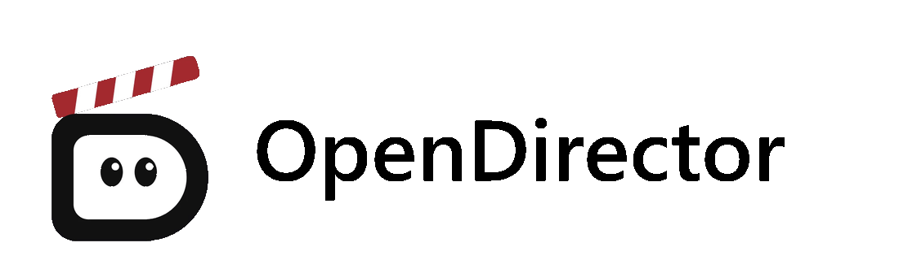

<p align="center">
  <picture>
    <source media="(prefers-reduced-motion: reduce)" srcset="src/assets/opendirector-readme-logo.png" />
    
  </picture>
</p>

<p align="center">
  <strong>English</strong> | <a href="README.zh-CN.md">简体中文</a>
</p>

# OpenDirector

**From an idea to a downloadable short film: generate through chat, organize on a canvas, edit media, and export from a timeline.**

OpenDirector is an AI video creation workspace that runs locally and is accessed through your browser. Discuss ideas with the assistant and generate assets, organize and iterate on them on the canvas, edit images, video, and audio, then arrange your material on a timeline and export an MP4.

Use it to explore visual ideas, refine assets, and make short films. Projects stay on your machine; generation uses the provider APIs or self-hosted model services you choose.

[Quick start](#quick-start) · [Connect models](#connect-models) · [Make your first short film](#make-your-first-short-film) · [Troubleshooting](#troubleshooting) · [More documentation](#more-documentation)

## What you can do

- **Work with AI**: Describe what you want to create, reference canvas assets, and ask the assistant to save text or generate content with your configured models.
- **Canvas and reference assets**: Upload files, connect nodes, or use `@` to add references. Organize assets in one place and review generation history.
- **Media editing**: Crop, adjust colors, and work with layers and clips. AI tools such as image extension, erasing, and background removal depend on the connected models' capabilities.
- **Timeline editing**: Arrange assets, adjust start and end points, speed, and volume, then preview and render an MP4. You can also export JSON, FCPXML, and asset bundles.
- **Local projects, your choice of models**: The canvas saves automatically to your machine. Configure multiple models for a service and switch between them as needed.

## Quick start

### 1. Prepare your environment

| Dependency | Requirement |
| --- | --- |
| Node.js and npm | Node.js `24.22.1` or later, with npm |
| Python | `3.11` or later |
| FFmpeg | `ffmpeg` with the `libx264` encoder and `ffprobe` must be available in your terminal for media processing |
| Model service | A working service URL, Model ID, and any API key or other authentication information required by the service |

Installing dependencies and calling remote models require a network connection. Prepare self-hosted model services separately; starting this application does not install or deploy models.

First, check that the media tools are available:

```sh
ffmpeg -version
ffprobe -version
```

### 2. Get the source

```sh
git clone https://github.com/ThinkFlowLab/OpenDirector.git
cd OpenDirector
```

You can also download and extract the source. Run all the following commands from the repository root.

### 3. Install and start

#### macOS, Linux, and WSL

```sh
npm ci
python3 -m venv .venv
.venv/bin/python -m pip install -r requirements.txt
npm run build
.venv/bin/python scripts/opendirector.py serve
```

#### Windows (PowerShell)

```powershell
npm.cmd ci
py -3 -m venv .venv
.\.venv\Scripts\python.exe -m pip install -r requirements.txt
npm.cmd run build
.\.venv\Scripts\python.exe scripts/opendirector.py serve
```

If the `py` command is unavailable but Python is on your PATH, create the virtual environment with `python -m venv .venv`.

Open the address shown in the terminal in your browser. The default is <http://127.0.0.1:8000>. Keep the terminal running while using the application; press `Ctrl+C` to stop it.

- **Start again**: Run the final `serve` command for your operating system from the repository root.
- **Update the source**: Stop the application and back up your projects first. After updating, reinstall dependencies, rebuild the frontend, and start the application.
- **Port conflict**: Append `--port 8001` to the corresponding `serve` command and open <http://127.0.0.1:8001>:

```sh
# macOS, Linux, and WSL
.venv/bin/python scripts/opendirector.py serve --port 8001
```

```powershell
# Windows (PowerShell)
.\.venv\Scripts\python.exe scripts/opendirector.py serve --port 8001
```

The default log level is INFO. To inspect model request parameters, append `--log-level debug` to the startup command. Access logs and model call logs use the same format.

## Connect models

Click the gear at the bottom left to open **Settings (设置)**, then open **Model connections (模型接入)**. Add models for chat, image, video, or audio generation as needed.

1. Choose the connection type and API protocol.
2. Enter the service URL, Model ID, and the credentials or authentication method required by the service.
3. For video models, check the adapter, supported modes, resolutions, and durations.
4. Save the model, then select it in the generation panel or chat.

Use the following guide to check the configuration fields:

| Field | What to enter |
| --- | --- |
| Connection type | Choose **Provider API (服务商 API)** or **Self-hosted service (自部署服务)** to match your service |
| API protocol | Choose a protocol that matches the service's actual API and the model category; matching names alone do not guarantee media compatibility |
| Service URL (Base URL) | Enter an address reachable from the machine running the application; for an SSH tunnel, use the locally forwarded address |
| API Key | Enter the key required by the service. If the service does not require authentication, select **No key required (无需密钥)**; a placeholder key is unnecessary |
| Model ID | Use the model name actually exposed by the service; select it with **Fetch models (获取模型)** or add it manually |

A service can provide multiple models within the same category. After entering its URL and authentication settings, click **Fetch models (获取模型)**, search for and select the models you need, then save. Use **Add manually (手动添加)** for models that are not listed. Chat models can be tested individually in the list. The service URL and credentials are stored once and can be updated together by editing the service. Deselecting a model removes its configuration; wherever that configuration was selected, you will need to select a model again.

The service URL and Model ID must match your model service. Self-hosted service URLs typically include `/v1`; use the model name actually exposed by the service as the Model ID. For third-party services, follow the information provided by the service.

For detailed video settings, see [Video model capability configuration (Chinese)](docs/guides/video-model-capabilities.md). When no explicit output specification is provided, use **Auto (自动)** or **Service default duration (服务默认时长)**.

Automatic region selection in images and video matting require a model with segmentation capabilities. Image generation and editing still require the corresponding generation or editing model.

In **General (通用)** settings, you can switch themes and adjust the watermark removal option. Watermark settings affect only content generated afterward, and the actual effect depends on support from the model service.

## Make your first short film

Start by generating and exporting a single shot, then expand to more clips.

1. **Connect models**: In **Settings → Model connections (设置 → 模型接入)**, configure the image and video models you need. Add an audio model if you want narration.
2. **Prepare an image**: Create an image node and generate an image, or upload one you already have. For example, try “a street on a morning after rain, soft morning light, reflections on the ground.”
3. **Generate a video**: Create a video node, choose a video model, and connect the image node containing your image as a reference. Describe the motion using a mode the model supports, then generate. Check progress and results in **Generation history (生成历史)**.
4. **Refine your assets**: Check the result and edit the image or video as needed. For narration, create an audio node, enter the text to be read aloud, and choose a voice supported by the service.
5. **Arrange the timeline**: Create a timeline node and open its editor. Add your prepared visuals and audio, adjust their order, start and end points, speed, and volume, then preview the result.
6. **Download your film**: Click **Render MP4 (合成 MP4)** and keep the page open until it finishes. Download the result or add it to the canvas.

You can also [chat with AI](#chat-with-ai) first to develop ideas, save text, or generate assets, then continue editing on the canvas and timeline. If something fails, check the [generation task status](#monitor-and-manage-generation-tasks) and identify the cause before deciding whether to submit again.

## Create and manage canvases

The first launch creates an untitled canvas (未命名画布). Later launches can restore the most recently used project.

- Click the project name at the top left to rename it. Press `Enter` or click elsewhere to save, or press `Esc` to cancel.
- Click the arrow next to the name to switch projects. Choose **New canvas project (新建画布项目)** to create one.
- Use the left toolbar or double-click empty canvas space to create text, image, video, audio, timeline, or subject nodes.
- Right-click empty canvas space to create a node, paste, undo, or redo.
- Click **Upload (上传)** on the left or drag files onto the canvas to add assets. Use **Asset library (资产库)** to choose existing assets.
- Double-click a node's name to rename it. Double-click its content to open the appropriate editor or preview.

The canvas saves automatically. Before closing it or switching projects, check that the top-left status reads **Saved locally (已保存到本机)**. If saving fails, keep the page open and follow the error message.

## Generate content and add references

1. Create a text, image, video, or audio node, then click it to open the generation panel.
2. Choose a model, enter a prompt, and set the available parameters.
3. Connect a source node that has content to the target node, or type `@` in the input field to select reference assets.
4. Check the references and parameters, then generate. When the task finishes, view its result in the node or **Generation history (生成历史)**.

After typing `@`, use the up and down arrow keys to select an asset, the left and right arrow keys to switch categories, `Enter` to insert, and `Esc` to close the picker. References are inserted into the text as single units. Removing the last reference to a source also removes its corresponding reference connection.

An empty node must first receive an upload, saved text, or generated content before it can serve as a valid reference for other nodes. When uploading a node's own content, the file type must match the node. To add references, use connections, `@`, or the reference controls in the generation panel.

For video generation, choose a mode supported by the model:

- **Multimodal references (全能参考)**: Add image, video, audio, or text references supported by the model.
- **First and last frames (首尾帧)**: Connect up to two image sources and assign them to the first- and last-frame slots. Last-frame support depends on the model's capabilities and the guidance in the interface.
- **Continuation (接续)**: Select a model that supports continuation and a source video. If the service restarts or the source is no longer available, you may need to regenerate the source video.

For audio generation, enter the text to be read aloud in the prompt and choose a voice supported by the service in the parameters.

## Monitor and manage generation tasks

Open **Generation history (生成历史)** at the top right to view task progress, results, and failure details.

- You can request cancellation of queued or running tasks.
- For recoverable interrupted tasks, choose **Continue checking the original task (继续查询原任务)**.
- If the submission status is unknown, first check whether the server accepted the task before deciding to generate again. This avoids duplicate submissions.
- After changing the service URL, model, or protocol, you may no longer be able to query older tasks.

## Chat with AI

Click **Chat with AI (与 AI 对话)** at the bottom right, select a chat model, and describe what you want to create. You can upload, drag and drop, or paste assets, or type `@` to reference canvas content. The assistant can save text as requested and call configured generation models to create assets.

- Press `Enter` to send, or `Shift+Enter` for a new line.
- You can stop the response while it is being generated.
- Click the collapse button at the top right to hide the chat panel. Drag its left edge to resize it.

Asset generation may continue after the reply ends. Check its progress in **Generation history (生成历史)**.

## Edit images, video, and audio

Select a node, then choose an action from its toolbar.

- **Images**: Crop, rotate, flip, adjust colors, work with layers, add text, shapes, or annotations, and edit selections.
- **Video and audio**: Extract frames, trim, extract audio tracks, and process clips.
- **AI tools**: Extend images, erase content, remove backgrounds, edit images with AI, upscale, and more. Availability depends on the connected models.

For a local edit, mark an area or create a selection first, then enter your instructions and confirm the action. If a required model capability is missing, follow the tool's instructions to configure it. Hover over a disabled control for an explanation.

## Arrange and export videos

1. Create a timeline node and open its editor.
2. Add images, videos, and audio. Adjust their order, start and end points, speed, and volume.
3. Preview and check the picture and sound.
4. Click **Render MP4 (合成 MP4)**. When rendering finishes, download the result or add it to the canvas.

The timeline also supports JSON, FCPXML, and asset bundle exports. Choose the format that fits your needs. If your browser reports that a required encoding capability is unavailable, try again in a browser that supports it.

Keep the page open while rendering. Closing the editor or canceling the render stops the current operation.

## Save, back up, and download

- Use a node's download control to save its asset.
- Use **Export canvas (导出画布)** at the top right to save a JSON copy of the canvas.
- Local projects are stored in the `projects/` folder inside the repository directory. To preserve complete projects, stop the application and back up that folder.
- Model settings are stored in `.opendirector/models.json` and may contain API keys. Keep backups secure and exclude these credentials when sharing projects or logs.

Saving projects locally does not imply offline inference. Generation prompts and selected reference assets are sent to the configured model service. Usage costs and data handling depend on that service; choose one appropriate for your assets.

## Troubleshooting

| Symptom | What to check first |
| --- | --- |
| The page will not open, or the service is unavailable | Check that the startup terminal is still running, use the address it displays, and check for startup errors or port conflicts. Running only `npm run dev` does not start the complete application service |
| A message asks you to build the frontend first | Run `npm run build` from the repository root, or `npm.cmd run build` on Windows, then restart |
| A model cannot generate content, or a tool is disabled | Check that the model is saved and selected in the panel, and that the service URL, protocol, Model ID, authentication, and required capabilities match |
| An upload is rejected | Check that the file type matches the node or reference slot, then check the size, format, and duration against the error message |
| Media processing fails | Run `ffmpeg -version` and `ffprobe -version` in your terminal to check that the tools are available; restart the application after installing them |
| A video cannot be rendered or exported | Check your browser's encoding support and whether the assets can be read and played correctly. Keep the page and editor open while rendering |
| A task is interrupted, or its submission status is unknown | Check **Generation history (生成历史)**. Use **Continue checking the original task (继续查询原任务)** for recoverable tasks. If the status is unknown, check whether the server accepted the task before submitting again |
| Changes have not been saved | Keep the page open, check the **Saved locally (已保存到本机)** status and any error messages, and resolve the save failure before closing or switching |

## More documentation

- [Video model capability configuration (Chinese)](docs/guides/video-model-capabilities.md): Configure video adapters, modes, and output specifications.
- [Documentation index (Chinese)](docs/README.md): Find the project architecture, development guidance, and validation guide.

To report a problem, open an [issue](https://github.com/ThinkFlowLab/OpenDirector/issues) with your operating system, relevant tool versions, reproduction steps, and the expected and actual results. Remove credentials and sensitive assets before sharing logs.

## License

OpenDirector is released under the [Apache License 2.0](LICENSE). See
[NOTICE](NOTICE) for the third-party components distributed with this
application and for the artwork under `src/assets`.
