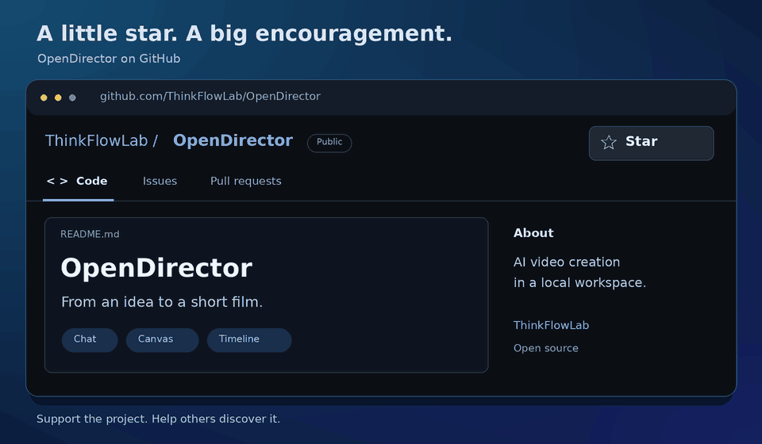

<p align="center">
  <picture>
    <source media="(prefers-reduced-motion: reduce) and (prefers-color-scheme: dark)" srcset="src/assets/opendirector-header-dark.png" />
    <source media="(prefers-reduced-motion: reduce)" srcset="src/assets/opendirector-header-light.png" />
    <source media="(prefers-color-scheme: dark)" srcset="src/assets/opendirector-header-dark.gif" />
    
  </picture>
</p>

<p align="center">
  <a href="README.md">English</a> | <strong>简体中文</strong>
</p>

# OpenDirector

**从创作想法到可下载的短片：对话生成、画布管理、媒体编辑、时间线导出。**

OpenDirector 是一个在本地运行、通过浏览器使用的 AI 视频创作工作台。你可以与助手讨论创意并生成素材，在画布上整理和迭代内容，用编辑工具调整图片、视频和音频，再通过时间线编排并导出 MP4。

适合验证视觉创意、反复调整素材和制作短片。项目保存在本机，生成内容使用你选择的服务商 API 或自部署模型服务。

[最新动态](#最新动态) · [短片示例](#短片示例我们还能赢) · [快速开始](#快速开始) · [文档](#文档) · [社区交流](#社区交流) · [参与贡献](#参与贡献)

## 最新动态

- [2026/11/06] OpenDirector 首个版本 [v0.1.0](https://github.com/ThinkFlowLab/OpenDirector/releases/tag/v0.1.0) 发布，将 AI 辅助生成、画布素材管理、媒体编辑与时间线导出整合在一个本地工作台中。版本亮点与安装说明见发布说明。

## 能做什么

- **与 AI 协作**：描述创作要求，引用画布素材，让助手保存文本并调用已配置的模型生成内容。
- **画布与参考素材**：上传文件、连接节点或用 `@` 添加参考，集中整理素材并查看生成历史。
- **媒体编辑**：裁剪、调色、处理图层和片段；扩图、消除、抠图等 AI 工具按已接入模型的能力提供。
- **图像预设**：选中图片后，从「预设」直接选择人物三视图、面部三视图、产品三视图、分镜或多机位，在单行功能栏点击「生成」。三视图各输出一张参考板；分镜和多机位各输出四张独立图片，使用适合布局的横版画幅并关联原图。
- **时间线编排**：安排素材顺序、起止点、速度和音量，预览并合成 MP4，也可导出 JSON、FCPXML 和素材包。
- **本地项目，自选模型**：画布自动保存到本机，同一服务可配置多个模型，按用途切换。

若图片生成经系统代理反复超时或连接中断，可在「设置 → 模型接入 → 编辑服务 → 高级连接」将「网络连接方式」设为「直连」。此设置仅影响该服务的模型请求和结果下载，不修改系统代理。提交结果不明的任务应先核对供应商记录，再决定是否新建尝试。

## 短片示例：《我们还能赢》

《我们还能赢》是一支关于 Dota2 中年云玩家的 60 秒短片。

下图展示剧本、视频镜头、时间线与成片。视频生成使用通过 [vLLM-Omni](https://github.com/vllm-project/vllm-omni) 部署的 FastH3。

[](docs/guides/assets/dota2-short-film-canvas.jpg)

*OpenDirector 实际画布截图，点击图片可查看完整分辨率。*

**成片示例**

https://github.com/user-attachments/assets/11babc03-e35c-40e7-b5f6-7d476b6bf11a

[下载原始成片（MP4，15.7 MiB）](docs/guides/assets/dota2-short-film.mp4?raw=true) · 60 秒 · 1280 × 720 · 24 fps · 配乐：《岁月神偷》。

## 快速开始

### 一句话安装

把下面这句话发给你正在使用的 AI：

```text
请按照这个 skill 帮我安装并启动 OpenDirector：https://github.com/ThinkFlowLab/OpenDirector/blob/main/.agents/skills/install-opendirector/SKILL.md
```

### 手动安装

源码安装需要 Python **3.11+**、Node.js **24.22.1+**（含 npm）、Git，以及可运行的 FFmpeg/ffprobe（含 `libx264`）。推荐使用虚拟环境，避免依赖冲突。

以下为 macOS/Linux 示例，`python3` 需满足上述版本要求：

```sh
git clone https://github.com/ThinkFlowLab/OpenDirector.git
cd OpenDirector
python3 -m venv .venv
source .venv/bin/activate
python -m pip install -e .
opendirector serve
```

打开 <http://127.0.0.1:8000>。安装过程自动构建前端，无需另行运行 npm 命令。Windows、macOS 环境准备及更新步骤见[安装指南](docs/guides/installation.zh-CN.md)。

在“设置 → 模型接入”中配置模型服务，即可开始 AI 对话和生成；也可先上传本地素材进行编辑。创作流程为：**接入模型 → 生成素材 → 编辑 → 时间线编排 → 导出**。参阅[使用指南](docs/guides/user-guide.zh-CN.md#制作第一支短片)。

导出 MP4 推荐使用 Chrome 或 Edge，合成期间需保持页面和编辑器打开。

## 文档

- [安装与更新](docs/guides/installation.zh-CN.md)：环境准备、各平台安装、启动与更新。
- [使用指南](docs/guides/user-guide.zh-CN.md)：模型接入、AI 协作、画布、媒体编辑与导出。
- [故障排查](docs/guides/user-guide.zh-CN.md#故障排查)：安装、生成、保存与导出问题。
- [业务 CLI](docs/guides/cli.md)：通过终端或 Agent Shell 操作工程。
- [文档索引](docs/README.md)：架构、开发与验证文档。

## 社区交流

欢迎加入 **OpenDirector** 交流群，交流 OpenDirector 的使用经验、分享创作。使用微信扫描下方二维码入群，点击图片可查看完整分辨率。

<p align="center">
  <a href="docs/guides/assets/opendirector-wechat-group-2.png">
    
  </a>
</p>

如果 OpenDirector 对你有帮助，欢迎[在 GitHub 上点亮 Star](https://github.com/ThinkFlowLab/OpenDirector)，支持项目，也让更多人发现它。

<p align="center">
  <a href="https://github.com/ThinkFlowLab/OpenDirector">
    <picture>
      <source media="(prefers-reduced-motion: reduce)" srcset="docs/guides/assets/star-opendirector.png" />
      
    </picture>
  </a>
</p>

## 参与贡献

欢迎通过 [Issues](https://github.com/ThinkFlowLab/OpenDirector/issues) 反馈问题或提出建议，通过 Pull Request 贡献代码与文档。开发检查见[验证指南](docs/development/validation.md)。

## 许可

OpenDirector 以 [Apache License 2.0](LICENSE) 发布。随本应用分发的第三方组件，
以及 `src/assets` 下的美术资源，见 [NOTICE](NOTICE)。
