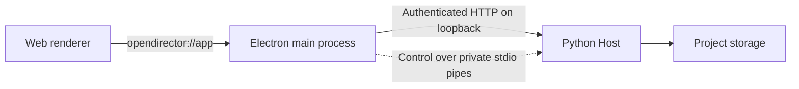

# Desktop architecture

[中文](desktop.zh-CN.md)

The desktop application runs the shared Web UI and Python API on the same machine. Electron manages native windows and starts the Python Host. The Host runs the [unified project services](unified-project.md) and the [Agent runtime](agent-runtime.md).

## Electron owns the connection to the Host

The main process starts the bundled Python runtime and gives the Host a fresh credential over the control pipe. The Host binds to an OS-assigned port on `127.0.0.1` and reports its address when ready. The main process opens the Web UI after the Host is ready.

The renderer requests application pages, media, and API resources through `opendirector://app`. The main process forwards those requests to the Host with the launch credential. The Host checks the credential before it serves the request. The renderer runs with Node integration off and context isolation on. A preload bridge exposes specific desktop operations, including edit-session registration and language and export status updates.

Renderer permissions are denied by default with an explicit allow list in [`permissions.mjs`](../../apps/desktop/src/permissions.mjs), limited to `opendirector://app`: `clipboard-sanitized-write`, the name a click-activated `navigator.clipboard.writeText` requests, and the two fullscreen names `requestFullscreen` uses. The read/write clipboard name stays denied because every copy in the shared UI starts from a click and the renderer never reads the system clipboard, so granting it would hand the page a capability no caller uses. The fullscreen names are granted because a denial leaves the request promise unsettled and the player's button silently does nothing. The installed smoke test asserts that a click-activated copy reaches the system clipboard, that a write without user activation is refused and leaves the clipboard untouched, and that a fullscreen request enters and exits. Granting a new renderer permission is a policy change, not a UI detail.

## The Host owns project state

The Host uses the same project storage, command validation, and edit-session rules as the standalone API. The desktop shell handles window behavior and opens native dialogs for file input and downloads.

The installed application supplies the Web UI, Python runtime, and bundled tools as application resources. The Host writes project and configuration data to `workspace/` under Electron's user data directory. The same user data directory also holds desktop logs and the cached language preference. Existing source and pip workspaces stay in their original locations.

## Closing a window keeps the Host running

Closing the main window hides it so work in progress can continue. Quitting the application checks local Agent runs, generation jobs, tool tasks, and renderer export activity before it stops the Host. The main process asks the user before interrupting active work. The Host releases edit sessions registered by this desktop instance during shutdown. Loss of the parent control pipe also starts Host cleanup.

A provider can continue running a submitted job and charge for it after the local application quits. Browser export requires the renderer process.

See [Desktop application development](../development/desktop.md) for build commands, CLI registration, and release checks.
