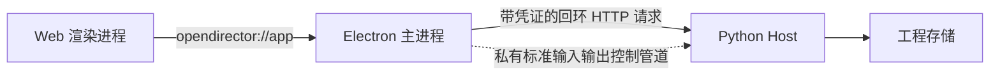

# 桌面架构

[English](desktop.md)

桌面应用在同一台机器上运行共用的 Web UI 和 Python API。Electron 管理原生窗口并启动 Python Host。Host 运行[统一项目服务](unified-project.md)和 [Agent Runtime](agent-runtime.md)。

## Electron 管理到 Host 的连接

主进程启动随包提供的 Python，通过控制管道把本次启动的凭证交给 Host。Host 在 `127.0.0.1` 上绑定系统分配的端口，就绪后报告地址。主进程收到就绪消息后打开 Web UI。

渲染进程通过 `opendirector://app` 请求应用页面、媒体和 API 资源。主进程转发请求时附带启动凭证，Host 验证凭证后处理请求。渲染进程关闭 Node 集成并开启上下文隔离。预加载脚本提供有限的桌面接口，包括登记编辑会话、同步语言和导出状态。

## Host 管理工程状态

Host 与独立 API 共用工程存储、命令校验和编辑会话规则。桌面壳管理窗口，并通过原生对话框选择文件和保存下载。

安装包提供 Web UI、Python 运行时和内置工具。Host 将工程和配置写入 Electron 用户数据目录下的 `workspace/`。该用户数据目录也保存桌面日志和语言缓存。源码版和 pip 安装版已有的工作区保留在原位置。

## 关窗后 Host 继续运行

关闭主窗口会隐藏界面，正在进行的工作可以继续。退出应用时，主进程先检查本地 Agent 运行、生成任务、工具任务和渲染进程的导出状态，再停止 Host。中断正在进行的工作前，主进程会请用户确认。Host 在停止时释放由该桌面实例登记的编辑会话。父进程的控制管道断开后，Host 也会开始清理。

退出本机应用后，供应商可能继续执行已提交的任务并产生费用。浏览器导出需要渲染进程保持运行。

## 快捷键由页面处理

快捷键的处理、提示与帮助面板都读渲染进程内同一份注册表，安装包不额外注册加速键。桌面壳里的 Chromium 没有浏览器级快捷键表，所以 `Ctrl+N`、`Ctrl+K`、`Ctrl+J` 会照常到达页面并执行注册的动作。在普通浏览器里这些组合属于浏览器（新建窗口、地址栏搜索、下载），浏览器会执行自己的动作而不把按键交给页面。

也正因如此，菜单加速键只会造成重复而不是启用：一次按键会同时触发菜单项和页面处理器。桌面壳只保留窗口级菜单（全屏、开发者工具、退出），业务快捷键全部留给渲染进程。

构建命令、CLI 注册和发布检查见[桌面应用开发指南](../development/desktop.zh-CN.md)。
