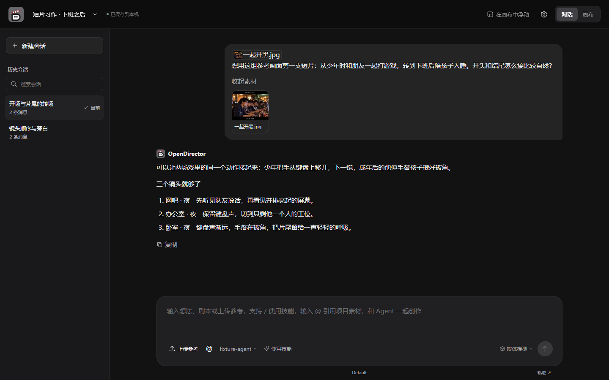
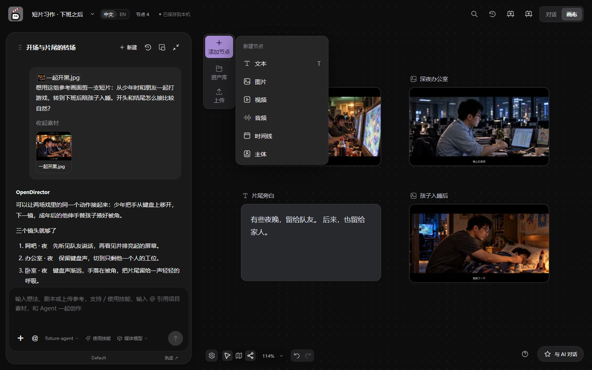
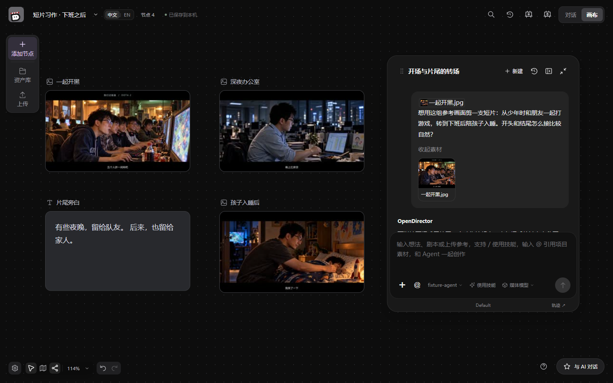
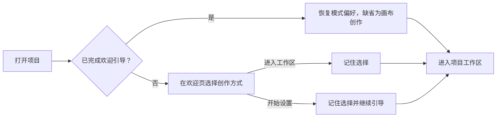
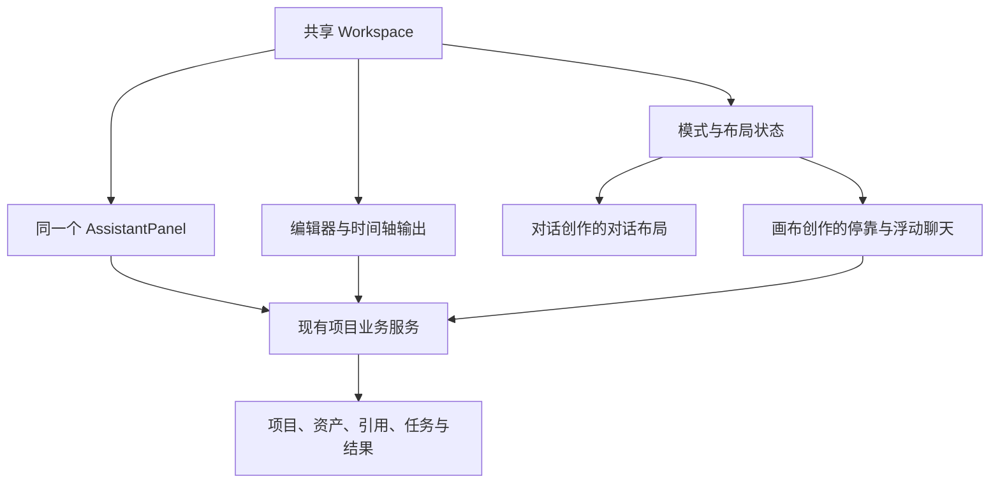

# RFC：对话创作与画布创作

本提案对应 [#373](https://github.com/ThinkFlowLab/OpenDirector/issues/373) 第 5 项，由 @congw729 于 2026-11-17 提出。[RFC 讨论 #386](https://github.com/ThinkFlowLab/OpenDirector/issues/386)

2026-11-22 修订。原提案中的“纯净模式”和“画布模式”现称“对话创作”和“画布创作”，顶栏简称“对话”和“画布”。本次同步首次引导、会话布局、画布工具栏和浮动聊天的设计。具体操作见[使用指南](../guides/user-guide.zh-CN.md)。

两种创作方式共用同一项目和会话。用户可以在对话中委托 Agent、检查结果，也可以随时打开画布继续编辑。

有时候用户只想描述目标，让 Agent 帮忙生成内容，再看结果、提修改意见。有时候又需要自己整理节点、调整引用和编辑时间轴。两种工作方式都应该方便，切换后也应该能接着做刚才的事。

## 1. 想改成什么

这次改动主要有三点：

- **对话创作**以会话和结果为主，消息与输入区占据主工作区。
- **画布创作**默认左侧聊天、右侧画布，按 1:2 分栏。用户可以收起聊天，也可以把聊天浮在画布上。
- **随时切换**：两种模式打开同一项目、同一会话。切换时保留草稿、引用、运行中的任务和编辑状态。

两种创作方式都支持深色和浅色主题。画布工具栏纵向排列，缩放、撤销等控件位于画布左下角。

## 2. 工作区截图

以下截图取自同一示例项目，分别展示整页对话、画布分栏和浮动聊天。画面使用仓库内的短片剧照，对话内容由测试替身提供。第 3 节列出从对话查看、编辑和导出结果的设计要求。

### 对话创作

两种创作方式共用一个会话面板。在对话创作中，可用宽度达到 900px 时，左侧列出当前项目的会话，支持切换和新建。较窄时从聊天顶部打开历史会话。消息与底部输入区对齐，阅读宽度最多 960px。用户消息靠右，助手回复靠左。工作区顶栏保留项目选择、保存状态、设置和模式切换。

输入框继续保留上传、`@` 引用、Agent、技能和模型选择。这里的操作和当前聊天框一致，用户之前配置的 Agent、模型和会话也继续使用。

生成的图片、视频等结果放在回复下面，能直接预览。执行详情默认收起，需要时展开。不要把每一次工具调用都铺满对话，也不要只留一句“已完成”，让用户自己去找文件。

**对话创作顶栏不常驻“中文 / EN”。** 语言切换放在现有的“设置 → 通用”中。默认读取已保存的语言；没有设置时，中文浏览器使用中文，其余使用英文。界面语言不会改写用户内容，Agent 仍跟随用户提问的语言回复。

### 画布创作

宽屏默认按 **1:2** 停靠聊天。左侧是聊天面板，右侧是独立画布，工具栏和底部控件相对画布定位。拖动聊天标题或点击“浮动聊天”可让聊天覆盖在画布上。对话创作顶栏的“在画布中浮动”可直接切到画布并浮起同一会话。浮窗可用鼠标拖动或通过键盘方向键移动，点击“停靠到左侧”恢复分栏。

画布左侧提供“添加节点”“资产库”和“上传”三个带文字的入口。“添加节点”展开文本、图片、视频、音频、时间线和主体六种类型。空画布中央的“浏览示例画布”打开示例列表，导入时会单独打开一个项目。

现有的连线、图片和视频编辑、历史版本、时间轴及导出入口继续保留。时间轴仍从节点进入编辑器，工作区底部不再另设常驻时间轴。

在聊天中点“在画布中查看”，切换后定位到同一个对象。用户在画布上选中内容后，也能继续引用到聊天里，让 Agent 接着处理。

## 3. 打开项目后怎么用

### 第一次进入

首次进入时，在现有欢迎页提供“对话创作”和“画布创作”，默认选中“画布创作”。两种选择各有简短说明，预览应能看出两种布局的区别。点击“进入工作区”直接进入项目，点击“开始设置”继续现有引导，两种入口都记住当前选择。

完成过引导的用户直接进入项目。有模式偏好时恢复上次选择，没有偏好时进入画布创作。顶栏随时可以切换。模型配置按任务需要提示，直接进入工作区无需先配置模型。

项目打开顺序沿用现有逻辑：深链接指定的项目优先，其次是最近项目；没有项目时走原有的默认项目创建流程。选择模式不再额外新建、复制或重新打开项目。项目打开失败时，先显示错误和重试入口。

### 在对话创作里查看和修改结果

用户可以直接描述目标，也可以上传素材、用 `@` 引用项目里已有的内容。引用选择器不能只列出当前可见的画布节点；没有展示在画布上的资产也应能通过已有的项目查询找到。

建议在项目菜单里提供“项目素材”入口。用户可以从这里上传素材、新建时间轴，选入素材后打开共用编辑器。这样即使没有配置模型，也能直接开始本地剪辑，无需先给 Agent 发一条消息。

建议结果卡片先支持这些动作：

| 用户要做的事 | 交互 |
| --- | --- |
| 看清图片或视频 | 点击打开现有大预览，支持播放和下载 |
| 让 Agent 修改 | 把这个结果作为引用继续对话 |
| 手工调整内容 | 打开现有图片、视频或时间轴编辑器，关闭后回到对话 |
| 整理节点或引用关系 | “在画布中查看”，切换模式并定位对象 |
| 检查生成候选 | 标明候选和当前采用结果；预览不会自动采纳 |
| 找到以前的成果 | 从会话历史和项目素材入口查找，不依赖当前消息是否仍在屏幕上 |

这里建议直接复用现有编辑器。点击卡片先看预览，需要修改时再打开编辑器；整理节点和引用关系时进入画布。

结果卡片要能追溯到项目中的资产、结果版本或编辑文档。缩略图地址只负责显示，后续引用、编辑和采纳通过对象 ID 与版本处理。如果对象已经删除或当前版本有变化，显示实际状态，让用户选择下一步。

同一素材在多条消息中出现时，继续引用同一份资产。用户在画布中改了内容，回到对话创作也能查到新的项目状态；历史生成记录仍保留当时的输入和结果。

### 从对话做到视频

可以从“帮我用这些素材做一段短片”开始，让 Agent 准备内容、生成候选、安排时间轴。用户在对话里查看结果，必要时打开编辑器或画布修改，再输出视频。

目前 Agent 已有可编辑时间轴包的导出能力。**MP4 输出仍由用户在浏览器中触发**，包括时间轴编辑器内导出，以及最新增加的画布直接输出入口。对话创作应从对应的时间轴结果提供同样的操作，并显示渲染、发布和下载状态；有多个时间轴时让用户选定目标。

让 Agent 直接发起 MP4 渲染，还需要补客户端执行请求和回执。这次先复用浏览器已有的输出能力，后台渲染另提需求。

## 4. 模式切换时保留什么

用户切换模式，是为了换个角度继续工作。因此这次切换不应产生业务命令，不更换 Agent 或模型，也不重启项目、会话和生成任务。

| 切换时正在做什么 | 预期行为 |
| --- | --- |
| 正在输入消息，已经添加素材引用 | 保留文本、引用、上传和当前会话；输入区仍可见时保留光标 |
| Agent 正在回复或调用工具 | 继续同一轮执行，另一种模式接着显示结果 |
| 图片或视频正在生成 | 保留原任务，不重新提交；结果仍登记到原对象 |
| 节点参数或媒体编辑器有未保存内容 | 保留草稿、版本基线和编辑器；不强制先保存再切换 |
| 时间轴正在播放、渲染或发布 | 保留播放头、渲染任务和待发布结果 |
| 刚遇到保存失败、锁或版本冲突 | 保留错误与重试入口，切换不自动覆盖或重试 |
| 正在拖拽节点或连线 | 按原交互规则结束临时手势，再切换布局 |
| 画布隐藏后重新显示 | 恢复原来的视口和选中对象；完成容器测量后继续操作 |

普通模式切换恢复原视口。“在画布中浮动”切换布局并保留会话。“在画布中查看”用于定位某条结果，允许调整视口和选择。对象没有可见画布项时，通过显式的显示操作恢复或创建展示项。

模式偏好使用浏览器键 `opendirector.workspaceMode.v1`，值为 `agent` 或 `canvas`。分栏宽度、浮动位置和停靠状态也属于浏览器偏好。项目文件、资产和导出包都不带这些偏好。模式偏好写入失败时，本页面照常切换，并提示偏好未保存。

其他标签页修改偏好时，当前页面不突然换布局；重新打开页面时再读取最新选择。模式变化也不进入业务撤销历史。

## 5. 画布移到右侧，需要一起处理的交互

停靠、浮动、收起聊天和窄窗口单区域展示会改变画布的可见范围。交互坐标依据实际画布容器计算。

需要一起检查：

- 节点拖动、框选、连线、素材拖入和双击创建，都按实际画布坐标计算。手动移动聊天浮窗时保持画布视口。
- 新建节点或显式定位对象时，目标应出现在聊天浮窗以外的可见区域。节点菜单、参数面板、选择工具条和大预览也应可操作。
- 聊天里的模型、技能、引用和执行详情面板要适应左侧位置，避免展开到窗口外。
- 画布的复制、删除和输出快捷键只在正确区域生效；在聊天输入框里操作不能误触画布。
- 画布缩放、适应视图和最小地图使用新的容器尺寸，切换模式不自动重排节点或保存一份错误视口。
- 对话创作里的对话不能被“折叠聊天”关成空白页；现有双 Shift 快捷键在这个模式里建议改为聚焦输入框。

**1:2 是默认停靠比例。** 拖动分隔线可调整宽度，双击恢复默认。收起聊天后，画布占满工作区。可用宽度不超过 700px 时，一次显示聊天或画布，保留项目和模式入口。窗口再次变宽时恢复之前的停靠或浮动布局。

## 6. 模型配置、任务与结果的规则

两种模式使用相同的模型配置、参数、引用校验和业务命令。对话创作可以把细节收起来，不能因此换掉用户已经选定的值，或减少 Agent 可用的业务能力。

模型提示按当前任务来：

- 用户只是导入素材、编辑时间轴，不要求配置生成模型。
- 想生成图片时，提示所需的图片能力；生成视频或配音时再检查对应能力。
- 使用应用内模型的 Agent，需要配置相应语言模型；外部 runtime 使用自己的模型来源时，按该 runtime 的就绪状态处理。
- 模型存在、服务能连接、模型支持输入、当前请求通过校验，是几个不同的检查。没有连接测试结果时，只显示“已配置”。

这部分与 #373 第 1 项共用模型说明和配置入口，沿用现有表单，避免两边写出不同的用途解释。配置完成后回到原任务，保留用户输入，由用户继续提交。

任务是否提交、文件是否生成、哪个候选已采用，都按实际回执显示。用户通过预览和反馈判断效果，聊天回复结束后也要能继续检查和修改。用户在生成过程中改了内容或锁了对象，后到的结果也要遵守现有采纳规则。

“停止”沿用当前行为：停止 Agent 会结束当前这轮回复和后续编排；已提交的生成任务通过各自的取消操作处理。切换模式或隐藏面板都不调用这些操作。

只关闭或刷新页面、后端仍运行时，活动 Agent turn 可以重新连接。退出后端后的恢复取决于各类任务自身的持久化能力，不能承诺原 Agent turn 自动续跑。MP4 的浏览器渲染则需要页面继续打开，渲染完成、发布到项目和下载文件分别反馈。

## 7. 实现从哪里改

当前代码已经有一个共享的 `Workspace`，项目、编辑器和生成相关状态由它持有。建议继续保留这一层，在里面增加模式状态和布局分支。

### 保持组件和数据的归属

`AssistantPanel`、编辑器和时间轴输出 hook 要留在稳定的父组件下。模式切换只改变布局和可见性，不因为换了一棵 React 子树而重新挂载这些组件。画布也保留原有状态，隐藏时暂停无必要的绘制和缩略图播放，恢复时重新测量尺寸。

尤其不能直接复用 `installDocument`。它用于安装另一个项目文档，会清理选择、编辑器、本地历史等状态。模式切换只需要更新本地偏好和布局。

对话创作从现有消息引用、项目快照和资源索引读取结果。缺少的信息通过只读查询补齐。两种模式共用项目数据和任务订阅，断线恢复后重新读取服务端状态。

### 主要代码入口

下表列出各项交互对应的代码入口和职责。

| 位置 | 改动重点 |
| --- | --- |
| [CanvasWorkspace.tsx](../../src/canvas/CanvasWorkspace.tsx)、[WorkspaceView.tsx](../../src/canvas/workspace/WorkspaceView.tsx) | 保留共享生命周期，加入整页对话布局与画布分栏；共用编辑器宿主 |
| [state.ts](../../src/canvas/workspace/state.ts)、[runtimeTypes.ts](../../src/canvas/workspace/runtimeTypes.ts)、[useWorkspaceChrome.ts](../../src/canvas/workspace/useWorkspaceChrome.ts) | 模式状态、首次选择与欢迎层顺序、焦点和快捷键 |
| [workspaceMode.ts](../../src/canvas/workspaceMode.ts) | 处理 `agent` / `canvas`、偏好读写及默认选择 |
| [AssistantPanel.tsx](../../src/canvas/AssistantPanel.tsx)、[useAssistantLayout.ts](../../src/canvas/useAssistantLayout.ts)、[useFloatingAssistant.ts](../../src/canvas/useFloatingAssistant.ts) | 复用会话和输入组件，处理会话侧栏、画布分栏、浮窗和可用区域 |
| [TimelineEditor.tsx](../../src/canvas/TimelineEditor.tsx)、[TimelineOutput.tsx](../../src/canvas/TimelineOutput.tsx) | 保留编辑草稿、播放头、渲染与待发布结果；供对话创作复用输出操作 |
| [SettingsDialog.tsx](../../src/canvas/SettingsDialog.tsx)、[locale.ts](../../src/i18n/locale.ts) | 复用语言设置；只移除对话创作顶栏的快捷切换 |
| [双语词条目录](../../src/i18n/messages) | 新增模式名称、选择说明和状态提示，中英文一起交付 |

当前 `TimelineOutput` 已支持从画布直接生成并发布 MP4，但 hook 卸载时会取消活动渲染、清空待发布结果。拆布局时要把它和 `TimelineEditor` 一起保住。

本次先抽取布局真正需要的边界，不顺带重构整个工作区。预期不需要改项目 schema，也不需要在业务命令里增加模式参数。

## 8. 怎么拆实现、怎么验收

建议分三步做：

1. **先完成模式和布局。** 接入现有欢迎页，提供对话布局、画布工具栏、可调整的停靠分栏和浮动聊天。验证普通切换、浮动和停靠都保留会话与项目状态。
2. **再完成对话创作的使用路径。** 接入结果预览、项目素材、引用、共用编辑器和时间轴输出。空项目、已有项目和无需模型的本地素材编辑都要能用。
3. **最后检查完整交互。** 包括两种语言、窄窗口、快捷键、任务中切换和失败重试，再结合新手使用反馈调整细节。

模式和布局可以先做一个 PR。向用户开放对话创作前，先把查看结果、继续修改和输出视频走通。

验收优先看这些场景：

| 场景 | 要检查的结果 |
| --- | --- |
| 初次打开、已有偏好、直接打开项目链接 | 打开正确项目，不因选择模式多创建项目；再次打开恢复选择 |
| 草稿、引用上传、Agent 回复中来回切换 | 同一会话和 turn，文本与引用不丢，上传继续，不重复提交 |
| 生成中切换，随后结果到达 | 候选归属正确，不覆盖用户后来改过或锁定的内容 |
| 编辑器有草稿、保存失败或版本冲突时切换 | 草稿、版本基线和错误保留，后续仍能正确保存或重试 |
| 时间轴播放、浏览器渲染、待发布阶段切换 | 播放头、输出任务和产物保留；发布冲突按原规则处理 |
| 隐藏画布再打开、拖动分栏、在聊天中输入快捷键 | 节点位置与视口正确，菜单可用，聊天操作不误触画布 |
| 从对话打开浮窗、移动和停靠、缩窄后恢复窗口 | 会话与草稿连续，移动浮窗保持视口，定位目标可见，窄窗口的聊天和画布均可访问 |
| 从对话创作定位结果，再回到对话 | 使用同一资产和版本，不复制项目；已有编辑继续可见 |
| 无模型、只有语言模型、外部 Agent runtime | 只拦截确实缺少能力的操作；导入和本地编辑可继续使用 |
| 做完一段视频，保存并重新打开项目 | 时间轴与素材可继续编辑，下载的 MP4 实际可播放 |
| 切换中英文、键盘导航和窄窗口 | 文案可读，输入和焦点保留，主要操作都能找到 |

切换前后还要比对项目 ID、对象版本和撤销历史，确认切换本身没有产生业务命令。后台任务在这期间完成的，单独记录它提交的变化。

可扩展现有的 `assistant_sessions`、`assistant_run_navigation`、`timeline_workflow`、`structured_editors` 和 MP4 输出浏览器用例。新增用例加入统一 manifest，具体命令按[验证指南](../development/validation.md)执行。模型替身用于重复测试失败和交错场景；真实服务验证另行记录，不把它们混在一起。

模式切换沿用[界面性能预算](../development/ui-performance.md)：首个反馈 P90 不超过 100ms，可操作中位数不超过 500ms、P90 不超过 1s。空项目、媒体较多的项目、第一次打开与已经加载过的切换分别测量。减少工具栏数量或工具调用次数，本身不能说明视频做得更快；需要观察用户是否更容易完成同一个任务。

本节列出交付条件。各阶段实现和验证记录见 [PR #380](https://github.com/ThinkFlowLab/OpenDirector/pull/380)。

## 9. 与其他任务的边界

#373 的模型说明、教程、样例和人物替换教学继续由各自任务推进。本方案提供相应入口，接入已经可用的内容；不把尚未完成的视频或样例放成空链接。

如果创作流程还缺服务或 Agent 入口，应单独列出具体操作和验收要求。
