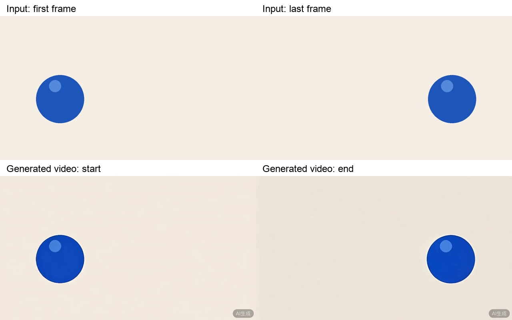
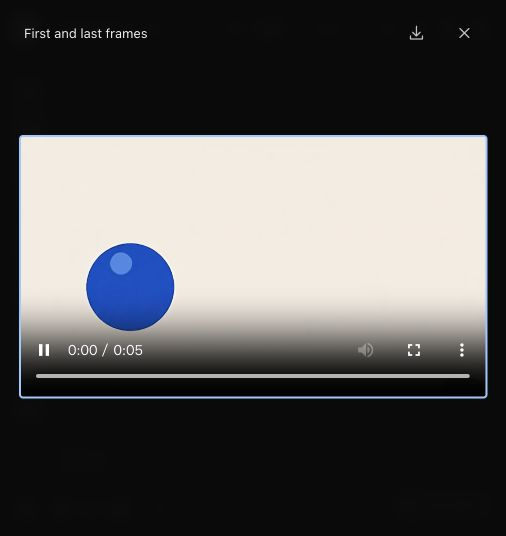
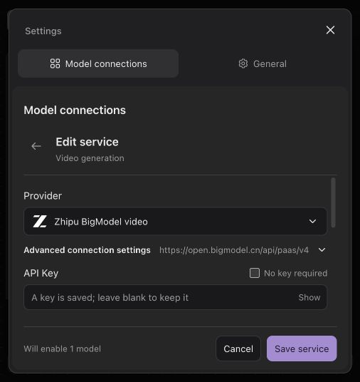
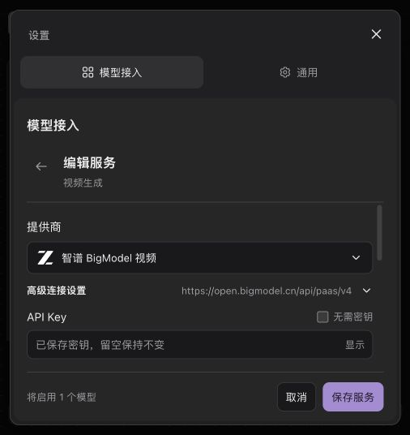
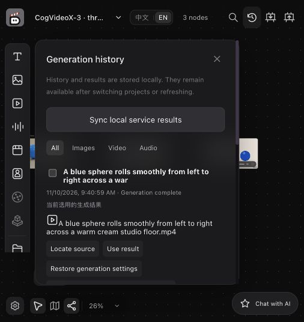
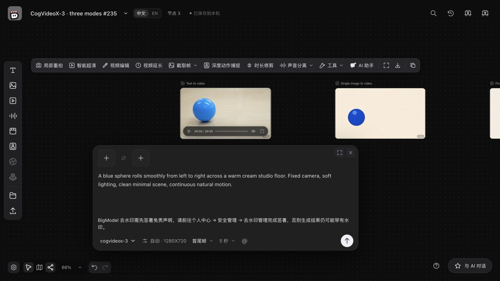
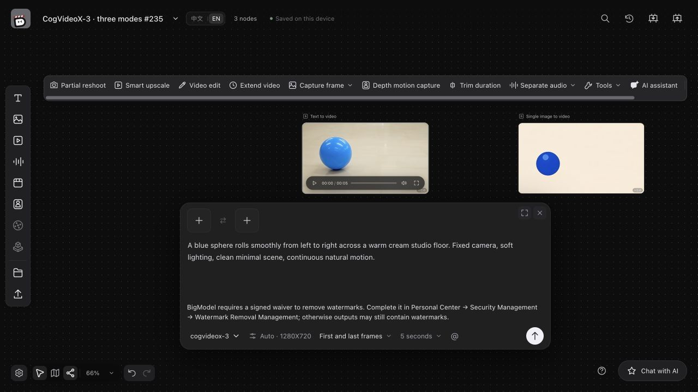

# CogVideoX-3 verification

This record accompanies the `codex/bigmodel-video-235` implementation, based on main `e0b411f151dfe48250c4651c0d820e05179f41ce`. Verification ran on Apple Silicon macOS with Python 3.12.15, Node 24.22.2, FFmpeg and ffprobe. Setup and recovery limits are documented in the [English](../guides/bigmodel-video.md) and [Chinese](../guides/bigmodel-video.zh-CN.md) guides.

## Real BigModel calls

Three generation requests were sent to `https://open.bigmodel.cn/api/paas/v4/videos/generations` using `cogvideox-3`, 1280×720, 5 seconds, 30 fps, speed quality and no requested audio. A local submission ledger recorded each POST before sending; exactly three were issued, with an expected cost of ¥3 at the published ¥1/request rate. This is a request count and price estimate, not an account billing reconciliation.

| Mode | Remote task ID | Downloaded media |
| --- | --- | --- |
| Text | `202611100940587616dc04c6ae438c` | H.264, 1280×720, 5.193548 s |
| Single image | `20261110094058b969e54f901542c3` | H.264, 1280×720, 5.129032 s |
| First and last frames | `202611100943553eeea4665ddd4a54` | H.264, 1280×720, 5.193548 s |

Text and single-image jobs used `CreationGeneration.execute`, the shared service behind UI submission. The frame-pair job used `AgentTools.execute` with `execute_command`. These were scripted business-service calls; the initial paid submissions were not mouse-driven browser interactions. Mocked tests separately cover all three modes through both entry points.

The images were PNG files imported as project-local assets. The first-frame sphere is on the left; the last-frame sphere is on the right. References were deliberately created in last/first order. The actual JSON request's decoded image hashes matched first/last order:

- First: `5ac201f728123bbc80e443b9fc640a9f55955f10ed7e653e05e6cb8d8fc11c12`
- Last: `60b4e0fa4e36e989d87b08bf08d25e71c0a579fe4c554ac2c05131064e54acf7`

The generated video's first and final frames also show that order. The comparison below places the two local inputs above actual frames extracted from the downloaded video. Provider media markings are preserved.



## Restart, candidates and reopening

The submission process paused after persisting the first two remote IDs, before polling. The third job was accepted locally but waited for a concurrency slot and had not reached the provider. That process exited; a new Python process reopened the same project and started recovery. It queried the first two original IDs using GET and made the third job's first POST. The ledger remained at three submissions, one per job. This is an actual process restart; the pause after ID persistence was injected by the acceptance harness.

All three results were downloaded and registered as candidates with no current result selected. Explicit `result.select` commands adopted them, using the shared UI service for two results and Agent tools for the frame pair. All videos passed ffprobe checks and a complete `ffmpeg -i <video> -f null -` decode. A fresh project-store instance retained the same results and adoption state.

Browser acceptance used the production build and a dedicated local API workspace. It checked saved configuration in Chinese and English, loading the supported model list and saving without a generation request, generation history, using a result, and refreshing the project. Each real video loaded at 1280×720, played from start to its full duration without a media error, and remained available after refresh. The browser review server rejected any new provider POST.

| Text video | Single-image video | First/last-frame video |
| --- | --- | --- |
|  |  |  |





## Automated checks

All checks below exited successfully:

```sh
.venv/bin/python -m pytest tests -q
# 1386 passed, 6 skipped; before the final frozen-capability regression was added
.venv/bin/python -m pytest tests/test_bigmodel_video.py -q
# 41 passed, including that final regression
npm test
# 699 passed
npm run build
npm run check:i18n
npm run check:browser-locale
.venv/bin/lint-imports
.venv/bin/python scripts/generate_contracts.py --check
git diff --check
```

The Python provider tests use mocked HTTP and real media bytes. They cover request shape, all documented sizes and durations, frame ordering, invalid images and prompts, preflight rejection without a job, saved parameters after model edits, read retries, terminal provider failure, unknown submission, restart recovery, unauthenticated public CDN downloads, private redirects, credential redaction, candidate adoption and reopening through UI and Agent entry points. The full suite's skipped tests retain their existing environment gates.

Only 720p, 5-second, silent generation was exercised against BigModel. Other supported sizes, 10 seconds, audio, account billing reconciliation and remote cancellation were not verified with the live service. Unknown submission and network/download failures were verified using mocks, not induced on the paid service. No API key, signed download URL or raw provider response is included here.

## Watermark waiver review follow-up

PR #254 requested a short note above Generate when BigModel is selected and Remove watermark is on. The composer now displays a translated note under exactly those conditions. It explains that BigModel requires a signed waiver in Personal Center → Security Management → Watermark Removal Management, and that outputs may otherwise retain watermarks. Both setup guides document the requirement and the inverse `watermark_enabled` mapping. No provider-side behavior or generated video is modified by this UI change.

The production browser check used the existing saved video project and a local review server that rejects new provider POSTs. The note appeared above Generate in Chinese and English; turning Remove watermark off removed it immediately, and turning it back on restored it without reloading. No additional paid generation was submitted.




Follow-up checks: 699 frontend tests passed, the production build passed with the existing chunk-size warning, the bilingual check reported 2,945 keys and zero problems, and generated-contract and diff checks passed. Backend generation behavior is unchanged by this follow-up; the original real-provider and Python verification above still describe their stated scope.

## Main-branch conflict resolution

Merged main `0bdc3a7b2a582cbb65a44e07a879775a9fc71fb1` after GitHub reported conflicts. The resolution retains the CogVideoX-3 error codes and translations alongside upstream timeline error codes and execution-file errors. JSON/TypeScript contracts were regenerated from the merged Python definitions. Text, single-image and first/last-frame generation, durable task recovery and the conditional watermark waiver note remain in scope; no paid provider request was added.

Post-merge validation:

- Frontend: all 767 tests passed. Production build, bilingual keys (3,006; zero problems), browser-locale checks, generated-contract consistency, all four import boundaries, dependency consistency and diff checks passed.
- Full Python suite: 1,655 passed, 100 skipped, **one failed** in `tests/test_native_runtime.py::test_native_events_real_cli_and_shared_write[True-codex]`. Its fixture CLI exited after a write was rejected because the project edit session had expired. The cause of that expiry was not established. The native runtime implementation and test are unchanged relative to main.
- The failing case passed alone (one passed), and the entire native-runtime module then passed (25 passed, five skipped). No source changes were made between these runs. These reruns do not turn the original full-suite failure into a clean full-suite pass; the occurrence remains recorded here.
- Build output retains its chunk-size warning and Python retains the Starlette/httpx deprecation warning. Skipped cases remain unverified. Original real-provider evidence above applies to its earlier revisions; this conflict update used automated and local checks only.
