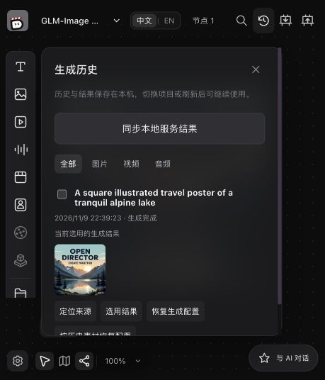
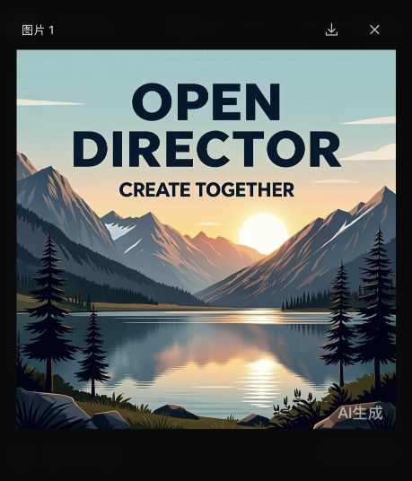
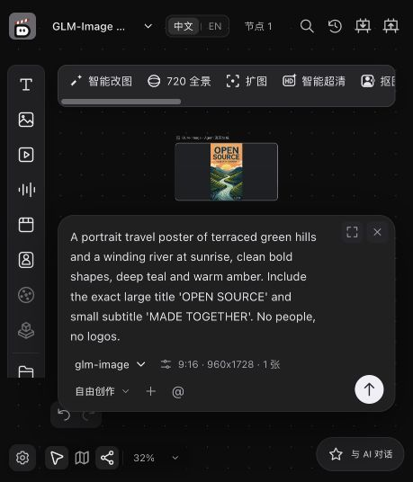
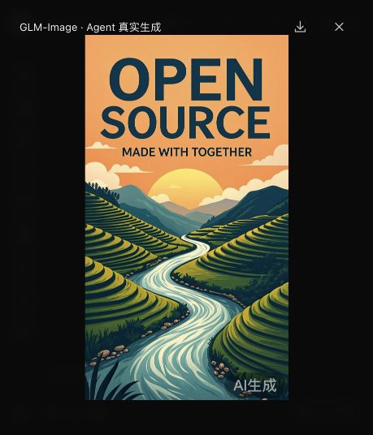
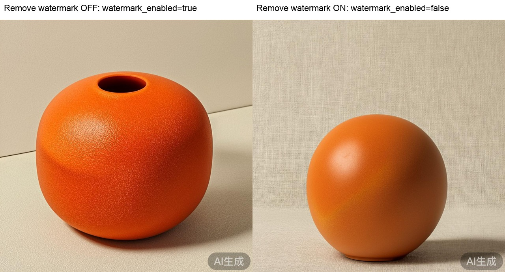
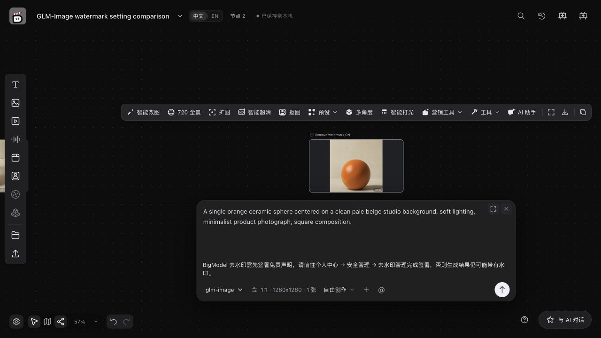
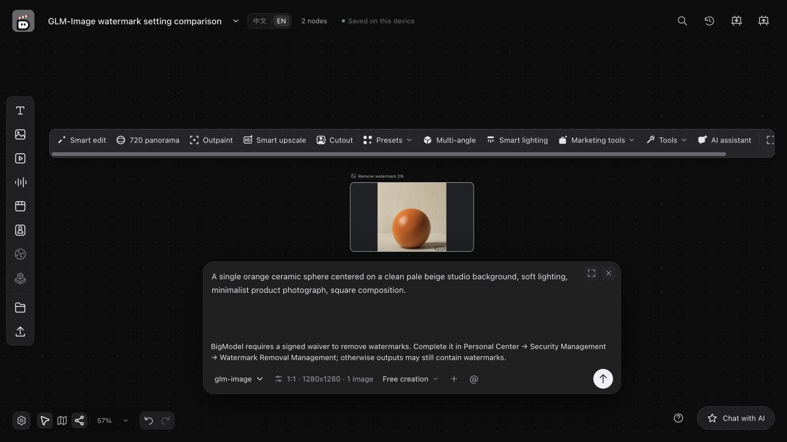
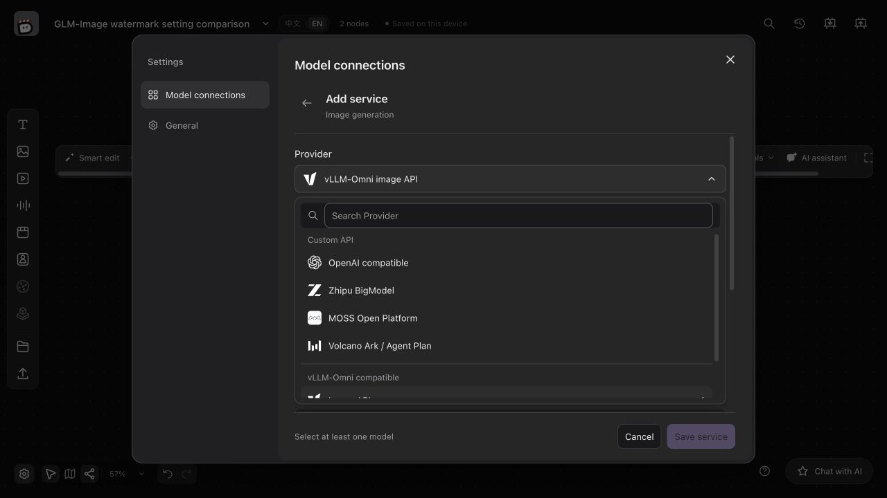

# GLM-Image validation / GLM-Image 验收

Validated on Apple Silicon macOS with Python 3.12.15, Node.js 24.22.2 and FFmpeg
9.0.2. Real-provider and installation acceptance ran on the feature based on
`f06e22f`. After rebasing onto `e0b411f`, the full Python and frontend suites,
build, bilingual checks, import contracts and generated contracts passed again.
Checks below apply to this feature change, not to upstream main alone.

验收环境为 Apple Silicon macOS、Python 3.12.15、Node.js 24.22.2 和 FFmpeg 9.0.2。
真实服务及安装验收在基于 `f06e22f` 的功能分支上完成；变基至 `e0b411f` 后，
重新通过完整 Python、前端测试、构建、双语检查、导入边界及生成契约检查。
以下结果针对本功能变更，不代表仅上游 main 已具备此能力。

## Real provider / 真实服务

Used a real BigModel account and `glm-image`, with the API key entered locally in
OpenDirector. Three generation submissions were made within an authorized limit
of five: two succeeded and one timed out with unknown acceptance. The timed-out
submission was preserved and was not automatically retried. Actual billing for
that request was not verified.

使用真实 BigModel 账户及 `glm-image`，密钥由用户在本机 OpenDirector 设置中填写。
在最多五次的授权内共提交三次：两次成功，一次超时、受理状态未知。
超时任务保留且未自动重发；未核实该次调用的实际计费。

- **Canvas:** selected the BigModel preset, submitted a 1280×1280 image from the
  generation panel, decoded the downloaded PNG, and confirmed the registered
  result was adopted. Reloaded and reopened the project and inspected its local
  asset and generation history. No new provider submission was needed to reopen.
- **Agent tools:** called the real `AgentTools.execute` → `execute_command`
  interface to create a generation node and submit a 960×1728 image with
  `adoptionPolicy=candidate_only`. Confirmed the result was a candidate before
  calling `result.select` through the same Agent entry point. Decoded the local
  PNG and verified adoption and persistence with a fresh project store, then
  opened the project in the browser and previewed the image.
- This verifies the Agent business tools and real image provider, including
  explicit adoption. It does not claim a conversational chat model performed
  the planning or tool selection; no chat model was configured for this check.

画布验收使用生成面板提交 1280×1280 图片，检查 PNG 解码、候选登记与采用，
并在刷新和重开后查看本地素材及生成历史。Agent 验收通过真实业务工具创建节点，
提交 960×1728 图片，先核实仅登记候选，再用 `result.select` 明确采用。
使用新的工程存储实例重读后核对同一结果，并在浏览器中打开工程及预览图片。
这证明 Agent 业务工具与图片服务的执行链路；未配置聊天模型，不声称验证了
聊天模型自主规划和选择工具的过程。生成图中文字的准确度仍由模型决定。

Canvas history after adoption / 画布采用后的生成历史：

Real canvas output preview / 画布真实图片预览：

Reopened Agent-created project with its model and prompt / 重开 Agent 创建的工程：

Real Agent tool output preview / Agent 业务工具真实生成图片预览：

## Watermark review follow-up / 水印审核补充

The review requested real outputs with Remove watermark both off and on, and OpenAI compatible first in the image provider dropdown. The dropdown order is corrected and regression-tested. A bilingual note now appears above Generate only when a BigModel image/video profile is selected and Remove watermark is on. The note explains the provider's signed-waiver requirement and where to find it.

Two additional live `glm-image` requests used the same prompt at 1280×1280. The first used the UI generation service with Remove watermark off; the second used Agent tools with it on. The intercepted POST body and persisted execution agreed in both cases:

| Remove watermark | Sent `watermark_enabled` | Execution watermark | Actual visible output |
| --- | --- | --- | --- |
| Off | `true` | `true` | Watermark present |
| On | `false` | `false` | Watermark present |

Both images generated successfully, decoded, and were explicitly adopted. This reproduces the reviewer's observation even though request mapping is correct. The [official image API](https://docs.bigmodel.cn/api-reference/模型-api/图像生成) states that `false` is only permitted for customers who have signed the disclaimer under Personal Center → Security Management → Watermark Removal Management. Account waiver status was not independently inspected or changed; removal for a signed account remains unverified. The adapter preserves provider output and does not erase marks locally. These are the fourth and fifth authorized image submissions; no further image requests were made.

The production browser check confirmed the Chinese/English note, its disappearance when Remove watermark is off, reappearance when on, and OpenAI compatible first in the image provider list. No additional generation was triggered in the browser.

Follow-up checks: the image/configuration/HTTP-logging Python selection passed 80 tests, including both settings through UI and Agent; the frontend suite passed 700 tests. Production build, i18n, contract consistency and diff checks passed.

## Automated checks / 自动检查

The provider tests use mocked HTTP and real PNG/JPEG/WebP bytes; they do not make
paid calls. They cover the documented payload, model identity, supported inputs
and sizes, result decoding, public CDN downloads, rejection of private redirects,
submission failures without reposting, download recovery after model removal,
and persisted candidate adoption through both UI and Agent entry points.

提供方测试使用模拟 HTTP 与真实图片字节，不调用付费服务。覆盖请求字段、服务
身份、输入和尺寸、图片解码、公开 CDN 下载、私网跳转拒绝、提交失败不重发、
移除模型后的下载恢复，以及 UI 与 Agent 两个入口的候选采用和持久化。

| Check / 检查 | Result / 结果 |
| --- | --- |
| `node --test tests/*.test.ts` | 699 passed |
| `.venv/bin/python -m pytest tests/test_bigmodel_image.py -q` | 38 passed |
| `.venv/bin/python -m pytest tests -q` | 1384 passed, 6 skipped |
| `.venv/bin/lint-imports` | 4 contracts kept, 0 broken |
| `npm run build` | Passed; chunk-size warning |
| `npm run check:i18n` | 0 problems |
| `node scripts/check-browser-locale.mjs` | 0 problems |
| `.venv/bin/python scripts/generate_contracts.py --check` | Passed |
| `.venv/bin/python -m pip check` | Passed |
| Installation helper with `--installed` | Passed |
| Bundled OpenCode `--version` during install | 1.19.5 |
| Official `serve` entry point, health, built HTML | Passed on 127.0.0.1:8000 |

The full Python suite first encountered sandbox restrictions on local sockets
and process execution. It passed when rerun outside those restrictions. The
suite reports a pre-existing Starlette/httpx deprecation warning. Skipped cases
remain unverified; Linux, Windows, other browser engines and real conversational
Agent orchestration were not exercised by this acceptance run.

完整 Python 测试最初因沙箱限制本机端口和进程执行而失败，解除相应限制后全部
通过。套件存在 Starlette/httpx 弃用警告。跳过的用例、Linux、Windows、其他浏览器
内核及真实聊天 Agent 编排不在本次验收范围内。

## Main-branch conflict resolution / 主分支冲突处理

Merged upstream main `0bdc3a7b2a582cbb65a44e07a879775a9fc71fb1` into the feature branch after the review requested conflict resolution. The resolution keeps GLM-Image alongside the new MiniMax image profile, preserves the upstream execution fields and model routing, and regenerates the JSON/TypeScript contracts from their Python definitions. It also removes a duplicate provider-label key introduced by the automatic merge. OpenAI compatible remains first for image providers, and the watermark waiver note is retained.

Checks on the combined branch: the full Python suite passed with 1,655 passed and 100 skipped; the frontend suite passed all 768 tests. Production build, bilingual UI keys (3,003; zero problems), browser-locale checks, generated-contract consistency, four import boundaries, dependency consistency and diff checks passed. The build retains its chunk-size warning and Python retains the Starlette/httpx deprecation warning. The skipped tests remain unverified. No additional paid provider calls were made for conflict resolution; the real-service evidence above was collected on the earlier revisions described there.
