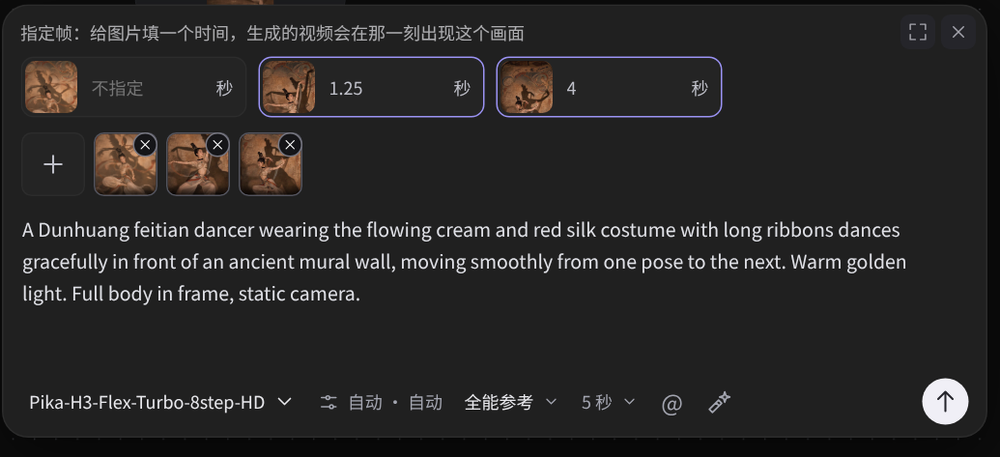
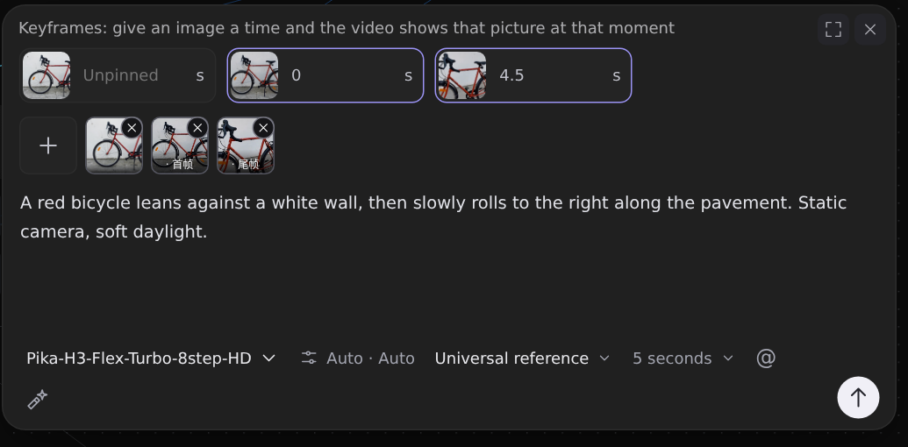
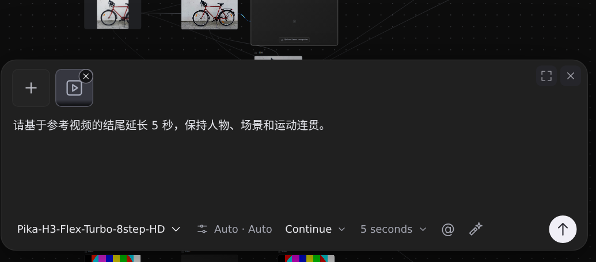
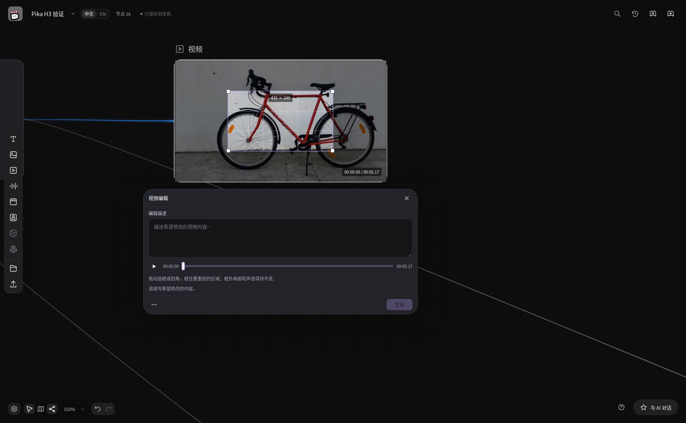
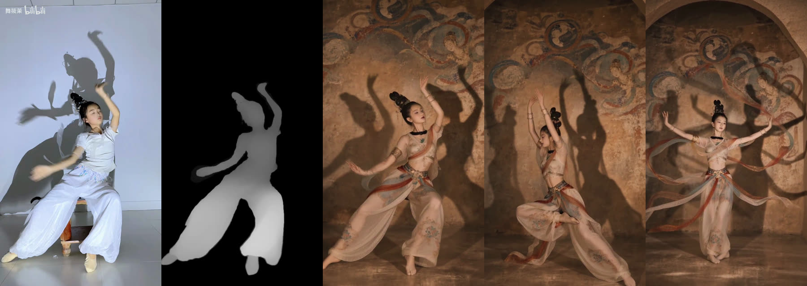
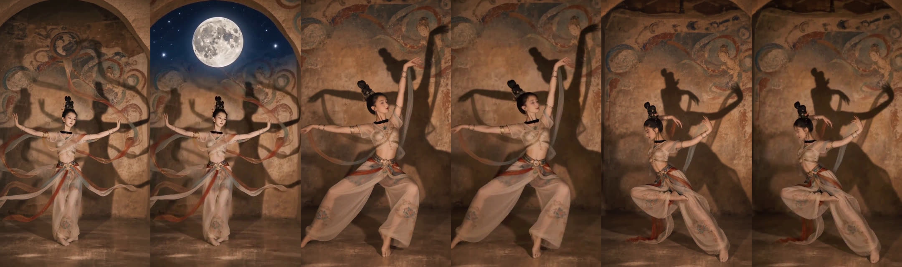

# H3 系列模型的条件生成能力：接入方案

本文说明如何让 OpenDirector 对所有自部署的 MiniMax-H3 衍生模型开放四项条件生成能力：结构控制（含姿态）、潜空间接续、局部重绘、指定时间点的关键帧。范围限于 `vllm_omni` 协议的视频模型。

## 1. 背景

vLLM-Omni 已经让每一种 H3 权重都能使用这四项能力（vllm-project/vllm-omni#11078）：原版 H3、FastH3 Omni，以及 LightX2V Turbo、Pika Flex Turbo、alibaba-pai Acc 这三类蒸馏适配器。OpenDirector 仍按最初接入时的划分，把能力绑定在两个互不重叠的档案上：

| 档案（`inputRules.profile`） | 适配器 | 视频模式 | 局部重绘工具 |
| --- | --- | --- | --- |
| `vllm-omni-h3` | `minimax_h3` | 首帧、素材参考、接续 | 可用 |
| `fasth3-omni` | `fasth3` / `fasth3_dual` | 素材参考、结构控制（`fasth3_dual` 另有首尾帧） | 不可用 |

结果是：用 `fasth3` 请求格式的模型（FastH3 Omni、Pika H3 等 8 步蒸馏模型）用不了接续和局部重绘；用 `minimax_h3` 的原版 H3 用不了结构控制；关键帧在两边都只有「首帧 / 尾帧」两个固定位置。

## 2. 实测依据

2026-11-27 在 4×B300 上用「原版 H3 Ref2VA + Pika Flex Turbo 8 步 LoRA + Fun ControlNet Union」实测，832×480、124 帧，每项一个提示词、一个种子。

- 同一个服务（张量并行 4，启动时带 `--controlnet-model-path`）在不同请求里分别完成了：姿态控制、深度控制、潜空间遮罩重绘、时间线关键帧、`continue_from` 接续。
- 结构控制与另外三项不能出现在同一个请求里，服务端返回 400：控制 + 关键帧、控制 + 遮罩重绘、控制 + `continue_from`。
- 按 vLLM-Omni 文档，控制分支只支持张量并行，不支持 Ulysses 序列并行（后者未实测）。张量并行 4 与此前的 Ulysses 4 在这组请求上速度相同，约 3 秒一段。
- 服务端不做预处理：`control_type=pose` 只读取上传的骨架画面，姿态、边缘、深度图都要由客户端准备。

## 3. 设计原则

**把「权重能做什么」和「请求怎么采样」分开。** 目前 `videoAdapter` 同时决定了两件事。四项能力属于 H3 这一族，与采样方式无关；采样约定才因权重而异。

- **能力**由 H3 族和服务的分区决定，写进输入规则，前端从 `inputRules` 读取，不再按适配器名判断。
- **采样约定**由适配器决定：步数、引导强度、流偏移、采样器、是否需要 LoRA。

分区限制是真实的，需要在规则里表达：

| 服务分区 | 文生 / 首帧 | 素材参考 | 结构控制 | 接续 | 局部重绘 | 关键帧 |
| --- | --- | --- | --- | --- | --- | --- |
| FL2VA（`--task-type fl2va`） | 是 | 否 | 是（无参考） | 是 | 是 | 是 |
| Ref2VA（`--task-type ref2va`，含 FastH3 Omni） | 否 | 是 | 是（带参考） | 是，衔接较松 | 是，需一张参考图 | 是 |
| 合并服务（两个 DiT） | 是 | 是 | 否 | 是 | 是 | 是 |

## 4. 分项方案

改动量参照结构控制最初接入的那次提交（`51dedd70`，52 个文件、约 840 行，其中包含两个工具）。

### 4.1 潜空间接续（改动最小）

界面上已有「接续」模式和「延长」按钮，`useWorkspaceEditor.ts` 在模型支持接续时会自动把「延长」升级为接续。缺的只是 `fasth3-omni` 档案不声明这个模式，以及它的请求路径不发 `continue_from`。

1. `domain/input_rules.py`：给 `fasth3-omni` 的 `videoModes` 加上 `continuation`。
2. `integrations/fasth3.py` 的 `generation_fields`：接续时写入 `extra['continue_from']`。
3. `integrations/providers.py`：接续模式下不上传源视频。来源解析沿用 `reference_inputs.continuation_source`。
4. `domain/creation/generation.py`、`model_availability.py`、`rule_facts.py` 的用例向量：把 `fasth3-omni` 纳入接续的校验与可用性判断。

来源必须是同一服务生成且缓存还在的任务，上传的视频不能接续。对上传的视频，「延长」继续走素材参考模式并截取结尾时间窗。Ref2VA 权重对潜变量尾部跟得较松，接缝可能可见，应在模式说明里写明。

### 4.2 局部重绘

界面（`VideoActionEditor`）、三个工具和后端流程都已存在，只是 `adapter_for` 只在 `vllm-omni-h3` 档案下返回提供 `video.edit` 的适配器。

1. `integrations/model_adapters.py`：`adapter_for` 对 `fasth3-omni` 也返回一个编辑适配器。
2. 该适配器按 Ref2VA 的约定发请求：`task=ref2va`、固定步数与引导强度，并附一张参考图（取源片段的第一帧）。现有的 `VllmOmniVideo.edit_video` 发的是 `task=t2va`，在只有 Ref2VA 的服务上不可用。
3. `domain/capability_contract.py`：`video_to_video` 档案的必需输入增加参考图的情况。

### 4.3 结构控制的类型

现在 `fasth3.control_parameters` 把类型写死为 `depth`，界面没有选择。

1. `VideoParameters` 增加 `controlType`（`depth`、`pose`、`canny`、`hed`、`mlsd`）和 `controlScale`，重新生成契约。
2. `NodeComposer.tsx` 在结构控制模式下增加类型下拉和强度输入，补中英文文案。
3. 给原版 H3（`vllm-omni-h3`）也开放 `control` 模式：FL2VA 服务上是无参考的 T2VA 请求。合并服务不提供。
4. 预处理工具：已有「深度动捕」；新增「姿态提取」和「边缘提取」，产出可直接连接为控制视频的素材。边缘可用本地 FFmpeg 完成；姿态需要一个检测模型，可以做成本地工具进程，也可以接一个新的模型协议。

### 4.4 指定时间点的关键帧（改动最大）

现有的首尾帧只存两个节点 ID，引用上没有时间字段，`frame_indices` 只会是 0 或 -1。

1. 契约：在引用上增加可选的 `frameTimeMs`（或在 `VideoParameters` 上增加关键帧列表），角色增加 `keyframe`，重新生成契约。
2. 画布：`NodeComposer.tsx` 的帧槽位从固定两格扩展为列表，每一项选一张已连接的图片并填写时间点；`creationProjection.ts` 负责双向映射。
3. 后端：`creation_generation.task()` 把时间随 `referenceRoles` 传下去；`reference_inputs.py` 换算成帧号；请求发送 `timeline_guides` 清单、`guide_files` 上传和 `quality=lossless`。
4. 校验：最多 8 项；时间点落在输出时长内；与结构控制、接续、局部重绘互斥。

首帧和尾帧可以统一成时间为 0 和结尾的关键帧，这样 Ref2VA 权重也能有首尾帧，不必依赖 `fasth3_dual` 的第二个 DiT。

### 4.5 采样约定与 LoRA

Pika、LightX2V Turbo、PAI Acc 都要求每个请求带 `lora` 字段，并使用各自固定的步数和流偏移。OpenDirector 现在不发 `lora`，部署时只能在中间加一层转发来补。

- 在模型配置上增加可选的采样约定：`steps`、`guidanceScale`、`flowShift`、`lora`（名称、服务端路径、强度）。`fasth3` 这条请求路径读取它们，而不是写死 8 步。
- 更好的来源是服务自己声明。OpenDirector 已经会查询 `/v1/omni/capabilities`，当前 vLLM-Omni 对它返回 404。等服务端提供该接口后，能力、分区和采样约定都应从那里读取，手工配置只作兜底。

## 5. 互斥规则

前端在 `rules.ts` 的 `backendBlocker`、后端在 `validate_generation` 中各校验一次：

- 结构控制不与关键帧、接续、局部重绘同时使用。
- 关键帧不与接续、局部重绘同时使用。
- 结构控制模式下输出时长跟随控制视频，现有规则不变。

## 6. 实现情况

已实现：

- **潜空间接续（4.1）**：`fasth3-omni` 档案声明 `continuation`；请求发送 `continue_from` 并沿用来源画幅，不上传源视频；服务端已无缓存时给出专门的说明。
- **局部重绘（4.2）**：`FastH3VideoEdit` 适配器为 `fasth3-omni` 提供 `video.edit`，按 Ref2VA 发请求，以源片段首帧作参考图。
- **指定帧（4.4）**：引用新增角色 `keyframe` 和字段 `frameTimeMs`，输入规则新增 `maxKeyframes`（两个 H3 档案均为 8）；画布设置为 `pinnedFrames`；两条 H3 请求路径都发送 `timeline_guides`。目前只在素材参考模式下提供。

未实现：

- **采样约定与 LoRA（4.5）**：OpenDirector 的请求仍固定 8 步、不带 `lora`；现在由随应用启动的视频转发层按模型名补上步数、流偏移和 `lora`（见[视频转发层指南](../guides/video-gateway.zh-CN.md)）。模型配置里直接填写采样约定仍未实现。
- **结构控制的类型（4.3）**：仍固定为深度。用现有的「视频抠像」「深度动捕」「蒙版合成」可以做出只有人物的深度视频，实测比姿态骨架更贴合动作，所以姿态的优先级可以降低。
- **原版 H3 的结构控制**、**首帧模式下的指定帧**、**用关键帧统一首尾帧**。
- 复制节点或导入画布时不会带上 `pinnedFrames`；重新从工程加载时会按后端引用恢复。
- 局部重绘工具只支持框选区域和时间段，不支持任意形状的遮罩。

## 7. 界面

以下截图来自自部署的「原版 MiniMax-H3 Ref2VA + Pika Flex Turbo 8 步 LoRA」服务，请求格式为 FastH3-Omni，素材均由该模型生成。

指定帧：素材参考模式下，每张已连接的图片对应一个时间框（中文 / English）。

潜空间接续：对该模型生成的视频选择「视频延长」后，模式自动为「接续」。

局部重绘：「视频编辑」在 FastH3-Omni 请求格式的模型上可用。

## 8. 敦煌素材实测

同一组素材在 OpenDirector 里走完四项能力，服务同第 7 节。每项只跑了一个种子，没有挑选：能说明功能通不通，不能说明质量高低。

素材与结果都在 [`assets/h3-conditioning/`](assets/h3-conditioning/)，视频为便于入库压缩到 540 像素宽：

| 文件 | 内容 |
| --- | --- |
| [`source-dance.mp4`](assets/h3-conditioning/source-dance.mp4) | 原始舞蹈视频，25.5 秒，提供动作。来源：哔哩哔哩 BV1yFyWziEGF，由原作者上传，仅作测试输入 |
| [`reference-picture.jpg`](assets/h3-conditioning/reference-picture.jpg) | 敦煌飞天造型图，提供服装和风格，由测试者提供 |
| [`control-person-depth.mp4`](assets/h3-conditioning/control-person-depth.mp4) | 人物深度控制视频：视频分割得到的人物遮罩与深度图相乘，凳子和房间不在其中 |
| [`result-structure-control.mp4`](assets/h3-conditioning/result-structure-control.mp4) | 结构控制：控制视频加造型图，768×1344、600 帧，音轨换成了原视频的音乐 |
| [`result-continuation.mp4`](assets/h3-conditioning/result-continuation.mp4) | 潜空间接续：接在上一段成片之后，119 帧 |
| [`result-video-edit.mp4`](assets/h3-conditioning/result-video-edit.mp4) | 局部重绘：对接续结果用「视频编辑」框选画面上方 37%，重画成夜空 |
| [`keyframe-a.jpg`](assets/h3-conditioning/keyframe-a.jpg)、[`keyframe-b.jpg`](assets/h3-conditioning/keyframe-b.jpg) | 两张指定帧图片，取自结构控制成片 |
| [`result-keyframes.mp4`](assets/h3-conditioning/result-keyframes.mp4) | 指定帧：两张图片分别钉在 1.25 秒和 4.583 秒，480×832、124 帧 |

从左到右：原始视频、人物深度控制视频、结构控制成片的同一时刻（第 10 秒）、成片第 21 秒、接续片段第 4 秒。

从左到右：重绘前（接续片段）、重绘后；指定帧图片 A、成片 1.25 秒处；指定帧图片 B、成片 4.583 秒处。

| 能力 | 入口 | 测量 | 耗时 |
| --- | --- | --- | ---: |
| 结构控制 | 视频节点的「结构控制」模式 | 另一版提示词下，与原动作的平均关键点距离为画面对角线的 0.026；成片未单独重测 | 126 秒 |
| 潜空间接续 | 视频节点的「接续」模式 | 接缝两帧 SSIM 0.878，片内相邻帧 0.926 | 20 秒 |
| 局部重绘 | 「视频编辑」工具 | 框外 PSNR 39.2 dB，框内 19.7 dB | 27 秒 |
| 指定帧 | 素材参考模式下给图片填时间 | 两帧与指定图 SSIM 0.82 和 0.80（输出 480×832，比较时放大到 768×1344） | 11 秒 |

- 结构控制的入口原本就有，另外三项是这次为 FastH3-Omni 请求格式新增的。
- 原视频里舞者坐在凳子上。提示词把人物写成悬浮在空中的飞天、脚下是空的石地；只写「没有凳子」时，模型会因为坐姿再画一个。
- 局部重绘里，月亮和夜空在片段后半段才出现，前面几十帧框内仍是壁画。
- 结构控制的输出长度取不超过控制视频的最大 `17n+5` 帧，可能比控制视频短不到 0.7 秒。
