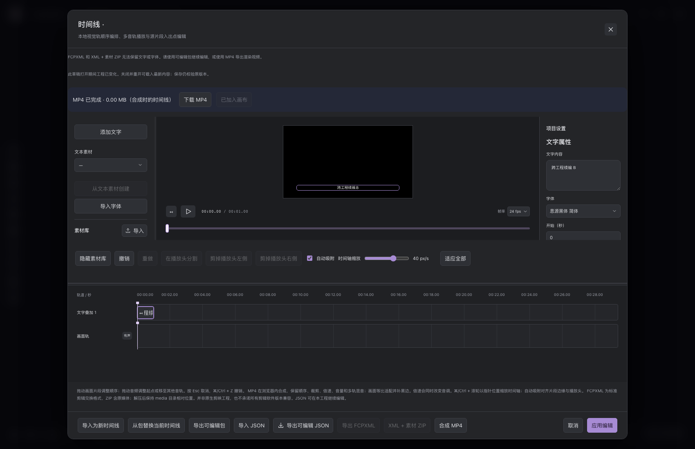
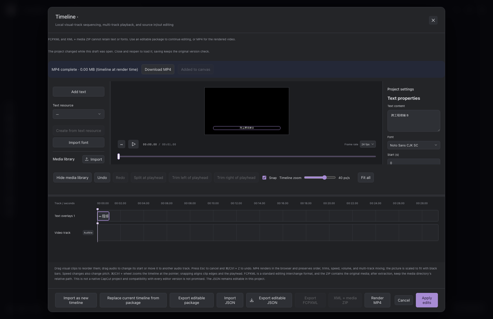

# Issue #87：可编辑时间线文字验收记录

2026-11-06 在 Apple M4 Pro（14 核、24 GB）、macOS 26.7.1 上验证。源码基线为 `28f30454ffba68907903c6d08db6bb8ba3b8bee2`，结果对应该基线上的 Issue #87 工作区实现；不是对未修改基线的功能声明。Python 3.12.10、Node 25.4.0（x64）、Chrome for Testing 151.0.7922.34、FFmpeg/ffprobe 8.1、fontTools 4.68.0、Pydantic 2.14.3、Mediabunny 1.62.1。未使用用户工程、用户浏览器 profile 或真实付费模型。

English summary: editable text was exercised through real UI and shared editor commands, persisted project state, native UI↔CLI package exchange, service restart, historical publication queries, and actual decoded MP4 frames. Desktop landscape/portrait H.264 outputs and the 2,000-cue measurements below are from this Mac only. A later native macOS arm64 installation and seven-browser-suite acceptance run also passed; its separate environment, wheel and measurements are recorded below. These results do not establish Windows support, background rendering, or a general performance guarantee.

## 场景与业务事实

| 场景 | 证据与范围 |
| --- | --- |
| UI 与 Agent 接续 | `timeline_text_editing.mjs` 使用真实 UI 和共用 `editor.save`，核对同一 editor/overlay 身份，中文组合输入、正文来源副本、时间、样式、字体、单步手势撤销、并发草稿与锁；模型回复不参与该测试 |
| 持久化与重开 | 浏览器脚本停止并重新启动实际隔离 API，重用同一临时项目目录，再读取正式项目和打开文字属性；不是仅刷新浏览器缓存 |
| 字体与来源 | 默认字体登记为项目 file 资产；文本素材复制后保留不可变来源；缺字、坏字体、文件缺失、资产依赖和删除保护由真实字体字节及服务测试核对 |
| 时序、中文与层次 | `timeline_text_render.mjs` 核对真实字体排版、预览/解码帧差异、独占结束帧、重叠层次、纯文字黑底和媒体结束后的文字；640×360 的字形边框差异不超过 1 输出像素，检查真实混音音频与取消清理 |
| 桌面横竖输出 | `timeline_text_desktop.mjs` 使用独立可见 Chrome 窗口及新 profile，实际生成 1920×1080 和 1080×1920 H.264、24fps、60 帧、2.5 秒 MP4；ffprobe 核对尺寸/时长，解码帧 11/12、24、36、48、59 核对黑底、中文出现、覆盖层、片尾及颜色；另保留帧 60 预览以核对独占结束 |
| 跨工程可编辑包 | `timeline_text_archive.mjs` 从 UI A 导出，真实 CLI 导入 B、导出 B，UI 导入 C；字体和正文来源获得目标工程新资产 ID，SHA-256 不变；关闭来源视图、重启服务后只打开 C 继续编辑 |
| 两份成片 | C 中正文 A/B 分别合成和发布为不同资产；真实解码帧不同，精确编辑版本分别可由历史 `object.get` 查询，旧文件指纹和 provenance 不变；成片引用实际目标字体和正文来源 |
| 导入与格式拒绝 | 新建导入保留当前未保存草稿；显式替换重新绑定并可续编。未知能力包在中英文均明确拒绝，不增加文档。含文字的 FCPXML 显示可编辑包/MP4 建议；JSON 和全画布归档的版本门禁由格式测试覆盖 |
| 双语 | 实际文字 UI 的中文/英文切换、字体显示名、属性、组合输入、导出及拒绝提示均有浏览器检查；正文和业务身份不因语言改变。长英文底部操作在 1700×1100 窗口可见 |
| 旧无文字行为 | 旧格式与原指纹由固化夹具测试覆盖；无文字视觉剪辑/音频/MP4 的浏览器回归结果在执行清单中单独记录 |

## 可复现执行

浏览器环境准备见 [验证指南](validation.md)。这些脚本自建隔离服务，均支持仓库约定的 `PYTHON`、`PLAYWRIGHT_MODULE` 和 `CHROMIUM_PATH`；桌面脚本需要真实桌面会话。不要将测试指向用户项目。

```sh
node tests/browser/timeline_text_editing.mjs
node tests/browser/timeline_text_render.mjs
node tests/browser/timeline_text_archive.mjs
node tests/browser/timeline_text_desktop.mjs
node tests/browser/timeline_workflow.mjs
```

`timeline_text_archive.mjs` 的完整执行通过，包括 UI↔真实 CLI、真实 MP4、服务重启、双语拒绝和 2,000 条 UI 编辑。`timeline_text_desktop.mjs` 的桌面输出及 600 秒实际合成通过；后续独立 ffprobe 检查确认两个性能样例均为 H.264 640×360、14,400 帧、600 秒。`timeline_text_render.mjs` 同时运行 `mp4_export.mjs`，真实音频混音通过。无文字 `timeline_workflow.mjs` 最终通过实际服务重启、顺序/变速修改、1.5 秒真实 MP4 与混音、发布、取消、缺失来源拒绝及第二份可播放导出。该旧脚本原有中文定位器依赖主机语言，本次只为测试显式设置 `zh-CN`；产品默认语言不变。

交付机器本地可复查输出位于 `test-results/issue87/desktop` 和 `test-results/issue87/archive`，含 `report.json`、选定 PNG 和真实 MP4。它们是忽略的可再生成测试输出，不是其他开发者构建或理解此文档的必需依赖。完整日志及临时工程属于本机验收材料；仓库中保留脚本和本记录以复现。

## 2,000 条 / 10 分钟测量

同一台机器、一个内置字体、2,000 条相邻非重叠文字，每条约 0.3 秒，600 秒，24fps。实际 MP4 性能比较固定为 640×360；它与上面的桌面 1080p 正确性检查是不同实验。基线与文字样例使用相同的黑色图片、时长和帧率。每个样例仅测量一次，不包含下载后的文件写盘时间。

| 实际合成样例 | 耗时 | MP4 字节 | 合成进度回调采样的最大 JS 已用堆 |
| --- | ---: | ---: | ---: |
| 无文字基线 | 36.747 秒 | 648,112 | 27,520,262 |
| 2,000 条文字 | 38.763 秒 | 1,356,395 | 29,578,344 |

本次样例中文字合成耗时多 2.016 秒（约 5.5%），文件多 708,283 字节。该差异仅用于描述这次固定样例，不是一般吞吐承诺。采样 JS 堆不包含全部原生字体、GPU、编码器、浏览器进程或系统内存，也不保证捕捉真实峰值。

真实保存的 2,000 条文档还在完整 UI 中执行 10 次正文填入、失焦提交，并等待两次 `requestAnimationFrame`。报告值包括 Playwright/CDP 往返、React 更新和等待，不能当作纯输入到像素延迟。本次打开耗时 1.254 秒，10 次样本最小 482.5 毫秒、中位数 520.6 毫秒、最大 889.1 毫秒；CDP JS 已用堆在打开前为 45,151,700 字节，编辑后为 56,389,300 字节（不是峰值或整个进程内存）。精确样本及 CDP heap 在归档脚本的 `report.json` 中记录；无文字文档没有正文编辑控件，因此没有伪造对应的无文字打字对比。此负载能编辑，但不宣称即时响应。

### 最终源码的浏览器进程 RSS 采样

为补充 JS 堆之外的内存测量，最终源码在独立可见 Chrome 中又运行相同 600 秒样例，同时每 500 毫秒通过浏览器级 CDP `SystemInfo.getProcessInfo` 获取该隔离实例 PID，再用 `ps` 读取这些进程的 RSS。保留每次 PID、父 PID、时间和数值；两阶段各取得 77 次采样、零采样错误。未计入其他 Chrome、用户浏览器、Python API、Vite 或 Node 控制进程。

| 最终源码样例 | 实际合成时间 | MP4 字节 | 采样浏览器进程 RSS 总和峰值 |
| --- | ---: | ---: | ---: |
| 无文字基线 | 37.403 秒 | 648,112 | 904,144 KiB（约 883 MiB） |
| 2,000 条文字 | 37.238 秒 | 1,356,395 | 678,304 KiB（约 662 MiB） |

该 RSS 总和可能重复计算共享页，500 毫秒采样也可能错过瞬时峰值，不能作为独占内存或整个应用内存。两阶段依次运行于完成 1080p 检查后的同一浏览器实例，先基线、后文字；热身、垃圾回收和编码器内存释放影响峰值，因此不能从此顺序实验推断文字使内存减少或性能提升。该次没有同时运行其他本任务构建或浏览器检查。真实输出再次通过 600 秒/14,400 帧、H.264、640×360 检查；完整外部采样及输出可再生成于 `test-results/issue87/desktop-rss`。初次性能基线及重复诊断仍分别保留。

## 最终字体修复复验

真实浏览器复现了未保存草稿缺字时的系统字体回退；修复后 `timeline_text_coverage.mjs` 用内置 Noto 的 `😀` 和实际 Latin-only TTF 的 `中文` 验证中英文诊断、正文保留、同一会话恢复，以及不支持正文的零绘制像素、零排版测量。未失焦输入同样能触发诊断。字体检查与实际字节 SHA-256 绑定，由本地 API 的既有静态字体解析规则提供覆盖事实；视图中自带的伪覆盖数据不能绕过检查。共用检查的取消隔离及错误后重试亦通过。

最终字体修复后又运行了文字编辑、640×360 渲染/混音/取消及真实桌面横竖 1080p 检查。第二次桌面诊断的 600 秒样例为无文字 38.109 秒、文字 38.277 秒，文件字节仍分别为 648,112 和 1,356,395。该次部分时间与其他聚焦检查重叠，因此保留为重复运行诊断，不替换上面的初次性能基线，也不据此宣称性能提升。代表记录可再生成于 `test-results/issue87/desktop-repeat`。

## 字体、安装与边界

默认字体为 Noto Sans CJK SC Regular 2.004，16,437,364 字节，SHA-256 `2c76254f6fc379fddfce0a7e84fb5385bb135d3e399294f6eeb6680d0365b74b`，附 SIL OFL 1.1；来源及固定提交写在 `public/fonts/manifest.json`，运行期间不联网下载。fontTools 精确固定为 4.68.0。仅支持静态 TTF/OTF，单字体 32 MiB，实际使用字体合计 64 MiB；原生可编辑包上限为 512 MiB，包含文档保留的全部字体、剪辑、媒体库和正文来源资源，不仅是本次成片使用的资源。

MP4 合成仍在浏览器进行，不提供关闭浏览器后的后台成片。当前没有 SRT/ASS、自动转写、通用多视觉轨或 Windows 验证声明。包操作可在编辑器关闭时由 CLI/Agent 调用，不能将这等同于后台渲染。

已观察到自身发布新成片后，打开的编辑器可能显示保守的“工程已变化”提示；测试仍能继续编辑并以正确版本发布第二份成片，历史及文件保持正确。此提示不作为已修复问题描述。

完整 Python 运行并非全绿：当次结果为 940 passed、11 failed、3 skipped。10 个非原生失败已在未修改的 `28f30454` 归档基线复现；原生 OpenCode 集成的一次运行停滞并由测试负责人终止，属于环境/终止限制。没有用删除测试、修改无关生产代码或重复执行长原生套件将其描述为通过。最终字体修复后的相关检查通过：Node 621 项、相关 Python 269 项（含 Agent 元数据）；契约生成一致性、前端构建与双语检查通过（2,921 词条、零问题）。这些聚焦结果不替代上述非全绿的完整 Python 运行。字体修复前另一次较广的非原生回归为 986 passed、8 failed、3 skipped，仅排除 `tests/test_native_runtime.py`；8 个失败均在已确认基线名单内，两个存在时序不确定性的取消测试在该次通过。该次结果同样不表示完整套件全绿。实际 wheel 验证见下方补充。

## 实际 wheel 安装验收

初次 wheel 虽含字体文件，已安装服务却未挂载 `/fonts`；此真实 404 已修复并由生产路由测试和新的实际 wheel 复验覆盖。另一次增量构建发现 setuptools `build/lib` 残留旧哈希资源，该试验包未接受；将本次忽略构建目录完整移入临时保留目录后重新构建。最终 wheel 的 18 个静态资源文件名和全部字节均与当前 `dist` 一致，无多余旧哈希文件。

接受的 wheel 为 `opendirector-0.1.0-py3-none-macosx_15_0_x86_64.whl`，86,465,373 字节，SHA-256 `c5c5511a821be6f0e2f4ba37c41a8138bea9ee3fd54a7f9a5c0bdacfa2aa64ea`。在全新隔离虚拟环境安装后，28 个依赖兼容；内置 OpenCode 1.19.5、技能、CLI、服务启动、首页/静态资源及持久化工程验证通过。默认字体离线发现、版本/字节/指纹、4,301 字节 SIL OFL 许可证，以及服务实际返回的 manifest/字体/许可证逐字节校验通过，后台 PATH 不包含 Node。该机器的 Python/Node 为 x86_64/Rosetta 环境；此产物不证明原生 arm64 wheel、Windows 或其他平台通过。

`timeline_text_installed.mjs` 直接连接该已安装后端，无 Vite 或仓库 Python 导入，使用隔离工程实际执行“添加时间线→添加文字→可见预览→缺字诊断且保留正文→修正→保存→关闭实际 API 监听→重新启动→重开正文”。测试启动和回收自己拥有的进程组，并在服务重启前确认监听已停止，避免仅重启 CLI 父进程留下子服务。代表截图、报告、wheel 与安装日志保留于 `test-results/issue87/wheel`；它们是可再生成的本地证据，不是源码依赖。

构建及安装命令遵循 [Python 安装与发布](packaging.md)。保留的安装浏览器回归可通过下面的命令对任意已安装 wheel 的隔离环境复现（并设置验证指南中的 Playwright/Chrome 环境）：

```sh
PYTHON=/absolute/path/to/wheel-venv/bin/python node tests/browser/timeline_text_installed.mjs
```

## 对照 Issue 原文的二次核对（2026-11-06）

本轮重新读取了 [Issue #87 的当前正文](https://github.com/ThinkFlowLab/OpenDirector/issues/87)及其[实施计划评论](https://github.com/ThinkFlowLab/OpenDirector/issues/87#issuecomment-6680337540)，按正文五项验收逐条核对当前工作区代码与实际结果。评论明确将字幕格式解析、自动听写及后台渲染另行规划，因此未将它们算作本轮未完成项。

| Issue 验收项 | 核对结论 | 代码与验证依据 |
| --- | --- | --- |
| UI/Agent 编辑、保存重开、撤销重做 | 当前实现满足 | `TimelineTextOverlay/TimelineTextStyle` 保留正文、时间、位置和样式；两种入口复用 `editor.create/save` 与项目历史。重新运行真实 UI 的组合输入、拖动、撤销重做、Agent 共用命令写入、冲突/锁与实际服务重启。另用两种写入来源分别修改正文、时间、位置、字号、颜色、背景、描边和层次，再执行正式 undo→重建存储读取→redo→重建存储读取，完整数据均一致。 |
| 中文、层次、位置和显示时间与实际 MP4 一致 | 当前实现满足 | 预览与导出都调用 `drawTimelineText`，共用字体准备、排版及半开帧范围。本轮重新合成并解码真实 MP4，检查帧 23/24/47/48/71/72/95/96、中文、换行、叠放、纯文字及片尾；预览比较和音频混合均通过。既有最终源码横竖 1080p 文件亦重新经 ffprobe 核对尺寸、H.264 和 60 帧。 |
| 改字后新成片与旧编辑依据分别保留 | 当前实现满足 | `timeline.publishRender` 固定 `editorDocumentId/editorRevision/sources`，历史 `object.get` 查询精确版本。本轮发布服务测试通过；另重新核对实际 A/B 成片的不同资产 ID、版本 2/3、不同且与报告一致的文件指纹，旧文件未被覆盖。 |
| 字幕/字体依赖、删除保护及可编辑导出 | 当前实现满足 | `sourceAsset` 和 `fonts[].asset` 使用真实不可变 AssetRef，参与依赖遍历、查询、删除预检和实际删除保护；本轮字体、来源与包服务测试通过。既有 UI→CLI→UI 跨工程证据重新核对来源/目标资源 ID 不同、实际字节指纹相同。原生包保留结构和资源；JSON 明确为同工程结构，含文字的 FCPXML/旧 ZIP 明确拒绝并提示替代方式。 |
| 旧剪辑、混音及无字幕导出不回退 | 覆盖的代表场景满足 | 旧提交夹具重开与重放指纹测试通过。本轮重新运行 `timeline_workflow.mjs`，实际核对顺序、变速、1.5 秒 MP4、混音、发布、取消、来源缺失拒绝、服务重启及第二份可播放输出；文字渲染脚本中的既有 MP4/混音回归也通过。 |

本次重新执行 Node 全套 621 项、相关 Python 269 项，以及 `timeline_text_editing.mjs`、`timeline_text_render.mjs` 和 `timeline_workflow.mjs`，全部通过。渲染报告位于可再生成的 `test-results/issue87/requirements-recheck/render`；本机日志为 `/tmp/issue87-requirements-{node,python,editing,render,workflow}.log`。首次渲染复验因指定的证据目录未创建而中止，补建目录后重跑通过，属于测试输出路径准备问题；未因此修改产品代码。

结论限于当前工作区实现和上述验证范围：未发现遗漏的 Issue 功能要求。Agent 验证使用共用命令、CLI/网关和隔离调用者，不等同于真实付费模型对话测试。完整 Python 套件的既有失败及原生运行限制仍适用。该轮尚未验证 Windows/原生 arm64；后续原生 arm64 补验结果见下节。改动尚未提交、创建 PR 或合并，Issue 仍保持开放；本次核对没有修改 GitHub 内容。

## 原生 macOS arm64 安装与验收（2026-11-06）

用户随后授权安装环境并补做原生 arm64 验收。沿用同一台 M4 Pro / 24 GB / macOS 26.7.1，复用已安装的 arm64 Python 3.13.12、Chrome for Testing 151.0.7922.34、FFmpeg/ffprobe 8.1 和 uv。Homebrew 两次在 OpenSSL 依赖升级处报锁冲突，未继续调整依赖；改从 Node 官方发布目录安装 `node-v24.22.1-darwin-arm64.tar.gz`，官方 SHA-256 为 `89c682593d76cd44233fa53b1563264e7de9cbb189cad169135c5b4fadfbc0a7`。新开原生 zsh 验证 Node 24.22.1 / npm 11.19.1 与 Python 均为 arm64；内置 OpenCode 1.19.5 的实际二进制也经 `file` 确认为 arm64。

原有全局 Python 软件源连接超时后，仅在本次安装/构建进程中使用官方 PyPI/npm，未修改全局源配置。原生 Node 独立位于用户目录，zsh 配置经备份后增加仅对 arm64 终端生效的 PATH 设置。现有 x64 工具及原工作区依赖保留。

从原工作区 Git 跟踪及未忽略的未跟踪文件创建独立源码快照，包含全部当前功能改动，未复制 `.git`、既有虚拟环境、构建目录、工程或凭证。快照共 752 个文件，基线仍为 `28f30454`，快照 SHA-256 为 `cabc383602bf7d6f6f8d424741a7f1841d032b62c12792650c47942cc1e13a55`；安装及测试后重新校验，752 个源码文件均未改变。独立源码目录的本机位置为 `OpenDirector-arm64-issue87`；路径和逐文件指纹仅作为可再生成的验收证据记录，不是其他开发者的构建依赖。

| 项目 | 原生 arm64 结果 |
| --- | --- |
| 源码安装 | 全新原生虚拟环境通过 editable 安装、npm ci、TypeScript/Vite 构建、pip check、环境 helper 的 installed 检查及真实 serve 启动/健康检查 |
| 运行依赖 | Python 3.13.12、Node 24.22.1、fontTools 4.68.0、FastAPI 0.162.0、Pydantic 2.14.3、Pillow 13.0.0、Starlette 1.10.0；源码环境与安装包环境分别记录 |
| 单元与服务回归 | Node 621 项、相关 Python 269 项通过；契约生成一致性和双语检查通过，2,921 词条、零问题 |
| 编辑与协作 | `timeline_text_editing.mjs` 通过真实 UI、组合输入、草稿撤销重做、共用命令、并发/锁、字体导入和实际 API 重启 |
| 排版与覆盖 | `timeline_text_render.mjs`、`timeline_text_coverage.mjs` 通过真实 MP4/预览帧比较、混音、纯文字/片尾、缺字零绘制、诊断和有效输入恢复 |
| 可编辑包 | `timeline_text_archive.mjs` 通过 UI↔CLI 跨工程导入导出、重新登记资源、服务重启、目标续编、A/B 成片发布及精确版本依据；实际文件指纹再次核对 |
| 桌面输出 | `timeline_text_desktop.mjs` 通过可见 Chrome 的 1920×1080 与 1080×1920 H.264、60 帧/2.5 秒，解码帧核对中文和层次；另通过两个 600 秒/14,400 帧样例 |
| 无文字回归 | `timeline_workflow.mjs` 通过顺序、变速、真实 MP4、混音、发布、取消、缺失来源、服务重启及第二份输出 |
| 安装包界面 | `timeline_text_installed.mjs` 通过全新 wheel 安装后的实际 UI，无 Vite、无仓库 Python 导入、后台无 Node PATH；覆盖添加文字、可见预览、缺字诊断、正文保留/恢复、保存、实际监听停止/重启及重开 |

接受的原生 wheel 为 `opendirector-0.1.0-py3-none-macosx_11_0_arm64.whl`，**81,652,959 字节**，SHA-256 `771d848268ba3dc674d04e18b85a785e34bb74f21e41ef98898e4117fcbd0eac`。全新安装环境的 pip check、内置 OpenCode、技能、CLI、真实 serve、首页/资源和持久化工程检查均通过。包内 18 个前端资源的名称和字节与该次原生构建的 `dist` 完全一致。实际安装后的离线 default-font、HTTP manifest/字体/许可证字节、16,437,364 字节字体指纹和 4,301 字节许可证均核对通过；检查没有创建用户工程。wheel 平台标签不表示已经实测所有 macOS 版本，本轮实际系统为 26.7.1。

该轮 2,000 条/600 秒、640×360、24fps 实际合成：无文字 38.478 秒，文字 38.984 秒，文件分别为 648,112 和 1,356,395 字节。500 毫秒外部浏览器 RSS 总和采样分别为 79/80 次、零采样错误，采样峰值分别为 1,024,832 / 888,560 KiB。真实 UI 2,000 条文档打开为 1.162 秒，10 次编辑样例中位数 533.4 毫秒（含 CDP 往返及两次动画帧等待）。这些仍是单次顺序实验和采样值，受热身、GC、共享页及编码器释放影响；不是独占内存、瞬时峰值或性能承诺。与此前 x64 轮次的 Python、Node 和依赖版本不同，不据此作 Rosetta/原生性能因果比较。

本轮七个浏览器脚本均退出 0，实际监听关闭已检查。首个编辑脚本成功后的临时 bind-only 检查曾因 TCP TIME_WAIT 误报，随后通过 lsof 无监听和 ECONNREFUSED 确认清理完成，改用连接拒绝检查后继续；未修改产品代码或删减测试。日志、环境/架构、源码快照、原生 wheel、MP4、PNG 和报告位于可再生成的 `test-results/issue87/arm64`。原有 x64 证据保留。

本次补验没有运行真实付费模型或重跑已知停滞的长原生 Agent 集成，也不将既有完整 Python 失败改报为通过。当前已验证范围扩展为本机 macOS x64/Rosetta 与原生 arm64；Windows 仍未验收。应用未留作后台常驻服务，原工作区仍未暂存、提交或推送。

## Windows 原生补验：PR #193（2026-11-06）

本节保留指定提交的修复前验收；后续本机修复及新 wheel 复验见下一节。

**结论：源码与 Windows wheel 安装、所覆盖的 UI/CLI 创作流程通过；#87 的 Windows 完整验收未通过。** 新增 Agent 包工具依赖的安全执行目录文件访问在 Windows 明确拒绝，不能用 UI↔CLI 包往返通过来代替内置 Agent 工具可用性。另有三项基线存储检查失败和一次桌面内存采样失败，以下分别记录。

English summary: native Windows source and clean-wheel installation, Chinese preview and decoded MP4, real edit/save/restart/reopen, UI↔CLI editable-package exchange and the no-text regression passed. Full Windows acceptance is **not green**: both Agent package tools reject execution-directory access on Windows. Focused Python checks returned 291 passed, 4 failed and 4 skipped; three storage failures were reproduced on the untouched baseline. The desktop runner exited 1 on an external memory-sampling error; its actual media passed the original ffprobe/frame assertions in a separate verification. No paid model was called and no code was committed, pushed or merged.

### 代码、机器与安装

- 目录为 `C:\Users\Qing Peng\OpenDirector`。开始时为干净 `main`，HEAD `9d057721e2f5e1fcf89fcc1e958a7b50da0f367d`；无已暂存、未暂存或未跟踪改动，无需 stash。
- 安装 GitHub CLI 并由用户完成认证后，实际执行 `gh pr checkout 193` 成功。检出后本地 HEAD 为 **`9834c1cc0d56abece57d815de53f78a501e698d0`**，工作区干净；验收期间未切换到其他提交。未合入更新的 upstream main。
- Windows 11 原生 x64，build 26200，PowerShell 7.6.9；Intel i7-11850H，8 核/16 线程，约 32 GiB 内存；不使用 WSL。Chrome 156.0.8078.80，Node 24.22.1 / npm 11.19.1，Python 3.12.10，FFmpeg/ffprobe 9.0.2（Gyan full build，实际检测到精确的 `libx264` 编码器）。
- 复用 fnm 中的 Node 和已有 Python；通过 WinGet 安装 gh 2.103.3、用户级 FFmpeg，安装器校验哈希成功。补充用户 PATH 且保留原条目；用刷新后的用户/系统 PATH 启动新的无 profile PowerShell，验证工具发现和版本。未更改执行策略、Developer Mode 或系统安全设置。
- 新建 `.venv`，实际运行 `python -m pip install -v -e ".[test]"`；安装钩子依次完成 npm ci、TypeScript/Vite 生产构建和 OpenCode **1.19.5** 执行校验。`pip check`、安装技能的 `check_environment.py --installed`、正式 `serve` 的 health/生产页面/资源及 CLI 持久化检查通过。
- 实际依赖包括 fontTools 4.68.0、FastAPI 0.162.0、Pydantic 2.14.3、Pillow 13.0.0、Starlette 1.10.0。安装依照 pyproject 范围解析，未声称与 requirements.txt 中全部版本一致；未修改锁文件、全局 registry 或凭证内容。

### 检查与实际产物

| 检查 | Windows 实际结果 |
| --- | --- |
| Node、双语、契约 | `npm test`：621 passed；`npm run check:i18n`：2,921 keys、零问题；`scripts/generate_contracts.py --check` 通过。前端生产构建由安装钩子完成 |
| 聚焦 Python | 十个文件共 299 项：291 passed、4 failed、4 skipped，333.99 秒；完整套件和已知长原生 Agent 集成未重跑，不宣称全绿 |
| 文字编辑 | Windows 宿主适配后的 `timeline_text_editing.mjs` 退出 0；真实 UI 组合输入事件、撤销重做、移动/改时长、保存、共用命令修改、UI 接续、冲突/锁、实际 API 停止再启动、重开及中英切换通过。组合输入采用脚本合成事件，不等同于人工使用 Windows IME 候选窗口 |
| 中文预览及 MP4 | `timeline_text_render.mjs` 退出 0；真实字体与 MP4 解码帧 23/24/47/48/71/72/95/96、起止时刻、换行与覆盖层、纯文字/片尾、混音与既有 MP4 回归通过；位置修改不重复读取字体来源 |
| 缺字与恢复 | `timeline_text_coverage.mjs` 退出 0；默认 Noto 对不覆盖的 emoji、实际 Latin-only 字体对中文均在中英界面诊断；正文保留、零绘制/零错误排版测量、取消隔离、重试与同会话恢复通过 |
| 可编辑包 UI↔CLI | `timeline_text_archive.mjs` 退出 0；UI A→真实 CLI B→UI C，资源重新登记且字节指纹相同，服务重启后续编；A/B 成片为不同资产，编辑依据版本分别为 2/3，旧文件/历史保持。双语拒绝未知能力包及含文字 FCPXML，通过；这不是 AgentTools 包工具通过 |
| 无文字回归 | `timeline_workflow.mjs` 退出 0；顺序/变速、1.5 秒真实 MP4、混音、正式发布、取消无结果、缺失来源拒绝、实际服务重启及第二份可播放输出通过 |
| 可见桌面输出 | 隔离可见 Chrome 实际生成 1920×1080、1080×1920 H.264，24 fps、60 帧、2.5 秒；中文清晰、层次正确。独立保留原脚本的 ffprobe/解码帧 11/12/24/36/48/59 断言，复核通过；预览含独占结束帧 60 |
| 2,000 条/600 秒 | 两份真实 H.264 640×360、24 fps、14,400 帧/600 秒产物通过独立 ffprobe 断言；不是以缩小分辨率代替上面的横竖 1080p 检查 |

Python 聚焦命令为：

```powershell
& .\.venv\Scripts\python.exe -m pytest tests/test_creation_timeline_text.py tests/test_creation_timeline_render.py tests/test_timeline_fonts.py tests/test_timeline_packages.py tests/test_creation_contracts.py tests/test_creation_storage.py tests/test_creation_history_service.py tests/test_creation_media_publication.py tests/test_creation_api.py tests/test_agent_metadata.py -q
```

### 未通过项及归因

1. **Agent 包导出/导入在 Windows 不可用。** `test_live_agent_gateway_package_roundtrip_scopes_files_without_large_json[asyncio]` 在首次导出失败。后续独立隔离探针分别调用真实 `ToolGateway` 的 `timeline_package_export` 和 `timeline_package_import`，两者均返回“当前平台不支持安全的执行产物文件读取。”，拒绝后工程快照保持不变。`application/creation_artifacts.py::execution_file` 要求 `os.open` 支持 `dir_fd` 和 `O_NOFOLLOW`，否则拒绝为 501；新增包工具复用了该限制。未采用降低安全校验的临时绕过，也未修改产品代码。该结果不满足本项在 Windows 上的 UI/Agent 能力等价门槛。
2. **三项存储基线失败。** `test_symlinks_and_missing_commit_records_are_not_followed_or_replaced` 在创建 symlink 时得到 WinError 1314；本机没有所需权限。`test_byte_verified_cache_detects_rewrites_with_unchanged_file_signature[head/ancestor]` 未抛出预期的损坏错误：缓存命中直接返回旧记录。将未修改的 `28f30454` 归档到独立目录，明确以其 core/API 源码导入，使用同一依赖重跑这三项，均再次失败（2.71 秒）；这三个测试及存储实现相对该基线无差异。没有启用 Developer Mode，也没有将权限失败当作业务校验通过。另四项测试由仓库已有 Windows/POSIX change-time 条件跳过。
3. **桌面 runner 的采样断言失败。** 外部内存读取替换为 Windows `GetProcessMemoryInfo`，只读取该隔离 Chrome 经 CDP 报告的 PID。基线阶段一次 `OpenProcess` 返回 WinError 87；该 PID 在后续进程列表中已不存在，符合进程退出与读取间的竞态，但本轮未进一步证明原因。原 runner 保留错误并退出 1，不能记成整套通过。后续独立脚本读取其实际输出，完整执行原有媒体参数、像素和样例成功断言并退出 0，未删改原采样失败。

### Windows wheel

从指定 HEAD 的 Git 归档创建独立源码目录，以全新构建目录运行 `pip wheel -v --no-deps`，由同一构建钩子执行 npm ci、生产构建及 OpenCode 版本检查。产物为 **`opendirector-0.1.0-py3-none-win_amd64.whl`，97,527,809 字节**，SHA-256 **`bbfe2db5303a54db2027bb3d57a0f837c0b974dba797af068ea6b98f97cab2a5`**。包内 22 个 web 文件（其中 18 个 assets）的名称与全部字节均与该次构建的 dist 一致；OpenCode 是实际 Windows AMD64 PE（machine 0x8664），不是其他系统二进制改标签。

在另一个全新 venv 安装该 wheel，`pip check`、原 `scripts/verify_install.py` 通过。独立字体检查确认从 site-packages 导入（`SOURCE_ROOT is None`），真实正式服务的 manifest、16,437,364 字节默认字体和 4,301 字节许可证均为 HTTP 200，并与安装内容逐字节一致；字体 SHA-256 与本记录上文相同。首次自编字体探针误请求 `LICENSE` 得到 404，改为仓库实际的 `LICENSE.txt` 后复验通过；保留初次日志，此 404 不作为产品缺陷。

Windows 宿主适配后的 `timeline_text_installed.mjs` 退出 0：不启动 Vite，后台 PATH 排除 Node，实际 UI 添加时间线/文字、可见中文预览、缺字诊断/正文保留/修正、保存、停止实际 API 监听、重启和重开通过。wheel 平台标签仅对应本机实际测试的 Windows 11 x64，不表示其他 Windows 版本或架构已验收。

### 测量、宿主适配与证据边界

桌面样例单次顺序测量，无文字为 **49.361 秒 / 496,550 字节**，2,000 条文字为 **50.380 秒 / 1,468,866 字节**。对应进度回调采样 JS 已用堆最大值为 42,997,810 / 51,681,874 字节。Windows working-set 总和采样成功 98/101 次，采样最大值 1,021,096 / 927,760 KiB；基线另有上述一次读取错误。working set 可重复计算共享页，采样会遗漏瞬时峰值，外部 Python 查询自身亦有开销；这些不是独占内存或可靠的完整峰值。该桌面测量期间本任务的构建与其他检查已结束，但不能排除用户/系统后台负载；不据此作跨平台性能比较或效率提升承诺。

归档脚本另在完整 UI 打开 2,000 条文档并做十次 fill/blur 编辑：打开 3.915 秒，编辑样本中位数 3.035 秒，最小 2.819 秒、最大 3.936 秒，保留所有原始样本与 JS 堆。该段与本任务部分其他检查/构建重叠，包含 CDP 往返和两次动画帧等待，只作功能与响应诊断，不是隔离性能基准，也不宣称即时响应。

本轮没有改动产品或原始浏览器测试文件。为运行现有 POSIX 宿主脚本，在忽略目录生成七个 Windows 测试副本，记录原文件与副本 SHA-256：将 PYTHONPATH 的冒号换为分号、相对 helper import 定位回原测试、通过 taskkill 回收自己启动的完整进程树；wheel 测试以 venv Scripts 和 Windows 系统目录组成无 Node PATH；RSS 使用上述 Win32 查询。业务场景、断言和媒体规格保留。桌面媒体补验另复用原脚本的媒体断言，独立报告，不覆盖 runner 的退出码。直接在 Windows 复现原脚本前必须处理这些宿主差异；原脚本未因此成为已修复的跨平台测试入口。

本机忽略目录 `test-results/issue87/windows` 保存安装/构建与每项运行日志、源码归档、Windows wheel、可复查宿主适配副本及清单、字体/包/桌面报告、PNG/MP4 和原始采样失败。它们是本轮本机证据，不是其他开发者的源码、安装或理解文档的必需依赖。文字编辑和无文字流程的临时工程/输出位置也记录于各自日志。所有 13 个固定浏览器测试端口最终连接拒绝，独立字体探针亦确认自有监听释放；未留下本任务应用服务。

未调用真实付费模型、未覆盖真实模型对话驱动完整创作，未重跑全套 Python 或长原生 Agent 集成，未提供后台渲染验收。Git HEAD 保持指定提交；仅补充本验收文档，未暂存、提交、推送、合并或更新 GitHub Issue/PR。

## Windows Agent 包访问修复及复验（2026-11-06）

**本次包导入/导出阻塞已修复并通过 Windows 原生复验；不将此前或更宽范围的失败改报为全部通过。** 代码基于 HEAD `9834c1cc0d56abece57d815de53f78a501e698d0` 的本机未提交修改，保留前一轮验收文档。以下结果不是对未修改 HEAD 的通过声明。

English summary: Windows Agent package import/export now passes through the real ToolGateway and CLI subprocess transport, including replay, exclusive export creation and boundary refusal. The shared execution-file layer uses handle-relative Windows file access, rejects reparse points and special filename aliases, and removes failed new outputs by handle. Source security/package tests passed (53 passed, 1 privilege-dependent symlink test skipped); an independent clean Windows wheel passed the Agent round trip and security tests (21 passed, 1 skipped) with Node absent from PATH. UI↔CLI exchange, actual MP4 publication, installed UI save/restart/reopen and bilingual diagnostics also passed. Broader Agent regressions still have unrelated preview, symlink-permission and metadata failures; this is not a full-suite green claim. Nothing was staged, committed, pushed or merged.

### 实现及安全边界

- 执行文件访问移到共用的 `infrastructure/execution_files.py`，产物发布和原生可编辑包继续调用同一入口；未在包服务或 Agent 入口增加跳过校验的 Windows 特例。范围仍由宿主提供的执行目录决定，命令身份、资源限制、字体检查、导入指纹、回执和重放语义不变。
- POSIX 保留目录 fd 逐级打开、`O_NOFOLLOW`、普通非空文件校验和独占创建。Windows 在 `windows_execution_files.py` 使用 [NtCreateFile 的 RootDirectory](https://learn.microsoft.com/windows/win32/api/winternl/nf-winternl-ntcreatefile) 对已打开的目录句柄执行单组件查找，不将用户子路径重新拼成绝对路径打开。以 `FILE_OPEN_REPARSE_POINT` 打开对象本身，并查询返回句柄，拒绝所有 reparse tag（包括 symlink/junction）；保留目录句柄直至操作结束。
- Windows 打开时不共享写入或删除访问，实际测试确认已打开目录/文件无法在查找、读取或写入期间被重命名、覆盖或删除；文件描述符不可继承。输出使用 `FILE_CREATE` 独占创建，写入或 fsync 失败通过 [SetFileInformationByHandle](https://learn.microsoft.com/windows/win32/api/fileapi/nf-fileapi-setfileinformationbyhandle) 标记本次创建的对象删除，不按可能已变化的路径删除。
- 在 `abspath` 规范化前拒绝 Windows 设备别名、ADS、尾部点/空格等特殊名称，避免规范化将危险名称改写成另一对象；打开每个组件前再次校验。UTF-16 名称测试包含中文、空格和非 BMP 字符。没有按路径检查后普通 open 的降级分支，没有改变系统安全设置或要求管理员权限。
- 测试宿主适配保留业务断言：Windows 用真实 junction 测试目录穿透；实际 Agent CLI 测试改用 Windows 临时目录和 `.cmd`，仍故意将 HTTP URL 设为不可达，证明 CLI 通过本轮 Agent 网关完成操作。

### 实际检查

| 范围 | 结果及依据 |
| --- | --- |
| 安全访问、产物发布及包服务 | `test_execution_files.py`、`test_creation_artifacts.py`、`test_timeline_packages.py`：53 passed、1 skipped，93.39 秒。覆盖越界、空文件/目录、独占创建、复制/fsync 失败清理、Windows ADS/设备名/尾部别名、真实 junction、路径替换及读写/删除互斥。唯一 skip 是本机无 symlink 权限；junction 场景实际运行通过 |
| 真实 Agent 包及 CLI | 上述包测试中的真实 ToolGateway 及 CLI 子进程均通过导出、导入、同 operationId 重放、拒绝覆盖并保留旧指纹、拒绝越界及链接路径；大于 4 MiB 的真实包在磁盘往返，不以大 JSON 替代包字节 |
| 产物与 CLI 定向回归 | 五个产物发布场景及 `test_cli.py`：18 passed，38.37 秒；覆盖重放、丢失回执恢复、真实图片/音频/视频发布及来源关联 |
| UI/CLI 与实际成片 | 重跑 Windows 宿主适配的 `timeline_text_archive.mjs`，退出 0；跨工程重新登记资源、UI↔CLI 往返、服务重启后续编、A/B MP4/编辑版本依据、双语格式拒绝及 2,000 条文档可编辑检查通过 |
| 干净 wheel 中的 Agent/安全检查 | 从 site-packages 导入修复实现，PATH 无 Node，实际运行执行文件测试和真实 Agent/CLI 包往返：21 passed、1 skipped，16.55 秒。该次还验证了包含中文和非 BMP 字符的文件名 |
| wheel 启动、字体及 UI | pip check、原 verify_install、内置 OpenCode 1.19.5、正式服务及静态资源通过；默认字体/manifest/许可证 HTTP 字节一致。实际安装 UI 的中文预览、缺字保留/恢复、保存、停止真实监听再重启和重开通过；浏览器 pageerror 为空 |
| 双语与构建 | check:i18n：2,921 keys、零问题；新 wheel 的安装钩子实际执行 npm ci、TypeScript/Vite 构建及 OpenCode 版本检查。没有新增显示词条，继续使用既有业务错误；真实 UI 中英文拒绝流程也已重跑 |

最终较宽回归同时运行上述三个文件及 `test_agent_artifacts.py`、`test_agent_gateway.py`、`test_cli.py`，结果为 **87 passed、6 failed、1 skipped，115.63 秒**。四项预览失败为 `test_asset_id_preview_is_bounded_and_preserves_project[image/video/audio]` 和 `test_public_queries_share_http_and_agent_results[asyncio]`，均在预览路径读取时得到文件不存在；另两项为 `test_skill_read_resolves_directory_alias_and_preserves_boundary` 的 WinError 1314，以及 `test_batch_hide_is_atomic_and_replayable` 的描述长度断言（161 > 120）。这些不是本次目标检查的通过项；本轮未将这六项全部放到未修改 HEAD 上重现，因此不笼统标记为“已证明的基线失败”。原始失败日志保留，完整 Windows 验收仍不能宣称全绿。

定向服务检查可在已安装源码环境直接复现，不依赖前一轮本机测试副本：

```powershell
$env:PYTHONUTF8 = '1'
& .\.venv\Scripts\python.exe -m pytest tests/test_execution_files.py tests/test_creation_artifacts.py tests/test_timeline_packages.py -q -ra
```

### 修复版 Windows wheel 与范围

从当前源码（含未提交修改及新增 Python 模块）创建独立源码快照，再在全新构建目录运行 `pip wheel -v --no-deps`。本机保留 755 个文件的快照清单及逐文件 SHA-256。修复产物为 **`opendirector-0.1.0-py3-none-win_amd64.whl`，97,531,237 字节**，SHA-256 **`b1c860642ae22f8b281c9d8fa5d55ff8265c78498759cb340c544da0ccb7b8c1`**。22 个 web 文件（18 个 assets）与该次 dist 的名称/字节一致，内置 OpenCode 为 AMD64 PE；三个改动的生产 Python 文件与当前源码逐字节一致。重新创建 venv 安装该包，没有覆盖前一轮 wheel 或安装环境。

本次针对文件访问和包工具重新验收，没有重新运行完整 Python、真实付费模型或长原生 Agent 集成；没有重测横竖 1080p 和 600 秒性能，因此上节的媒体结果及采样限制仍按原轮次归属，不宣称为本轮新测量。更宽 Agent 检查发现的预览路径失败、技能 symlink 权限和元数据长度断言仍需单独处理；未删除相关测试或修改无关产品代码来取得全绿。详细最终结果及本机材料保留于忽略目录 `test-results/issue87/windows-fix`，含每项日志、快照清单、wheel、字体/浏览器/包报告和实际 MP4，不是其他开发者的必要源码依赖。

最终未留下本任务测试服务，工作区只保留代码、测试及本验收文档修改（包括新增模块），HEAD 未变；未暂存、提交、推送、合并或修改 GitHub 内容。

## Windows 剩余六项修复与完整 Python 套件（2026-11-06）

**本节为上一轮历史结果；50 项后续修复见下节。原六项失败已修复；该轮完整 Python 套件仍未全绿。** 本轮在同一 Windows 原生 x64 机器、同一 HEAD 加未提交修改上继续，保留先前所有代码和验收材料。没有删除测试、新增 skip/xfail 或扩大既有跳过条件。

English summary: all six previously reported failures now pass, both in focused tests and in the full Python run. The related Agent/artifact/metadata/CLI checks passed 54 tests without skips. The complete, unfiltered `tests` suite finished with **983 passed, 50 failed and 8 skipped** (1,041 collected, exit 1, 1,094.28 seconds). The remaining failures span storage integrity, generation, runtime execution/catalog/readiness, filesystem privileges and lifecycle checks; they are not all classified as environment limitations or proven baseline failures. Node tests (621), generated-contract consistency and i18n checks passed. A new Windows wheel was built and installed; its related run had 53 passes and one source-launcher handoff failure, while the installed module CLI and production startup checks passed. Nothing was staged, committed, pushed or merged.

### 六项修复及未削弱的校验

1. **四项预览失败：** 预览缓存和 Agent 执行目录都重复使用 `asset UUID + 完整 SHA-256` 作为文件名。在本机 pytest 深层目录中，普通 Windows 路径超限，实际复制/读取报文件不存在。缓存及 Agent 投影改用完整的 `asset.id.hex` 加媒体后缀；不是截断内容指纹，也没有改变 Asset、AssetRef 或项目持久化身份。每次预览仍先经过 `open_media` 的项目范围、实际文件及指纹校验，预览尺寸/音频时长限制不变，HTTP 与 Agent 返回字节一致。没有关闭源文件验证或更改 Windows 全局长路径设置；此修改不宣称解决任意超深目录的所有 Windows 文件操作。
2. **技能别名测试：** Windows 使用真实 junction 构造已发现技能目录别名及向目录外的逃逸，POSIX 保留原符号链接路径。实际验证通过别名/规范路径读取同一内容，以及拒绝遍历和链接逃逸；没有把权限异常改成通过或跳过。预览的 Windows 恶意路径场景同样使用真实目录 junction，并核对目录外哨兵文件和源文件均未被覆盖。
3. **命令简介长度：** 两条命令简介分别收敛到 111/112 字符，保留 `<=120` 断言。固定/跟随参考的来源身份要求仍在 `references` 参数说明；完整配置替换、未编辑字段保留、当前 expected version 及已接受任务快照不变仍在 `SpecWrite.spec` 说明中，新增测试防止压缩简介时丢掉这些约束。CLI 简介继续明确“Replace the complete generation configuration”。业务校验、操作身份与保存语义未改变。
4. **生成文件：** 重新生成共享契约 JSON；生成器显式写入 UTF-8/LF，遵守仓库 `.gitattributes`，避免 Windows 生成无语义的 CRLF 差异。生成的 TypeScript 类型没有语义变化。

对应文件为 `application/creation_assets.py`、`agent/tools.py`、`domain/creation/commands.py`、`scripts/generate_contracts.py`、生成的契约及相关测试。前轮执行文件安全访问实现保留。

### 运行结果

| 检查 | 本轮实际结果 |
| --- | --- |
| Agent/artifact/gateway/metadata/CLI 相关测试 | `test_agent_artifacts.py`、`test_agent_gateway.py`、`test_agent_metadata.py`、`test_cli.py`：54 passed、零跳过，37.29 秒 |
| 完整 Python | 1,041 collected，983 passed、50 failed、8 skipped、1 warning，1,094.28 秒；正常完成并写出 JUnit，退出 1，无测试筛除 |
| 原六项在完整套件中的结果 | 从最终 JUnit 逐项核对：三种媒体预览、HTTP/Agent 共用查询、技能别名边界、批量隐藏原子/重放，六项全部 passed |
| Node | 621 passed、零失败、零跳过；最终代码再次执行 |
| 契约与双语 | `generate_contracts.py --check` 通过；check:i18n 为 2,921 keys、零问题；没有新增显示词条 |

完整执行入口（需要已安装项目测试依赖和 FFmpeg/ffprobe）：

```powershell
$env:PYTHONUTF8 = '1'
New-Item -ItemType Directory -Force test-results/issue87/windows-regression | Out-Null
& .\.venv\Scripts\python.exe -m pytest tests -vv --tb=short -ra -o faulthandler_timeout=180 --junitxml=test-results/issue87/windows-regression/python-full.xml
```

`faulthandler_timeout` 只提供长测试的堆栈诊断，不跳过或终止测试。第一次完整尝试在约 29% 时因发现 CLI “complete configuration” 措辞回归而中止；修正后，从头执行上述最终完整套件，期间没有再改动产品代码。前次部分日志单独保留，不计作完整结果。独立 wheel 构建及部分安装检查与最终套件重叠；本轮运行时长不是性能基准。

### 完整套件的 50 项失败

下表是最终 JUnit 按模块统计的全部失败（合计 50），不是仅列代表性通过项。详细用例名、异常和堆栈保留在完整日志/JUnit 及其 JSON 摘要中。

| 模块 | 失败数 | 实际失败特征／本轮边界 |
| --- | ---: | --- |
| `test_creation_assets.py` | 1 | 构造符号链接时 WinError 1314，未执行到该场景的拒绝断言 |
| `test_creation_generation_service.py` | 1 | 隐藏来源生成、历史、重启及幂等场景出现 tuple IndexError |
| `test_creation_storage.py` | 3 | 一项 symlink 权限失败；两项相同文件签名下的提交改写没有触发预期 ProjectError。后两项是实际存储完整性检查失败，不能算作环境通过；前轮已在未修改基线复现这三项 |
| `test_deepseek_runtime.py` | 7 | CLI 安装/发现失败、列表 IndexError、ACP 版本断言及取消场景未达到预期 |
| `test_installation.py` | 1 | 创建字体目录逃逸链接时 WinError 1314；独立真实安装/字体 HTTP 检查通过不代替该失败测试 |
| `test_jiuwenswarm_runtime.py` | 10 | CLI 查询、正文/最终回复、取消、stderr、交互及错误传播场景失败 |
| `test_native_runtime.py` | 11 | 模拟或真实原生流程的进程退出、技能链接权限、四种运行时取消检查中的 WinError 87；包括两个真实内置 OpenCode 测试，未将其记作通过 |
| `test_runtime_catalog.py` | 8 | CLI 启动失败或 WinError 193（不是有效的 Win32 程序）；目录、默认模型选择等预期未满足 |
| `test_runtime_readiness.py` | 6 | 返回 unknown/not_installed，而测试期望 ready/needs_login/checking |
| `test_self_hosted.py` | 1 | 视频参考接入规则没有抛出预期 ProjectError |
| `test_tool_lifecycle.py` | 1 | 活跃 worker 场景得到 running，预期 queued |

部分 runtime 测试构造的是 POSIX shebang/可执行脚本夹具，尚未适配本机 Windows 启动方式；另有实际服务断言及权限失败。仅凭这些报错不足以将全部失败归为测试宿主问题。本轮没有对新增发现的 50 项逐项执行未修改 HEAD 的对照，因此不把它们笼统描述为“均已证明是基线失败”，也没有安装或登录外部 Harness 来隐去测试结果。

8 个跳过均来自原有条件：4 个依赖 POSIX change-time 的存储缓存场景、1 个缺少 Windows symlink 权限的执行文件场景、3 个需要真实 dsh/JiuwenSwarm CLI 的引擎/媒体集成。实际 junction 防护测试运行通过。本轮没有扩大这些条件；未启用 Developer Mode 或改变系统安全设置。

### 新 wheel 与额外限制

从本轮当前源码快照重新构建 **`opendirector-0.1.0-py3-none-win_amd64.whl`，97,531,441 字节**，SHA-256 **`1f77ecc4e5bb5e6354969a1581f7e7dfe44eec3047252a1eca19416b9a144a5d`**。22 个 web 文件（18 个 assets）与该次 dist 名称/字节一致，六个改动的生产 Python 文件与当前源码逐字节一致。全新 venv 安装后 pip check、正式 serve/健康检查、内置 OpenCode 1.19.5、字体/manifest/许可证 HTTP 字节检查通过。

该安装环境排除 Node、保留真实 FFmpeg，再运行同一组 54 项相关测试，实际为 **53 passed、1 failed**。失败是 `test_parser_error_shows_specific_command_help`：它调用仓库 `scripts/opendirector.py`，从 wheel venv 重入源码 `.venv` 时出现带空格路径错误，并返回 0 而非预期的 2。该跨虚拟环境源码启动脚本问题未在本轮修复，不能将这组测试改报为全绿。独立调用安装环境的 `python -m opendirector.cli video create --asset unknown` 则按预期返回 2，stderr 包含具体选项帮助；这个补充证明正式模块入口可用，不消除上述失败。

本机材料位于忽略目录 `test-results/issue87/windows-regression`：最终完整日志、JUnit、全部 50 项失败和 8 项跳过摘要、六项逐项通过核对、源码快照清单、最终 Node/契约/双语日志、新 wheel 及安装结果。材料用于本机复查，不是其他开发者的源码依赖。未调用真实付费模型；没有以文件生成或工具成功代替创作质量批准。本轮没有重测桌面 1080p/600 秒性能，也不沿用那些旧值冒充新结果。

所有改动保持未暂存、未提交、未推送、未合并，HEAD 仍为指定提交。最终检查未发现本轮 pytest 临时目录下的残留测试进程；独立安装字体探针已确认自有监听释放。

## Windows 50 项失败与启动脚本修复复验（2026-11-06）

本节继续上一轮记录，保留全部既有改动。HEAD 仍为 `9834c1cc0d56abece57d815de53f78a501e698d0`，结果针对该提交加当前未提交修改；没有暂存、提交、推送或合并。

English summary: All 50 previously reported Python failures now pass in both the related checks and the final complete suite. The complete, unfiltered run collected 1,054 cases and finished with **1,046 passed, zero failed and 8 skipped** (exit 0, 1,482.58 seconds). The rebuilt Windows wheel passed 180 related tests with five existing skips; the former launcher failure and real native OpenCode continuation also passed. No tests were deleted and no skip/xfail conditions were widened. Real child processes, directory junctions, installed native OpenCode and actual files were exercised; model responses used local doubles. The eight existing platform/integration skips remain explicit limitations. No paid model service was called, and nothing was staged, committed, pushed or merged.

### 实现修复与安全边界

- **提交缓存：** 原 Windows 分支计算了文件摘要，但在比对摘要前就按文件签名返回缓存。现将实际字节读取、读取前后签名一致性检查和摘要比对放在缓存复用之前；摘要不同则重新解析并验证提交。相同 size/mtime/模拟签名下的 head 和 ancestor 改写均必须报错，暖缓存仍不重复解析未变化快照。未关闭完整性校验。
- **私有技能副本：** 深层工程中的技能资源可达到普通 Windows 路径上限。复制私有快照时使用扩展长度路径，公开路径保持普通格式；新增真实资源路径超过 260 字符的测试。同时忽略符号链接和 Windows reparse point，不复制链接到目录外的私有资源；没有修改系统长路径策略或 Developer Mode。
- **Harness 目录映射：** Claude/Jiuwen 的私有目录映射在 Windows 使用 junction，在 POSIX 保留目录 symlink。只创建新别名，移除时只移除 symlink/junction，拒绝替换普通文件或目录；外部哨兵、真实目标目录及其内容保留。
- **OpenCode 续聊：** 真实 CLI 首轮成功后，在新目录直接恢复同一个原生会话会出现模型已返回而 CLI 结束事件不可见的挂起。结合真实 trace 及 [OpenCode 1.19.5 的会话/事件订阅实现](https://github.com/anomalyco/opencode/blob/v1.19.5/packages/opencode/src/cli/cmd/run.ts#L769) 定位，最终保留该原生会话原有的引擎目录，并继续为每轮创建新的执行目录。CLI 通道、技能目录、预览和可发布文件仍按当前轮授权；提示要求文件/媒体操作显式使用当前执行目录作为 shell workdir。恢复目录必须属于本工程的 `agent-runs/<UUID>/work`、存在且无重定向。缺失或未通过校验的目录不用于恢复，原生会话保留，当前轮以完整权威对话创建新会话。原生会话 ID 在续聊及事件流中仍必须一致，任意变化拒绝且不覆盖会话记录。没有添加自动批准、关闭权限或扩大文件发布范围的参数。
- **源码启动脚本：** Windows 的跨虚拟环境重入改由参数列表形式的 subprocess 调用完成，并传播真实子进程退出码，修复带空格路径的 CRT execv 参数丢失。新增真实 venv/中文及补充平面字符/空格/引号和 `&` 参数/退出 17 的回归，原 parser-error 测试继续要求退出 2 和具体子命令帮助。POSIX 保留 execv。

### 测试修正的依据

没有把上述 50 项全部归因于环境，也没有通过减小断言范围取得通过。Windows 测试用 distlib 原生控制台启动器运行 Python 替身，保留真实 stdin/stdout、协议版本、错误回执、stderr、共享工程写入及取消检查；生产环境没有新增“把非可执行文件当脚本执行”的回退。故意损坏的内置程序夹具仍保留，安装完整性拒绝测试照常执行。新增测试依赖 `distlib` 同步到测试 extra 和 requirements。

需要 symlink 权限的三项失败夹具在 Windows 改用真实 junction；POSIX 保留原 symlink 场景。上传目录重定向会在写恢复日志前被拒绝，测试验证未产生工程事实或外部写入；POSIX 最终文件链接仍验证安装阶段拒绝并保留恢复日志。字体目录逃逸仍必须 HTTP 404，提交目录逃逸仍必须拒绝且外部字节不变。没有新增 skip。

三项旧测试预期按现有业务规则纠正并加强：

1. 隐藏来源保留逻辑引用，但新任务的有效输入排除隐藏来源。冻结输入测试先验证该区别，再恢复来源接受任务，分别覆盖接受后隐藏来源与完成后隐藏来源：前者保留候选、后者可采用；两者均保留实际输入、历史、重启和幂等断言。
2. 当前 Seedance 2.0 配置明确支持视频参考。原测试错误地要求它拒绝视频；现同时验证自托管与 Seedance 接受，以及明确不支持 reference 模式/视频输入的模型拒绝，拒绝不增加 Job。
3. 活跃 worker 的排队测试原来只占用一个许可，而服务默认并发为 2。夹具显式使用并发 1 后保留 queued、未误标中断/取消等断言。运行时可用性测试也分别替换实际负责查询的 native 与 Jiuwen executable 入口。

取消测试改用 Windows 进程句柄等待状态核对退出，避免用不具有 POSIX 探活语义的 `os.kill(pid, 0)`；加强为同时验证真实父进程及其创建的子进程停止。没有将异常视为成功，也没有跳过取消。

### 最终运行结果

| 检查 | 实际结果 |
| --- | --- |
| 完整 Python | **1,054 collected，1,046 passed、0 failed、8 skipped、1 warning**；退出 0，1,482.58 秒（24 分 42.58 秒） |
| 原 50 项在完整套件中的结果 | 最终 JUnit 逐项核对 50/50 通过；隐藏来源旧场景对应两个加强的参数场景，均通过 |
| 相关业务测试 | 201 passed、0 failed、4 个既有跳过 |
| 相关 runtime/目录/会话测试 | 49 passed、0 failed、零跳过；包含真实内置 OpenCode 首轮/续聊和四种运行时的父子进程取消 |
| 两组相关测试去重 | 247 passed、4 个既有跳过（251 个不同用例，不重复计算共享用例） |
| Node | 621 passed、0 failed、零跳过 |
| 契约与双语 | `generate_contracts.py --check` 通过；2,921 keys、0 problems，Chinese source lines 168/168 |
| 安装环境相关测试 | 180 passed、0 failed、5 个既有跳过；真实 wheel、无 Node PATH |
| 测试范围审计 | 67 个受 Git 管理的 Python 测试文件中无测试函数删除、无既有 skip/xfail 装饰器变化；完整收集数比上一轮增加 13；最终跳过集合未增加 |

完整命令如下，未用 `-k`、`--ignore` 或其他筛除：

```powershell
$env:PYTHONUTF8 = '1'
& .\.venv\Scripts\python.exe -u -m pytest tests -vv --tb=short -ra -o faulthandler_timeout=180 --junitxml=test-results/issue87/windows-completion/python-full.xml
```

`faulthandler_timeout` 仅输出诊断，不结束或跳过测试。修复过程中保留了失败的中间日志；第一次完整尝试在约 17% 时因真实 OpenCode 续聊阻塞而停止，修复后重新从头执行最终完整套件。最终完整运行期间 Python 源码与测试未再改动，源码快照哈希另行核对。构建、安装和部分相关检查与完整套件有重叠，运行时长不作为性能结论。

原有 8 项跳过保持不变：4 项 POSIX change-time 缓存场景、1 项需要 Windows file-symlink 权限的执行文件场景、3 项需要真实 dsh/JiuwenSwarm CLI 的引擎/媒体场景。junction、安全发布、真实文件和内置 OpenCode 场景实际运行，没有用这些跳过替代。

### 最终 wheel 与限制

从冻结的当前源码构建 `opendirector-0.1.0-py3-none-win_amd64.whl`，**97,533,027 字节**，SHA-256 **`6d4431d0e868f4a744ee3d6b54c599a3ae8e625d4b3ecfa402642633a2cd19e0`**。22 个 web 文件（18 个 assets）与本次 dist 逐字节一致，内置 OpenCode 为 x64 PE/1.19.5，12 个改动的生产 Python 文件与工作区逐字节一致。

全新 venv 安装后 pip check 通过。在无 Node 的 PATH 中，正式 CLI/OpenCode/skills/serve、健康检查、web 资源、工程保存重开和字体/manifest/LICENSE.txt 的真实 HTTP 字节检查均通过；字体仍为已记录的 Noto Sans CJK 2.004 指纹，字体探针自有监听已释放。

**安装环境相关测试实际为 180 passed、0 failed、5 skipped（185 collected，208.65 秒）**，覆盖 Agent/artifact/gateway/metadata/CLI、执行文件安全、可编辑包、提交缓存、目录/会话边界，以及真实内置 OpenCode 的首轮和续聊。`SOURCE_ROOT is None`，PATH 中实际没有 Node，但保留 Git 与 FFmpeg；没有把源码 editable 导入误当 wheel。原来失败的 `test_parser_error_shows_specific_command_help` 和新增的真实跨虚拟环境参数/退出码测试均通过。5 个跳过就是上述既有 4 项 POSIX change-time 与 1 项 symlink 权限场景；未扩大条件。

模型回复使用 HTTP/进程替身，真实内置 OpenCode、CLI、文件系统、媒体探测及业务写入实际执行；没有调用真实付费模型。未安装外部 dsh/JiuwenSwarm 来冒充真实引擎集成通过。此次修复在 Windows 原生环境验证，未执行 Linux/macOS 套件；也未重做桌面 1080p、600 秒时间线或创作质量审看，不把历史记录当作本轮新结果。依赖的 Starlette TestClient 弃用警告如实保留。

本机完整日志、JUnit、50 项逐项核对、测试覆盖审计、源码快照、wheel 及安装证据保留在忽略目录 `test-results/issue87/windows-completion`，它们不是其他开发者的必读依赖。最终进程检查未发现本轮遗留的 pytest、Harness 或媒体子进程；字体探针确认自有监听已释放。全部工作保持未暂存、未提交、未推送、未合并。

## 当前全部未提交改动的最终审查（2026-11-06）

**审查结论：暂不签收。存在一项 Windows 文件范围安全阻断和一项 POSIX 回归，需要修复后复审。** 上节的 1,046 passed、8 skipped 是真实的既有套件结果；下述补充探针发现了其未覆盖的问题，不能据套件通过推断安全边界完整或跨平台均通过。本轮只审查、补充隔离探针和记录，没有修复产品代码或改动仓库测试。

只读核对远端 [Draft PR #193](https://github.com/ThinkFlowLab/OpenDirector/pull/193)：仍为 open/draft，head 与本地指定提交一致。本轮范围是该 head 上全部未提交的 41 个文件，不等同于重新审查 PR 的全部 92 个远端变更文件。PR 描述中原有的基线助手面板改动拆分、整合最新 upstream main 等待办仍未完成，也不由本次局部审查自动豁免。

English summary: final review found two actionable defects: **P1**, resolving an attacker-replaced execution root permits Windows Agent package reads/writes outside the current turn; **P2**, the extracted POSIX helper calls `fdopen(dup(fd))` before rejecting directories, changing the exception and leaking the duplicate on failure. Existing focused checks passed 29 tests with one existing skip; three review-only assertions failed as expected against the current implementation. No test functions were removed or existing skip/xfail decorators widened. The eight skips limit the claims described below; they do not excuse these defects. Acceptance remains blocked. No product/test source was changed, staged, committed, pushed or merged during review.

### 必须修复的发现

1. **[P1] 执行根被重定向时仍可读写目录外文件。** 位置：`infrastructure/execution_files.py:39`。`execution_directory.resolve()` 先跟随根目录/祖先中的重定向，再以解析后的地址作为可信根；后续逐组件拒绝 reparse point 只保护新根的子项。拥有原生文件操作能力的 Agent 可把尚未被固定句柄持有的当前 `work` 移开，原位置换成指向其他目录的 junction。该条件在 OpenCode 续聊时尤其需要覆盖：引擎 cwd 是旧轮目录，当前轮 `work` 没有因该 cwd 而固定。

   本机原生 Windows 隔离复现：仅在一个临时工程中创建有效文字时间线和临时“目录外”资源，将 `agent-runs/<当前 turn>/work` 移开后换成 junction。共用 helper 读出了外部普通文本并创建了外部输出；**正式 `ToolGateway` 的 `timeline_package_export` 返回 `error=null`，包真实写在当前轮目录之外；`timeline_package_import` 也从该位置成功导入并产生第二份编辑文档**。归档本身合法，因此不是 ZIP 校验缺失。整个探针未访问用户文件。

   影响：当前轮文件授权可被突破，#87 的 Agent 可编辑包安全验收不能签收。此 `.resolve()` 信任模式在旧 POSIX 实现已存在；本次新增 Windows 路径从原先拒绝执行变成可用时继承了该缺口，不能描述为 Windows 安全边界已完备。修复应从创建当前轮时固定并持有可信目录身份，或从已验证的工程锚点逐级打开并持有句柄，拒绝根及祖先重定向；不能仅增加一个容易竞态的路径预检。需补当前轮根/祖先替换的读取、创建及正式 Agent 包导入导出拒绝测试，保留已存在输出不覆盖和失败回滚保护。

2. **[P2] POSIX 目录输入在普通文件校验前进入 `fdopen`，并泄漏复制 fd。** 位置：`infrastructure/execution_files.py:24`、`:54`。原实现先 `fstat` 拒绝目录，再复制 fd；抽取后 `_posix_file` 先执行 `os.fdopen(os.dup(fd), ...)`，外层才检查普通文件。POSIX 的 `os.open` 可以打开目录，CPython 的 `fdopen` 会先抛 `IsADirectoryError`，外层预期的 `ProjectError` 检查无法执行。复制的 fd 未登记到清理栈，`fdopen` 对调用者传入 fd 的初始化失败也不会接管/关闭它，重复非法请求可耗尽进程描述符。

   证据：本机用真实 Windows 目录句柄转换成 CRT fd，确认 `fstat` 为目录、`fdopen(dup)` 抛 `IsADirectoryError(errno=21)`，错误后 `fstat(duplicate)` 仍成功；随后以 Windows 目录打开适配器执行**未修改的 POSIX Python 分支控制流**，复现同一异常。另核对 [CPython 3.12.10 FileIO 的目录拒绝与失败清理实现](https://github.com/python/cpython/blob/v3.12.10/Modules/_io/fileio.c#L430)。这是 Windows 支撑的适配探针与源码核对，**不是实际 Linux/macOS 套件实跑**。需恢复在 fdopen 前的普通文件/非空检查，并在所有包装失败路径关闭复制 fd；随后在真实 POSIX 环境验证目录输入、重复错误调用的 fd 数量和正常发布/回滚。

### 安全保留情况与测试修改审查

机械核对覆盖全部 **41 个未提交文件（33 个受 Git 管理的修改、8 个未跟踪文件）**，包含生产实现、生成契约、测试和验收文档。受修改的既有 Python 测试未删除测试函数，既有 skip/xfail 装饰器未改变；生成契约去掉 `description` 后与 HEAD 的业务结构完全相同。没有发现移除 ZIP 路径/重复项/资源指纹/预算、版本/锁定、操作幂等或依赖保护校验的改动。

Windows 新实现中，子路径逐级 handle-relative 打开、所有 reparse tag 拒绝、ADS/设备名/尾点空格预检、独占创建、非继承 fd、打开期间禁止写/删除替换、按创建句柄回滚等保护仍在。提交缓存现在确实先比较实际字节摘要再复用，head/ancestor 固定签名改写测试未被改弱。上述保留项不消除 P1 的根锚定问题。

| 测试修改 | 审查结论 |
| --- | --- |
| POSIX shebang 替身改为 Windows 原生启动器；路径比较改用 `samefile`；显式发现实际 CLI | 具有平台依据，仍执行真实子进程和原协议/写入/错误断言；生产程序未增加执行任意脚本的回退 |
| symlink 改为 Windows junction | 可无提权验证目录重定向拒绝，但不是最终文件 symlink 的完全等价覆盖。文件链接场景仍有一个跳过；根目录被替换也未覆盖，补充探针已证实 P1 |
| 上传目录重定向不再要求恢复日志存在 | 因新夹具在暂存目录预检阶段拒绝，早于写日志；仍断言工程无新资产及外部字节不变。POSIX 原最终文件链接/日志断言保留，不能将两者描述为相同故障阶段 |
| 隐藏来源生成测试 | 与现有 `current_generation_inputs` 的有效输入策略一致，额外验证逻辑引用保留、接受后隐藏不改固定输入且保留候选、完成后隐藏不抹去已采用结果。没有修改生产可见性规则来放行测试 |
| Seedance 视频参考拒绝改为接受，并增加不支持模型拒绝 | 与既有明确 Seedance 2.0 profile（`maxVideos=3`、允许 reference）一致；拒绝场景及不新增 Job 断言仍在，未扩大模型能力声明 |
| 排队夹具显式并发 1；Windows 用进程句柄核对退出 | 单许可门闩与 queued 断言相符；Windows `os.kill(pid,0)` 不能按 POSIX 探活解释。新测试还验证真实子进程退出，没有把异常当成功 |
| OpenCode 续聊的 cwd 断言修改 | 与复用原生引擎目录的设计一致，但 FAKE 主动指定当前工作目录，而真实 OpenCode 测试第二轮只回复文字。它们不能证明真实续聊中的文件生成→发布/包往返闭环；应补此场景，并将当前轮根替换纳入安全测试 |

因此未发现以删测试或扩大 skip 造绿的证据；但“未删测试”不等于覆盖充分。Windows 单平台运行没有执行 POSIX 分支，既有安全用例又只测试根下的链接，确实未捕获本轮两个发现。

### 8 项跳过是否影响 #87

重新对照 [Issue #87 正文](https://github.com/ThinkFlowLab/OpenDirector/issues/87)及[实施范围评论](https://github.com/ThinkFlowLab/OpenDirector/issues/87#issuecomment-6680337540)：核心是 UI/Agent 共用文字编辑、保存重开/撤销重做、中文预览与 MP4、新旧成片依据、依赖与可编辑包，以及无文字回归；不要求所有外部 Harness 或真实付费模型均验收。

| 跳过项 | 数量 | 对结论的影响 |
| --- | ---: | --- |
| POSIX change-time 提交缓存正确性/200 提交缓存复用 | 4 | Windows 使用字节摘要策略，已有固定签名 head/ancestor 改写等实际执行覆盖；不直接否定 Windows #87 的代表性保存重开。但不能据此宣称 POSIX 和长历史性能均通过。P2 也不能由这些跳过豁免，它来自另一条未在 Windows 执行的 POSIX 文件分支 |
| Windows 最终文件及目录 symlink 访问 | 1 | 无 symlink 权限；junction、ADS/设备名、子路径替换等用例实际执行，但最终文件 symlink 仍需在具备该权限的 Windows CI/测试机补验。它限制安全覆盖完整性的声明，不能用 junction 直接等同替代 |
| 真实 dsh 引擎 | 1 | 缺少外部 CLI，不阻止默认 Agent/共用业务服务的 #87 核心验收；不能宣称真实 DeepSeek Harness 已验证 |
| 真实 Jiuwen 引擎 | 1 | 同上，不能宣称真实 JiuwenSwarm 已验证 |
| 真实 Jiuwen 媒体发布/重开 | 1 | 保留该外部入口的端到端限制；默认内置 OpenCode、正式网关和 UI/CLI 证据不能冒充这个入口通过 |

**8 项跳过未增加，本身不直接推翻已记录的 #87 核心功能证据；一项文件链接跳过仍留下安全证据缺口。但当前不签收的直接原因是 P1 的真实目录外读写，另有 P2 共享实现回归。** 应修复并补充对应回归，再重跑相关/完整套件；最终签收需同时保留既有 UI/MP4/保存重开/包往返和无文字证据的适用范围，不能只看通过数。

### 本轮实际验证与改动边界

- 既有执行文件、会话目录、目录别名和技能快照检查：**29 passed、1 个既有 skip**，26.37 秒。
- 新增的本机审查用例：**3 failed**，10.91 秒；两项为真实 Windows 执行根 junction 的读取/创建拒绝断言未触发，一项为 POSIX 控制流的 Windows fd 适配探针得到错误异常。它们位于忽略目录，并未加入或改写仓库测试来改变上一轮计数。
- 正式 Agent 包探针：目录外导出成功、目录外导入 `applied`；这是应当拒绝却成功的负面结果，不记为验收通过。探针数据和输出均属于一个自动回收的临时工程，junction 单独移除后再回收真实测试目录。
- 本机材料为 `test-results/issue87/final-review` 内的原始差异、逐文件指纹、AST/契约审计、探针脚本、JSON、日志和 JUnit。关键复现条件与修复方向已在本文说明，这些本机材料不是其他开发者的必读依赖。
- 本轮没有再次运行 24 分钟完整套件、构建新 wheel 或重做浏览器媒体；仅记录上一轮实际结果并补充上述审查。产品代码、依赖声明和仓库测试保持审查开始时的内容，没有关闭系统安全设置；没有创建 GitHub 评论/审查、提交、推送或合并。

## P1 执行根与 P2 文件描述符修复复验（2026-11-06）

本节承接上节两个发现，保留此前的未提交工作与负面复现记录。修复针对当前源码；HEAD 仍为 `9834c1cc0d56abece57d815de53f78a501e698d0`。没有暂存、提交、推送或合并。

English summary: P1 now anchors file access at the filesystem/volume root and opens every directory component without following links, including the execution root and its ancestors. Windows retains the bound execution-root handle while releasing lookup-only ancestors so normal project commits remain possible; sharing protections are unchanged. P2 checks the original descriptor before duplication and closes the duplicate on every fdopen construction failure. Twenty-eight regression cases were added without removing tests or widening skips. The final complete run collected **1,082 cases: 1,074 passed, zero failed and the same eight skips** (exit 0, 1,310.61 seconds). The first complete run exposed one existing depth-conversion failure; isolated, whole-module and complete reruns passed without source or assertion changes, so its cause is not established. Both complete-run outcomes remain recorded below. No real POSIX host is available here: the Windows CRT adapter exercises ownership/control flow only, and native Linux/macOS verification remains outstanding. No new wheel or browser/media acceptance was performed, and nothing was staged, committed, pushed or merged.

### 修复及保留的安全边界

- **P1：** 不再对执行根调用 `resolve()` 并把链接目标当作授权根。执行目录只做词法绝对化；Windows 从卷/共享根、POSIX 从文件系统根开始，逐个目录组件相对已打开的父句柄/fd 打开，包括执行根的全部祖先。Windows 检查每个句柄的 reparse 属性，POSIX 使用 `O_DIRECTORY | O_NOFOLLOW`，拒绝根或祖先上的 junction/symlink。宿主提供已规范化的工程路径；后来出现的路径别名拒绝执行，不通过解析链接扩大授权范围。
- Windows 在根绑定后保留根及用户子目录句柄，之后的文件操作始终相对该根进行。只释放查找阶段使用的上层祖先句柄，避免在素材登记期间阻挡工程 `project.json` 的原子替换。**没有放宽 `SHARE_READ`，没有加入路径式打开回退。** 根绑定后的祖先改名只能被系统拒绝，或仍访问原有绑定对象，不能转到替换后的目录外目标。
- **P2：** POSIX 分支在 `dup`/`fdopen` 前先对原始 fd 做 `fstat`，拒绝目录、其他非普通文件和空输入；`fdopen` 构造失败时显式关闭复制 fd，原始文件及目录 fd 由清理栈关闭。创建过程的失败仍回滚新建文件，原有文件不覆盖。
- 原有的目录包含校验、子路径无链接打开、Windows ADS/设备名/尾点空格拒绝、非继承 fd、独占创建、普通文件/非空校验、flush/fsync、失败回滚均保留；ZIP 路径/重复项/资源指纹/预算、业务版本/锁定/幂等校验未改动。

### 回归覆盖与测试修改依据

新增 **28 个参数展开后的仓库用例**，没有删除测试或扩大 skip/xfail：

| 覆盖 | 新增用例数 | 实际检查 |
| --- | ---: | --- |
| 替换 `work`、turn、`agent-runs` | 12 | 读取/创建 × 相对/绝对输入路径；真实 Windows junction，POSIX 上使用真实 symlink；拒绝后外部哨兵不变且无外部输出 |
| 根打开前及根绑定后替换目录 | 4 | 在实际底层打开调用边界插入替换；允许系统拒绝替换或继续访问已绑定的原对象，禁止读取/写入外部目标 |
| 正式 Agent 包导入/导出 | 3 | 对三层根/祖先分别替换，合法 ZIP 与真实指纹仍必须被文件授权边界拒绝；无外部导出、无导入事实变更、归档字节不变 |
| POSIX 目录/空文件、包装错误、正常往返 | 9 | 每类非法输入重复 100 次、四种 fdopen 错误组合各重复 30 次，以及 dup 错误、中文二进制文件往返、独占创建；核对清理调用及真实 fd 的 `EBADF`，保留已有字节 |

既有 Windows 查找中改名测试的拦截条件增加 `name == 'nested'`：逐级打开祖先后，首个目录打开不再是该测试的目标子目录。测试仍在真正打开 `nested` 句柄后尝试改名，保留系统拒绝、确实执行替换尝试、文件不变和最终可改名的全部断言。不是跳过新的祖先检查。

机械审计对比既有测试函数及 skip/xfail 装饰器，未发现删除或扩大；新增 POSIX 文件也没有 skip。修复前后审查探针、正式仓库回归与完整套件分别记录，不将同一用例重复计入完整套件总数。

### 真实 POSIX 环境与适用范围

本机 `wsl.exe --list --quiet` 实际退出 1，提示 WSL 未安装；没有 Docker CLI，也没有本任务可用的远程 POSIX 执行环境。因此**本轮没有在真实 Linux/macOS 内核上执行 P2 验证**，没有安装 WSL/虚拟机或改动系统功能。

Windows 下新增测试用目录句柄到 CRT fd 的适配器执行 POSIX Python 分支，`fstat`、`dup`、`fdopen` 和 `close` 使用真实 Windows CRT 描述符；这能检查类型判断顺序、复制 fd 所有权和错误清理，**不等于验证 POSIX 的 `openat`/`O_NOFOLLOW`/目录 fd 语义**。同一文件在 POSIX 会直接使用真实系统调用，不启用此适配器。后续需在原生 Linux/macOS 环境运行，例如：

```sh
.venv/bin/python -m pytest tests/test_execution_files.py tests/test_posix_execution_files.py tests/test_creation_artifacts.py tests/test_timeline_packages.py -q
.venv/bin/python -m pytest tests -q
```

本轮只修改共用文件访问实现、对应回归测试和本文；没有新增依赖、用户界面文案或契约字段。没有重建含本轮修复的 wheel，也没有重做浏览器中文预览/MP4；前述 wheel 和媒体证据继续按其原有源码范围解释，不能作为本轮新 wheel 的验证结果。

### 运行记录与最终结果

首版根遍历修复曾在文件读取期间保留全部 Windows 祖先句柄。相关测试通过后，较广范围的完整运行暴露素材登记时 `project.json` 原子替换报 `WinError 32`；这次运行在约 17% 停止，相关旧运行也停止，日志保留为失败的中间记录，不计为完整通过。最终实现如上所述，在绑定根后释放查找用祖先，根与子路径仍由原保护句柄固定。发布、重放和根绑定后替换的回归通过后，从头重跑完整套件；运行期间实现和测试保持指纹一致，只补充本文。

| 检查 | 真实结果 |
| --- | --- |
| 最终完整 Python 复跑 | **1,082 collected；1,074 passed、0 failed、8 个既有 skip、1 warning**；退出 0，1,310.61 秒（21 分 50.61 秒） |
| 根修复后的首次完整 Python 运行 | **1,082 collected；1,073 passed、1 failed、8 个既有 skip、1 warning**；退出 1，1,369.01 秒。新增 28 项均通过；唯一失败为既有 `test_depth_capture_turns_metric_depth_into_inverse_depth[255-0-12]`，任务返回通用失败消息 |
| 最终相关测试（文件访问、素材发布、包、网关、运行时、会话、目录别名、技能快照） | **137 passed、0 failed、1 个既有 skip、1 warning**；退出 0，298.82 秒 |
| 深度图三个参数单独复跑 | **3 passed、0 failed**，退出 0，34.67 秒；单次复跑通过不能确定首次失败根因 |
| 整个工具任务模块诊断复跑 | **48 passed、0 failed、0 skipped、1 warning**；退出 0，123.33 秒；未捕获后台异常 |
| 上轮失败的三个独立审查探针 | **3 passed、0 failed**；退出 0，2.73 秒；不并入完整套件计数 |
| 契约生成检查 | `generate_contracts.py --check` 通过 |
| 双语检查 | `npm run check:i18n`：2,921 keys、0 problems、Chinese source lines 168/168 |

这些运行使用原生 Windows/Python 3.12.10。OpenCode 模型响应来自本地替身，不是付费服务验证；P2 的 Windows fd 适配器限制如上。原始日志、JUnit、源码指纹、测试审计和环境探测保存在本机忽略目录 `test-results/issue87/root-fix`，关键条件与结果直接记在本文，不要求其他开发者依赖该本机目录。

首次完整运行中的深度图错误没有被当作通过。测试辅助函数使用 `gather(return_exceptions=True)` 等待后台任务，没有展示该任务再次抛出的原始异常，且默认 pytest 临时目录在下一轮自动回收后已移除。后续诊断仅在本机忽略目录添加一个 pytest 观察插件，记录后台异常后原样重新抛出，不改变源码、断言、收集范围或 skip。诊断运行曾因手动选择过深的 `--basetemp` 触发 Windows 长路径夹具错误（4 passed、44 setup errors）；这属于验证路径选择问题，保留日志，并改用新建的短临时目录。不能将这些夹具错误计为原深度图缺陷的复现，也没有据此放宽产品校验。

随后完整复跑仍使用默认 pytest 临时路径，只把临时目录保留数量提高到 10，以便再次失败时检查原始材料；不是缩短完整套件的测试路径。使用 `tests -vv --tb=short -ra -o faulthandler_timeout=180 -o tmp_path_retention_count=10 -p task_error_diagnostics`，没有 `-k`、忽略文件或失败重试插件。深度图首次失败的根因尚未确定，不能因单项/模块复跑成功而描述为已修复一个新的媒体问题。

最终核对 JUnit：上一轮 1,054 个用例的身份全部保留，新增 28 项全部通过；**8 个跳过的用例身份及原因与上一轮完全一致**，仍为 4 个 POSIX change-time、1 个 Windows symlink 权限、3 个外部 dsh/Jiuwen 集成条件，影响范围沿用上节说明。没有新增跳过或 xfail。唯一 warning 来自 FastAPI/Starlette testclient 的 httpx 弃用提示。最终完整复跑中的深度图三项均通过，观察插件没有捕获后台异常；这不能还原首次异常，也不消除其偶发失败记录。

最终源码清单核对覆盖 761 个文件：完整执行期间只有本文改变，实现和测试字节未变，没有新增未纳入运行清单的源文件。`git diff --check` 通过，暂存区为空，HEAD 未变；本轮 pytest/原生 CLI 临时进程检查无匹配遗留。P1 的真实 Windows 目录外读写复现现已被拒绝，P2 的目录输入与 fd 所有权回归在 Windows 适配层通过；**真实 POSIX 复验、Windows 最终文件 symlink 的权限场景和首次深度图失败根因仍是明确限制**，不据此宣称全部平台或所有外部入口已完成 #87 验收。

## Windows 剩余失败收敛与最新 wheel 复验（2026-11-07）

本节记录暂停前尚未归档的故障分析，以及从保存点恢复后的最终复验。恢复时核对了 762 个源码/测试/文档文件，内容与暂停清单一致；全部既有未提交改动保留。HEAD 始终为 `9834c1cc0d56abece57d815de53f78a501e698d0`，未暂存、提交、推送或合并。

**本轮不能描述为全部验证全绿。** 最终完整 Python 运行显式开启三个外部 CLI 集成用例，收集 **1,093 项：1,087 passed、1 failed、5 skipped、1 warning，退出 1，789.17 秒**。两项真实 Jiuwen 用例通过；唯一失败是 dsh 原生 Windows 沙箱拒绝执行目录写入，未产生预期资产。最新 wheel 的 295 项相关测试、两项真实 Jiuwen 用例和下列浏览器验收通过。P1/P2 也完成了真实 Linux 内核验证；Windows 最终文件 symlink 仍受系统权限限制。

English summary: the final unfiltered Python run enabled all three real external-CLI tests and collected 1,093 cases: **1,087 passed, one failed, five skipped** (exit 1; 789.17 seconds). Both real Jiuwen tests passed after correcting native Windows shell quoting and strictly decoding the CLI's successful stdout transcript. The remaining failure is dsh's native workspace-write sandbox denial; no extra permission was granted. The latest Windows wheel passed 290 related tests plus both real Jiuwen tests, with five original platform/privilege skips. Five browser suites passed, including Chinese preview/MP4, save/reopen, editable-package exchange, no-text behavior and installed-wheel UI without Node. Native Linux passed 155 selected cases; a real fd probe stayed at four descriptors across 2,000 rejected inputs and 100 binary roundtrips. Security checks, existing test identities and skip conditions were retained. No staging, commit, push or merge occurred.

### 实际修复与安全边界

- **媒体任务的真实后台异常：** 将工具任务测试等待器改为传播非预期后台异常后，实际捕获了视频抠像登记任务 JSON 时的 `WinError 5`，位置是 `local_projects.write_json` 的原子替换。用真实 Windows 打开读句柄可以确定性复现同类拒绝。共用写入器现在只对 Windows 错误 5/32/33 最多等待 0.5 秒，重用同一份已 flush/fsync 的临时文件；每次尝试重新检查链接，永久拒绝及其他错误继续抛出。原目标不删除，不回退为原地覆盖，失败临时文件仍清理。真实读句柄、永久拒绝、无关错误及重试期间链接变化均有回归。
- **原深度图失败的证据边界：** 历史通用失败对应的临时材料已经回收，不能唯一还原该次异常。本轮修复的是新捕获、可独立复现的共用媒体元数据写入故障，未据此声称已证明历史深度图错误的唯一原因。最终完整运行的深度转换三项及视频抠像均通过；原失败日志保留。
- **Windows 长元数据路径：** 实际复现了超过 MAX_PATH 的原子替换/读取失败。读取、链接检查、临时创建和替换现在使用一致的 Windows 扩展路径拼写；转换仅做词法绝对化，不解析链接。新增长提交路径的真实工程创建/重开及长元数据读写回归。普通文件授权入口仍使用原有 handle/fd-relative 保护，没有引入绝对路径打开回退。
- **Jiuwen 二次技能复制：** 私有运行时的第二次复制复用共用技能复制函数，保留长路径处理，拒绝源目录别名并过滤目录/文件 reparse 或 symlink。长资源、外部目录哨兵和复制后字节均被检查，原技能不改写。
- **P1/P2 保持：** 执行根及其祖先仍从卷/文件系统根逐级无链接打开；Windows 根与用户子目录句柄保持原共享限制，根绑定后才释放查找祖先。POSIX 仍在复制 fd 前检查原描述符，并在 fdopen 构造失败时关闭副本。独占创建、非继承 fd、非空普通文件、flush/fsync、失败回滚及 ZIP 路径/重复项/指纹/预算、版本/锁定/幂等校验均保留。

### 测试修改为何不掩盖缺陷

| 修改 | 依据及保留的验证 |
| --- | --- |
| 后台任务等待器不再吞掉非预期异常 | 新回归注入真实配方调用中的 RuntimeError，核对同一异常对象抛出、任务失败且无输出；业务拒绝仍按原回执检查 |
| 媒体准备、只读大字体包导出后重新打开同一编辑会话 | 首次完整复验有一项准备耗时 266.833 秒，超过 60 秒租约；导出不续租，后台导入也不续租。夹具调用真实 `store.open`，对应 UI 的打开心跳；没有改 TTL、时间函数、授权来源或租约校验。锁定、版本及拒绝断言保留 |
| 安装包假引擎调用改为 `python -m opendirector.cli` | wheel 不携带源码启动脚本；仍运行真实业务 CLI，保留写入、重放、预览、技能及会话断言。源码启动脚本另有测试 |
| 默认字体测试支持 wheel 资源根 | 仍检查真实字体版本 2.004、内容指纹、MIME、中文 cmap 及只读查询不创建工作区 |
| Jiuwen 命令夹具按 Windows cmd / POSIX shell 分别引用 | 单引号和 shlex 命令串在 Windows 原生 shell 下不能表达相同 argv。Windows 管道用 Python 输出同一份 JSON 字节；选定技能、故意退出 7、真实 FFmpeg、素材发布及持久化断言均保留 |
| Jiuwen 原生工具回执解包 | 当前 CLI 将真实 stdout 放在 `Command / Stdout / Stderr / Exit Code` 文本中。只有完整、空 stderr、退出 0、stdout 为有效 JSON 的记录可被解包；负面探针确认非零退出、stderr、坏 JSON、尾随内容均拒绝作为回执。最终仍核对实际工程资产、源文件/输出字节、编码参数和重开 |
| 活动数量按业务意图核对 | 两次 `canvas.show` 后，当前 CLI 各做一次 `object.get` 回读，六条同名显示活动不等于六次写入。断言现在要求恰好按顺序两次发布、两次 canvas.show，全部完成；另外要求两次回读对应这两个 canvas 对象及 revision 1。没有把“四次写入”放宽为六次 |
| dsh 增加确切资产数量检查 | 预期一项真实写入就必须有一个资产；即使原生模型正常结束、工具活动显示完成，也不能冒充业务写入成功。本机该断言实际失败并保留在完整套件中 |

最终 AST 审计覆盖 **23 个被修改的既有 Python 测试文件**：未删除既有测试函数，原 skip/xfail 装饰器没有变化。JUnit 核对保留上一轮全部 **1,082 个用例身份**，新增 **11 项全部通过**。新一轮五个跳过身份全部来自原八项；其余三个门槛显式开启后得到两项通过、一项失败。生成契约去掉 description 后，业务结构与 HEAD 相同。

### 完成的验证

| 检查 | 实际结果与适用范围 |
| --- | --- |
| 最终完整 Python | `pytest tests`，未过滤文件/用例，未使用失败重试插件；1,093 collected，**1,087 passed、1 failed、5 skipped、1 warning**，退出 1，789.17 秒。显式设置 `DEEPSEEK_ENGINE_TEST=1`、`JIUWENSWARM_ENGINE_TEST=1` |
| 最新已安装 wheel 相关 Python | 16 个模块、295 项；**290 passed、5 skipped、0 failed**，601.75 秒；隔离 venv，server/CLI 的 PATH 无 Node，保留 Git 和 FFmpeg |
| 最新 wheel 的真实 Jiuwen | **2 passed、0 failed**，75.99 秒；原生 CLI、实际 shell/技能/FFmpeg、业务 CLI、媒体发布及新后端重开，模型为本地协议夹具；PATH 无 Node |
| 真实 POSIX 相关 Python | Alpine 3.24.4、Linux 6.18.60-0-virt、Python 3.14.10，QEMU TCG；8 个模块、170 项，**155 passed、15 个既有 Windows-only skip、0 failed**，442.60 秒。包含 P1 根/祖先链接及竞态、正式 Agent 包、9 项 P2、元数据/技能长路径及原四项 POSIX 提交缓存用例 |
| 真实 POSIX fd 探针 | 实际 O_NOFOLLOW / 目录 fd；2,000 次非法目录/空输入拒绝、100 次中文二进制创建/读取，`/proc/self/fd` 起点、十次采样、终点均为 **4** |
| 浏览器编辑接续 | 真实 IME、撤销重做、共用 editor.save、Agent 接续、UI 再编辑及 API 重启/重开通过 |
| 中文预览及 MP4 | 真实中文/英文文字及层次、结束帧、纯文字、预览/解码帧比较和实际混音通过；音频 RMS 3516.07。选定 PNG 人工查看，中文可读 |
| 可编辑包 | UI A 导出→真实 CLI B 导入/导出→UI C 导入，服务重启后继续编辑、生成两份不同 MP4、核对历史发布依据和中英文拒绝；2,000 cue UI 场景通过 |
| 无文字回归 | 时间线编排/变速、音频混合、真实 MP4、发布、取消、缺失来源拒绝及重开通过 |
| 已安装 wheel UI | 实际已安装服务，server PATH 无 Node、无 Vite；添加文字、预览、缺字诊断、保留不支持草稿、恢复、保存、服务重启/重开通过，浏览器错误列表为空 |
| 其他检查 | 契约检查通过；i18n 为 2,921 keys、0 problems、168/168 Chinese source lines。此前 621 项 Node 测试和构建通过；其前端源码与本次冻结版本相同 |

本机为原生 Windows 11 x64、Python 3.12.10、Node 24.22.1、Chrome 156、FFmpeg/ffprobe 9.0.2。最新 wheel 为 `opendirector-0.1.0-py3-none-win_amd64.whl`，97,534,317 字节，SHA-256：

`9a70c1ae777dbee203f73299eb16b0e39aae82dc50e33a1bc0d92295960c11c6`

从干净隔离 venv 安装后逐字节核对 **105 个生产 Python 模块和 22 个前端文件**；模块位于该 venv 的 site-packages，SOURCE_ROOT 为 None。从仓库外、无 Node PATH 执行原生 `opendirector.exe --help` 退出 0。后续仓库变更只涉及三个 CLI 测试夹具及本文，wheel 的生产模块仍与最终源码一致。

### 失败记录与当前限制

1. **dsh 尚未通过。** 安装的 `@deepseek-ai/dsh 0.2.2-rc.1` 确实运行 ACP 和原生 pwsh，但原生 workspace-write 沙箱拒绝 marker 写入，随后无法发现轮次内的 opendirector CLI，工程资产数为 0。默认临时目录、独立用户临时目录及标准 CPython 对照均保留了失败材料。仅进行了 ACL 读取调查；未关闭沙箱、额外批准权限或运行会修补 ACL 的厂商诊断脚本。具体受限 token/ACL 组合原因尚未唯一证明，不能声称真实 DeepSeek Harness 业务闭环已验收。
2. **Windows 最终文件 symlink 仍缺权限。** 错误 1314，开发人员模式开关由用户反馈为灰色；未修改注册表或系统策略。Windows junction、根重定向、路径命名空间及句柄替换检查实际通过，Linux 的真实文件/目录 symlink 也通过；这些不替代该 Windows 权限场景。
3. **另外四项跳过是 POSIX change-time 缓存检查。** 已在上述真实 Linux 运行中全部执行通过。Linux 中十五项跳过均是既有 Windows 命名空间/junction/共享句柄条件，相关 Windows 分支在本机执行；没有新增跳过或 xfail。
4. **临时目录和路径范围。** 本机 AppData 临时目录的 junction 子目录创建曾返回错误 183；同版本 Python.org 对照也复现，不能简单归因于 Store 版 Python。另一次刻意加深的临时根触发了私有会话目录的 WinError 206。本轮最终外部 CLI/完整运行使用进程级 TEMP/TMP 指向用户自有 `od-tmp`，每轮使用全新的子目录。未更改系统 TEMP。元数据及技能资源超过 260 字符的显式回归保留并通过，不据此宣称所有 API/任意深工程根均具备完整长路径支持。
5. **模型与环境范围。** 模型响应来自本地协议夹具，真实的是原生引擎进程、文件、字体、FFmpeg、项目提交、浏览器及 MP4；没有验证真实付费生成服务或后台自主渲染。Linux 为真实内核虚拟机，不是裸机性能结论。虚拟机及其仅监听 loopback 的输入服务器已关闭。

暂停前有一轮 1,090 项完整运行得到 1,082 passed、8 skipped，随后另一轮得到 1,081 passed、1 failed、8 skipped；后一项是媒体准备后租约已过期，已按上表修正夹具。暂停/追加夹具修复而中断的完整尝试均未作为完整通过记录。本次浏览器准备也先后出现输出目录未创建、Windows taskkill 对已退出后代返回错误的脚本问题；保留原始日志后补齐目录，并以真实进程句柄确认退出，未更改业务断言，随后五组全部通过。

最终完整执行期间冻结清单的 **762 个文件字节未改变**；执行结束后才补充本文。原始差异、指纹、JUnit、负面复现、安装/构建日志、截图、MP4 和最终审计在本机忽略目录 `test-results/issue87/depth-failure-fix` 与 `test-results/issue87/resume-20261107`，关键条件及结果已在本文直接说明，这些本机材料不是其他开发者的必读依赖。

**可确认 P1/P2 修复及上表 #87 核心闭环在所列环境通过；当前全部验证仍非全绿，保留 dsh 和 Windows symlink 权限限制，不据此签收所有外部入口。**

## dsh Windows 原生沙箱定位与最终复验（2026-11-07，续）

本节更新上一节的 dsh 失败结论。**正常私有用户工作目录中的真实 dsh 业务闭环已通过；完整 Python 最终为 1,093 passed、0 failed、5 个既有 skipped，最新已安装 wheel 为 306 passed、0 failed、5 个既有 skipped。** 本轮修正的是 Windows 验收夹具的目录 ACL 与命令假设，没有修改生产代码、关闭沙箱或修补既有工程权限。外部 SDK 对 `OWNER RIGHTS` 临时目录的兼容限制及 Windows 文件符号链接权限限制仍须保留，不能将本节解释为任意目录权限配置均已支持。

English summary: native dsh validation now passes in an ordinary private user workspace. The final unfiltered Python run collected 1,098 cases: **1,093 passed, zero failed, five original skips** (817.21 seconds, exit 0). The installed wheel passed **306 cases, zero failures and five original skips** (445.55 seconds, exit 0), including real dsh and both Jiuwen integrations. The fix corrects the Windows fixture's ACL assumptions and uses a PowerShell cmdlet compatible with constrained language; production sandbox policy is unchanged. Five new fixture regressions also passed on real Linux. The tested external SDK still fails with OWNER RIGHTS-only temporary-directory ACLs; Windows final-file symlink creation still returns error 1314. No tests were removed, skip conditions broadened, files staged, commits created, pushes made or merges performed.

### 根因对照与修正范围

1. **命令必须适用于原生沙箱。** 原夹具的 `[IO.File]::WriteAllText` 在本机 Windows PowerShell 5.1 的 ConstrainedLanguage 中被拒绝。独立使用真实 `AclSandbox` 对照，在正常目录中也可复现该拒绝。Windows marker 改用 `Set-Content -LiteralPath ... -NoNewline`，保持文件名及预期字节 `native bash` 不变；POSIX 原 `printf` 命令保留。没有改变语言模式或请求额外执行权限。
2. **Python 私有临时目录并不等同于应用的普通用户目录。** 同一父目录、同一 SDK 和同一 PowerShell cmdlet 下，普通 `mkdir` 继承当前用户具体 SID 的私有目录可写，Python `0700` 临时目录使用 `OWNER RIGHTS` 的对照不可写。该现象也出现在 Python.org 3.12.10，不能归因于 Store Python。为隔离变量，仅在本轮自建、确认为当前用户所有且无 reparse 的空实验目录，为同一所有者增加等价的具体 SID ACE；保留原 deny 和沙箱保护后，相同写入成功，目录外哨兵不变。这是故障诊断，不是交付的 ACL 修补方案。
3. **正式夹具使用真实、普通且私有的用户工程目录。** Windows dsh 集成在用户主目录下新建 `.opendirector-validation/dsh-<随机 id>`，通过普通目录继承创建，不执行 chmod、ACL grant、ACL repair 或 SDK 诊断修复。原 pytest 目录保存 `native-workspace.txt` 指针，便于定位实际文件。运行前只读检查所有者、普通目录及祖先无 reparse，并要求允许项仅为 SYSTEM、Administrators 和当前用户具体 SID；遇到额外主体或不满足的 ACL 直接断言失败，不增加 skip。这个输入对应应用普通用户工程目录；它不声称修复任意 `0700`/OWNER RIGHTS 工程根。
4. **没有将写入成功降格为工具结束。** 保留原技能加载、未授权技能不可见、精确一个资产、Agent 来源、真实文件字节及会话结束断言。新增执行目录外的文件哨兵，实际尝试覆盖；必须保持原字节，工具须正常完成且结果未截断，结构化结果仅含一段 text，stdout 逐行必须恰为 `NATIVE_OUTSIDE_DENIED`。不是只在输入或混合错误文本中搜索标记。
5. **另行检查只读模式。** 直接运行安装 SDK 的真实 `read-only` 沙箱，`writableDirs=[]`，在一个此前已有 workspace-write 授权的目录中尝试改写内部文件和外部哨兵。两次均实际返回 UnauthorizedAccess，进程退出 0，文件仍分别为 `YES`、`KEEP`。没有通过残留目录授权获得只读写入能力。

`tests/process_helpers.py` 的新增目录检查最终只使用只读目录句柄和安全描述符查询，关闭所有句柄及分配的缓冲区；没有 ACL setter。开发过程中的权限投影辅助实现未纳入最终代码。五项新增回归覆盖所有者与重复检查、非空目录拒绝、文件拒绝、目录别名拒绝、已有 deny 与父目录权限保持；Windows 上实际加入更严格的 deny 后核对描述符与父目录不变，POSIX 上核对权限位不变。

生产 `deepseek.Client` 对权限请求仍选择 `reject_once` 或取消，原生命令参数没有新增沙箱覆盖项。P1/P2 的逐级无链接打开、执行根绑定、目录/非空普通文件校验、fd 所有权与错误清理，以及 ZIP 路径、重复项、指纹、预算、锁定、版本和幂等检查均保持原代码。本轮 105 个生产 Python 模块与上轮 wheel 及其实际安装文件逐字节相同。

### 最终结果及证据边界

| 检查 | 实际结果 |
| --- | --- |
| 最终相关测试 | 4 个模块、51 项；**50 passed、0 failed、1 个既有 symlink skip、1 warning**，50.77 秒，退出 0 |
| 最终完整 Python | `pytest tests`，未过滤文件/用例、未使用失败重试插件；**1,098 collected，1,093 passed、0 failed、5 个既有 skipped、1 warning**，817.21 秒，退出 0 |
| 最新已安装 wheel | 隔离 CPython 3.12.10 venv，21 个模块、311 项；**306 passed、0 failed、5 个既有 skipped、1 warning**，445.55 秒，退出 0；包含真实 dsh、两项真实 Jiuwen、Agent 包/时间线包、根重定向、fd、存储和安装入口 |
| 真实 Linux 的新增回归 | QEMU 的真实 Alpine/Linux 内核、Python 3.14.10；**5 passed、0 failed、0 skipped**，0.76 秒。输入文件指纹与最终仓库一致；不是 Windows fd 适配器运行 |
| 原生 SDK 沙箱探针 | 普通目录可写、目录外写入被拒绝；OWNER RIGHTS 对照失败；隔离单变量对照成功；只读模式内外写入均被拒绝且文件字节不变 |
| wheel 启动脚本 | 从仓库外、无 Node PATH 执行已安装 `opendirector.exe --help`，退出 0；包从隔离 site-packages 导入，SOURCE_ROOT 为 None |
| 用例及源码审计 | 保留上一轮全部 **1,093 个用例身份**，新增 **5 项全部通过**；23 个已修改既有测试文件无函数删除、原 skip/xfail 装饰器无变化；最终两组运行期间 **763 个文件字节不变** |

两组最终运行都显式设置 `DEEPSEEK_ENGINE_TEST=1`、`JIUWENSWARM_ENGINE_TEST=1`，原先门控的三项外部 CLI 用例均实际执行通过。进程级 TEMP/TMP 使用用户自有 `od-tmp`，每组全新 basetemp；未改系统 TEMP。唯一 warning 仍是 FastAPI/Starlette testclient 的 httpx 弃用提示。

本轮只改测试夹具、增加五项测试和补充本文，继续复验既有最新 wheel，未因测试文件变化重建相同产品字节。该 wheel 仍为 97,534,317 字节，SHA-256 `9a70c1ae777dbee203f73299eb16b0e39aae82dc50e33a1bc0d92295960c11c6`；压缩包及实际安装中的 **105 个 Python 模块、22 个前端文件**均与当前生产文件一致。应用测试 PATH 不含 Node；外部 dsh 通过安装时固定的绝对路径使用其 Node 24.22.1 运行时。中文预览/MP4、编辑保存重开、可编辑包 UI/CLI 往返及无文字浏览器证据沿用上一节相同生产字节的五组验收，本轮没有重新执行这些浏览器组。

五个跳过的身份与上一轮完全一致：四个 POSIX change-time 检查和一个 Windows 最终文件 symlink 权限检查。前四项在上一节真实 Linux 的 155 项运行中已实际通过，相应生产代码和测试未变；本轮 Linux 五项是新增夹具回归，不能表述为重跑了全部 Linux 套件。Windows 文件 symlink 的独立重试仍为 **WinError 1314**；未修改开发人员模式、注册表或安全策略。Windows junction、执行根重定向及共享句柄拒绝已实际运行通过。

保留中间失败和中断记录：将 ACL 投影到具体所有者 SID 的早期测试方案仍遇到受限临时祖先下 PowerShell 当前目录异常，随后移除该方案。最终普通用户目录方案先通过相关测试；对新增拒绝断言进行复核后，进一步收紧为精确结构化 stdout，一次进行中的完整运行因此中断，不计为完整通过。收紧前 wheel 的 306 passed 记录仍保留；上表只计收紧后从头运行的最终结果。没有通过删除测试、降低资产数量或扩大 skip 获得通过。

原始 JUnit、日志、ACL 对照、源码指纹、wheel 字节审计、只读模式探针及符号链接权限结果位于本机忽略目录 `test-results/issue87/dsh-sandbox-fix`，关键条件和结果已直接记入本文。Linux 虚拟机及仅监听 loopback 的输入服务器已关闭。模型响应来自本地协议夹具，真实的是原生引擎、文件、项目提交及业务 CLI；真实付费模型服务仍不在本轮范围。

HEAD 保持 `9834c1cc0d56abece57d815de53f78a501e698d0`，所有既有未提交改动保留，暂存区为空。**所列普通私有工作目录中的源码及 wheel 验证均无失败；OWNER RIGHTS 目录兼容性、Windows 文件 symlink 权限及上一节的路径/服务范围限制继续保留。未提交、推送或合并。**

## OWNER RIGHTS 产品修复及 #87 最终核对（2026-11-07）

本节更新上一节的目录规避方案和 OWNER RIGHTS 未修复结论，历史失败记录保留。**当前工作区实现已在原生 Windows 的原 OWNER RIGHTS 测试目录通过真实 dsh、#87 五项业务验收及下表检查；完整 Python 为 1,128 passed、0 failed、5 个既有 skipped，最新已安装 wheel 为 341 passed、0 failed、同样 5 个 skipped。** 不是对未修改 HEAD 的通过声明，也不表示所有平台和外部服务均已实测。

English summary: the production fix supports caller-owned OWNER RIGHTS execution trees on the tested native Windows/NTFS environment without moving the workspace, disabling the sandbox or changing restricted-token capabilities. All five issue #87 acceptance requirements have passing UI/shared-command, real-file, MP4 and package-exchange evidence. The unfiltered source suite collected 1,133 cases: **1,128 passed, zero failed, five original skips**. The freshly installed wheel passed **341 cases, zero failures and five original skips** across 22 affected modules. All 621 Node tests and seven browser suites passed. Thirty-five added Python cases passed; all previous 1,098 case identities and existing skip conditions were retained. Windows final-file symlink creation remains unavailable (error 1314); four other Windows skips are POSIX change-time cases already passed on real Linux. No paid model service or autonomous background renderer was validated. No files were staged, committed, pushed or merged.

### 产品修复及安全边界

新增 `opendirector.agent.owner_rights.native_owner_access`，由 DeepSeek 原生运行服务在启动子进程前调用；其他平台直接通过该上下文，不修改 POSIX 文件。撤销了上一节 dsh 测试将 `tmp_path` 换成用户主目录普通目录的做法，正式集成直接使用 pytest 原目录，并断言它确实含有 OWNER RIGHTS。进程级 TEMP/TMP 仍使用前述用户自有 `od-tmp` 和每轮全新 basetemp；这是原测试目录的实际父路径，没有在用例内换目录或移走失败工程，系统 TEMP 未改。

- 保留所有既有 ACE，包括 OWNER RIGHTS 与 deny，只把现有 owner 权限的保守子集投影到同一当前用户 SID。祖先仅暂时增加**不继承的读取/遍历权限**，执行树仅增加必要 Modify 子集；不增加 `WRITE_DAC`、`WRITE_OWNER` 或 `FILE_DELETE_CHILD`，不更换所有者、组、SACL 或完整性标签。继承使用 CREATOR OWNER，将普通新子对象映射到其自己的所有者。原 OWNER RIGHTS ACE 保留，未恢复其所抑制的隐式 ACL 修改权限。
- 计算允许项时扣除所有适用 deny 位，包括继承的组 deny；不通过新显式 allow 的顺序越过 deny。未知复杂 OWNER RIGHTS ACL 拒绝处理；当前投影只适用于所有者等于调用进程 TokenUser 的对象，不接管其他所有者的权限。
- 从卷/共享根逐级通过目录句柄打开和验证，拒绝 reparse、文件硬链接及 DOS 别名/ADS；在规范化之前检查原输入。实际写 ACL 使用短时重新打开的句柄，并比较文件身份后才设置。以 `MAXIMUM_ALLOWED` 句柄调用 SetSecurityInfo，逐个处理已验证对象，避免隐式传播到未检查的子树。相关 Windows 行为参见 [SetSecurityInfo](https://learn.microsoft.com/en-us/windows/win32/api/aclapi/nf-aclapi-setsecurityinfo) 与 [ACE inheritance rules](https://learn.microsoft.com/en-us/windows/win32/secauthz/ace-inheritance-rules)。
- 同一文件身份的并发操作通过私有目录中的、句柄相对打开的 LockFileEx 锁协调，拒绝协调目录别名和锁文件硬链接，不截断或写锁文件内容。等待取消不释放别人的授权。准备失败时回滚所有修改；正常结束仅移除本轮祖先读权限，保留同时发生的其他 ACL 更新。成功执行树的等价 owner 投影会保留，属于明确的持久化 ACL 变化，与 SDK 的 standing workspace grant 共存；不是退出后所有 ACL 都逐字节恢复。
- 原生沙箱参数、SDK 及受限 token 的写 capability 列表均未修改。权限请求仍 `reject_once` 或取消，未开启提权、切换语言模式或关闭沙箱。P1/P2 的根绑定、逐级无链接文件打开、目录/非空普通文件检查、fd 清理，以及包路径、重复项、指纹、预算、锁定、版本及幂等校验保留。

真实 SDK 回归将 A/B 两个工作区都预先授予 standing capability，并让 B 处于 Low 完整性级别。A 的 token 可以在 A 创建/读取文件和普通继承子目录，但仍不能写 B 或目录外哨兵；因此拒绝不能仅由完整性级别解释。对 A 执行实际 `icacls` 修改 DACL 返回 5。另一个无可写目录的 read-only token 可以读取 A，不能改写 A/B。正式 dsh 业务测试同时保留技能加载、未授权技能不可见、精确一个资产、Agent 来源、实际字节及会话结束检查，目录外写入工具的完整、未截断 stdout 必须精确为 `NATIVE_OUTSIDE_DENIED`。

新增 31 项 owner ACL/真实 WinAPI 回归及 1 项真实 SDK 回归，覆盖 deny、继承、重复规划、准备失败回滚、根/祖先/子目录 junction、硬链接、外来所有者拒绝、并发取消、50 次失败遍历句柄数无增长、路径替换、文件身份不符、并发 ACL 更新、协调文件别名和原始路径拒绝。额外实际安全描述符审计确认所有者、组、DACL protected 位和完整性标签未变，目录外完整描述符未变；祖先新增 ACE 已移除，Windows 自动继承 bookkeeping 标记可能规范化，不声称原 SDDL 文本完全相同。

### 最终执行结果

| 检查 | 实际结果 |
| --- | --- |
| owner 回归 | **31 passed、0 failed、0 skipped**，3.12 秒 |
| 产品冻结版本相关检查 | 6 个模块、93 项，**92 passed、0 failed、1 个既有 symlink skip**，84.23 秒；随后新增心跳回归与真实 Jiuwen 媒体验证另为 **9 passed**，62.38 秒 |
| 最终完整源码 Python | `pytest tests`，**1,133 collected，1,128 passed、0 failed、5 个既有 skipped、1 warning**，退出 0；JUnit 耗时 26,011.03 秒包含下述近七小时系统休眠，不作为性能测量 |
| 最新已安装 wheel Python | 全新 CPython 3.12.10 venv、22 个受影响模块、346 项，**341 passed、0 failed、5 个既有 skipped、1 warning**，381.77 秒，退出 0；包含两项真实 dsh、两项真实 Jiuwen，以及包、根重定向、fd、存储及安装检查 |
| Node、契约、双语、构建 | **621 passed、0 failed、0 skipped**，13,967.21 ms；契约检查退出 0，i18n 为 **2,921 keys、0 problems**；干净 wheel 构建实际执行 npm ci、TypeScript 与 Vite，退出 0 |
| 七组浏览器 | editing、render、archive、coverage、desktop、workflow、installed **全部最终退出 0**；保留原 184 条业务 assert，未修改仓库浏览器脚本以取得通过 |
| 本轮真实 POSIX | QEMU TCG 中实际 Alpine 3.24.4/Linux 6.18.60-0-virt/Python 3.14.10；owner 测试 **13 passed、0 failed、18 个新增 Windows API-only skipped**，6.27 秒；另实际调用 POSIX no-op，inode、0500 权限、mtime 及中文文件 SHA-256 全部不变 |
| 用例及源码审计 | 上轮 **1,098 个用例身份全部保留**，新增 **35 项全部通过**；23 个修改的既有测试文件无 test 函数删除、原 skip/xfail 装饰器无变化；两组最终运行期间 **766 个源码/测试文件字节不变**，结束后才追加本文 |

两组 Python 均开启 `DEEPSEEK_ENGINE_TEST=1`、`JIUWENSWARM_ENGINE_TEST=1`，不使用用例过滤、失败重试或新增 xfail。唯一 warning 为既有 FastAPI/Starlette testclient 的 httpx 弃用提示。新增 35 项为 owner 31 项、真实 SDK 1 项、测试驱动心跳 3 项。本轮 Linux 使用的 owner 产品文件与测试文件匹配最终仓库；快照中的 process_helpers 在之后只新增心跳，其本次实际使用的 directory_link 及原四个辅助函数 AST 均未变，不将 Linux 结果表述为运行过新心跳测试或完整 Python 套件。

此前真实 Linux 的 **155 passed、15 个既有 Windows-only skip** 及 P2 的 2,000 次非法输入/100 次往返、fd 始终为 4 的结果继续保留；相应安全文件访问产品字节本轮未变。本轮没有重跑那整组 Linux 检查，不能将旧证据标作新执行。

### 对照 Issue #87 的五项验收

| Issue 要求 | 当前实现和实际验收 |
| --- | --- |
| UI/Agent 编辑正文、样式和时间，保存重开、撤销重做，遵守锁和对象版本 | editing 的真实 IME、单步手势撤销重做、共用 editor.save、Agent 接续、UI 再编辑、冲突/锁及实际 API 停止重启/重开通过；完整服务套件验证正式持久化对象及命令拒绝 |
| 中文预览与 MP4 的内容、层次、位置和时序一致 | render/desktop 直接合成并解码 MP4，与预览核对；包括中文/英文、重叠层、独占结束帧、纯文字黑底、媒体之后的文字及混音，实际音频 RMS 3516.07；横向 1920×1080、纵向 1080×1920 均为 H.264、60 帧、2.5 秒，并检查选定解码帧，中文截图人工核对可读 |
| 修改后输出新成片，旧文件及旧编辑依据保持不变 | archive 在目标工程分别编辑 A/B、实际生成和发布不同 MP4，核对解码帧差异；历史 object.get 返回精确编辑版本，旧文件 SHA-256 与 provenance 不变 |
| 文字/字体依赖可查并保护删除，原生包可继续编辑，不支持交换格式清晰拒绝 | archive 完成 UI A→真实 CLI B→UI C 往返、目标新资源身份与字节指纹、关闭来源视图后重启目标续编；Agent 包与恶意输入/锁/版本回归在源码和已安装 wheel 均通过；实际切换中英文核对未知能力包和含文字 FCPXML 的拒绝提示；coverage/installed 验证真实字体缺字诊断、草稿保留及恢复 |
| 既有剪辑、音频及无文字导出无回归 | workflow 实际完成顺序/变速、混音、MP4、发布、取消、缺失来源拒绝、服务重启及第二份输出；原无文字格式/指纹回归和全部 Node 套件通过 |

桌面组另实际完成 2,000 cue/600 秒、640×360、24fps、14,400 帧输出：该次无文字 61.218 秒/496,550 字节，文字 66.314 秒/1,468,866 字节。与完整测试并发，单次顺序样例不能作为独立性能对比或一般性能承诺。installed 组连接本轮新 wheel 的实际服务，服务 PATH 无 Node、无 Vite、无仓库 Python 导入，实际预览、诊断、保存和停止监听后重启/重开均通过。

### wheel 及失败过程复核

新 wheel 为 `opendirector-0.1.0-py3-none-win_amd64.whl`，**97,539,388 字节**，SHA-256：

`86304665e0c0ecb73873dc1c8a1234e68ab5c6e68ae06f836204448f01ed9f3f`

从干净源码快照构建，独立 Python.org 3.12.10 venv 安装及 pip check 通过。压缩包、实际 site-packages 中 **106 个生产 Python 模块、22 个前端文件**逐字节匹配当前源码/dist；最终三项心跳相关改动仅涉及测试，不改变 wheel 产品字节。包的 SOURCE_ROOT 为 None。从仓库外、无 Node PATH 执行原生 PE `opendirector.exe --help` 退出 0；实际 `serve` 的 health 为 200、字体版本为 2.004，之后确认监听已关闭。外部 dsh 仍使用固定绝对路径的 Node 24.22.1；不是 dsh 无 Node 依赖的声明。

保留以下失败及修正依据，不把初次失败改写为通过：

1. 首次完整源码 **1,124 passed、1 failed、5 skipped**（1,436.90 秒）、首次 wheel **337 passed、1 failed、5 skipped**（837.07 秒）都在真实 Jiuwen 媒体任务超过 60 秒时触发编辑会话租约过期，旧测试未模拟 UI 的续租。测试驱动现对同一已有 project/session 每 15 秒实际 PUT 心跳，与现有 UI 相同，拒绝续租必须报错，退出停止线程。不延长租约、不 mock 时钟、不替换身份、不改为后台权限；保留该媒体用例的 **42 条原 assert**，另加三项成功/拒绝/流失败的心跳回归。
2. 系统事件明确记录本地 **15:30:59 因 Battery 休眠，22:26:59 唤醒**。该轮源码最终仍全部通过；同轮 wheel 的权限测试跨越休眠后，写入被过期会话校验正确拒绝，得到 **340 passed、1 failed、5 skipped**（25,628.34 秒）。唤醒后同用例、同产品字节单独通过（12.86 秒），随后从头、不筛选地重跑全部 22 模块，结果为上表 341 passed。最终运行已接电，并仅在验证进程内申请防自动休眠，finally 恢复；没有更改系统电源策略或安全设置。
3. 桌面首轮外部 RSS 采样遇到 CDP 列出的进程已退出、OpenProcess 返回 87。Windows 忽略目录采样器现通过实际内核句柄/退出状态确认退出后才记为 exited/RSS 0，存活进程的采样错误仍报错；真实存活与已退出 PID 对照通过。随后整组桌面脚本重新通过，原 22 条断言保留。七组共 184 条 assert 的语法树调用文本审计完全一致。
4. 初次原生启动探针误用不支持的 `serve --root`，保留 usage 错误后按真实 `OPENDIRECTOR_ROOT` 环境契约执行成功。Linux 首次过长串口准备命令截断，改为短启动器从 loopback 获取完整输入后执行成功。两者属于验证驱动准备失败，未修改产品以迁就命令。

### 保留的环境限制及结论

Windows 的五个 skip 身份与上轮完全一致：四个 POSIX change-time 缓存用例已在前述真实 Linux 运行通过；一个最终文件 symlink 用例的独立本机重试仍是 **WinError 1314**。未改变开发人员模式、注册表或安全策略。Windows junction、根重定向、硬链接及共享句柄拒绝实际执行通过；Linux 文件/目录 symlink 证据保留，但不冒充 Windows 这项权限场景已执行。没有删除测试或扩大已有跳过条件，因而准确结论为**最终已执行检查全部通过、仍有五项 Windows 环境跳过**。

OWNER RIGHTS 兼容性实测范围是当前用户所有的普通 NTFS 执行树、受支持简单 ACL，以及普通继承创建的子对象；不声明组所有权、提权 token、UNC、任意自定义复杂 ACL 或命令显式另建不继承 DACL 均已兼容。不支持的结构安全拒绝。前述 AppData junction 错误 183 和极深私有会话路径错误 206 的环境/范围记录继续保留；本轮不将明确的超过 260 字符回归通过扩展为任意路径的保证。

本机为 Windows 11 x64、Python 3.12.10、Node 24.22.1、Chrome 156、FFmpeg/ffprobe 9.0.2。模型响应仍来自本地协议夹具，真实的是原生引擎、受限 token、文件/字体、业务 CLI、工程提交、浏览器和 MP4。SRT/ASS、自动转写、通用多视觉轨及关闭浏览器后的后台自主渲染不属于 Issue #87 本轮交付；没有将改动时间线等同于已实现后台渲染，也未验收付费模型服务。

原始失败和最终 JUnit、ACL 对照、安全描述符、源码冻结清单、wheel 字节审计、系统休眠事件、截图/MP4 及七组报告保存在可再生成的本机忽略目录 `test-results/issue87/owner-rights-fix`；仓库中的本节直接记录关键条件及结果，本机文件不是他人必读依赖。Linux 虚拟机和其 loopback 输入服务器已关闭。

**按 Issue #87 五项验收核对，当前未提交实现已在上述环境通过；OWNER RIGHTS 的原目录 dsh 阻塞已由产品代码修复，沙箱和安全拒绝保留。HEAD 仍为 `9834c1cc0d56abece57d815de53f78a501e698d0`，暂存区为空，既有改动保留，未提交、推送或合并。**

## PR #193 全部未提交改动复审（2026-11-07）

**复审结论：发现 1 项 P1、4 项 P2，当前不能给出安全及并发路径已完成签收的结论。** 上一节的功能测试通过记录保留；本节补充实际复现的覆盖遗漏，并收紧其“并发、异常清理可靠”和“测试修改未掩盖原失败”的解释。此轮仅审查、运行隔离探针和追加记录，没有修复产品代码或修改仓库测试。

English summary: review of all 53 uncommitted paths found **one P1 and four P2 findings**. A deterministic real-ACL interleaving drops a newly added deny; a hard link created after traversal receives the execution file's ACL changes through its outside alias; real processes using different TEMP directories bypass mutual exclusion and revoke another active call's ancestor grant; failure of the first root attribute check leaks one actual handle per attempt. The original hidden-source generation test copied byte-for-byte from HEAD still fails, whereas its modified version restores source visibility before submission. These findings do not prove that the restricted dsh token can escape by itself: the ACL/link probes require a concurrent host-side actor. Existing native capability, read-only and outside-write rejection tests still pass. The targeted run returned **101 passed, one original symlink skip, zero failures**; the isolated original test returned **one failure**. Previous full-suite and wheel results remain historical test evidence, not approval of the newly discovered paths. No product/test changes, staging, commits, pushes or merges were performed during this review.

### 已复现发现

1. **[P1] ACL 的读取和整表写回之间会覆盖并发新增的 deny。** `owner_rights.py:266–280` 从旧 DACL 计算完整 `updated`，`edit` 只比较文件身份便调用 setter；清理的 `292–297` 也采用同类读后写模式。文件身份相同不能证明安全描述符未变。隔离探针在真实 setter 前插入一次实际 DACL 写入，加入 Everyone 的写入 deny，确认该 deny 已安装，再执行未修改的产品 setter，最终 deny 消失。没有 mock setter 的成功结果。当前 file lock 只约束遵循该协议且找到同一协调目录的调用，不约束其他 ACL 编辑者。应在设计中提供可靠的权限修改串行化/冲突处理，并补充准备与清理阶段的交错回归；不能仅增加一个旧快照检查便宣称与任意外部 DACL 更新完全原子。此问题破坏保留 deny 的并发保证，需要在签收 OWNER RIGHTS 修复前处理。
2. **[P2] 硬链接只在遍历时检查，实际 ACL 写入前没有保持该条件。** `_tree` 的 `252` 行检查链接数，但 `apply/edit` 在可能等待锁之后没有再次验证并保护链接关系。探针在 `_Projection(work)` 完成后，为已检查文件新建目录外硬链接，再执行实际 `apply`：文件身份相同、链接数为 2，操作仍成功，目录外别名看到的 ACL 确实改变，原字节仍为 KEEP。该交错需要有创建目录外链接权限的宿主侧进程；未证明原生受限 token 能完成该操作。应让“普通、单链接文件”条件在权限变更期间持续成立，并测试锁等待期间及 setter 前的变更。硬链接共享同一安全描述符，不能按路径分别授权，参见 [CreateHardLinkW](https://learn.microsoft.com/en-us/windows/win32/api/winbase/nf-winbase-createhardlinkw)。
3. **[P2] 协调目录依赖各进程 TEMP，同一文件身份不一定使用同一把锁。** `native_owner_access` 的 `316` 行在 `tempfile.gettempdir()` 下建锁目录。双进程实际环境对照未 monkeypatch 锁或权限：相同 TEMP 时第二进程必须等待，先退出后再进入且授权稳定；不同 TEMP/TMP 时两进程同时进入同一原工作目录，先退出者移除第二进程仍在使用的祖先读取 ACE。两组全部子进程退出 0，后者安全描述符变化被独立读取确认。需要使用同一用户跨进程稳定的协调位置或等价全局机制，并保留不同进程环境的回归。现有同一进程/同一 TEMP 的取消测试不能覆盖此条件。
4. **[P2] 首次根句柄检查失败时，该句柄未进入清理表。** 构造函数 `230–234` 在真实 CreateFileW 成功后，先 `checked(handle)` 再登记 `self.nodes`。若首次属性/类型检查抛错，`self.close()` 看不到该句柄。注入首次检查失败、保留真实创建/计数 API，连续 32 次后实际进程句柄数 **302→334**，每次泄漏一个。探针最后显式关闭捕获的句柄，计数恢复 302，没有把泄漏留在验证进程中。应先建立所有权/清理登记再执行可能失败的检查，并补第一处 WinAPI 错误的回归；现有“50 次失败遍历不泄漏”只覆盖登记之后的错误。
5. **[P2] 隐藏来源测试的改动改变了原失败的业务前提。** `tests/test_creation_generation_service.py:90–102` 在接受任务前重新 `canvas.show` 来源；原测试是在来源保持隐藏时提交，并要求实际 `inputSnapshot.references` 包含该来源。把 HEAD 中原测试文件逐字节复制到忽略目录，使用当前产品和真实持久化服务单独重跑，仍在原第 104 行因 `references[0]` 的 **IndexError（实际为空）** 失败，2.13 秒，退出 1。该测试原本期望的场景没有被当前修改修复；现有逻辑引用保留及接受后隐藏两分支验证不能替代“隐藏时接受”的场景。这不表示新增了该产品行为，相关生成输入策略属于既有实现；但不能仅依据现有实现就把原失败改写为已解决。应保留原失败场景的独立回归，结合正式业务契约明确是否修产品或调整需求，不能将它归类为纯 Windows 夹具适配。

上述前两项实际操作仅使用本轮新建私有目录；交错由宿主侧探针按确定顺序触发，没有更改沙箱 SDK、token、系统策略或用户工程。它们证明 ACL/链接竞争窗口存在，不证明 sandbox-only 攻击者具有所需外部写入或 WRITE_DAC 权限。另一次父目录设置探针观察到既有子文件的 inherited ACE 标记发生规范化，但没有据此宣称新增有效权限或新增沙箱逃逸；不将“使用 MAXIMUM_ALLOWED”扩大解释为所有子对象安全描述符字节必然不变。[SetSecurityInfo 的 MAXIMUM_ALLOWED 说明](https://learn.microsoft.com/en-us/windows/win32/api/aclapi/nf-aclapi-setsecurityinfo)不能代替具体系统的实测。

### 沙箱、测试差异与验证范围

- **稳态沙箱约束仍有实测支持。** 本轮重新运行真实 dsh 业务和真实 SDK 回归，原 OWNER RIGHTS 目录可写、A/B capability 区分、Low B 仍不可写、目录外哨兵、read-only 内外拒绝及 icacls 修改 DACL 失败的严格断言均通过。新增允许掩码不含 WRITE_DAC/WRITE_OWNER/FILE_DELETE_CHILD，没有新增宽泛主体或修改权限请求的 reject_once/cancel 策略。静态 deny 扣除测试仍通过；这与上面的并发 deny 覆盖是不同条件。
- **异常清理有已覆盖的正确路径，也有上述遗漏。** 准备失败回滚、登记后的遍历失败、单次取消等待、异身份拒绝、协调别名拒绝、普通并发 ACL 更新后清理及 P1/P2 文件访问检查均通过。NativeRuntime 的 finally 兜底终止进程并关闭权限上下文保留；没有把它扩展为任意二次取消、进程崩溃或强制关机后自动恢复临时授权的保证。当前没有崩溃恢复授权日志，本轮未验证这些额外条件。
- **审查覆盖全部 53 个未提交路径。** 包括新增未跟踪模块/测试，不只查看 git diff 的已跟踪部分。检查了执行文件边界、根绑定、fd 所有权、目录 junction、技能快照、会话恢复、元数据原子替换/缓存完整性、预览命名、入口脚本、依赖/契约和 23 个既有测试文件的差异。未发现包路径/预算/指纹、对象版本/锁/幂等检查被删除或旁路；其现有回归通过，不将此描述为不存在任何其他缺陷的保证。
- **没有 test 函数删除或原 skip/xfail 装饰器扩大。** 但这一形式审计不能证明业务断言等价，第 5 项就是反例。文件 symlink 换为真实目录 junction 仍保留重定向拒绝，但覆盖不同 Windows 原语，不能代替受 1314 限制的最终文件 symlink。其它主要测试调整分别为原生 PE/PowerShell 命令、同一编辑会话真实心跳、精确业务回执/资产数和进程退出检查；未发现以异常文本包含标记冒充成功、吞掉意外后台异常或降低数量取得通过。上一轮浏览器 184 条 assert 和 Jiuwen 心跳前后 42 条 assert 的保留证据继续适用。
- **本轮相关测试：7 个模块、102 项，101 passed、0 failed、1 个既有 Windows symlink skipped、1 warning，23.48 秒，退出 0。** 本轮未改产品或仓库测试，也未再次运行完整 Python、wheel 或七组浏览器。上节的完整源码 1,128 passed/5 skipped、wheel 341 passed/5 skipped、Node 621 及七组浏览器最终通过记录对应相同产品/测试字节，继续按其原范围引用；它们没有覆盖本节新反例。原测试隔离重跑为 1 failed、4 deselected，不属于已通过的 102 项结果，不加入正式套件或改成 skip。

Windows 最终文件 symlink 权限仍记录为错误 1314；四项 POSIX change-time 的既有真实 Linux 通过证据、此前 P2 fd 验证、本轮 Linux 范围、路径深度/复杂 ACL/组所有者/UNC/付费模型与后台渲染限制均保留。本轮没有更改系统权限或伪造这些条件通过。

本轮源码/测试指纹与上一轮冻结清单相比，只有验收文档不同；审查过程中和结束后再次核对 HEAD、暂存区及产品/测试文件。探针、双进程对照、原测试副本、JUnit 与审计保存在忽略目录 `test-results/issue87/final-review-20261107`。关键复现条件、实际数值及建议已在本节直接说明。**先处理上述五项并补充针对性回归，再重新评价最终签收；本轮未暂存、提交、推送或合并。**

## PR #193 五项复审修复与重新验收（2026-11-08）

**上一节复审提出的 1 项 P1、4 项 P2 已修复，并补充回归；以下是修复后的实际结果，上一节及此前失败记录继续保留。** HEAD 仍为 `9834c1cc0d56abece57d815de53f78a501e698d0`。既有未提交工作全部保留，没有暂存、提交、推送或合并。

English summary: all five findings from the November 7 review are addressed. Directory DACL updates use a real RH oplock, read and transform the current descriptor under that guard, and perform a same-FILE_OBJECT native DACL update. Conflicts release the guard and retry against the new descriptor within a bounded deadline; unsupported protection fails closed. Initialization now precedes file creation in the same original work directory, and existing files are never ACL-repaired, because adding a hard link does not reliably break an oplock. Coordination uses the process token's OS profile rather than environment-dependent TEMP. First-check failures close their actual handles, and exceptions/cancellation reach permission cleanup. Hidden sources remain hidden at job acceptance while their active references, structured prompts and exact input snapshots remain intact. An additional reproduced GENERIC_EXECUTE mapping defect was tightened and has two regressions. No tests were removed or existing skip/xfail gates broadened. Final executed checks pass, with the same five Windows environment skips described below. Native sandbox tokens, capability separation, outside/read-only rejection and security checks remain enabled.

### 修复及针对性证据

1. **P1，并发 deny 不再被旧 DACL 写回覆盖。** 新增 `windows_acl_guard.py`，使用实际 RH（READ/HANDLE）oplock；在保护内读取当前 owner/DACL、重新计算保守投影，并在 setter 前后检查 break。通过同一 FILE_OBJECT 的 `NtSetSecurityObject` 只写 DACL，保留 owner、group、DACL protection/inherited 标志和 SACL/完整性标签。其他 FILE_OBJECT 的 SET_SECURITY 必须等待 HANDLE break 确认；发生冲突时释放保护，让对方完成，再在最多 0.5 秒内重读重算，不重放旧表。没有无保护 RMW 的回退。新增四项真实外部 ACL writer 交错（预打开/新打开 WRITE_DAC 句柄 × 读后/setter 内）及清理阶段交错，确认实际 deny 保留、没有对应 owner 写入 allow、worker 和租约均结束。其依据为 Windows 的 [SET_SECURITY oplock 规则](https://learn.microsoft.com/en-us/openspecs/windows_protocols/ms-fsa/306239fb-cb60-49fe-b293-df4d1a5f757a)，不是仅靠一次安全描述符比较宣称原子。
2. **P2，硬链接竞争通过初始化边界解决。** 实际探针证明新建硬链接不会可靠打破 RH oplock，share=0 也不能作为该保证，因此产品不再修改任何既有文件 ACL。`NativeRuntime` 在同一原始新建 work 目录、复制技能/创建启动器之前初始化目录，随后文件按原普通继承创建。预检遇到既有普通文件、遍历后硬链接或晚到文件均在 ACL 写入前拒绝；edit 仅接受已绑定身份的目录。新增三项检查字节和内外安全描述符均不变的拒绝回归。真实 SDK 测试的输入文件改在权限上下文进入后创建，原 token、A/B capability、Low B、只读、目录外哨兵和 icacls 拒绝断言全部保留；没有改换 work 或 tmp_path，也不迁移用户工程。此功能明确是创建执行树之前的初始化，不是既有文件 ACL 修复工具。
3. **P2，跨进程协调不再依赖 TEMP。** 使用 `GetUserProfileDirectoryW` 查询实际进程 token 对应的 OS profile，在其中使用固定私有协调目录，独立于 TEMP/TMP/HOME/USERPROFILE/LOCALAPPDATA 覆盖。保留目录 owner/ACL 校验、逐级无链接打开、handle-relative 锁文件、单硬链接校验及 LockFileEx。两个真实子进程分别在相同/不同环境覆盖下操作同一个原 work：第二个必须等待，第一个退出后第二个仍保有祖先授权，两个进程均正常退出。
4. **P2，首次检查及异常退出可靠清理。** CreateFileW 成功后先登记根句柄，再执行首个可能失败的查询；连续注入 32 次首检失败，实际进程 handle 数不增长。另重复 8 次 oplock 请求失败，真实文件/event 句柄数不增长。NativeRuntime 的准备工作纳入 try/finally，权限上下文收到实际异常；RuntimeError、CancelledError、技能复制失败及清理冲突重试都有回归，失败初始化撤回目录投影，祖先临时 ACE 被移除。正常完成仅保留该执行树所需的等价 owner 投影，不将其扩展到目录外。
5. **P2，恢复隐藏来源原场景并修业务服务。** `current_generation_inputs` 按活动逻辑参考解析，不再按画布可见性排除参考或删除结构化提示词；首尾帧引用预算也计入隐藏的活动引用，避免隐藏绕过数量限制。接受时来源保持隐藏，既有两分支及新增四项 follow_current/pinned × 来源/分组隐藏场景都检查实际任务输入、provider payload、指纹和采用。HEAD 原测试逐字节副本独立重跑通过；接受后的显示/隐藏不改写冻结输入。统一项目架构同步补充中英业务契约，没有以测试恢复可见性替代修复。

补充权限审计实际复现：旧 `_specific` 把 GENERIC_EXECUTE 映射为 `0x1200A9`，导致仅可执行的继承文件额外可读。现按 Windows [文件权限映射](https://learn.microsoft.com/en-us/windows/win32/fileio/file-security-and-access-rights) 改为 `0x1200A0`，不增加 FILE_READ_DATA/FILE_READ_EA。两项新回归修复前均失败，修复后通过；其中真实 Windows 夹具移除会掩盖问题的 SYSTEM/Administrators 子项继承，仅在本轮新建自有私有目录内验证“初始化前后均不可读取”。

### 最终执行结果

| 检查 | 实际结果 |
| --- | --- |
| 针对性回归 | **95 passed、0 failed、0 skipped**，80.59 秒，退出 0；HEAD 原隐藏来源测试逐字节副本另 **1 passed**，1.80 秒 |
| Windows 完整 Python | **1,154 项：1,149 passed、0 failed、5 个既有 skipped、1 warning**，1,263.83 秒，退出 0 |
| 最新已安装 wheel Python | **26 个模块、408 项：403 passed、0 failed、同 5 个 skipped、1 warning**，681.77 秒，退出 0；含两项真实 dsh 及两项真实 Jiuwen |
| Node / 契约 / 双语 | **621 passed、0 failed、0 skipped**；契约检查退出 0，i18n 为 **2,921 keys、0 problems**；干净 wheel 构建通过 |
| 七组浏览器 | editing、render、archive、coverage、workflow、desktop、最新 wheel installed **全部退出 0**，原 184 条业务 assert 保留 |
| 真实 POSIX | **45 passed、0 failed、49 个 Windows-only skipped**，17.16 秒；no-op 保持文件不变，fd 探针始终为 **4** |
| 用例/源码/wheel 审计 | 上轮 **1,133 个身份全部保留，新增 21 项均通过**；25 个修改的既有测试文件无测试函数删除或 skip/xfail 扩大；最终运行期间 **769 文件字节不变**；wheel 的 **107 Python + 22 前端文件**匹配源码及实际安装 |

源码完整套件执行 `python -m pytest tests`，wheel 执行 26 个受影响模块，均启用 `DEEPSEEK_ENGINE_TEST=1`、`JIUWENSWARM_ENGINE_TEST=1`，没有用例过滤、失败重试或新增 xfail。相关测试覆盖 owner、生命周期、真实 dsh、生成、画布及完整业务工作流。唯一 warning 为既有 FastAPI/Starlette testclient 的 httpx 弃用提示。两轮仅在各自验证进程运行期间请求防自动空闲休眠，结束已恢复；没有更改系统电源策略。

对比上一轮 1,133 个用例身份，全部保留，本轮新增 21 项均通过（15 项生命周期、4 项隐藏结构化输入、2 项执行权限映射）。修改的既有测试文件及此前未跟踪的 owner/execution/process-helper 测试中，没有 test 函数删除，原 class/module/function skip/xfail 条件未扩大。该形式审计之外，还逐项核对业务断言：隐藏来源原失败场景已恢复，不再依靠可见性变化；真实 SDK 的安全断言保留；浏览器原 184 条 assert 调用文本完全一致。

七组浏览器覆盖中文预览/真实解码 MP4、IME、撤销重做、UI/Agent 共用编辑命令、保存/服务重启/重开、UI→真实 CLI→UI 原生可编辑包往返、字体依赖、新成片与旧文件/编辑历史不变，以及无文字剪辑和混音。六组源码脚本在本轮业务及并发修复后通过，其后仅 agent 权限映射和两项回归变化，前端/渲染/业务服务字节未变；installed 组再次连接下面最新 wheel 实际服务通过。桌面覆盖横竖 1080p 与 2,000 cue/600 秒真实输出；与 Python 测试并发的样例不作为独立性能比较或一般性能承诺。

### 最新 wheel 与 POSIX 核对

从最终干净源码快照构建 `opendirector-0.1.0-py3-none-win_amd64.whl`，**97,542,088 字节**，SHA-256：

`11c04fe6266c9e4b9f464843bb5e3f4ced0716eb8fffcfdf9d63df737f971913`

构建实际执行 npm ci、TypeScript 与 Vite；全新 Python.org 3.12.10 venv 安装及 pip check 通过。wheel 压缩包和实际 site-packages 中 **107 个生产 Python 模块、22 个前端文件**逐字节匹配最终源码/dist；SOURCE_ROOT 为 None，应用测试 PATH 没有 Node。从仓库外执行原生 PE `opendirector.exe --help` 退出 0，实际 serve 的 health 为 200、字体版本 2.004，结束确认监听关闭。外部 dsh 使用固定绝对路径的 Node 24.22.1，这不代表 dsh 不依赖 Node。

真实 POSIX 为 QEMU TCG 内 Alpine 3.24.4/Linux 6.18.60-0-virt/Python 3.14.10，使用最终输入文件哈希匹配的 owner/execution/lifecycle/POSIX fd 模块。49 项 skip 为 Windows API/namespace 场景；这是本轮 Linux 的实际范围，不冒充完整 Linux Python 套件。实际调用 POSIX no-op 后 inode、0500 权限、mtime 和中文文件 SHA-256 不变；另 2,000 次非法输入拒绝、100 次二进制往返，fd 在开始、十次中间采样及结束始终为 **4**。此前真实 Linux 的四项 POSIX change-time 与 155 passed 记录继续保留，对应文件访问/缓存代码本轮未变，不把旧证据标为新执行。虚拟机及其 loopback 输入服务器已关闭。

### 保留的失败过程及限制

- 首次相关测试因 `SetSecurityInfo` 在 RH 保护下内部重新打开目录而阻塞，中断日志保留。改为同一 FILE_OBJECT 的原生 setter 后解决；第二轮出现四个 ACL inheritance/protection 保留失败及一个旧隐藏预算预期失败（55 passed/5 failed），修复描述符控制位和业务预算后通过。没有把中断或失败计作完成。
- 首次完整源码为 **1,146 passed/1 failed/5 skipped**（1,014.39 秒），首次 wheel 为 **400 passed/1 failed/5 skipped**（565.51 秒）。唯一失败的 workflow 测试要求隐藏来源删除输入，与已恢复的正式契约相冲突。等两轮均结束后，将三条“缺失引用/提示词”的断言改为七条精确 A2 引用、提示词、真实 provider 输入与旧 A1 不可变断言，其他历史/时间线/重启断言保留。随后完整源码 1,147 passed/5 skipped、wheel 401 passed/5 skipped 均通过；这是补充映射审计前的历史结果，最终结果以上表为准。
- 随后的 GENERIC_EXECUTE 真实反例和两项修复前失败日志也保留；最终代码重新构建 wheel，并从头运行完整源码、受影响 wheel、最新安装验收及 Linux 检查。最终两组 Python 期间 **769 个源码/测试/文档文件字节未变**，结束并完成审计后才追加本节。
- **五项 Windows skip 身份与上轮完全相同**：四项 POSIX change-time 只适用于 POSIX；一项最终文件 symlink 的本机独立重试仍为 **WinError 1314**。未改开发人员模式、注册表或系统安全策略。Windows junction、根重定向、硬链接和共享句柄拒绝实际执行通过，不能替代未获权限的文件 symlink 场景。因此结论是本轮已执行检查通过，仍有五项明确环境跳过。
- OWNER RIGHTS 实测限当前调用者所有的普通本地 NTFS 执行目录、受支持简单 ACL 和可用 oplock；不保证任意复杂 ACL、组所有者、提权 token、UNC 或所有文件系统。重解析点、别名、外部所有权、意外既有执行文件以及不支持的保护条件拒绝。持续外部 ACL 冲突或撤销 WRITE_DAC 会明确失败；不承诺系统拒绝恢复时仍能完成物理清理，也没有扩大为进程崩溃/强制关机/任意二次取消的恢复保证。既有 AppData junction 183 及极深路径 206 的限制保留。
- 保留原受限 token、capability、reject_once/cancel 和安全校验；新增 allow 不含 WRITE_DAC/WRITE_OWNER/FILE_DELETE_CHILD，所有适用 deny 扣除仍执行。真实 SDK 的写入隔离不等于通用读取/网络隔离。模型响应使用本地协议夹具，原生引擎、业务服务、文件/字体、FFmpeg、浏览器和媒体输出是真实执行；未验收费模型服务或关闭浏览器后的后台自主渲染，不扩大 Issue #87 的交换格式及自动转写范围。

原始失败、最终 JUnit、真实 ACL/句柄/双进程对照、769 文件冻结清单、wheel 字节核对和浏览器报告保存在可再生成的本机忽略目录 `test-results/issue87/review-fixes`，本节直接保留他人评估所需关键条件与数值。当前结论替代上一节尚未处理五项的状态；既有工作保留，暂存区为空，**未提交、推送或合并**。


## 2026-11-08：PR #193 共享复审修复后的 Mac arm64 检查

本节对应包含本节的共享修复提交，输入为 PR 头 `0934583c29173509b8a41d557165e073a15dc3a7`
与主分支 `2f35c78ee3b4d7ba389bf62686762b5c849c0062`。最终发布检查点的完整 SHA 由 PR 描述记录；
复现时先检出该 SHA。采用合并提交保留已发布历史，未重写 Windows 提交。此前各节的 Windows、
wheel、桌面性能证据保留原始版本范围，不将旧结果重新标为本次运行。

English summary: the shared review fixes integrate main, preserve active references through hidden
source/group editing, publish common text/font limits, require Pydantic >=2.12, retain typed bilingual
diagnostics through HTTP/CLI/Agent, and disable unsupported exchange actions with alternatives.
A fresh independent review found a missing aggregate browser font budget; a failing regression was
added, then the actual-byte/digest-based limit was implemented. The final complete suites passed.
This is a Draft checkpoint for the remaining Windows ACL repair and native acceptance, not a new
Windows, installed-wheel, headed-desktop, paid-model or performance sign-off.

环境：macOS 原生 arm64，Python 3.13.12、Node 24.22.1 arm64、Pydantic 2.14.3、fontTools 4.68.0、
FFmpeg 8.1、Chrome for Testing 151。使用隔离生成的工程、浏览器 profile、测试 CLI/模型夹具；
没有用户工程、付费服务或系统安全策略修改。依赖复用本机已安装的原生环境；额外测试工具和
Pydantic 2.12.0 安装到独立临时目录，没有升级共享环境。

| 检查 | 本次实际结果 |
| --- | --- |
| 完整 Python `python -m pytest -q` | **1,306 passed、56 skipped、0 failed、1 warning，133.30 秒，退出 0**。56 项由现有平台/能力门禁跳过，未增加 skip/xfail；不是 Windows 结果。warning 为 Starlette/httpx 弃用提示 |
| 完整 Node `npm test` | **714 passed、0 failed**，包含字体总量的三个新回归 |
| 最低 Pydantic 2.12.0 | 时间线文字、规则事实、字体、可编辑包四个模块 **77 passed**；空字体/文字字段省略、Schema 可选性、旧工程指纹和重放均执行。该版本仍产生序列化告警，未将其冒充零 warning |
| 生成契约、构建、i18n | `generate_contracts.py --check`、`npm run build` 均通过；**2,934 keys、0 problems**。构建保留既有大 chunk 提示 |
| 架构与浏览器规范 | import-linter **4 kept、0 broken**；browser locale **64 pages、0 problems**；manifest **66 entries**，含两个有原生前提的 manual 项 |
| 隐藏引用跨边界 | Node 真正读取并准备修改，Python 真正提交并用新存储实例重开；follow_current / pinned+sourceVersion × 来源 / 分组隐藏，**4 passed**。提示词引用、业务身份及最终输入素材均保留 |
| 真实 UI 编辑 | `timeline_text_editing.mjs` 通过：IME、撤销/重做、保存、Agent/UI 接续、服务重启重开、并发/锁、中文/英文新导出说明、FCPXML/旧 ZIP 禁用 |
| 真实文字渲染与混音 | `timeline_text_render.mjs` 通过：实际字体、预览/MP4 解码帧、独占结束、层次、纯文字、音频混合及清理；本次不新增性能保证 |
| 字形覆盖与独立消费者 | `timeline_text_coverage.mjs` 退出 0：取消一个消费者不取消另一个、失败可重试、缺字拒绝、Inspector 预览/恢复；同时执行中英文 |
| 可编辑包、两份成片 | `timeline_text_archive.mjs` 通过 UI→CLI→UI 跨工程、重启后续编、两次 MP4 发布与精确旧版本、双语拒绝、未知包能力拒绝 |
| 无文字媒体回归 | `timeline_workflow.mjs` 通过：保存失败保留草稿/重试、实际 MP4 顺序/尺寸/混音、取消无结果、缺失素材拒绝、重启/速度/顺序编辑及第二份成片 |

最初的完整 Python 运行有两项失败：DeepSeek resume 的 ACP cwd 与实际进程目录不一致；主分支将
media recipe 拆分后，旧测试仍 patch 原模块。前者通过复用经过校验的 DeepSeek 工作目录修复，
后者将失败注入移到实际 recipe 模块，仍核对异常传播和持久化失败任务。聚焦检查 59 passed，
随后上表完整 Python 重跑通过。Windows 必须重新覆盖续聊时的 owner-access、技能快照和清理。

独立复核的字体总量反例使用三个不同的 23 MiB 输入，旧浏览器可加载 69 MiB，但后端会拒绝保存。
新增 Node 回归先观测到“缺少拒绝”，修复后核对恰好 64 MiB、超过上限、不同槽位复用同字节字体；
按实际 SHA-256 去重，超限字体加载前拒绝，已加载 FontFace 均释放。真实浏览器渲染继续通过。

共享代码的风险边界未扩大：文件仍经平台 execution-file adapter 打开，应用层经 ports 使用基础设施，
保存仍受会话/锁/对象版本控制；引用的隐藏仅影响展示。字体和包继续验证实际字节、格式、指纹与预算，
错误码与双语显示分离。完整契约、持久化、真实媒体及失败清理检查的范围如上。

剩余 Windows 工作见 [Windows 指令](issue-87-windows-handoff.zh-CN.md)
([English](issue-87-windows-handoff.md))。已知 ACL 回滚记账问题未在 Mac 修复：未写入的尝试可能认领
外部同字节 deny；实际 WinAPI 并发、setter 成功后冲突、租约退出均需本机回归。七组浏览器的
Windows host adapter 需要正式提交并对最终 SHA 验证。本轮没有新建 Windows wheel，也没有重跑
可见桌面 1080p/2,000-cue 性能或已安装 wheel 浏览器；这些不可由上述五组源码浏览器替代。

本地完整日志位于 `test-results/issue87/pr193-shared-review-20261108/`（忽略的验收产物），
复现命令和范围已记在本节，读取仓库不依赖该本机目录。

## 2026-11-08：91c2 检查点后的原生 Windows ACL 与交付验收

输入为 `Qing7364/OpenDirector:codex/issue-87-timeline-text` 的
`91c2f09f22bb717b9b181cef81b036f73480148e`。起点 `0934583c29173509b8a41d557165e073a15dc3a7`
的 tracked 工作区干净，先保存状态/差异记录，保留本机材料后 fast-forward；没有重写历史。
本节对应包含本节的 Windows 修复提交；提交后的完整 SHA 另由 Git 回执和 PR 头核对记录。
此前 Windows/Mac 各节保留其原版本范围，不作为本次执行的替代证据。

English summary: the native setter now journals only successful ACL writes, before any post-write
conflict or caller exception. Real WinAPI races preserve an external identical deny through retry,
failure, cancellation and lease close. Validated DeepSeek resumes retain the existing worktree ACLs
and release inspection-only file handles before execution. The tracked browser host adapter uses
private Windows jobs, native path handling and real working-set samples. The complete source suite,
Node suite, installed-wheel checks and seven browser groups passed within the explicit platform
limits below. The PR remains Draft; this is not a paid-model, arbitrary-filesystem or background-rendering guarantee.

### 改动与原生回归

- ACL 的 `prepare()` 仅生成计划；`NtSetSecurityObject` 成功后立即调用内部写入回执，
  在后置冲突检查/外层 setter 异常之前记录实际 delta。未写入的重试不认领外部同字节 ACE。
  保留原 ACE 次序、owner、保护/继承控制及所有适用 deny 的扣除；新增 allow 不含
  WRITE_DAC、WRITE_OWNER 或 FILE_DELETE_CHILD。没有关闭 dsh 沙箱或增加权限回退。
- 新增五项确定性记账用例、八项真实 WinAPI 并发 writer/租约关闭用例；覆盖写入前冲突、
  成功写入后冲突、正常结束、初始化失败、body 异常和取消。原生 writer 实际等待 RH oplock
  确认，核对最终外部 deny、owner、回滚内容及租约重获。修复前 **7 failed/6 passed**；
  简单地移到 setter 返回后记账仍有 **1 failed/60 passed**，最终原生成功回执版本 **61 passed**。
  这是原生 ACL/control-flow 复现，不表述为已证明通用沙箱逃逸。
- 完整套件发现 Windows 续聊仍按“空目录初始化”处理既有执行文件。只允许已校验的宿主会话记录
  选择 resumed 模式：仍检查路径、身份、reparse point 和单链接，租用祖先，但不重写任何可写
  工程对象的描述符。技能目录可正常刷新，失败/取消不会尝试回滚已被替换的旧技能目录。
  检查结束释放文件 READ_DATA 探测句柄，保留目录绑定与租约；否则真实 PowerShell
  `Add-Content` 会因未共享读权限返回 WinError 32。该反例先失败，新增八项 WinAPI 回归均通过。
  默认新初始化仍拒绝既有文件。真实 dsh 两轮保持相同目录 inode/session、第一份 trace 不变，
  能修改保留文件和生成第二项业务素材，两轮越界写入均返回 `NATIVE_OUTSIDE_DENIED`。
- 七组浏览器共用已纳入 Git 的 `host.mjs`、类型声明与 `windows_host.py`。Windows 子进程
  suspended 创建、先加入私有 Job 后运行；清理只终止本测试 Job 并等待成员退出。回归核对孙进程
  和不相关的存活 sentinel、根进程先退出、重复关闭、Unicode 参数、真实退出码及拒绝外部 PID。
  源码使用 `path.delimiter`；wheel 去除源码导入与宿主 Node PATH，保留必要系统/PowerShell 路径。
  内存使用实际 `GetProcessMemoryInfo` 和 CDP PID/创建时间，采样失败报错，不伪造 RSS。
- 既有 Python 测试函数与 skip/xfail 表达式保留。真实 Jiuwen 媒体测试仅将 trace 查询修正为
  产品实际写入的 `agent-runs/{turn}.jiuwenswarm.jsonl`，保留媒体、重开及敏感信息检查。
  测试 setter instrumenter 转发新增回执参数，保留原异常注入断言。七组原有 **192 条 assert
  调用文本完全一致**。首次全量的 1,375 个用例身份全部保留，新增八项 resumed 用例均实际通过。

### 环境、命令和结果

Windows 11 Pro 25H2 **26200.9711**、原生 AMD64。Python.org **3.12.10**，Node **24.22.1**、
npm **11.19.1**、FFmpeg/ffprobe **9.0.2**、Chrome **156.0.8078.80**；五个本机可执行文件均核对
AMD64 PE。Pydantic **2.14.3**、fontTools **4.68.0**、Pillow **13.0.0**。真实 dsh **0.2.2-rc.1**、
WorkSwarm **0.2.8**（openjiuwen **0.1.20**），wheel 内 OpenCode **1.19.5**。模型响应使用本地协议
夹具，原生引擎、ACL、文件、字体、FFmpeg、浏览器和输出是真实执行；未调用付费模型或用户工程。

| 检查 | 实际结果，均退出 0 |
| --- | --- |
| ACL、续聊、dsh/SDK、Jiuwen 相关七个模块 | **81 passed、0 skipped、0 failed，109.31 秒** |
| 完整 Python `pytest tests` | **1,368 passed、15 skipped、0 failed，1,181.61 秒** |
| 完整 Node | **720 passed、0 skipped、0 failed，17.07 秒**，含六项真实 host 回归 |
| wheel 的 28 个受影响模块 | **448 passed、7 skipped、0 failed，559.28 秒** |
| contracts / i18n | 生成契约 `--check` 通过；**2,934 keys、0 problems**，既有 CJK 基线检查通过 |
| 浏览器规范 / 架构 / build | locale **64 pages、0 problems**；manifest **67 entries**；import-linter **4 kept、0 broken**；TypeScript/Vite 构建通过 |
| 全新安装 | pip install、pip check、原生 PE `--help`、实际 serve/health/web/内置 CLI/技能/持久化工程均通过；SOURCE_ROOT=None、应用 PATH 无 Node |
| 七组浏览器 | **editing / render / coverage / archive / workflow / installed / desktop 均退出 0**；详见下节 |

Python 两个套件各有一条既有 Starlette/httpx testclient 弃用 warning；构建保留既有大 chunk 提示。
源码完整套件不筛选用例，三个真实 CLI 门禁均设为 1，没有增加重试、xfail 或跳过范围。

以下为本机使用的命令与变量（路径以本机实际安装为准）；每次执行的完整 argv、开始/结束、
退出码及环境门禁另保存为 `*-command.json` / `*-status.json`。`wsrc` 是从 tracked 与本任务
未跟踪源码清单复制的独立快照，不包含旧产物或 node_modules；构建 hook 实际执行 npm ci 和 build。

```powershell
Set-Location -LiteralPath 'C:\Users\Qing Peng\OpenDirector'
$e = 'test-results/issue87/handoff-91c2'
$org = 'C:\Users\Qing Peng\.opendirector-tools\python31210\python.exe'
& $org -m venv "$e/svenv"
$py = (Resolve-Path "$e/svenv/Scripts/python.exe").Path
$env:TEMP = "$env:USERPROFILE/od-tmp"; $env:TMP = $env:TEMP
$env:PYTHON = $py; $env:PYTHONUTF8 = '1'; $env:PYTHONNOUSERSITE = '1'
$env:OPENDIRECTOR_REAL_CLI = '1'
$env:DEEPSEEK_ENGINE_TEST = '1'; $env:JIUWENSWARM_ENGINE_TEST = '1'
$env:NO_PROXY = '127.0.0.1,localhost'
$env:Path = [Environment]::GetEnvironmentVariable('Path','Machine') + ';' + [Environment]::GetEnvironmentVariable('Path','User')
$env:Path = (Join-Path (Get-Location) 'test-results/issue87/resume-20261107/cli-bin') + ';' + (Split-Path $py) + ';' + $env:Path
& $py -m pip install -e '.[test]'
& $py -m pytest tests --basetemp="$env:TEMP/hs91final" -q --tb=long -ra `
  -o faulthandler_timeout=180 -o tmp_path_retention_count=10 `
  "--junitxml=$e/python-full-final.xml"
$node = (Get-Command node).Source
$npm = Join-Path (Split-Path $node) 'node_modules/npm/bin/npm-cli.js'
& $node $npm test
& $py scripts/generate_contracts.py --check
& $node $npm run check:i18n
& $node $npm run check:browser-locale
& $node $npm run check:browser-manifest
& "$e/svenv/Scripts/lint-imports.exe"
& $node $npm run build
& $py -m pip check
& $py -m pip wheel --no-deps "./$e/wsrc" --wheel-dir "./$e/wheel"
& $org -m venv "$e/wvenv"
$wp = (Resolve-Path "$e/wvenv/Scripts/python.exe").Path
& $wp -m pip install "$e/wheel/opendirector-0.1.1-py3-none-win_amd64.whl[test]"
& $wp -m pip check
& $wp scripts/verify_install.py --python $wp
```

wheel 的 Python 验收移除 PYTHONPATH/PYTHONHOME、设置 PYTHONNOUSERSITE=1，并用独立 PATH：
测试 CLI bin、外部 Agent bin、wheel Scripts、FFmpeg bin、Git cmd、System32、
System32/WindowsPowerShell/v1.0、Windows 根目录；不含 Node。实际核对
`installation.SOURCE_ROOT is None` 和 `shutil.which('node') is None`。
外部 dsh 的可信 launcher 使用 Node 的绝对路径，不声称 dsh 无需 Node。

```powershell
$sourcePath = $env:Path
$ffmpegDir = Split-Path (Get-Command ffmpeg).Source
$gitDir = Split-Path (Get-Command git).Source
$env:Path = @((Join-Path (Get-Location) 'test-results/issue87/resume-20261107/cli-bin'),
  "$env:USERPROFILE/.opendirector-tools/bin", (Split-Path $wp), $ffmpegDir, $gitDir,
  "$env:SystemRoot/System32", "$env:SystemRoot/System32/WindowsPowerShell/v1.0", $env:SystemRoot) -join ';'
Remove-Item Env:PYTHONPATH -ErrorAction SilentlyContinue
Remove-Item Env:PYTHONHOME -ErrorAction SilentlyContinue
$env:PYTHON = $wp
& $wp -c "import shutil; from opendirector import installation; assert installation.SOURCE_ROOT is None; assert shutil.which('node') is None"
$modules = @('agent_artifacts','agent_gateway','agent_metadata','cli',
  'creation_artifacts','creation_storage','directory_links','execution_files',
  'native_runtime','native_sessions','skill_snapshot','timeline_packages',
  'posix_execution_files','local_json','tool_tasks','installation','process_helpers',
  'owner_rights','owner_rights_lifecycle','owner_rights_journal','owner_rights_resume',
  'creation_generation_service','creation_canvas_service','creation_workflow',
  'deepseek_engine','deepseek_runtime','jiuwenswarm_engine','jiuwenswarm_media')
$selection = @($modules | ForEach-Object { "tests/test_$_.py" })
& $wp -m pytest @selection --basetemp="$env:TEMP/hs91wheelcomplete" -q --tb=long -ra `
  -o faulthandler_timeout=180 "--junitxml=$e/wheel-related-complete.xml"
# 浏览器控制端恢复源码工具 PATH；installed 后端由 helper 单独隔离。
$env:Path = $sourcePath; $env:PYTHON = $py
$env:CHROMIUM_PATH = 'C:\Program Files\Google\Chrome\Application\chrome.exe'
$env:PLAYWRIGHT_MODULE = 'file:///C:/Users/Qing%20Peng/.cache/codex-runtimes/codex-primary-runtime/dependencies/node/node_modules/playwright-core/index.mjs'
$env:OPENDIRECTOR_INSTALLED_PYTHON = $wp
$suites = @('timeline_text_editing','timeline_text_render','timeline_text_coverage',
  'timeline_text_archive','timeline_workflow','timeline_text_installed','timeline_text_desktop')
foreach ($suite in $suites) {
  $env:TIMELINE_TEXT_EVIDENCE = "$e/browser/$suite"
  & $node "tests/browser/$suite.mjs"
}
```

### wheel、七组浏览器与真实媒体

本机构建 `opendirector-0.1.1-py3-none-win_amd64.whl`，**97,586,605 字节**，SHA-256：

`91d48da97f36c14f4735c1e9044319a88cfcf8b58020137691450bd34b7310ce`

全新 Python.org venv 安装；归档及实际 site-packages 中 **130 个生产 Python 模块、31 个打包资源
（含 23 个 web 文件）**逐字节匹配构建快照，23 个 web 文件另与当前源码 dist 匹配。最终运行期间
生产代码和全部 Python 测试未变化；开始后的六个文件变化仅为浏览器 host/fixture 的目录、事件导入、
证据位置与 PowerShell PATH 修正，随后重跑 Node 和相应浏览器。追加本节前的 **865 文件**清单
SHA-256 为 `3f29cb4ba4976a31d875abaff35eb7dfde38b972e7ff623d10949810958e1aaf`；逐文件哈希保留在
`source-hashes-final.json`。本节是检查结束后的证据追加，不把尚未存在的提交 SHA 写进旧日志。

| 脚本 | 本次实际覆盖 |
| --- | --- |
| editing | 中文 IME、撤销/重做、UI/Agent 共用命令、保存、服务重启/重开、版本冲突/锁和中英文导出说明 |
| render | 实际中文字体、预览和 MP4 解码帧、独占结束、层次/位置、纯文字、真实混音及无文字 MP4 子回归 |
| coverage | 独立字体消费者取消、失败重试、缺字拒绝、Inspector 预览、草稿保留与恢复，实际中英文 |
| archive | UI→真实 CLI→UI 跨工程包往返、字体/正文依赖、重启续编、两份成片、精确版本和旧文件/历史不变 |
| workflow | 无文字剪辑、失败保留草稿/重试、真实 MP4 顺序/尺寸/混音、取消无结果、缺失素材拒绝、重启及第二份成片 |
| installed | 新 wheel 实际服务，无 Vite、无源码导入、无 Node 的后台 PATH；Add text、预览/缺字/草稿恢复、保存/重启/重开 |
| desktop | 可见 Chrome、横竖 1080p、实际 H.264 解码帧、2,000 cue/600 秒对照及原生 Windows 工作集 |

`render/text.mp4` 实测 H.264 **640×360、99 帧、4.160 秒**，AAC **48 kHz/双声道**，混音 RMS
**3,516.07**；`pure-text.mp4` 为 **96 帧/4 秒**。帧 **23/24、47/48、71/72、95/96** 比较均通过，
ROI MAE 为 **0–2.716**，文字边界误差不超过 1 像素；已实际查看解码中文图及中英文 UI 截图。

跨工程字体 fingerprint 为 `sha256:2c76254f6fc379fddfce0a7e84fb5385bb135d3e399294f6eeb6680d0365b74b`，
正文为 `sha256:7c4b1a704cb0b8531ae5f219d6c877354578ee231087f14c78b2008a8881c46e`，目标工程使用
自己的素材身份。续编 A/B 两份 **640×360、24 帧/1 秒** MP4 分别绑定编辑版本 **2/3**，SHA-256 为
`14b54e3886d13ddb9c7ffdf691fa426eade0ebae7fffdbb55313361f6be24115` 和
`96d1fe0b5ad573d5bda81536aac09e68b91d80f19ba57fc0f8129ecb8e45a4a5`；旧素材指纹、来源和文件字节保持不变。

desktop 在上述 Python 重任务结束后单独执行，实际 H.264 为 **1920×1080** 和 **1080×1920**，
均为 **60 帧/2.500 秒**；预览边界和解码帧 **11、12、24、36、48、59** 的颜色/层次断言通过。
横屏/竖屏文件 SHA-256 为 `4bf963e8f7e44bf8843cce79329acffe34359dee2b3826869b8f127d2915d92e` /
`afb782432b2672d6e402a1674a2830e178e739bc07ac3a6bc0b8e06b9dc60290`，已实际查看两种尺寸的中文解码图。

同一隔离 Chrome 内按 baseline→text-2000 顺序各测一次，均为 **640×360、24 fps、600 秒、14,400 帧**：

| 样例 | 渲染耗时 | 文件字节 | 采样 JS heap 峰值 | Win32 工作集总和采样峰值 | 采样数 |
| --- | --- | --- | --- | --- | --- |
| baseline（同一黑图，无文字） | **49,897.90 ms** | **496,550** | **41,625,047 B** | **933,208 KiB** | **101** |
| text-2000 | **51,455.90 ms** | **1,468,866** | **51,819,977 B** | **867,228 KiB** | **104** |

原生采样错误 **0**；完整 PID、创建时间和逐次数据保留在 report.json。顺序、缓存/GC 和采样定义影响
这些单次结果，不据工作集的大小差异声称文字降低内存，也不作为跨机器性能保证。两份 600 秒文件的
SHA-256 分别为 `73a3c2e486f2d624a43afe9165b6eb2f641454750fd7f13ccb914ccb8b2d6323` /
`11c720a28ce0d2f8bf69f37554cb3c8c848180171c150be6a6baac3f6abeda98`。
本轮 **73 个 MP4/PNG/ZIP 媒体证据**另列字节和 SHA-256；七组后台的隔离监听端口均确认关闭。

### 保留的失败过程与限制

- 首轮完整源码 **1,358 passed/2 failed/15 skipped，870.84 秒**：续聊错误使用新初始化，以及
  旧 Jiuwen trace 查询路径。补充相应回归和契约修正后重跑全量，得到上表结果。另保留真实
  WinError 32 的失败证据。未删除或放宽旧媒体/trace/会话断言。
- 首轮 wheel **446 passed/2 failed/7 skipped，669.55 秒**。独立 PATH 漏掉系统 PowerShell，
  实际 OpenCode 工具回执显示 `powershell.exe` 不存在，素材断言正确捕获失败；补路径后两项聚焦
  **2 passed，81.63 秒**，再从头执行全部 28 模块，得到 **448 passed/7 skipped**。
  另一次 `jiuwenswarm --version` 诊断返回 2（该 CLI 不支持此参数），版本以安装 metadata 核对，
  不计作成功命令或功能验收失败。
- 首轮 render/coverage 因执行器未预建证据目录返回 ENOENT；原失败日志保留。修复目录创建，保留
  MP4 子回归的 `once` 导入，重跑相应组退出 0。可编辑包/workflow 使用本轮独立证据目录。
  未把仅生成部分文件或旧结果当作整组通过。
- **15 个 Windows skip 身份与首轮完全一致**：Agent gateway 一项和 storage 一项 POSIX 语义，
  storage 四项 POSIX change-time，runtime readiness 八项 POSIX shebang/权限，共 **14 项 POSIX**；
  一项文件 symlink 仍为 **WinError 1314**。wheel 的同范围子集为六项 POSIX加一项 symlink，
  共七项。本轮未重跑 POSIX；此前真实 Linux 证据仍保留原版本范围。Windows junction、硬链接、
  namespace、根重定向及共享句柄拒绝实际执行，不能替代未获权限的最终文件 symlink 场景。
- Microsoft Store Python 激活器的真实孙进程曾不在私有 Job 内，保留失败及 PID/创建时间对照；
  host adapter 在应用启动前明确拒绝该解释器。本轮使用 Python.org，六项 host 回归和七组浏览器
  实际通过。这是测试宿主支持边界，不是扩大 skip、修改用户目录 ACL 或关闭产品沙箱。
- OWNER RIGHTS 范围为当前调用者拥有的普通本地 NTFS、受支持简单 ACL 和可用 oplock。
  不承诺复杂 ACL/UNC/所有文件系统、撤销 WRITE_DAC 后仍可恢复或任意二次取消/崩溃/关机恢复。
  不支持条件继续拒绝；原受限 token、capability、只读边界与安全校验保留。原生 SDK 写隔离不等于
  通用读取/网络隔离。没有修改开发人员模式、注册表、系统安全策略或全局电源策略。
- 早期源码、wheel 与部分浏览器验收并发执行；archive 的 2,000 cue UI 延迟样本不作为独立性能承诺。
  最后的 desktop 在 Python 重任务结束后单独执行。Windows RSS 是 CDP 所列隔离 Chrome 进程的
  工作集之和，可能重复计算共享页，是采样峰值，不是独占内存或瞬时精确峰值；不含控制端/后端。
  未声称关闭浏览器后后台自主渲染，也未扩大交换格式、自动转写或付费服务交付范围。

完整命令、退出回执、JUnit、失败过程、逐文件/用例身份审计、wheel 字节审计、真实 MP4、PNG 与
逐次内存采样保存在可再生成的本机忽略目录 `test-results/issue87/handoff-91c2`；关键条件、数值及
限制已直接记录于本节。他人理解和复现不依赖该本机目录。按本轮明确授权提交并正常推送到原 PR
分支；同步 upstream，不强推、不合并、不改为 Ready，PR 保持 Draft。

## 2026-11-08：733001a2 后的完整 PR 复审与修复

本轮先核对 PR #193、Issue #87 的全部验收项及唯一外部 review，再对
`2f35c78e..733001a2` 的全部 **163 个变更文件**分区审查：前端/浏览器、后端契约与服务、
原生 Agent/文件访问，以及构建/依赖/文档。生成文件通过生成器校验，字体及媒体二进制
结合指纹、许可证、解析和实际渲染检查。以下结果对应包含本节的后续修复提交；原生
Windows 的 `733001a2` 结果仍保留在上一节，不能替代本轮新增 WinAPI 回归。

English summary: the complete PR review confirmed six defect groups. The follow-up consumes ACL
cleanup deltas at the successful native write, refreshes Claude skill aliases on real continuation,
finds Python in PATH-only CI installations, preserves uncertain POSIX outputs instead of deleting a
replacement by name, shows live text move/trim previews, and aligns browser assertions with retained
hidden references. New native Windows cases require a fresh Windows run; historical evidence is not
relabelled as current acceptance.

### 已复现的问题与修复依据

| 问题 | 失败证据 | 本轮处理与验证 |
| --- | --- | --- |
| ACL 清理写入成功后重试，再次删除外部同字节 deny | 新确定性回归 **4 failed / 7 passed**；此前仅覆盖 apply 阶段 | 原生 setter 成功回调消费清理 delta；聚焦 **25 passed / 52 Windows skips**，新增两项真实 WinAPI/oplock 清理阶段用例待 Windows 执行 |
| Claude 第二轮重复创建技能链接 | 真实命令构建、子进程、会话记录复现第二轮 `FileExistsError` | 仅刷新 alias，拒绝普通目录；相关 **32 passed / 3 skipped**；两轮同目录/session、技能实际更新，未调用真实 Claude 模型 |
| 全局 Python 的 CI 无 `.venv` | GitHub run `42542108951` 的五个 host 测试失败；本机新目录同样失败 | 显式 PYTHON → 工程 venv → PATH Python；七项 host 回归及无 venv 独立运行均通过，保留 venv 路径拼写和 Windows packaged-Python 拒绝 |
| POSIX 失败清理删除另一 writer 的替换文件 | 真实 rename/replace 后 copy 失败；两项新增用例失败，包含原异常被 unlink 的 ENOENT 遮蔽 | 不按公开路径删除不确定文件；保留可能不完整输出并继续独占创建；相关 **60 passed / 15 skipped**，Windows 仍按准确句柄清理 |
| 字幕移动/裁剪时条块不跟随鼠标 | 按住指针的真实 UI 断言超时；松开后才跳变 | 文字 lane 使用临时 dragPreview；移动、左右裁剪、Escape 和单次撤销在实际编辑套件通过 |
| 隐藏来源的旧浏览器断言与业务规则相反 | CI 和本机 closure 仍期待隐藏后阻止采用；扩展用例缺少 welcome dismissal | 保留活动引用及正常采用断言、冻结输入和显式移除检查；真实 hidden-reference 回归通过 |

POSIX 处理是明确的保守取舍：没有可移植的“比较打开 inode 后原子删除此名字”接口，
`stat` 后 `unlink` 仍有竞态。本轮不引入新的宿主 staging/沙箱/跨文件系统协议，失败时
保留可能不完整的输出、传播原异常，重试不得覆盖它。双语 CLI 文档说明检查输出并换新
文件名；该规则针对 Agent 执行目录导出，不改变浏览器下载或原生 Windows 句柄清理。

### 当前 macOS arm64 检查

本机使用原生 Node **24.22.1**、Python **3.13.12 arm64**、Pydantic **2.14.3**，源码路径显式
设置为当前 checkout 的 `packages/core/src` 和 `apps/api/src`。解释器与 node_modules 复用
本机开发安装；不是新的 wheel 验收。模拟模型与真实文件/浏览器/子进程分开评价。

| 检查 | 实际结果 |
| --- | --- |
| `python -m pytest tests -q -ra` | **1,321 passed、74 skipped、0 failed，140.58 秒**；一条既有 Starlette/httpx warning |
| `npm test` | **721 passed、0 failed** |
| `npm run build` | TypeScript/Vite 通过；既有大 chunk 提示 |
| `generate_contracts.py --check` | 契约一致 |
| i18n / browser locale / manifest | **2,934 keys / 0 problems；64 pages / 0 problems；67 entries** |
| import-linter | **4 kept / 0 broken** |
| host 从无 `.venv` 的独立目录运行 | **7 passed**，未设置 PYTHON，实际 PATH 解释器与进程树检查 |
| `timeline_text_editing.mjs` | 中英文、IME、移动/左右裁剪的实时预览、取消/撤销、锁/冲突、UI/Agent、保存/服务重启通过 |
| `timeline_text_render.mjs` | 真实字体/MP4 解码帧、中文/位置/叠层/起止帧、纯文字、无文字回归和混音通过；混音 RMS **3516.07** |
| `timeline_text_coverage.mjs` | 独立字体消费者、取消/恢复、实际 Inspector 缺字诊断与草稿保留通过 |
| `timeline_text_archive.mjs` | UI↔CLI 跨工程包、真实资源依赖、重启续编、两份不可变 MP4 发布和双语拒绝通过 |
| `hidden_references.mjs` | 隐藏后活动 prompt 引用保留，恢复不重建业务关系，显式移除和历史输入保持正确 |
| 完整浏览器 gate | 第二次完整运行 **19/19 通过，166.2 秒**；包含真实导演舞台发布和无文字时间线媒体闭环 |

测试没有删除原断言来掩盖产品回归：隐藏显示的预期按已验证的共享业务规则更新；POSIX
失败输出断言按上述明确的平台合同更新。新增 Windows 专属用例在 Mac 跳过，新增 POSIX
真实 rename 用例在 Mac 实际执行、Windows 明确跳过。原平台/能力门禁没有扩大。

### 保留的失败过程与边界

- 首轮 19 项浏览器 gate 为 **18/19**：`structured_editors.mjs` 在导演舞台 `Camera name`
  控件等待超时。相同代码独立复跑（含 `--publish`）通过，记录为时序波动，不能把首轮写为全绿。
  随后相同代码再次完整执行 **19/19 通过**，未延长超时或修改产品代码来绕过这次等待。
- 初次扩展 hidden-reference 运行被欢迎弹窗遮挡；补齐标准 fixture 初始化后，保留有效的
  零 thumbnail 断言，只修正活动 prompt 引用预期，最终通过。
- import-linter 初次使用不支持的 `python -m importlinter` 返回 1；改用已安装 CLI 的
  `importlinter.cli:lint_imports` 入口后四项边界通过，未修改产品边界或忽略规则。
- 本轮未在 Mac 冒充执行 Windows WinAPI、dsh 原生沙箱或 Windows wheel；后续原生检查见
  [Windows 补验指令](issue-87-windows-handoff.zh-CN.md)。没有重新测量此前的横竖 1080p
  桌面性能，也没有调用付费模型。旧证据仍准确对应其原始提交。
- engsec 完成局部预检与上下文/代码分析，独立源代码审查及反例已纳入修复；完整外部报告/
  通知管线未执行，未向 Jira/聊天服务发送内容，不将此描述为正式安全签核。

完整本机日志及反例保留在可再生成的 ignored `test-results/issue87/pr193-full-review/`；
上述步骤、结果和限制直接写在仓库内，理解与复现不依赖本机材料。

独立最终复审读取本轮全部修复差异、原三份完整覆盖报告及相关调用链，未确认新的
Critical/Important 问题；另独立运行 **93 项 Python 通过 / 43 项平台或能力跳过**、
**7 项 Node host 通过**，以及真实 POSIX“输出替换后 fsync 失败”组合反例。
该组合检查确认两份文件、原异常及描述符释放都保留。审查不等于原生 Windows 运行，
最终平台状态仍按补验结果确认。没有需要额外处理的代码缺陷或被隐藏的失败结论。

## 2026-11-08：d5c6b3a1 Windows 原生补验与 setter 写前检查

本机起点为 `733001a2811399e668ccf46256034864ae8a9ed6`，tracked 工作区干净；保存状态、
差异和未跟踪清单后，以 fast-forward 同步到
`d5c6b3a1d4aa249f034a8d7e79be67c99bc59b4c`。本节覆盖该输入及本节所在提交的必要修复。
提交后的完整 SHA 由 Git 回执/PR 头核对另行记录，不把未存在的提交号写入旧日志。
按更新后的 [Windows 补验指令](issue-87-windows-handoff.zh-CN.md) 复用现有环境；
此前 `733001a2` 七组浏览器、1080p 与性能记录保留其原始版本范围。

English summary: the new native cleanup regressions passed, but the existing real concurrent-setter
case exposed a Windows regression: an already broken guard could still reach the native write,
consume the removal receipt, and leave a temporary read grant after a competing stale ACL replay.
The setter now rechecks the guard immediately before NtSetSecurityObject while retaining successful
write acknowledgment and one-time cleanup consumption. Native regressions, the complete source
checks, focused browsers and a freshly built Windows wheel passed within the explicit skip limits.
No sandbox, deny rule, assertion or existing platform gate was relaxed.

### 实际失败与修复

- 输入提交新增的两项真实 WinAPI 清理用例先实际执行 **2 passed，0.38 秒**；独立 host
  **7 passed，0 skipped，5.92 秒**，包括无 `.venv` 的 PATH 解释器、显式覆盖/无效覆盖及 venv 优先级。
- 首轮 11 个相关模块为 **183 passed、1 failed、3 skipped，238.83 秒，退出 1**。
  四个 ACL 模块独立复现 **76 passed/1 failed，8.88 秒**。失败为既有
  `test_cleanup_retry_preserves_a_deny_added_during_its_actual_setter`：最终 ACL 多出临时 owner READ ACE。
  加强该原场景的原生成功回执观测后，再次先失败：失效 guard 下仍有 **1 次已提交写入**；日志保留。
- `_Windows.set_acl` 新增内部 `before_write` 回调，在描述符/控制位准备后、实际原生写入前重查
  guard；`edit` 传入当前 `unchanged`。已经失效则拒绝本次写入并按原重试规则重读。
  保留原生成功点的 `on_write` 和 `added.clear`，没有改成后置检查成功后才记账/消费。
  原 ACE、deny 扣除、owner、控制位、受限 token、capability、只读与别名拒绝规则均保留。
- 保留原测试完整 ACL 等式、外部 deny、线程结束及租约重获断言，另要求失效 guard 下的成功回执为零。
  fake setter 同样执行新增写前检查；因此后置故障注入从第 2 次检查移至第 **3** 次，第 2 次是新写前检查。
  原生清理用例还核对写前/写后实际同字节 deny 数为 **2/1**，确保后置反例仍发生于真实写入之后。
  没有移动业务断言来避开失败。修复后四个 ACL 模块 **77 passed、0 skipped，8.01 秒**。
- 相关 11 模块重跑 **184 passed、3 skipped、0 failed，331.02 秒，退出 0**。
  前后 **187 个用例身份完全一致**，三个 skip 身份一致；修改测试的函数与 skip/xfail 表达式未改变。
  Claude 两轮走真实命令构建和真实 fixture 子进程，保持 session/目录并更新技能；普通目录 sentinel 保留。
  该检查不冒充真实 Claude 厂商服务或模型调用。

### 本轮环境和最终结果

原生 Windows 11 Pro 25H2 **26200.9711 / AMD64**，复用未打包 Python.org **3.12.10**、
Node **24.22.1**、npm **11.19.1**、FFmpeg/ffprobe **9.0.2**、Chrome **156.0.8078.80**、
Playwright **1.62.1**。Python/Node/FFmpeg/ffprobe/Chrome 的 AMD64 PE 均实际核对。
Pydantic **2.14.3**、Pillow **13.0.0**、fontTools **4.68.0**、pytest **9.2.0**；dsh **0.2.2-rc.1**。
WorkSwarm **0.2.8** / openjiuwen **0.1.20** 由既有安装 metadata 核对。没有重装运行时或重复安装源码环境，
只按要求构建新 wheel 并装进新的 venv。模型响应为本地协议夹具，原生引擎、文件、ACL、字体、
FFmpeg 和浏览器真实执行；未调用付费模型、用户工程或修改系统安全策略。

| 检查 | 实际最终结果，均退出 0 |
| --- | --- |
| 完整 Python，无用例过滤 | **1,378 passed、17 skipped、0 failed，998.04 秒** |
| 完整 Node | **721 passed、0 failed、0 skipped，16.79 秒** |
| contracts / i18n | `--check` 一致；**2,934 keys、0 problems** |
| 浏览器规范 / 架构 / build | locale **64 pages、0 problems**；manifest **67 entries**；import-linter **4 kept、0 broken**；TypeScript/Vite 构建通过 |
| 新 wheel 中受影响的 13 模块 | **195 passed、3 skipped、0 failed，331.04 秒**，包含新增 WinAPI 和真实 dsh/SDK |
| 新 wheel 安装与启动 | pip install / pip check、原生 PE `--help`、实际 serve/health/web/内置 OpenCode **1.19.5**/技能/持久化工程均通过 |
| `timeline_text_editing.mjs` | 按住指针时移动、左右裁剪实时预览；Escape、单次撤销、IME、UI/Agent、版本/锁、保存/重启、中英文均通过 |
| `timeline_text_render.mjs` | 真实中文字体、预览/解码帧、层次/位置、起止帧、混音、纯文字及无文字 MP4 子回归通过 |
| `timeline_text_installed.mjs` | 全新 wheel 的实际服务，无源码导入/无后台 Node PATH；文字预览、缺字、草稿恢复、保存/重启/重开通过 |

完整 Python 和 wheel 各有一条既有 Starlette/httpx testclient 弃用 warning；构建保留既有大 chunk 提示。
三个真实 CLI 门禁 `OPENDIRECTOR_REAL_CLI`、`DEEPSEEK_ENGINE_TEST`、`JIUWENSWARM_ENGINE_TEST` 均设为 1。
本轮源码/测试冻结 **866 个文件**，清单 SHA-256：
`cfc3ed29c04e3529d1b3c1b7b5bc7d991238636c679459c4035f34461410107a`。
运行中逐文件字节未变；检查结束后仅追加本节证据。没有删除测试或扩大 skip/xfail。

### 命令与独立 wheel

以下变量描述本轮实际路径；每次 argv、环境门禁、起止、退出码和 scoped 防空闲休眠恢复结果另存
`*-command.json` / `*-status.json`。运行时从上轮现有 Python.org venv 复用；不同机器使用其实际已安装位置。

```powershell
Set-Location -LiteralPath 'C:\Users\Qing Peng\OpenDirector'
$e = 'test-results/issue87/supplement-d5c6-20261108'
$py = (Resolve-Path 'test-results/issue87/handoff-91c2/svenv/Scripts/python.exe').Path
$env:PYTHON = $py; $env:PYTHONUTF8 = '1'; $env:PYTHONNOUSERSITE = '1'
$env:TEMP = "$env:USERPROFILE/od-tmp"; $env:TMP = $env:TEMP
$env:OPENDIRECTOR_REAL_CLI = '1'
$env:DEEPSEEK_ENGINE_TEST = '1'; $env:JIUWENSWARM_ENGINE_TEST = '1'
$env:NO_PROXY = '127.0.0.1,localhost'
$env:Path = [Environment]::GetEnvironmentVariable('Path','Machine') + ';' + [Environment]::GetEnvironmentVariable('Path','User')
$env:Path = (Join-Path (Get-Location) 'test-results/issue87/resume-20261107/cli-bin') + ';' + (Split-Path $py) + ';' + $env:Path
$related = @('owner_rights','owner_rights_journal','owner_rights_lifecycle','owner_rights_resume',
  'native_runtime','native_sessions','directory_links','skill_snapshot','execution_files',
  'posix_execution_files','timeline_packages') | ForEach-Object { "tests/test_$_.py" }
& $py -m pytest @related --basetemp="$env:TEMP/ds5relatedfinal" -q -ra --tb=long `
  -o faulthandler_timeout=180 "--junitxml=$e/related-final.xml"
$node = (Get-Command node).Source
$npm = Join-Path (Split-Path $node) 'node_modules/npm/bin/npm-cli.js'
& $node --test tests/browserHost.test.ts
& $py -m pytest tests --basetemp="$env:TEMP/ds5full" -q -ra --tb=long `
  -o faulthandler_timeout=180 -o tmp_path_retention_count=10 "--junitxml=$e/python-full.xml"
& $node $npm test
& $py scripts/generate_contracts.py --check
& $node $npm run check:i18n
& $node $npm run check:browser-locale
& $node $npm run check:browser-manifest
& (Join-Path (Split-Path $py) 'lint-imports.exe')
& $node $npm run build
& $py -m pip check
& $py -m pip wheel --no-deps "./$e/wsrc" --wheel-dir "./$e/wheel"
& 'C:\Users\Qing Peng\.opendirector-tools\python31210\python.exe' -m venv "$e/wvenv"
$wp = (Resolve-Path "$e/wvenv/Scripts/python.exe").Path
& $wp -m pip install "$e/wheel/opendirector-0.1.1-py3-none-win_amd64.whl[test]"
& $wp -m pip check
& $wp scripts/verify_install.py --python $wp
$sourcePath = $env:Path
$ffmpegDir = Split-Path (Get-Command ffmpeg).Source
$gitDir = Split-Path (Get-Command git).Source
$env:Path = @((Join-Path (Get-Location) 'test-results/issue87/resume-20261107/cli-bin'),
  "$env:USERPROFILE/.opendirector-tools/bin", (Split-Path $wp), $ffmpegDir, $gitDir,
  "$env:SystemRoot/System32", "$env:SystemRoot/System32/WindowsPowerShell/v1.0", $env:SystemRoot) -join ';'
Remove-Item Env:PYTHONPATH -ErrorAction SilentlyContinue
Remove-Item Env:PYTHONHOME -ErrorAction SilentlyContinue
$env:PYTHON = $wp
& $wp -c "import shutil; from opendirector import installation; assert installation.SOURCE_ROOT is None; assert shutil.which('node') is None"
$wheelRelated = @($related) + @('tests/test_deepseek_engine.py','tests/test_deepseek_runtime.py')
& $wp -m pytest @wheelRelated --basetemp="$env:TEMP/ds5wheel" -q -ra --tb=long `
  -o faulthandler_timeout=180 "--junitxml=$e/wheel-related.xml"
```

`wsrc` 是独立复制的最终 866 文件源码快照，不带旧 `_bundled`、node_modules 或产物；构建 hook
实际执行 npm ci 和 production build。新文件 `opendirector-0.1.1-py3-none-win_amd64.whl`
为 **97,586,988 字节**，SHA-256：
`4a0e30dc1c8b9645ff78607a2c9b2fafa71c022057ca87fe787d2e528ee5bf75`。
归档/实际 site-packages 的 **130 个 Python 模块、31 个打包资源（23 个 web 文件）**与最终源码/
构建快照逐字节一致，23 个前端文件另与当前 dist 核对。验证
`installation.SOURCE_ROOT is None` 和 `shutil.which('node') is None`。

wheel Python 测试移除 PYTHONPATH/PYTHONHOME，设置 PYTHONNOUSERSITE=1；PATH 仅含测试 CLI bin、
外部 Agent bin、wheel Scripts、FFmpeg、Git cmd、System32、WindowsPowerShell/v1.0 及 Windows 根。
因本轮写前 guard 修复影响 dsh 原生路径，在交接指定 11 模块外增加真实 dsh/SDK 和 ACP 两模块的 wheel 验证。
外部 dsh 使用可信 launcher 的绝对 Node 路径，不声称该外部 CLI 不依赖 Node。
浏览器控制端恢复原工具 PATH，后台由 tracked helper 单独隔离；实际命令为：

```powershell
$env:Path = $sourcePath; $env:PYTHON = $py
$env:PLAYWRIGHT_MODULE = 'file:///C:/Users/Qing%20Peng/.cache/codex-runtimes/codex-primary-runtime/dependencies/node/node_modules/playwright-core/index.mjs'
$env:CHROMIUM_PATH = 'C:\Program Files\Google\Chrome\Application\chrome.exe'
$env:OPENDIRECTOR_INSTALLED_PYTHON = $wp
foreach ($suite in @('timeline_text_editing','timeline_text_render','timeline_text_installed')) {
  $env:TIMELINE_TEXT_EVIDENCE = "$e/browser/$suite"
  & $node "tests/browser/$suite.mjs"
}
```

### 真实媒体与限制

本轮 `text.mp4`：H.264 **640×360、99 帧、4.160 秒**，AAC **48 kHz/双声道**，RMS **3,516.07**。
帧 **23/24、47/48、71/72、95/96** 的边界、层次与文字位置断言通过，ROI MAE **0–2.716**；
纯文字 MP4 为 **96 帧/4 秒**。两份文件 SHA-256 分别为
`35e1378dfe69a81d704636ce0bb2de59e076280364d605a16fd8dcf8fd102ffb` /
`3f17b89f6d8b794b025616e6e696586a4d1173aa3f974afb9d51d30b338984b1`。
实际查看本轮解码中文图与 UI 截图；**23 个 PNG/MP4** 证据逐项记录字节及哈希，三个隔离后台/前端监听均确认关闭。

完整源码 **17 项 skip**：16 项为 POSIX 条件（原有 gateway/storage/readiness 14 项，加输入提交新增的
两项真实 open-file rename 用例），一项为最终文件符号链接。相关及 wheel 子集均为 **3 项**：
两项 POSIX rename 加一项 symlink。文件符号链接在本机独立创建重试仍为 **WinError 1314**。
本轮没有新增或扩大门禁；两项 rename 按交接要求在 Windows 明确跳过，不冒充原生 POSIX 执行。
Windows junction、硬链接、目录重定向、普通目录拒绝及句柄清理场景实际执行通过，不能替代该文件 symlink 用例。

本轮没有重新测量 `733001a2` 的横竖 1080p 或 2,000 cue 桌面性能，也没有把旧七组验收改标为新提交结果。
原生 ACL 范围仍是当前调用者拥有的普通本地 NTFS、受支持简单 ACL 和可用 oplock；不支持条件继续拒绝。
不承诺任意复杂 ACL/UNC、持续外部 ACL 改写、系统拒绝恢复或进程崩溃/任意二次取消下仍能物理清理。
Microsoft Store Python 的测试宿主限制不变，本轮使用 Python.org，未修改系统安全或电源策略。
未验收费模型、远控、额外交换格式或关闭浏览器后的后台自主渲染。

失败过程、最终 JUnit、输入清单/逐文件与用例身份审计、完整命令回执、wheel 字节审计和真实媒体保留在
ignored `test-results/issue87/supplement-d5c6-20261108`；理解本次结论所需条件已直接写在本节。
按本轮授权提交必要修复与证据，先同步既有 upstream 再正常推送同一 PR 分支；保持 Draft，不强推或合并。


## 2026-11-08 Windows 最终整合与原生窗口验收（97edaf4e）

本节记录美国太平洋时间 2026-11-08 的实际执行。main 基线为
`c54d78eb5314d7068b6bf465dbbb2cf199ab1df9`，保留 `5fd0556128f98b5f3bf3b00417a1a2728425df54`
及全部已发布历史。源码先冻结为 `2ddb74ee99e53e44fb1696402b745002d4281be7`；
处理 CI 暴露的前端竞态后，最终源码冻结为 **`97edaf4e0b932cb1085d6d5dcb8b7c59def98749`**。
本记录和计划/handoff 的后续状态提交不改变产品输入；最终证据提交的自身 SHA 不在提交内容内自引用，
由 PR 交付回执及本机 `final-delivery.json` 记录真实值。

English summary: main integration, native ACL diagnosis, independent read-only review and final
Windows acceptance are complete at source freeze `97edaf4e0b932cb1085d6d5dcb8b7c59def98749`. The earlier
Windows full Python result remains **1503 passed / 17 skipped at 2ddb74ee**; every one of the
241 Python files and both dependency locks is byte-identical after the UI-only increment.
Final frontend checks, five Windows browser groups, a new clean Windows wheel and its **324 passed /
3 skipped** regressions passed. Linux Release checks passed at this freeze, including full Python,
all 19 standard browser workflows, the independent voice fixture and assistant panels.
The first CI failure and failing/passing deterministic browser proof remain recorded below.
No security checks, existing test assertions or skip gates were removed or relaxed. Keep Draft;
the existing CHANGES_REQUESTED review still requires the maintainer's assessment.

### 输入、整合及失败过程

- 开始时 checkout 为 `1799464f`，工作区无既有未提交文件；保存 status/diff/untracked 清单后安全快进到
  `5fd05561`。合入上述 main，逐项解决实际七处冲突，保留音色库和字幕/字体/package 两侧能力。
  检查自动合并的 projection/dataBoundary、CLI、routes/localization、schema、manifest 和 CI；
  #232 缺少必要 benchmark measurement 必须失败的语义保留。
- 执行 `uv pip compile pyproject.toml --extra test --universal --output-file requirements.txt`，
  相对原 PR 只新增 `python-multipart==0.0.33`，其余已有版本未变。uv 0.13.7 输出不包含既有 `-e .`，
  因 CI 仅安装这份 requirements，保留原 editable 根条目。先用仅删除该精确条目的临时依赖清单同步生成器，
  再生成契约及 `--check`，最后安装完整 requirements；editable 安装、npm ci/build、pip check 均退出 0。
- 整合时真实回归发现 Agent 音色上传直接 resolve/open 接受执行根重定向和硬链接；初始新增用例
  **4 failed / 5 passed**。改用共用 handle-relative `execution_file`，并在共用 fstat 边界拒绝硬链接，
  保留重解析点、根目录绑定、普通文件、独占输出和现有路径校验。新增稳定错误码有中英显示。
- 新上游音频参数测试把完整 WAV 字节放入 pytest 节点名，Windows 超过 32767 字符，产生 setup/teardown
  两项错误；只增加三个明确 ids，输入与断言不变。组合回归还观察到旧进程句柄用例计数 738→734，
  原因是其他测试的后台线程收尾；原八次原生失败、错误码及严格 `handle_count == before` 全部保留在
  精确同一用例的独立子进程，父用例必须验证退出 0，30 秒超时仍失败，未改成宽松阈值。
- 本机独立只读复审覆盖整合和 ACL，并发现释放前的额外窗口；根执行者是唯一产品/index/分支写入者。
  复审后的 ACL 集合 **94 passed / 0 skipped**，定点 native/voice/file 集合 **214 passed / 1 skipped**。
- 首个源码冻结的 [Release checks 42565840952](https://github.com/ThinkFlowLab/OpenDirector/actions/runs/42565840952)
  中 Linux Python **1433 passed / 87 skipped**，标准浏览器 **18/19**，唯独
  `structured_editors.mjs:209` 等待 Added to canvas 超时，界面显示版本冲突；其余步骤通过。
  没有用重复全量测试或扩大超时代替定位。
- 对真实后台 projection.read 做确定性延迟，复现已确认的舞台保存 rev2→3 后，晚到读取恢复旧基线，
  后续 creation.batch 仍带 rev2 而被正确拒绝。正式用例无修复退出 **1**、有修复退出 **0**；
  产品只在异步读取完成时重检 editorSaving 和捕获的 snapshot，发布版本/执行快照/重试身份不变。
  原 CI 没有网络跟踪，因此不声称已经还原它的确切调度；定点回归独立证明了相同失败症状的业务缺陷。
  泛化 alert 等待改为必须观察到注入的发布拒绝原文，原时长、重试、保存重开和来源断言全部保留。
  最后又进行只读复审。反证实测后的产品文件仅补三行解释注释，原始哈希区别在 proof/审查记录保留。
- GPG 首次提交曾超时（128），用户处理后重试签名成功；没有关闭签名。HTTPS 首次推送缺 workflow scope
  被拒绝；复用已有 SSH 凭证正常推送，无 SSH/远控配置修改。每次推送前同步 configured upstream，
  `rebase --rebase-merges` 保留既有 merge，未强推或合并 PR。
- 最终 wheel 首次相关集合为 **322 passed / 3 skipped / 2 failed**，两项真实 OpenCode 技能用例
  返回 `ripgrep execution failed`。两版 wheel 内 OpenCode 二进制 SHA-256 完全相同；日志显示进入
  ripgrep 获取路径但未获得可用工具，底层日志不足以区分下载和解包失败，不把它写成产品代码损坏。
  对照[固定 OpenCode 版本的解析代码](https://github.com/anomalyco/opencode/blob/v1.19.5/packages/core/src/ripgrep/binary.ts)，
  验收脚本隔离 PATH 漏掉了主机已有的 rg；复用现有 **ripgrep 15.2.0**，核对 SHA-256
  `2d72d90150ab24f04d9849f7e7c7a64d2d1df322c5067f942ca3ab9e84f55d41`，并确认该目录无 Node。
  不改产品、不改测试、不换 OWNER RIGHTS 场景、不关闭沙箱；两项定点 **2 passed** 后重跑同一 wheel 集合，
  最终 **324 passed / 3 skipped**。初次失败的完整日志/XML/环境另存 wheel-attempt1，未覆盖丢弃。

### ACL 结论及真正命中的原生阶段

两个窗口均在真实 Windows 上成立：最终 `before_write` 返回后、调用保存的原始
`NtSetSecurityObject` 之前，以及最终 post-write 检查返回后、原始 `CancelIoEx` 之前。
独立 writer 持另一 FILE_OBJECT，实际打破 RH oplock 并等待 acknowledgment；原始原生 setter 返回
NTSTATUS **0**，成功回执只消费一次 delta。第一个窗口修复前 **3 failed / 3 passed**；
释放窗口修复前同样 **3 failed / 3 passed**。不是只重复准备阶段测试或模拟 WinAPI setter。

清理在重试的新 guard 内核对已提交移除后 ACE 的数量。外部旧 ACL 回放导致无法区分归属时，明确抛
`CleanupUnconfirmedError`，不静默成功、不再次删除外部同字节 deny。原请求成功完成表示真实 break，
主动取消完成 995 表示正常释放；已有 body 异常保留。正常、body failure、cancel，保持移除/旧 ACL 回放，
两个窗口共 **12** 场景在最终 wheel 原生回归实际执行。下表最后 ACL SHA-256 对应完整原生快照；
原始 owner、完整 ACL/ACE、线程及回执记录保存在本机原始证据，owner 在全部场景保持不变。

| 原生阶段 | 退出方式 | 外部写入 | NTSTATUS / 移除回执 | 临时 READ / 同字节 deny 数 | 操作句柄打开 / 关闭 | 租约 | 最终 ACL SHA-256 |
| --- | --- | --- | --- | --- | --- | --- | --- |
| after_final_check | complete | 保持移除结果 | 0 / 1 | 0 / 1 | 27 / 27 | 已重获 | `c3e05099bfa58118a0de16eed5b9f9bc7cfff2f180332725b39bf83432ee2667` |
| after_final_check | complete | 旧 ACL 回放 | 0 / 1 | 1 / 2 | 27 / 27 | 已重获 | `a6ec0734f738014f274e722bcc31ee99dfcea5dd11670d6b6de5f5382ada1f6e` |
| after_final_check | body_failure | 保持移除结果 | 0 / 1 | 0 / 1 | 29 / 29 | 已重获 | `c3e05099bfa58118a0de16eed5b9f9bc7cfff2f180332725b39bf83432ee2667` |
| after_final_check | body_failure | 旧 ACL 回放 | 0 / 1 | 1 / 2 | 29 / 29 | 已重获 | `a6ec0734f738014f274e722bcc31ee99dfcea5dd11670d6b6de5f5382ada1f6e` |
| after_final_check | cancel | 保持移除结果 | 0 / 1 | 0 / 1 | 29 / 29 | 已重获 | `c3e05099bfa58118a0de16eed5b9f9bc7cfff2f180332725b39bf83432ee2667` |
| after_final_check | cancel | 旧 ACL 回放 | 0 / 1 | 1 / 2 | 29 / 29 | 已重获 | `a6ec0734f738014f274e722bcc31ee99dfcea5dd11670d6b6de5f5382ada1f6e` |
| after_final_post_check | complete | 保持移除结果 | 0 / 1 | 0 / 1 | 27 / 27 | 已重获 | `c3e05099bfa58118a0de16eed5b9f9bc7cfff2f180332725b39bf83432ee2667` |
| after_final_post_check | complete | 旧 ACL 回放 | 0 / 1 | 1 / 2 | 27 / 27 | 已重获 | `a6ec0734f738014f274e722bcc31ee99dfcea5dd11670d6b6de5f5382ada1f6e` |
| after_final_post_check | body_failure | 保持移除结果 | 0 / 1 | 0 / 1 | 29 / 29 | 已重获 | `c3e05099bfa58118a0de16eed5b9f9bc7cfff2f180332725b39bf83432ee2667` |
| after_final_post_check | body_failure | 旧 ACL 回放 | 0 / 1 | 1 / 2 | 29 / 29 | 已重获 | `a6ec0734f738014f274e722bcc31ee99dfcea5dd11670d6b6de5f5382ada1f6e` |
| after_final_post_check | cancel | 保持移除结果 | 0 / 1 | 0 / 1 | 29 / 29 | 已重获 | `c3e05099bfa58118a0de16eed5b9f9bc7cfff2f180332725b39bf83432ee2667` |
| after_final_post_check | cancel | 旧 ACL 回放 | 0 / 1 | 1 / 2 | 29 / 29 | 已重获 | `a6ec0734f738014f274e722bcc31ee99dfcea5dd11670d6b6de5f5382ada1f6e` |

上表“旧 ACL 回放”保留残留 READ 并报告清理未确认，是明确失败语义；不能把它描述为物理清理已完成。
测试仅在 fixture 自己恢复已知策略后验证租约重获，不代表产品会猜测归属并删除外部 ACE。
保留 sandbox token、workspace capability、deny 扣除、read-only/目录外拒绝和 WRITE_DAC/OWNER 限制。
原生范围为当前调用者拥有的普通本地 NTFS、受支持简单 ACL 与可用 oplock；独立 WRITE_DAC 主体在
guard 已释放后仍可重写 ACL，不承诺永久不变、任意持续重写、权限撤销、崩溃或任意二次取消下物理恢复。

### 检查、命令和版本边界

复用 Python.org 3.12.10 AMD64 的既有 source venv，Node 24.22.1、npm 11.19.1、Chrome 156.0.8078.80、
Playwright 1.62.1、FFmpeg/ffprobe 9.0.2。源环境显式 PYTHONPATH 指向本 checkout 的 core/src 与 api/src。
Pydantic **2.14.1**、Pillow **13.0.0**、fonttools **4.68.0**、pytest **9.1.1**、FastAPI **0.143.2**、
httpx **0.28.1**；两份依赖锁未因 UI 增量变化。真实 CLI 门禁 OPENDIRECTOR_REAL_CLI、
DEEPSEEK_ENGINE_TEST、JIUWENSWARM_ENGINE_TEST 保持 1，使用既有 dsh 0.2.2rc1 / WorkSwarm 0.2.8。

| 检查 / 可复现命令 | 版本 | 实际结果 | 退出码 |
| --- | --- | --- | --- |
| `python -m pytest tests -q -ra --tb=short -o faulthandler_timeout=180 --junitxml=<E1>/python-full.xml` | 2ddb74ee | 1503 passed / 17 skipped，988.20 秒 | 0 |
| `npm test` | 97edaf4e | 730 passed / 0 skipped | 0 |
| `python scripts/generate_contracts.py --check` | 97edaf4e | 一致 | 0 |
| `npm run check:i18n` | 97edaf4e | 2995 keys / 0 problems | 0 |
| `npm run check:browser-locale`、`npm run check:browser-manifest` | 97edaf4e | 两项通过 | 各 0 |
| `lint-imports` | 97edaf4e | 四项边界 kept / 0 broken | 0 |
| `npm run build`、source `python -m pip check` | 97edaf4e | production build / 无依赖冲突 | 各 0 |
| `node tests/browser/timeline_text_editing.mjs` | 97edaf4e | IME、撤销重做、UI↔Agent、保存、API 重启重开 | 0 |
| `node tests/browser/timeline_text_render.mjs` | 97edaf4e | 中文预览/解码帧、层序时间位置、纯文字及真实音频 | 0 |
| `node tests/browser/timeline_text_archive.mjs` | 97edaf4e | UI A→CLI B→UI C、重启续编、两次真实 MP4/版本来源 | 0 |
| `node tests/browser/voice_library.mjs`，独立 `voice_library_server.py` | 97edaf4e | en-US/zh-CN，真实 probing/storage/WAV，provider HTTP mock | 0 |
| `python -m pip wheel <E2>/wsrc --no-deps -w <E2>/wheel` | 97edaf4e | 新 Windows wheel | 0 |
| 新 venv：安装锁定依赖、wheel；`python -m pip check` | 97edaf4e | 全新环境无冲突 | 各 0 |
| `python scripts/verify_install.py --python <E2>/wvenv/Scripts/python.exe` | 97edaf4e | 无源码导入、服务 PATH 无 Node；PE CLI/OpenCode/skills/web/保存通过 | 0 |
| wheel Python 运行 owner_rights/journal/lifecycle/resume、native_runtime/sessions、directory_links、skill_snapshot、execution_files/posix_execution_files、timeline_packages、deepseek_engine/runtime、agent_tools_voices、voice_library、cli | 97edaf4e | 324 passed / 3 skipped | 0 |
| `node tests/browser/timeline_text_installed.mjs`，显式 OPENDIRECTOR_INSTALLED_PYTHON | 97edaf4e | 新 wheel Add text、预览、缺字错误、草稿恢复、保存重开 | 0 |
| [Linux Release checks 42569337698](https://github.com/ThinkFlowLab/OpenDirector/actions/runs/42569337698) | 97edaf4e | Python 1433 passed / 87 skipped；19/19 标准浏览器、独立音色和助手面板、wheel、全部门禁通过 | 0 |

本机实际用 source Python 的绝对路径和 `node <npm-cli.js>` 调用以避免 .cmd 差异；上表 npm/python 是等价写法。
E1=`test-results/issue87/post-windows-5fd05561-20261108`，E2=`test-results/issue87/post-windows-projection-20261108`。
完整 argv、cwd、环境、开始结束时间和原生退出码在对应 `*-command.json` / `*-status.json`，不是只保存末尾摘要。
这些 ignored 原始诊断不是其他开发者的必读依赖；正式命令、条件、结论与边界已在本节和仓库测试说明中给出。

源冻结输入覆盖 875 个生产、测试、构建/CI、锁、技能、契约、字体及其他跟踪文件，排除七份不参与构建运行的
issue-87 状态/验收文档。最终清单 SHA-256：`f7d306860193c70b4970423e2406e2becd8d5baf8126f5ebc9ec887479dc4bee`。
由 2ddb74ee 到 97edaf4e 只有 workspace hydration、对应浏览器回归和 lessons 三文件变化，
其余 **872/875** 文件字节一致，包括全部 **241 个 Python 文件**及依赖锁。
Windows 完整 Python 结果保留原 SHA，按 UI 影响范围复验前端、五组浏览器和新 wheel，没有冒充新版本全量重跑。
最终证据文档提交再对这 875 项逐字节核对；文档更新不重跑 Windows 功能，自动触发的最终头 CI 继续由本执行者跟踪。
源冻结 CI 实际检出 `f4b6ec41fa825acfabde3db2b026b2517de599fd`，其完整 Git tree
`9945083c1eaff6a8e961603a22636d23af2cd6aa` 与 97edaf4e 完全相同；不是仅凭运行名推断输入一致。

### 新 wheel、真实媒体与 Issue #87 对照

最终 wheel 为 `opendirector-0.1.1-py3-none-win_amd64.whl`，**97,609,142 bytes**，SHA-256：
`f013d6270e87be2ee097f6cafa65188571e8398a5562b913021037d7de8caa67`。在新建 venv 安装，PYTHONPATH/PYTHONHOME 清除；
SOURCE_ROOT=None、服务 PATH 查找不到 Node。逐字节对照当前源码/冻结副本/ZIP/安装目录的
**133 Python 文件、31 打包资源**，以及 source/snapshot 的
**23 web 文件**全部一致。先前 efef6893… wheel 仍仅属于 2ddb74ee，不作为最终 wheel。

五组浏览器留下 44 份带哈希 PNG/MP4；检查 fixture 端口均关闭，测试使用 owned 进程/私有 job，
没有按用户 PID 名称杀进程。音色验收明确启动独立 fixture，直连及 Vite 代理都核对 `/api/voice-test-health`；
不拿普通 creation fixture 冒充。E1 最初本地 driver 临时目录前缀错误，被 fixture 安全拒绝（退出1），
只修正 ignored driver 前缀后通过；原失败日志保留，未改产品安全校验。

实际解码检查中文在帧 24 出现、48 样式/层序转换、96 后消失；真实混音 MP4 H.264 640×360、99 帧、
4.16 秒，AAC 48 kHz 双声道，RMS **3516.068941283685**；纯文字另导出 96 帧/4 秒 MP4。
预览与解码帧在边界帧逐项比较；实际查看中文帧及中英文 package/installed 界面截图。
跨工程字体和文字重新取得目标身份但字节指纹不变，源工程关闭后 C 重开续编；两份 24 帧/1 秒新成片
各自保留 editorRevision 2 与
3 及来源，旧成片条目不变。

| Issue #87 验收 | 对应证据 |
| --- | --- |
| UI/Agent 编辑、保存重开及撤销重做 | editing + shared editor/CLI/service tests + installed restart |
| 中文预览与实际 MP4 的时间/位置/层序一致 | render 的实际解码帧比较和纯文字成片 |
| 改字发布新成片，旧编辑版本不变 | archive 两次 publication、来源/字节/历史断言 |
| 素材依赖、删除保护、可编辑包、格式拒绝 | shared dependency/package 测试，真实 A↔B↔C 与双语禁用/拒绝 |
| 原画面、混音、无字幕导出不回退 | Node/完整 Python、Linux mp4_export/timeline_workflow 及真实混音帧/音频 |

### 跳过项、复审及剩余边界

Windows 完整 Python 的 **17 项**逐项保留：agent_gateway 1 项 POSIX、creation_storage 1 项 POSIX 和
4 项 POSIX change-time、posix_execution_files 2 项打开文件 rename、runtime_readiness 8 项 POSIX，
另 execution_files 1 项文件 symlink。最终 wheel 子集 **3 项**为上述两项 POSIX rename + 一项 symlink。
本机独立创建文件符号链接仍 WinError **1314**；没有修改系统安全策略。真实 junction、硬链接、根重定向、
只读/目录外拒绝与原生 sandbox 场景实际执行。Linux 的 87 个既有条件跳过主要为 Windows 原生和可选 CLI/
宿主能力门禁，完整原始 reason 保留 CI 日志；不能把它们写成 Linux 实测了 WinAPI。
所有既有 Python 测试函数身份保留，原 skip/xfail decorators 和模块门禁通过 AST 对照，未扩大跳过范围。
上游将旧 MOSS 音色 UI 场景迁入独立 voice fixture，未由本批删除覆盖来取得全绿。

独立只读整合审查另记录 main 已有 `voiceSelection` 引用比较行为（sameObject=true / equalClone=false），
与 main 相同且未确认数据丢失或 UI 缺陷，未扩成无关整改。确认的本批 ACL/路径/异步基线问题均已处理。
既有 `733001a2` 的七组、桌面横竖 1080p 与 2,000 cue 性能仍保留原版本，
不把它们写成最终冻结点新实测；本轮 archive 的 headless 2,000 cue 校验也不能替代 headed 性能验收。
本轮未验收费模型、远控或后台自主 MP4 渲染，浏览器合成条件不变。
OpenCode 的技能/搜索还需要主机 rg 或上游首次获取成功；本轮复用已安装工具，没有宣称 wheel 离线包含 rg。
字体与安装后编辑器的离线资源验证仍使用 wheel 实际打包文件，与该上游 CLI 依赖是不同条件。

原 reviewer 五项建议的处理：main 冲突与生成契约已整合；Pydantic 下限保持>=2.12；六项规则事实共用生成；
错误按稳定码显示中英；不支持文字的 FCPXML/legacy ZIP 动作禁用并保留后端拒绝。
处理说明已准备，未发送 reviewer 评论或请求复审。PR 保持 Draft，CHANGES_REQUESTED 不等于已批准。

## 2026-11-09 交付后整合与安装归属修复（Windows 原生待确认）

输入为已完成 Windows 交接的 `83b341e62fa1270ed5e774c8cb8629283863110d`。随后 main 前进到
`63100975dae048dfd591eaa0ec31a63b033e43ea`（#210 下载边界与媒体结果修复、#229 Codex 历史恢复），
产生 localization、lessons、native 三处真实冲突。用户要求继续，Mac 负责本批整合、修复及 Linux CI，
Windows 仅执行[当前定点交接](issue-87-windows-handoff.zh-CN.md)。本节随修复提交，精确提交 SHA 和
提交后的 CI 结果由 PR 交付回执记录；此处不虚构尚未生成的自身 SHA。

English: this follow-up integrates main 63100975 and fixes uncertain ACL installation ownership.
Mac arm64 source checks and independent review passed; the eleven new WinAPI interleavings and
related native regressions remain pending on Windows. Prior 97edaf4e media/wheel evidence remains
revision-bound. This is not another full Windows media/performance acceptance cycle.

### 整合与根因

- 两侧 localization/lessons 均保留。Codex 不再使用 ephemeral；先验证已保存执行目录，再检查 rollout。
  缺失 rollout 仅清除 session ID，保留验证过的目录并以完整对话启动新原生会话，继续保存真实会话记录。
  保留 OpenCode 的引擎目录与当轮输出目录边界、Claude 技能更新及 Windows 已初始化目录检查。
  上游 `[True-codex]` 回归在缺少恢复判断时实际失败，加入判断后相关集合通过。
- ACL 根因是**安装**回执在重试时仍被当成当前 ACE 的归属依据：独立 writer 回写旧 ACL 和自己的同字节
  deny 后，旧安装记录在最终清理中误删该 deny。可移植实际 apply/edit/close 探针复现 deny 数量
  `1→0` 且正常返回。九个回放/追加/异常回归在旧控制流均失败、修复后通过；不把模拟边界称为 WinAPI 实测。
- 安装写入已成功但 guard 未正常确认结束时，`InstallationUnconfirmedError` 阻止重试和 Agent body，
  清理保留该对象的完整不确定 ACL，释放资源并明确失败。不能用数量推断相同字节规则的归属。
  已确认的其他对象仍正常回滚。若 setter 包装层报错而 guard 检查及释放均正常，原异常（包括取消）
  保持身份并正常回滚；既有部分初始化失败测试未改动。清理阶段的一次移除回执/后置确认规则不变。
- **明确的合同变化：**既有安装 `after_write` 的可移植两项及原生四项，不再预期成功重试，而预期拒绝执行、
  报告归属未确认并保留 writer 的完整 ACL；写入前四项原生重试、既有十二项清理窗口及普通异常回滚保留。
  没有扩大 skip/xfail 或关闭沙箱；此处不声称所有旧成功断言保持不变。
- 新原生用例 `test_installation_guard_failure_preserves_the_independent_writer_policy` 含十一项，覆盖最后
  写入前检查、成功回执、最终检查后释放、setter 回执后异常，与无 READ/相同数量旧值回放及追加 deny。
  夹具显式建立所需 OWNER RIGHTS READ，记录真实 setter 状态、回执、完整 ACL/owner、禁止执行、
  操作句柄/事件释放及 fixture 恢复策略后的租约重获。本机只收集/静态检查，尚未执行 WinAPI。

### 本机验证及复审

当前 checkout 显式 `PYTHONPATH=packages/core/src:apps/api/src:<本轮依赖目录>`，使用既有 arm64 Python venv。
缺少的 `python-multipart==0.0.33`、`import-linter==2.16`、`grimp==3.19` 安装到 ignored 的本轮目录，
不改变共享 venv。默认企业索引超时；从 PyPI 取得同一锁定版本。首轮 imports 命令因缺少可执行入口退出，
补齐这些依赖后按同一契约重跑通过。既有 Starlette/httpx 弃用提示仍记录，不作为产品失败。

| 检查 | 实际结果 |
| --- | --- |
| `OPENDIRECTOR_REAL_CLI=1 python -m pytest`：owner_rights、journal、lifecycle、resume、native_runtime、native_sessions、directory_links | **78 passed / 76 Windows skips**，81.21 秒；真实 OpenCode 技能/续聊/看门狗执行，退出 0 |
| `python -m pytest`：creation_tool_drafts、tool_tasks、result_download_security、localization、agent_tools_voices、voice_library、cli、timeline_packages、moss、openai_images、self_hosted、self_hosted_proxy | **430 passed**，32.94 秒，退出 0 |
| `npm test` | **734 passed / 0 skipped**，退出 0 |
| `python scripts/generate_contracts.py --check` | 一致，退出 0 |
| `npm run check:i18n` | **2996 keys / 0 problems**，退出 0 |
| `npm run check:browser-locale`、`npm run check:browser-manifest` | 通过，各退出 0 |
| `lint-imports` | **4 kept / 0 broken**，退出 0 |
| `npm run build` | TypeScript 和 production build 通过，退出 0；既有 bundle 大小提示保留 |

本批独立只读整合审查确认上游未被 PR 修改的 41 个路径与 main 逐字节相同，并核对其余八处重叠；
下载边界、时间线数据/来源、双语错误和会话恢复均保留。独立 ACL 审查另验证已确认对象的回滚、
不确定对象保留、原异常身份、重复 close 和资源释放，未发现新的确认缺陷。原生结论保持待验证。
日志/XML 保留在 ignored `test-results/issue87/integration-83b341e6-20261109`，正式命令与边界见本节和 handoff。

### 剩余范围

提交后由本 Mac 会话跟踪 Linux Release checks 并处理可归因失败。Windows 只运行 handoff 指定七个模块，
包括十一项新安装时序、已调整的安装冲突合同、十二项已有清理时序和会话恢复。原 Windows 完整 Python、
五组媒体浏览器、1080p/性能和 wheel 保留原 SHA，不改标、不机械重跑。当前没有新 Windows wheel 的交付声明。
完成原生确认前保持 Draft；既有 CHANGES_REQUESTED 仍需维护者复审。未发送 reviewer 或外部聊天消息。


## 2026-11-09 浏览器发布重试与过期自动保存

`3cb30b64` 的 [Linux Release checks](https://github.com/ThinkFlowLab/OpenDirector/actions/runs/42595923987)
通过 Python **1496 passed / 98 skipped**、Node **734 passed**、构建、安装包、契约、双语、音色和助手检查；
标准浏览器为 **18/19**，导演预览发布重试显示版本冲突。该次失败保留，不用重跑覆盖原结果。

[最新评论](https://github.com/ThinkFlowLab/OpenDirector/pull/193#issuecomment-6738222633)
建议隔离投影测试的挂起对象、明确释放并确保清理。这些改进已纳入测试。其“0.5 秒读取先于 release
赋值”的推断不能由现有控制流支持：测试先等待 held 标记，Promise executor 在同一任务内同步赋值
release，之后才点击渲染。CI 的可见状态也是版本冲突，不能直接认定为投影死锁。

本机在隔离项目中保留一个真实到期的自动保存回调，并在编辑确认后、React 更新引用前运行原闭包。
旧控制流实际写出 **0.5 秒 / revision 3 → 6 秒 / revision 4 → 0.5 秒 / revision 5**，发布仍固定
revision 3，因而收到与 CI 相同的 `revision_conflict`。该受控调度证明缺陷存在，不声称还原了 CI 的每个调度步骤。
正式浏览器回归先在旧代码上因 **revision 4 != 3** 失败，再在修复后通过。

修复在编辑保存、媒体发布和时间线包导入开始时使旧自动保存失效。已经入队的保存仍完成，当前画布草稿
仍在编辑提交前显式保存；没有刷新发布版本或绕过冲突检查。隐藏页面的自动刷新使用同一保护；过期项目
的回调在修改自动保存状态前被拒绝。测试只挂起指定快照，检查一次挂起、一次释放、读取返回及方法恢复，
并在 finally 清理。测试保留原来的回执与 React 更新间隙，未通过延长断言超时掩盖失败。

本机使用与 CI 相同的 Playwright **1.58.2 / Chromium headless shell 145**，保留隔离项目和独立端口。
最初使用其他本地浏览器版本时发生的界面等待失败不计入通过证据。源码 Python 仍使用上一节的隔离依赖目录，
不修改共享 venv。本批未修改 Python、WinAPI、权限测试或 Windows 交接范围。

English: Linux CI at 3cb30b64 failed the stage publication retry after 18/19 standard browser workflows.
A controlled real autosave callback reproduced a source-editor rollback and the same revision-conflict error;
this establishes a defect, not the exact CI schedule. Editor transactions now invalidate earlier automatic
callbacks while preserving queued writes, explicit draft saving and fixed publication versions. The regression
failed before the change and passed afterward. Projection hooks now select the injected snapshot, assert release
and restoration, and clean up unconditionally. Windows acceptance remains the focused native assignment above.

本批最终源码本地验证：

- `structured_editors.mjs --publish`：修复前回归失败，修复后两次通过；真实 MP4、422 后重试、来源快照和重开均通过。
- 五项定点浏览器流程：structured editors、editor save、canvas switch、local output delivery、timeline text archive，**5/5 通过**。可编辑包流程包含真实 UI↔CLI 跨工程往返、重启、继续编辑、再次发布和中英拒绝提示。
- Node **734 passed / 0 skipped**；TypeScript 与 production build 通过；i18n **2996 keys / 0 problems**，browser locale 与 manifest 检查通过。
- 独立只读复审未确认新问题。后续 Linux CI 以当前 PR 检查结果为准；原生 Windows 权限确认仍待执行，不能由本批浏览器结果替代。

Final-source local validation: five focused browser workflows passed, including a second pass of the real
stage publication regression and UI↔CLI editable-package/restart/publication/bilingual refusal checks.
All 734 Node tests, production build, i18n and browser manifest/locale checks passed. Independent review found
no confirmed new issue. The PR records post-push Linux CI; focused Windows native acceptance remains pending.


## 2026-11-09 Windows 七模块原生收尾（d0d89993）

本批按最新用户责任安排完成原生收尾、独立只读复审与交付；不重新执行历史 handoff 的全量任务。
测试源码为 **`d0d89993ce60eed5989292db4cef734dfb1b190d`**，已包含 main
`63100975dae048dfd591eaa0ec31a63b033e43ea`；从本机 `83b341e6` 安全快进到该版本，
configured upstream 为 `pr193/codex/issue-87-timeline-text`。初始工作区和索引干净，状态/差异已保留，
没有 reset/clean、追赶后续 main、重写 merge 历史或强推。
本批**没有生产代码、测试、依赖、构建或打包变更**，正式提交仅交付本节、双语 handoff 和当前计划状态。
文档提交 SHA 由提交后的 PR 交付回执及最终报告记录，不在提交内容中虚构自身 SHA。

English: focused native acceptance is complete at the full source SHA above. This batch changes only evidence
and handoff/plan documents. A real host ACL prerequisite failed first and was repaired with explicit user
authorization; product validation and sandbox checks were retained. Historical Windows full-suite, media,
performance and wheel results keep their original revisions and were not rerun or relabeled.

### 环境、输入与命令

- Windows 11 Pro 25H2，build 26200，AMD64；复用 Python.org **3.12.10 / 64 bit**，
  `$TaskPython = 'C:\Users\Qing Peng\OpenDirector\test-results\issue87\handoff-91c2\svenv\Scripts\python.exe'`。
  base 为 `C:\Users\Qing Peng\.opendirector-tools\python31210`，未使用 Microsoft Store Python。
- 实际导入来自当前 checkout 的 `packages/core/src/opendirector/agent/native.py` 与
  `apps/api/src/opendirector_api`。`PYTHONPATH` 只包含这两处绝对源码路径；
  `PYTHONUTF8=1`、`PYTHONNOUSERSITE=1`、`TEMP/TMP=C:\Users\Qing Peng\od-tmp`。
- **36 项适用锁定依赖全部匹配**，`pip check` 退出 **0**，不安装或升级依赖。
  bundled OpenCode **1.19.5** 的 `--version` 退出 **0**，二进制 SHA-256
  `d7b473388cb62555970e400ce54cdfb6d6573608beea6f8fdf382cd1a698a3fa`。沿用既有 rg 15.2.0，SHA-256
  `2d72d90150ab24f04d9849f7e7c7a64d2d1df322c5067f942ca3ab9e84f55d41`。显式开启 `OPENDIRECTOR_REAL_CLI=1`。
- 冻结清单覆盖 **878 个跟踪输入**（生产/全部测试/依赖/CI/构建/技能/资源等），
  只排除不参与运行的七份 issue-87 状态文档。`inputs.json` SHA-256 为
  `26551d759b34128595cff2ca0ca2a64acbfd2dc99d1152cdfb041b2e796aee48`。初次失败与最终复验清单逐字节相同；
  最终文档提交继续对同一清单核对，纯文档变化不重跑 Windows。

```powershell
$TaskRoot = (Get-Location).Path
$TaskPython = (Resolve-Path 'test-results/issue87/handoff-91c2/svenv/Scripts/python.exe').Path
$EvidenceDir = Join-Path $TaskRoot 'test-results/issue87/windows-final-20261109-103814'
$env:PYTHONPATH = (Join-Path $TaskRoot 'packages/core/src') + ';' + (Join-Path $TaskRoot 'apps/api/src')
$env:OPENDIRECTOR_REAL_CLI = '1'
$env:OPENDIRECTOR_ACL_EVIDENCE = Join-Path $EvidenceDir 'acl-native.jsonl'
& $TaskPython -m pytest tests/test_owner_rights.py tests/test_owner_rights_journal.py tests/test_owner_rights_lifecycle.py tests/test_owner_rights_resume.py tests/test_native_runtime.py tests/test_native_sessions.py tests/test_directory_links.py -q -ra --tb=short "--junitxml=$EvidenceDir\native.xml" 2>&1 | Tee-Object -FilePath (Join-Path $EvidenceDir 'pytest.log')
$TestExitCode = $LASTEXITCODE
Set-Content -Path (Join-Path $EvidenceDir 'exit-code.txt') -Value $TestExitCode
```

完整 PATH、实际 argv/cwd/开始结束时间/退出码在本轮 `runtime.json`、`command.json`、`status.json`。
局部防空闲休眠请求在 finally 中恢复；不修改系统电源策略。

### 失败与实际处置

1. 初次尝试 E1=`test-results/issue87/windows-final-20261109-102238`：**101 passed / 53 failed / 0 skipped**，
   **318.38 秒，退出 1**。53 项都被 `native_owner_access` 的协调目录主体白名单拒绝；
   当时十一安装、十二清理的 writer 未运行，不能把收集数或空 JSONL 记为原生通过。
   OpenCode fresh/resume/watchdog 三项确已通过，且记录的 watchdog PID 经真实 WinAPI 确认退出。
2. 既有 `C:\Users\Qing Peng\.opendirector-owner-rights` 和 3943 个锁文件含孤立 SID（后缀 1005）
   的 `0x1200A9` 读取/执行 allow。它没有写入权限，但读句柄也能申请独占字节锁，
   不能据此直接放宽“私有协调目录”的主体校验。独立复审未将保守拒绝误报为权限完整性缺陷。
3. 用户明确授权备份后收紧这一目录。完整逐对象 owner/group/SDDL/DACL/身份备份及原始 icacls 导出保留 E1。
   仅移除指定 SID 的 allow，核对 **3944 个对象**的其他 ACE 字节、owner、group 和 DACL 保护不变；
   不改目录位置、测试 TEMP、token、沙箱或产品白名单，也不删除锁文件或 deny。
   WinAPI 将 AUTO_INHERITED 元数据规范化清除；逐对象记录该实差，不声称全部控制位不变。
   第一次维护脚本在首个根目录写入后因该元数据差异停止，原日志保留；
   后续从不可变备份核对已完成根写入并完成 3943 个锁文件，退出 **0**。
   `authorized-acl-before.json` SHA-256：`b0bc068d8a8181698f3d27eae739c4326e6ab0fc1a9a9bb1398a40984d740835`。
4. 同一原目录定点重跑首个失败用例，**1 passed，3.24 秒，退出 0**，之后执行最终七模块。
   初始本地 PowerShell 防休眠包装器另有 UInt32 转换错误，未阻止 pytest，但不算有效防休眠证据；
   新包装器使用明确 UInt32 十进制常量并验证恢复，旧日志未覆盖。

### 最终七模块

E2=`test-results/issue87/windows-final-20261109-103814`：**154 passed / 0 failed / 0 skipped**，
控制台 **291.10 秒**（JUnit suite time `291.086`），**原生退出码 0**。
保留一项既有 Starlette/httpx 弃用警告。没有任何 skip 原因，也没有漏设 CLI 门禁、修改断言或扩大跳过范围。

| 模块 | passed | failed | skipped |
| --- | ---: | ---: | ---: |
| `test_owner_rights.py` | 33 | 0 | 0 |
| `test_owner_rights_journal.py` | 28 | 0 | 0 |
| `test_owner_rights_lifecycle.py` | 49 | 0 | 0 |
| `test_owner_rights_resume.py` | 8 | 0 | 0 |
| `test_native_runtime.py` | 28 | 0 | 0 |
| `test_native_sessions.py` | 6 | 0 | 0 |
| `test_directory_links.py` | 2 | 0 | 0 |

### 原生安装矩阵：11/11 实际执行

每行均调用保存的原始 `NtSetSecurityObject`，状态 **0**、恰好一次安装回执；
实际 writer 在最后写前检查返回后、成功回执后、最终检查后释放时或 setter 回执后异常时参与。
所有场景均报告 `InstallationUnconfirmedError`、不进入 Agent body、不重试安装，
完整 writer ACL 与 owner 保留；旧 ACL 回放、同数量替换及额外同字节 deny 均不被清理误删。

| 阶段 | writer policy | native status / receipt | body / writer ACL | operation handles 开 = 闭 |
| --- | --- | --- | --- | --- |
| `after_final_check` | `stale_without_read` | 0 / 1 | 未进入 / 保留 | 29 = 29 |
| `after_final_check` | `stale_equal_counts` | 0 / 1 | 未进入 / 保留 | 27 = 27 |
| `after_native_ack` | `stale_without_read` | 0 / 1 | 未进入 / 保留 | 27 = 27 |
| `after_native_ack` | `stale_equal_counts` | 0 / 1 | 未进入 / 保留 | 27 = 27 |
| `after_native_ack` | `additive` | 0 / 1 | 未进入 / 保留 | 27 = 27 |
| `after_final_post_check` | `stale_without_read` | 0 / 1 | 未进入 / 保留 | 27 = 27 |
| `after_final_post_check` | `stale_equal_counts` | 0 / 1 | 未进入 / 保留 | 27 = 27 |
| `after_final_post_check` | `additive` | 0 / 1 | 未进入 / 保留 | 27 = 27 |
| `after_ack_exception` | `stale_without_read` | 0 / 1 | 未进入 / 保留 | 27 = 27 |
| `after_ack_exception` | `stale_equal_counts` | 0 / 1 | 未进入 / 保留 | 27 = 27 |
| `after_ack_exception` | `additive` | 0 / 1 | 未进入 / 保留 | 27 = 27 |

### 原生清理矩阵：12/12 实际执行

每行状态 **0**、一次移除回执，真实 oplock break completion 成功；
stale 回放明确报告 `CleanupUnconfirmedError`，不再次消费移除 delta；
benign 更新保留正常回滚及原 body 异常。完整 ACL/owner、外部同字节 deny、独立无关 deny 均保留。

| 阶段 | outcome | stale replay | 预期/实际合同 | operation handles 开 = 闭 |
| --- | --- | --- | --- | --- |
| `after_final_check` | `complete` | False | 正常 | 33 = 33 |
| `after_final_check` | `complete` | True | CleanupUnconfirmedError | 33 = 33 |
| `after_final_check` | `body_failure` | False | 原 body 异常 | 35 = 35 |
| `after_final_check` | `body_failure` | True | CleanupUnconfirmedError | 35 = 35 |
| `after_final_check` | `cancel` | False | 原 body 异常 | 35 = 35 |
| `after_final_check` | `cancel` | True | CleanupUnconfirmedError | 35 = 35 |
| `after_final_post_check` | `complete` | False | 正常 | 33 = 33 |
| `after_final_post_check` | `complete` | True | CleanupUnconfirmedError | 33 = 33 |
| `after_final_post_check` | `body_failure` | False | 原 body 异常 | 35 = 35 |
| `after_final_post_check` | `body_failure` | True | CleanupUnconfirmedError | 35 = 35 |
| `after_final_post_check` | `cancel` | False | 原 body 异常 | 35 = 35 |
| `after_final_post_check` | `cancel` | True | CleanupUnconfirmedError | 35 = 35 |

23 项全部无遗留 owned handle，事件/worker 结束，nodes/journal 清空；
fixture 仅恢复其已知策略后，**23 次真实租约重新取得成功**。
写入前四项实际冲突仍可重试，guard 正常结束时的 setter 后异常、取消与普通回滚仍通过；
部分初始化、目录复用/别名/hardlink 身份拒绝和会话恢复均通过。
`acl-native.jsonl` 的 **23 主回执 + 23 租约回执**与 JUnit 具体参数身份、控制台摘要、退出码及冻结测试输入交叉核对，
不是只数日志行。`evidence-audit.json` 保存核对与四份原始文件哈希。

### CLI、复审与边界

- bundled OpenCode **fresh / resume / watchdog 三项全部执行通过**。技能读取、真实业务 CLI 写入与会话延续均实际执行，
  模型 HTTP 使用协议夹具，不是真实付费模型服务。E1 的 watchdog 记录 PID 另通过 OpenProcess/零等待核对退出，
  结论限该次该 PID；E2 本项再次通过，但临时目录经 pytest retention 清理，不虚称额外取得第二份 PID 核查。
  取消回归自身检查受控父子进程。
- Codex 缺失 rollout 的完整历史恢复与已验证目录保留通过；Codex/Claude 协议子进程夹具、真实业务 CLI
  与真实 OpenCode 是不同证据，未宣称调用真实 Codex/Claude 模型服务。
- 独立只读复审核对安装归属/拒绝执行、正常回滚、清理、会话恢复和冻结输入，未确认新的范围内产品缺陷。
  另指出旧清理夹具撤销 CloseHandle 拦截前后的一种可能记账时序；本批未复现该假设，
  实际十二项句柄严格守恒全部通过，未据此删除断言或更换测试。
- 七模块没有文件符号链接权限跳过；历史 WinError 1314 限制仍保留原记录，不能借此次无 skip 宣称取得系统符号链接权限。
  本批未重复完整 Windows Python/Node、媒体/字幕浏览器、音色库、1080p、2000 cue 或新 Windows wheel。
  历史 wheel `f013d6270e87be2ee097f6cafa65188571e8398a5562b913021037d7de8caa67` 仍只属于其原源码边界。
- 原生权限支持范围继续限当前 owner 的受支持本地 NTFS/simple ACL/oplock；
  不确定安装/清理可以明确失败并留下未推断归属的 ACE，独立 WRITE_DAC actor 可在释放后再次改策略。
  没有承诺任意 ACL、UNC、进程崩溃、二次取消后的无条件物理回滚。

本批 Windows 原生技术阻塞已消除；纯证据提交的输入一致性、正常推送、最终 CI 和 PR 状态由交付回执关账。
继续保持 Draft，既有 CHANGES_REQUESTED 留待维护者复审；不发送 reviewer/外部聊天消息，不合并 PR。


## 2026-11-09 最终 CI 的音色重开等待修复

前一节的原生证据已通过签名提交 `3b1bcc2142e0233d02e907275d653d05e38da154` 正常推送；
其[首次交付 CI](https://github.com/ThinkFlowLab/OpenDirector/actions/runs/42678109793)必须保留为 **FAILURE**。
完整 Python **1496 passed / 98 skipped**、Node **738 passed**、标准浏览器 **19/19**、build、
Linux wheel 无 Node 安装验证、音色以外的助手与静态门禁均通过；唯一失败为
`voice_library.mjs:776` 重开音频 `waitForResponse` 的 15 秒超时。
原始 353633 字符日志保留于上一节 E2 的 `ci-attempt1-full.log`，未通过重跑覆盖失败。

English: the first evidence-delivery CI failed only its voice-library media-response wait. A controlled cold
navigation reproduced the premature response deadline. The browser test now separates bounded navigation,
readiness and media deadlines and strengthens actual reopened-media checks. This demonstrates a fixture
deadline issue, not the exact original CI schedule. No product, Python, native permission or dependency code changed.

### 归因、实际变更与边界

- 实际 CI checkout 为 `81d7e43c6f187c7953cee9395d004582bd9790c0`，包含当时 main
  `f06e22fcd2c1f5767a6b6f0e89708e45ebe86b5c`（#242）的合成合并；相比交付分支仅多
  `src/backend/rules.ts` 和 `tests/voiceLibrary.test.ts` 两处前端变更。
  全部 242 个 Python 文件、依赖及 CI 配置 Git 内容相同。分支仍只整合固定 main `63100975`，未追赶后续 main。
- 未改动原测试的正常流程在 Windows Chrome 156、以及 CI 同版本 Playwright **1.58.2 /
  Chromium headless shell 145.0.7632.6** 都通过，媒体响应均为 200；不能据此断言原 CI 是304缓存或选中节点导致。
  音频挂载/读取不依赖先选中节点，已由代码路径核对排除该假设。
- 实际导航重定向到 `/?creation=unified`。在该真实导航请求上保留 **17 秒**文档门控，旧测试在释放前
  明确报出同类 `waitForResponse Timeout 15000ms`（退出1）。首次门控路径未命中、另一次诊断 catch 遮盖原异常，
  以及新版初次遗漏导航预算的 `page.reload Timeout 15000ms` 均保留；不把这些尝试冒充有效通过或清洁复现。
- 仅修改 `tests/browser/voice_library.mjs`。提前监听实际媒体响应；**该次重开导航由15秒改为独立30秒**，
  保存就绪与媒体读取期限仍分别为15秒。媒体期限在导航及保存就绪后开始；早到的成功响应仍被保留。
  所有退出均撤销监听并清理 timer。没有改全局浏览器门禁超时或 skip，明确承认导航/阶段总预算增加。
- 必须取得同一素材路径的真实成功 UI 响应和 audio MIME，原 jobs/results/voiceSelection/不重复生成/provider
  调用数断言全部保留。新增重开后实际播放器 Blob 的素材映射、MIME、大小、SHA-256 和再次播放至 ended；
  不用独立 API 请求代替 UI 读回，不容忍500或缺失媒体。
- 精确 CI 耗时路径没有保留下可追溯 trace，本轮受控门控只证明期限耦合缺陷，不声称还原 CI 全部调度。
  本机未安装 WSL，没有为复现修改系统设置；Linux 平台结论仍由后续最终头 CI 提供。

### 定点验证及失败保留

以下目录均位于 ignored `test-results/issue87/`，每次尝试独立保存 argv/cwd、环境、源码哈希、开始结束与原生退出码。
沿用 Python.org 3.12.10 与独立 voice fixture，先后核对 API 及 Vite 代理的 `/api/voice-test-health`；
受控服务/浏览器使用既有 owned process/job 清理，没有操作用户浏览器配置或非任务进程。

| 目录 | 结果及实际意义 |
| --- | --- |
| `ci-voice-20261109` | 原流程 Chrome156 中英通过；另保存CI版本浏览器下载的TLS失败及使用系统CA后的成功，不关闭证书校验 |
| `ci-voice145-20261109` | 原流程 Playwright1.58.2/Chromium145 中英通过，退出0 |
| `ci-voice-cold-before-20261109` | 门控路径未命中，退出0；不算17秒反例 |
| `ci-voice-cold-proof-before-20261109` | 门控命中，但诊断catch抛context destroyed遮盖原错，退出1；不据此断言原始错误 |
| `ci-voice-cold-old-20261109` | 有效17秒门控，原15秒响应超时，退出1 |
| `ci-voice-cold-fixed-20261109` | 新helper初次仍受15秒导航限制，退出1；独立只读复审发现后修正 |
| `ci-voice-cold-final-20261109` | 最终17秒门控中英完整流程通过，退出0；页面就绪分别约19025/19063ms，真实媒体/身份/指纹/播放与所有原断言通过 |
| `ci-voice-formal-final-20261109` | 最终正式源文件、无门控中英完整流程通过，退出0；就绪2128/2005ms |
| `ci-voice-missing-negative-20261109` | 最终代码的预期负例：UI媒体接口返回500，实际记录 `[500,500]`，15秒媒体期限拒绝，退出1；不是新的未解决产品失败 |

源码调用为 `node tests/browser/voice_library.mjs`，由既有 host 适配启动独立
`voice_library_server.py --port <owned-port> --root <fresh-fixture-root>` 和 Vite，
设置 `PLAYWRIGHT_MODULE` 指向本轮 ignored 的 `pw158/node_modules/playwright-core/index.mjs`、
`PLAYWRIGHT_BROWSERS_PATH` 指向本轮浏览器目录，清除机器 Chrome override。
冷启动和负例仅在 ignored 探针副本加入所述门控/500响应；正式源文件没有环境绕过开关。
`node --check tests/browser/voice_library.mjs` 与 `git diff --check` 退出0。
独立只读复审确认成功 UI 响应和全部原业务断言保留，资源清理完整。

### 新冻结点与复用证明

浏览器测试源码冻结：**`c19781ae22828c003d68457490591f9177aef3f0`**；其完整跟踪输入清单仍为 **878 项**，SHA-256
`59faaf062c4bc44dc1fe1a1ccaf962bc545eea5fefd488f1f68ceb2697e6a33a`。
正式浏览器测试文件 SHA-256：`c0e5cbe721bfdae64541567adfa76d0c3b539f089d711a7debb0444f38fe182a`，
与冷启动、正式正常及媒体负例实际执行的工作树字节完全相同，提交前对完整暂存文件核对。

相对原生测试源码 `d0d89993ce60eed5989292db4cef734dfb1b190d` 只有这一份浏览器测试变化：
其余 **877/878 项逐字节一致**，包括全部 **242 个 Python 文件**、七模块测试、原生实现、锁、构建和CI配置。
因此原生结果仍准确标为 **d0d89993 的154/0/0**，本批不重跑 Windows 七模块、完整 Python/Node、
字幕/MP4/1080p/2000cue 或新 Windows wheel。单独的音色复验由实际CI失败触发，不扩成全套媒体验收。
本节、双语 handoff 与当前计划的纯证据提交再对新的878项清单核对，不再次跑Windows。
最终交付 SHA、推送、新头 CI checkout/结论及当前PR状态由提交后的PR交付回执记录。
保持 Draft、保留 CHANGES_REQUESTED；不强推、不合并、不发送reviewer或外部聊天消息。

## 2026-11-09 阻断冲突整合后的最终 Windows 交付（a71d3b1e）

本节替代此前“只需文档收尾”的当前状态，旧版本实测仍保留原SHA。用户最新指令允许处理实际阻断交付的main冲突。
`5d5895fd18242f9a7d91591e8d8d9320b3e6f7b5`发布后GitHub确认CONFLICTING/DIRTY且没有新CI；
merge-tree复现6处冲突，故仅整合固定main `e0b411f151dfe48250c4651c0d820e05179f41ce`，没有主动追赶后续main。

源码冻结 `a71d3b1e179385ee6a50ee320fd02c8a0921816f`，固定 main `e0b411f151dfe48250c4651c0d820e05179f41ce`。
源码七模块 **154 passed / 0 failed / 0 skipped**，422.54秒；最新0.1.2 wheel相关 **308 passed / 0 failed / 0 skipped**。
11安装、12清理原生窗口和真实CLI均执行，权限/沙箱校验保留。源码CI [Release checks](https://github.com/ThinkFlowLab/OpenDirector/actions/runs/42735681008) **SUCCESS（1578 Python通过/98跳过，744 Node，19/19标准浏览器，wheel、音色与助手检查均通过）**。
886项Windows运行输入SHA-256 `36ec56252d87ada89d1de6feac19830ac77cfd77e9e232906e44d67a74926fb0`；本次四份纯证据文档不属于运行输入，不因其提交再跑Windows。

### 冲突、必要修复与独立复审

- 六处冲突为API localization、native.py、creation commands、generated.ts、en/zh errors。
  保留timeline/font/archive错误、音色库、验证过的会话目录和Codex缺失rollout全历史恢复；
  native.py继续使用Windows安全目录链接封装，合并0.1.2版本信息，不退回symlink-only路径。
- 同时保留main的Kling4.0/Flash、音色能力变更修复、0.1.2版本和review规范；契约重新生成并check。
  共享下载仍校验公网DNS、固定IP及Host/SNI、禁止跨来源凭证/重定向并限制响应大小。
  原生owner/journal/guard实现未为本次验收放宽。
- 原Kling浏览器检查失败不是随机ID：助手缺失选择取API第一项，画布取按名/ID的确定性默认，
  新工程的节点模型随助手加载时机改变。修复仅让image/video/audio缺失/失效选择复用既有resolver；
  有效显式选择和agent默认不变。原“已有节点不变”和“显式选择用于新节点”断言保留。
  新回归持住真实assistant GET，在加载前后分别创建节点并核对持久化spec和偏好；
  前置条件确保API第一项不等于排序默认。中英文正例退出0，同一新回归运行旧冻结前端准确在加载后身份断言退出1。
  旧跨项目/跨模型目录状态的initialSpec比较被上述更强的同目录时序证明替换；不把无偏好新项目等同于另一个项目的历史选择。
- 音色测试先因新增的开发模块import违反既有previewSafe清单而失败，未修改清单标记或lane。
  改为观察实际fetch→Blob→player URL，保留同一Response、请求参数、错误和实际字节；
  继续断言成功UI响应、目标素材路径、MIME、大小、SHA-256及真实播放至ended。
  合并候选生产预览中英通过，17秒冷启动通过，UI媒体500负例按原15秒媒体期限被拒绝；最终wheel中英再次通过。
- 独立只读复审检查自动合并、共享下载安全、默认规则与测试真实性，未发现本轮剩余确认缺陷；
  复审未代替原生实测。Python测试AST审计：既有9个下载安全测试函数完全未变，新增6函数；新增Kling19函数。
  没有删除既有Python测试、修改skip/xfail或关闭Agent沙箱。

### 环境、输入与实际命令

沿用Windows11 Pro25H2/26200 AMD64、Python.org3.12.10/64bit、Node24.22.1/npm11.19.1、FFmpeg9.0.2、
bundled OpenCode1.19.5。`$TaskPython = C:\Users\Qing Peng\OpenDirector\test-results\issue87\handoff-91c2\svenv\Scripts\python.exe`，
实际源码导入为本checkout的packages/core/src及apps/api/src；没有选用Store Python。
36项适用锁定依赖沿用，pip check退出0；仅项目editable元数据由0.1.1更新为0.1.2。
最初no-build-isolation安装因现有环境无setuptools退出2，正常PEP517隔离构建安装成功，未随意增改运行时依赖。
浏览器使用Playwright1.58.2/Chromium145.0.7632.6，沿用既有owned process/job清理与系统CA，未关闭TLS校验。

`runtime-inputs.json`含886项生产、测试、锁、构建/CI、资源与技能；只排除7份issue87状态文档。
manifest SHA-256 `36ec56252d87ada89d1de6feac19830ac77cfd77e9e232906e44d67a74926fb0`。冻结tree `17fade9828708b5747aa724981d77a565a7e9c8b`与提交源码tree一致。
启动串行七模块时Git HEAD仍为5d5895fd（等待GPG），但暂存tree和全部运行输入已冻结；签名后a71d3b1e为同一tree。
各命令原始head字段保留，不改写成启动时已经位于a71。
`tools/fasth3/connect.ps1`按.gitattributes要求checkout为CRLF，与raw Git blob仅行尾不同；
Git archive/Windows输入逐字节一致，此例外在index-line-endings.json记录，不能把raw blob说成完全相同。

```powershell
. test-results/issue87/blocking-main-e0b411f1-20261109/environment.ps1
$EvidenceDir = Join-Path $PWD 'test-results/issue87/blocking-main-e0b411f1-20261109/native-final-20261109-1724'
$env:OPENDIRECTOR_REAL_CLI = '1'
$env:OPENDIRECTOR_ACL_EVIDENCE = Join-Path $EvidenceDir 'acl-native.jsonl'
& $TaskPython -m pytest tests/test_owner_rights.py tests/test_owner_rights_journal.py tests/test_owner_rights_lifecycle.py tests/test_owner_rights_resume.py tests/test_native_runtime.py tests/test_native_sessions.py tests/test_directory_links.py -q -ra --tb=short "--junitxml=$EvidenceDir\native.xml"
```

实际调用通过本地run_command.py记录完整argv/cwd、环境、时间、电源和原生退出码，生成pytest.log、pytest-status.json、exit-code.txt。
源码七模块计数33/28/49/8/28/6/2；全部skip原因：**无**。
原生JSONL46行须与JUnit154例、控制台和退出0联合核对，审计结果为11安装+12清理+23租约重获，不只数行。
每项原始NtSetSecurityObject status `[0]`、成功回执恰一次；完整writer ACL、owner及同字节deny保留。
安装归属不明报告InstallationUnconfirmedError、不执行Agent体/重试安装/删除不明ACE；写入前重试、正常guard回滚保留。
句柄、事件、worker及部分初始化/取消/目录复用/恢复检查通过。
OpenCode真实fresh/resume/watchdog均执行，模型HTTP仍为本地协议夹具；Codex/Claude为子进程协议夹具，
不是付费模型调用。Codex缺失rollout全历史恢复和验证目录保留继续通过。

| 类型 | 最后窗口 | writer策略/结果 | stale replay | NtSet状态/成功回执/租约重获 |
| --- | --- | --- | --- | --- |
| 清理 | `after_final_check` | complete | False | 0 / 1 / 1，通过 |
| 清理 | `after_final_check` | complete | True | 0 / 1 / 1，通过 |
| 清理 | `after_final_check` | body_failure | False | 0 / 1 / 1，通过 |
| 清理 | `after_final_check` | body_failure | True | 0 / 1 / 1，通过 |
| 清理 | `after_final_check` | cancel | False | 0 / 1 / 1，通过 |
| 清理 | `after_final_check` | cancel | True | 0 / 1 / 1，通过 |
| 清理 | `after_final_post_check` | complete | False | 0 / 1 / 1，通过 |
| 清理 | `after_final_post_check` | complete | True | 0 / 1 / 1，通过 |
| 清理 | `after_final_post_check` | body_failure | False | 0 / 1 / 1，通过 |
| 清理 | `after_final_post_check` | body_failure | True | 0 / 1 / 1，通过 |
| 清理 | `after_final_post_check` | cancel | False | 0 / 1 / 1，通过 |
| 清理 | `after_final_post_check` | cancel | True | 0 / 1 / 1，通过 |
| 安装 | `after_final_check` | stale_without_read | — | 0 / 1 / 1，通过 |
| 安装 | `after_final_check` | stale_equal_counts | — | 0 / 1 / 1，通过 |
| 安装 | `after_native_ack` | stale_without_read | — | 0 / 1 / 1，通过 |
| 安装 | `after_native_ack` | stale_equal_counts | — | 0 / 1 / 1，通过 |
| 安装 | `after_native_ack` | additive | — | 0 / 1 / 1，通过 |
| 安装 | `after_final_post_check` | stale_without_read | — | 0 / 1 / 1，通过 |
| 安装 | `after_final_post_check` | stale_equal_counts | — | 0 / 1 / 1，通过 |
| 安装 | `after_final_post_check` | additive | — | 0 / 1 / 1，通过 |
| 安装 | `after_ack_exception` | stale_without_read | — | 0 / 1 / 1，通过 |
| 安装 | `after_ack_exception` | stale_equal_counts | — | 0 / 1 / 1，通过 |
| 安装 | `after_ack_exception` | additive | — | 0 / 1 / 1，通过 |


### 检查结果与失败现场

| 检查 | 真实结果/退出码 |
| --- | --- |
| 合并后相关后端12模块 | 337 passed / 0 skip，0 |
| 最终Node | 744 passed / 0 skip，0 |
| 最终tsc/Vite build | 0（保留既有大chunk提示） |
| contracts生成/check、i18n、locale、manifest、4项import边界 | 均0；3002键/0问题，69浏览器项 |
| 初次合并候选七模块 | 153 passed / 1 failed / 0 skipped，1 |
| 失败OpenCode resume单独隔离 | 原60秒watchdog/断言不变，1 passed/61.42秒，0 |
| 最终串行七模块 | 154 passed / 0 failed / 0 skipped，422.54秒，0 |
| 最新wheel12个相关模块 | 308 passed / 0 failed / 0 skipped，0 |
| 最终wheel pip check、verify_install.py --python、字节/隔离审计 | 均0 |
| 最终wheel中英音色浏览器 | 0，无Vite、API/静态资源均来自已安装wheel，服务PATH无Node |

首轮OpenCode失败为现有聚合60秒watchdog触发，原日志保存模型第4次请求及同一session的恢复文本已到达、
step_finish尚未完成。保留两条turn JSONL和CLI日志于native-resume-failure-forensics/，未扩大超时。
与构建/浏览器并行时失败，隔离和最终串行均通过；资源竞争是推测，不能声称精确调度根因已证实。
最终原生证据不覆盖掉失败。最初广泛复制夹具在生成的node_modules长路径处报错，
不把部分复制树称作完整备份；三份关键取证文件单独保存并哈希。
另保留一次误用未安装tsx的测试命令失败，改用仓库Node原生TypeScript命令后35项定点通过，未安装额外依赖。
首次媒体汇总脚本按扩展名查找失败（素材按无扩展名ID存储）；改读已提交head snapshot的素材登记，
先核对路径、大小和fingerprint再复制/ffprobe，汇总退出0；未因此重复功能测试。source/wheel各有1项既有StarletteDeprecationWarning，未屏蔽。
GPG提交超时128及正常签名重试也保留，无禁用签名或重写历史。

### 最新Windows wheel与媒体证据

wheel为`opendirector-0.1.2-py3-none-win_amd64.whl`，97623495字节，SHA-256
`8ae498f7748edbcbdb46a9945fbaf14f7934e11d858d751e3fcfb6791736007c`，平台tag为py3-none-win_amd64、Root-Is-Purelib=false。
从冻结输入独立snapshot执行`$TaskPython -m pip wheel . --no-deps --wheel-dir <wheel-final>`，退出0；
全新wvenv-final安装锁定依赖及wheel(--no-deps)成功，清除PYTHONPATH/PYTHONHOME、PYTHONNOUSERSITE=1。
`scripts/verify_install.py --python <wvenv-final/Scripts/python.exe>`退出0，实际CLI、OpenCode、skills、health、静态文件及重开持久化通过。
SOURCE_ROOT=None、实际模块导入来自site-packages、后台PATH无Node；135个Python文件、31个bundled资源（包含23个web文件）
在snapshot/wheel/site-packages逐字节核对。受影响installed模块为七原生模块、deepseek_engine/runtime、kling_video、result_download_security、cli。
真实dsh仍验证OWNER RIGHTS目录内写入及目录外拒绝，不关闭原生沙箱。

最终音色浏览器测试运行同一正式voice_library.mjs，服务使用新wheel的Python/API/静态资源，无Vite和源码导入；
供应商HTTP模拟，上传探测、WAV内容/存储/播放及重开真实。Kling四模式生成/采用使用真实夹具MP4，非真实付费Kling调用。
`media-evidence-final.json`记录本次PNG/WAV/MP4原路径、大小、哈希和ffprobe事实，不把静默音频/色块视频说成模型质量验证。
实际汇总12个素材文件：8个H.264 MP4（96×64、1秒），4个PCM16 WAV（8kHz单声道、0.3秒）；另保存68张分次浏览器截图。
这些夹具输出不证明供应商的1080p/原生音频质量；已人工查看最新wheel中文播放和英文Kling配置代表截图。
历史字幕/中文MP4、1080p/2000cue、可编辑包和0.1.1旧wheel证据继续保留原SHA，不改标为本次新实测。

### 证据目录、交付与限制

本批本机根目录为`test-results/issue87/blocking-main-e0b411f1-20261109/`（ignored，不提交环境/凭证/庞大日志）：
- `native.xml`、`native-012.log`为153/1/0失败；`native-resume-failure-forensics/`保留关键CLI取证。
- `opencode-resume-isolated.xml`、`opencode-resume-isolated.log`为隔离门禁；`native-final-20261109-1724/`含最终native.xml、pytest.log、exit-code.txt、acl-native.jsonl及evidence-audit.json。
- `browser/kling/`失败；`browser/kling-fixed/`中英正例；`browser/kling-negative/`旧前端负例；
  `browser/voice-preview|voice-cold|voice-negative/`及`browser/wheel-voice-final/`保留逐次现场。
- `wheel-affected-final.xml`、`wheel-affected-final.log`、`wheel-byte-audit-final.json`、`wheel-environment-final.json`及完整*-command/status.json记录安装验收。
- `runtime-inputs.json`、`freeze.json`、`test-preservation-audit.json`、`index-line-endings.json`和CI完整日志/输入审计记录版本边界。

文件符号链接新探针仍报Windows1314，未开启开发者模式/提升系统权限；七模块及本批wheel相关集合无skip，
不能据此声称全部历史file-symlink测试已在Windows执行。原生支持限于当前owner的受支持本地NTFS描述符/oplock；
归属不明时显式失败而非强行回滚，独立WRITE_DAC主体仍可在guard释放后改变策略。
本批没有重跑完整Windows Python、字幕/MP4/1080p/2000cue或全套浏览器；0.1.2打包和共享契约变化才触发上述受影响扩验。
冻结源码CI结果见上链接，之后纯证据提交的正常推送、最终头CI与精确交付SHA由PR描述和交付回执记录；
最终交付继续核对同一886项输入，不因文档更新再次跑Windows。保持Draft及CHANGES_REQUESTED，不替维护者批准或撤销审查。

English: the fixed blocking-main integration preserves timeline/voice and ACL boundaries. The generation default race
is repaired through the shared resolver, with a passing controlled browser scenario and failing old-frontend control.
Native154/0/0 and the fresh0.1.2 wheel are revision/input-bound; the first CLI watchdog failure remains recorded.
No test/skip relaxation or sandbox bypass. Native scheduling, fixture media and real-provider calls are distinguished.

### 冻结源码Linux CI最终结果

[Release checks #177](https://github.com/ThinkFlowLab/OpenDirector/actions/runs/42735681008)已完成 **SUCCESS**。
Python **1578 passed / 98 skipped / 1 warning**，291.73秒；Node **744 passed / 0 skipped**；标准浏览器 **19/19**，226.8秒。
构建、contracts、i18n、locale/manifest、4项边界、Linux installed wheel/no Node、音色中英和助手中英检查全部通过。
日志实际checkout为`d9d27404747a3477ea11b826bc1054c66606b43e`，已fetch核对其完整tree与源码冻结a71d3b1e同为
`17fade9828708b5747aa724981d77a565a7e9c8b`，不是只凭head SHA推定输入相同。完整日志为ci-source-job-full.log，
终态及输入审计为ci-source-final.json/ci-source-inputs.json。

Linux98项跳过为92个Windows专属用例及6个未启用的CLI门禁；全部原始原因如下，不统称为平台跳过。
Windows本批七模块154项和wheel相关308项仍均零skip，实际OpenCode/dsh证据不由Linux的opt-in跳过代替。

| pytest -ra原始原因 | 数量 |
| --- | --- |
| requires installed dsh CLI | 1 |
| requires the native Windows ACL SDK | 1 |
| Windows file namespace | 12 |
| Windows junctions need no symlink privilege | 1 |
| Windows handle sharing | 2 |
| requires installed JiuwenSwarm Process CLI | 1 |
| requires installed JiuwenSwarm and FFmpeg | 1 |
| Set OPENDIRECTOR_REAL_CLI=1 to run the bundled CLI integration | 3 |
| requires Windows security descriptors | 18 |
| requires native Windows ACL inheritance | 1 |
| requires native Windows ACL and oplock APIs | 49 |
| requires native Windows ACL and file identity APIs | 8 |

后续纯证据交付提交仅更新本记录、双语handoff与计划；其最终头CI/交付SHA在PR回执记录，886项运行输入继续核对，无新增Windows功能重跑。


## 2026-11-09 PR review screenshots and commit identity normalization

At the contributor's request, the 18 PR-only commits were recreated with both
Author and Committer email set to `vera.xpq@gmail.com`. Author/committer names,
timestamps, commit messages, every commit tree and the merge topology were
preserved; upstream main commits were not rewritten. Signatures were regenerated
with the existing local signing key. Its user ID remains the work-email identity;
local cryptographic validity is distinct from GitHub's account verification.
The original branch is retained in a local backup ref and verified Git bundle.

Historical acceptance records above keep their original SHAs and results. The
mapping below locates the equivalent source trees after the metadata rewrite;
it does not relabel past runs as new runs. The final image/documentation commit
adds no runtime, dependency, test or build change. Windows tests were not rerun.
Final-head CI and Ready status are recorded in the PR delivery receipt.

| Original commit | Equivalent rewritten commit |
| --- | --- |
| `28f30454ffba68907903c6d08db6bb8ba3b8bee2` | `5dfd7dfd4fdcc134662ef6521e942722c661fb42` |
| `9834c1cc0d56abece57d815de53f78a501e698d0` | `76088035fcfed27cb0788a9713b50123671c5afe` |
| `0934583c29173509b8a41d557165e073a15dc3a7` | `6073044ac4981d44931fd5fe8fd230b7fae3feba` |
| `91c2f09f22bb717b9b181cef81b036f73480148e` | `712036bba30b1f1b242255daebecf4fe201136bf` |
| `733001a2811399e668ccf46256034864ae8a9ed6` | `1cdf597403682e97628d9e0344a2f1518859385d` |
| `d5c6b3a1d4aa249f034a8d7e79be67c99bc59b4c` | `689b209ad534802df938bc670e8f5cf1b4d9632e` |
| `1799464f1d6ba5f721521c474c4dd96c3a254ed7` | `e25fdc4b3cfc5aecf7227edb979f06e99b5ffe08` |
| `5fd0556128f98b5f3bf3b00417a1a2728425df54` | `3402a5eecb70918338d23c2884fbdfbfdf4168d4` |
| `2ddb74ee99e53e44fb1696402b745002d4281be7` | `2fa9013463d868ccb565146bb943fbe920c17c4a` |
| `97edaf4e0b932cb1085d6d5dcb8b7c59def98749` | `5880f2a2fab393193d62b135b0c0325f099a527d` |
| `83b341e62fa1270ed5e774c8cb8629283863110d` | `8158883fcb25c3fba8b9cc4657ecaa142e9cbfcb` |
| `3cb30b64d5f1c9ec1402de26a08a570be4a3bba9` | `da1fe5188a22111c3d9021da9ba5c12d25fc4b22` |
| `d0d89993ce60eed5989292db4cef734dfb1b190d` | `95dbd307aff09d5bf0c6794a0c060b7c4055500a` |
| `3b1bcc2142e0233d02e907275d653d05e38da154` | `346c3affbe4a092c035bd5aed07be9d63d2f00d8` |
| `c19781ae22828c003d68457490591f9177aef3f0` | `b5d199f91502d51cf4730c9f29260033e4a7fcff` |
| `5d5895fd18242f9a7d91591e8d8d9320b3e6f7b5` | `38b2ca4ad9eedb6d19ab6eaf74eab3cbeb52655b` |
| `a71d3b1e179385ee6a50ee320fd02c8a0921816f` | `79eac341866e44542d84c57b375df9eb459580f3` |
| `59fc9aac85325770666f2f47b0374b879a363266` | `0e94abb3b2a92c6d41ad8a1a1d8077469cd8a672` |

### Existing screenshots / 既有截图

These screenshots were captured during the November 9 macOS focused browser
regression run and are reused byte-for-byte without recapture. The archive report
identifies HeadlessChrome 145.0.7632.6 on macOS and synthetic fixture content; it
does not embed a source Git revision. These are historical visual evidence, not
a new verification of the rewritten PR tip or Windows behavior. No private user
project, credentials or paid-provider response is included.

Chinese UI: continued editing of a cross-project text timeline, text properties,
editable text track, package controls and a completed MP4 publication. The
stale-draft notice is visible in this captured scenario and has not been hidden.



English UI: the same scenario, including the preserved Chinese fixture text.
Changing the interface language does not translate project content. The small
fixture MP4 rounds to 0.00 MB in the interface; it is not a missing output.



| Image | Bytes | SHA-256 |
| --- | ---: | --- |
| `timeline-text-zh.png` | 141853 | `b4287458f9f608159ac5b2f48355c0c975d419937aaf14f63674abff2658c805` |
| `timeline-text-en.png` | 131236 | `ea65a38d4d4d6685a33670e266cc4815ba32b4657e872feee530196fce61baa3` |

中文：复用既有 macOS 验收截图，不修改图片，不宣称本次重新验收 Windows。
历史测试保留原提交号；上表仅提供邮箱统一后的等价源码定位，所有运行输入保持不变。
