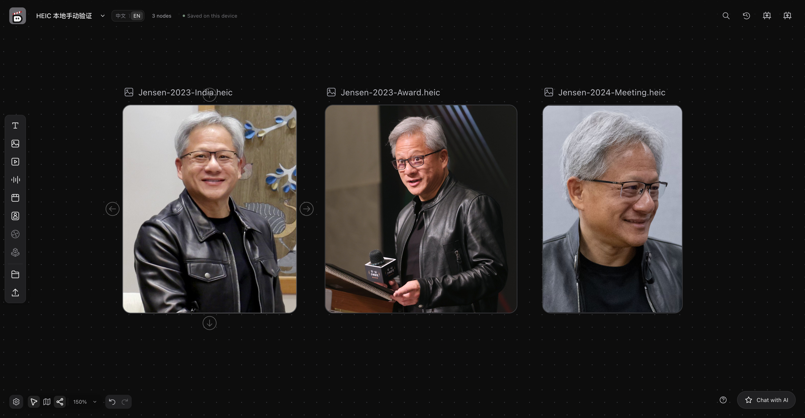
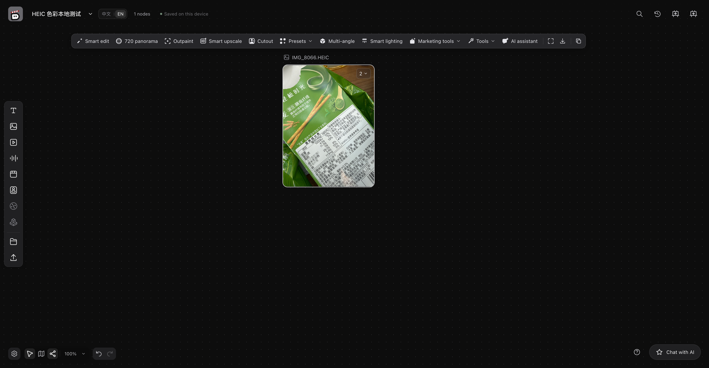
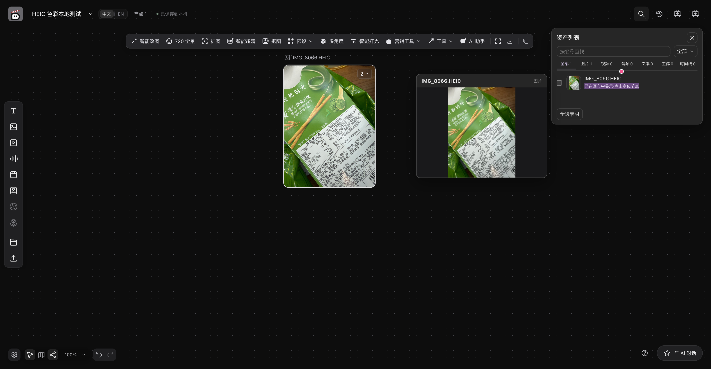
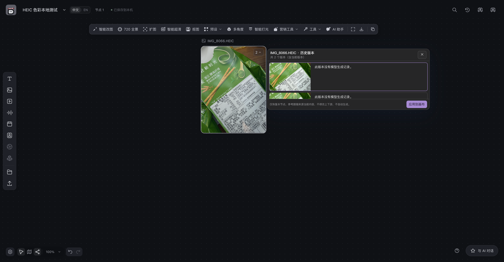

# 开发验证指南

本文件维护可复现的检查入口和证据规则，不保存随版本失效的累计通过数量。启动说明见 [根目录 README](../../README.md)，交付门槛见 [发展路线](roadmap.md)。

## 环境与基本命令

在仓库根目录执行。Node.js 版本见 [`.nvmrc`](../../.nvmrc)，前端依赖见 [`package.json`](../../package.json)，Python 依赖见 [`requirements.txt`](../../requirements.txt)。使用自己的虚拟环境，不依赖其他开发者的绝对路径或相邻仓库。

```sh
python3 -m venv .venv
.venv/bin/python -m pip install -e ".[test]"
npm exec --no -- opencode --version

npm test
.venv/bin/python -m pytest tests -q
.venv/bin/lint-imports
npm run build
npm run check:i18n
.venv/bin/python scripts/generate_contracts.py --check
```

内置 Agent 安装验证必须实际执行上述 OpenCode 版本命令，不能只检查文件存在。不要跳过 `opencode-ai` 的安装脚本；若依赖安装不完整，在仓库根目录重新执行 `pip install -v -e .`；安装钩子会运行 npm 安装、前端构建和 OpenCode 版本校验。

`tests/test_native_runtime.py` 默认使用 CLI 和技能发现替身检查新会话、恢复会话及工程写入。真实 bundled OpenCode 集成测试需设置 `OPENDIRECTOR_REAL_CLI=1`；它使用模拟模型服务，不调用付费模型，在独立进程中限制运行时间，超时输出阶段和线程堆栈并终止跟踪到的 CLI 进程。Linux 上的故障注入还检查超时后进程已退出，其他平台的进程树清理需要相应平台验证。安装验证仍须运行上述版本命令。

Release checks runs these real CLI cases in a dedicated `Bundled OpenCode model gateway regression` step with `OPENDIRECTOR_REAL_CLI=1`. This uses local mock models and must verify final text, tool-result continuation, request counts, persisted assets and session resumption, not merely HTTP 200 or process startup. Gateway tests must also distinguish a properly terminated HTTP body from interrupted streaming and cancellation. Fresh Default `hello` cases exercise plain and reasoning streams through the actual bundled runtime, require exactly one provider request (including auxiliary calls), no native or business tool calls, and the complete reply on disk. The runtime tool surface remains enabled; model replies are simulated.

Windows 使用对应虚拟环境的 Python 路径。涉及真实媒体探测、工具处理或对应测试时，需要 PATH 中的 `ffmpeg` 和 `ffprobe`；视频处理使用 `libx264` 编码器，可通过 `ffmpeg -encoders` 检查是否包含它。不因纯文档修改而运行全部生成或媒体测试。

macOS 使用 README 中的 `python3.12` 环境准备命令，避免误用系统旧版 `python3`。安装验证需使用全新源码目录、新建 `.venv` 和 `pip install -e .`；构建由 pip 钩子执行，然后通过正式 `serve` 入口检查页面、上传、刷新与服务重启恢复。wheel 与 editable 的隔离验收见 [Python 安装与发布](packaging.md)。实测边界见 [macOS 安装验证记录](macos-install-validation.md)。

前端测试、Python 测试、契约生成检查和构建分别验证不同边界，任意一项不能替代其他相关检查。修改契约时同步更新自动生成文件，再执行一致性检查，不手工维护第二份契约。`scripts/generate_contracts.py` 同时写出 `src/contracts/ruleFacts.generated.ts`。共享的比例、时长、字节上限和菜单推导以 `packages/core/src/opendirector/domain/rule_facts.py` 为准。

Consult the [development lessons](lessons.md) when selecting relevant scenarios, and verify against the current code and tests. For model capability or parameter changes, trace representative input from the entry point through backend validation to the provider request, and check that rejected input does not create a job. For imports, references, navigation, or asynchronous tasks, inspect persisted identities and actual execution inputs after conversion or recovery.

## PR 前轻量静态检查 / Lightweight checks before a PR

静态工具独立安装，不需要安装应用、模型、ffmpeg 或浏览器。使用 Python 3.11+；Windows 可将下方 `python` 替换为 `.venv/Scripts/python.exe`。在仓库根目录执行：

Install the static tools separately with Python 3.11+; no application, model, media or browser dependencies are needed. On Windows, use `.venv/Scripts/python.exe` as appropriate. Run from the repository root:

```sh
python -m pip install -r requirements-static.txt
python -m pre_commit install
```

安装 hook 后，正常 `git commit` 会对暂存文件运行 [统一配置](../../.pre-commit-config.yaml)。失败会阻止提交；空白、换行和文件结尾检查可能自动修改文件，需审阅修改并重新暂存、提交。首次运行需要联网安装隔离的 hook 环境；actionlint 的 Go 工具链由 pre-commit 管理，首次初始化不代表后续检查耗时。不会运行单元测试、构建、ready 或真实服务调用。

Once installed, the hook checks staged files on normal `git commit`. Failures block the commit. Whitespace and line-ending hooks may fix files; review and stage the fixes before committing again. The first run needs network access to initialize isolated hook environments, including pre-commit's managed Go toolchain for actionlint. Initialization time is separate from warm check time. These hooks do not run tests, builds, ready suites or real services.

提出 PR 前，先提交全部拟交付的修改，再更新目标分支引用并检查整个 PR 差异，避免只检查最后一次提交。以下以本仓库的 `upstream/main` 为例；如果目标远端名为 `origin`，相应替换远端与引用。用户和 agent 使用相同命令，检查失败或自动修改文件时先修复、重新提交并重跑：

Before opening a PR, commit all intended changes, fetch the target branch and check the entire PR diff rather than only the last commit. Replace `upstream` with `origin` if that is your target remote. Users and agents use the same command; fix failures or automatic edits, commit again, and rerun:

```sh
git fetch upstream main
python -m pre_commit run --from-ref upstream/main --to-ref HEAD
```

该范围命令检查 merge-base 到 HEAD 的已提交差异，不包含未提交文件。提交前可用 `python -m pre_commit run --files path/to/file` 提前检查；`python -m pre_commit run --all-files` 用于显式全仓审计，不要求本 PR 批量重排历史文件。配置变更后建议执行全仓审计，记录既有失败，不能把仅检查配置文件通过解释为已有代码全部合规。

The range command checks committed changes from the merge base to HEAD, excluding uncommitted files. Use `python -m pre_commit run --files path/to/file` for an early check or `python -m pre_commit run --all-files` for an explicit repository audit. Configuration changes should be audited against all files, recording existing failures; a passing config-only check does not establish repository-wide compliance. This change does not require bulk reformatting historical files.

检查包括 YAML/JSON/TOML 与 Python 语法、合并冲突标记、Python 调试语句、文件结尾与混合换行、尾随空格，以及 GitHub Actions workflow 语法。Markdown 保留双空格硬换行。actionlint 不调用可选 shellcheck/pyflakes，避免额外平台工具依赖。未引入 GPU/CUDA、Buildkite、模型专用检查、提交签名改写或全仓类型/风格迁移。

Checks cover YAML/JSON/TOML and Python syntax, conflict markers, Python debug statements, file endings, mixed line endings, trailing whitespace and GitHub Actions workflow syntax. Markdown hard line breaks are preserved. actionlint disables optional shellcheck/pyflakes integrations to avoid extra platform toolchains. GPU/CUDA, Buildkite, model-specific checks, commit sign-off rewriting and repository-wide typing/style migrations are excluded.

本地 hook 可未安装或被绕过，不能保证阻止 GitHub 上所有 PR 的创建。PR 与 main push 的 Release checks 在独立 static job 中安装 `requirements-static.txt` 并执行同一配置。PR 检查 base 到测试用合并提交的差异，push 检查 before 到 HEAD 的差异；只有需要范围比较的 static checkout 拉取完整历史，其他 job 保持浅克隆。手动或首次 push 的全仓审计无需完整历史。

Local hooks can be absent or bypassed. PR and main Release checks run the same configuration in a separate static job. PRs compare base to tested merge HEAD; pushes compare before to HEAD. Only the static checkout needing a range comparison fetches full history; other jobs use shallow checkouts. Manual/initial-push full-file audits do not need full history.

静态通过后并行运行 Python（导入、契约、全量 pytest、bundled OpenCode 回归）、前端/构建/wheel 和浏览器检查。浏览器 isolated、voice、assistant 分为三个独立 matrix job，`fail-fast: false`，一条失败不取消其余旅程。每个 runner 独立安装依赖，复用现有 pip/npm 缓存；这会增加 runner 分钟数，墙钟耗时改善须以实际 CI 为准。

After static success, Python (imports, contracts, full pytest and bundled OpenCode), frontend/build/wheel and browser checks run in parallel. Browser isolated, voice and assistant journeys use separate matrix jobs with fail-fast disabled. Each runner installs its own dependencies using existing pip/npm caches. This increases runner minutes; wall-clock improvements require actual CI measurements.

最终 `checks` 汇总 job 保留现有必需检查名称，并始终读取各检查线结果；任何失败、取消、意外跳过或缺失回执均失败。只有调用方显式关闭静态检查时，static 的 skipped 才允许通过。静态失败不会启动重测试，但最终汇总仍失败，不能把依赖跳过误判为通过。

The final `checks` aggregate preserves the existing required-check name and always evaluates all lane results. Failure, cancellation, unexpected skips or missing receipts fail closed. A skipped static job is allowed only when the caller explicitly disabled static checks. Static failure prevents heavy test jobs from starting and still fails the aggregate.

可复用工作流的 `static-checks` 默认关闭，由 `ci.yml` 开启；nightly 不新增重复静态检查。CI 不提交自动修复：hook 修改文件视为失败，需在本地修复。当前静态 job 上限 10 分钟，Python、前端和每个浏览器 job 各 30 分钟，汇总 job 5 分钟；这是各 job 的限额，不是整个工作流的总上限。当前仍跑全量，暂不采用 PR ready 子集的 15 分钟目标；待子集切换或并行运行有足够耗时证据后再收紧。

The reusable workflow's `static-checks` defaults to false and is enabled by `ci.yml`; nightly adds no duplicate static pass. CI never commits automatic fixes. Static has a 10-minute timeout; Python, frontend and each browser job have 30 minutes; the aggregate has 5 minutes. These are per-job limits, not a workflow-wide deadline. Full suites still run, so the 15-minute PR-ready target is deferred until subset activation or sufficient timing evidence from parallel runs.

## Python 分层与迁移 / Python layers and transition

### 耗时证据 / Timing evidence

Python CI 为全量套件和独立 bundled OpenCode 回归分别保存 JUnit XML、`--durations=50` 日志，以及 `--ci-profile` 生成的 JSON/Markdown；从运行的 `python-test-evidence-<attempt>` artifact 下载，保存 14 天。JSON 记录 SHA、系统、Python/pytest 版本、筛选条件、逐用例 setup/call/teardown 耗时、结果、显式层级与未标记默认归属，不记录 stdout、失败正文或局部变量。

Python CI saves separate JUnit XML, `--durations=50` logs and opt-in `--ci-profile` JSON/Markdown for the main suite and bundled OpenCode regression. Download `python-test-evidence-<attempt>` from the run; retention is 14 days. JSON records SHA, OS, Python/pytest versions, selection, per-test setup/call/teardown timings, outcomes, explicit layers and transitional defaults. It excludes stdout, failure text and local variables.

```sh
python -m pytest tests -q -ra --durations=50 --junitxml=test-results/python.xml --ci-profile=test-results/python.json
```

先按关键能力确定 PR 必留代表用例，再审查最耗时模块的完整矩阵是否适合 merge；慢不是移走的充分理由，flake 也不是扩大 nightly 的充分理由。用例在模块级和函数级只能有一个有效 CI mark；冲突会在报告中显示为 `conflict`，不自动替调用方改标记或改变 pytest 筛选。

First identify mandatory PR representatives for each critical capability, then review costly modules for broader merge coverage. Slowness alone does not justify moving a test, nor does flakiness justify removing essential regression coverage. Conflicting module/function layer marks appear as `conflict` in the report; profiling never rewrites marks or changes pytest selection.

[`tests/ci_ready_contract.json`](../../tests/ci_ready_contract.json) 维护 PR 代表用例：命令重放与版本冲突、提交恢复、Agent 授权、素材范围、参考版本、生成采用、编辑锁、撤销重做、时间线发布、真实媒体校验和共享契约；浏览器另保留 MP4 导出 gate。这是最低保护清单，不等于其他未列出用例都可以移走，也不能代替完整 UI/Agent 或视频输出验收。

[`tests/ci_ready_contract.json`](../../tests/ci_ready_contract.json) owns the minimum PR representatives for replay/conflicts, recovery, agent authorization, asset scope, reference versions, adoption, editing locks, undo/redo, timeline publication, actual media validation and shared contracts, plus browser MP4 export. It is a minimum floor, not permission to move every unlisted test or a substitute for complete UI/agent and output acceptance.

```sh
# Full collection only: verify selection accounting without claiming execution.
python -m pytest tests --collect-only -qq --ci-profile=test-results/inventory.json
python scripts/ci/check_test_layers.py --profile test-results/inventory.json
# After a completed full run: also require all PR representatives to have passed.
python scripts/ci/check_test_layers.py --profile test-results/python.json --require-executed
```

分层核对要求完整、无 `-m` / `-k` 的 `tests/` 清单，校验所有 ID 唯一、三层无重叠且未标记归 ready、每项代表仍存在且属于 ready，并核对导出脚本仍在浏览器 gate。只有要求执行证据时才把代表用例的 skip / 未执行判为失败。当前 CI 对默认全量调用运行该核对；后续切换子集时必须保留独立的完整收集核对，不能拿子集清单证明全量覆盖守恒。

The audit requires a full tests/ inventory without `-m` or `-k`, rejects duplicate/missing IDs and overlapping marks, retains unmarked cases in ready, checks each representative and the export browser gate. Requiring execution evidence also rejects skipped/unexecuted representatives. CI audits the current full/default invocation; future subset activation must retain a separate full-collection audit rather than claim whole-suite conservation from a subset.

只用 `complete: true`、`exit_status: 0` 且平台、运行阶段和环境可比的样本分析正常耗时；保留失败和不完整样本作诊断，不把它们当成提速证据。全量和独立 CLI 回归分开分析，不能把同一用例的 skip 与另一次执行混为一条。安装耗时从 CI 步骤读取，不包含在 pytest 的模块累计时间里。被硬超时终止的运行可能只留下 `complete: false` 的初始清单，甚至来不及上传，不能按零耗时计算。

Use complete, successful profiles with comparable platforms, phases and environments for normal timing analysis. Retain failed/incomplete samples for diagnosis, never as speedup evidence. Analyze the main suite and dedicated CLI run separately; do not conflate a skip in one with execution in the other. Installation time comes from CI steps, outside pytest module totals. Hard timeouts may leave only an incomplete inventory or prevent upload entirely; missing measurements are never zero-time results.

CI 层 mark 在 `pyproject.toml` 注册为 `ready`、`merge`、`nightly`。它们与 `requires_ffmpeg`、`requires_posix` 能力门禁不同；目录名不是 mark，浏览器 lane 仍只由 manifest 定义。每个用例至多属于一个 CI 层；模块级 mark 与函数级 mark 会累加，不能用函数 mark 覆盖模块 mark。

CI-layer marks are registered in `pyproject.toml`: `ready`, `merge`, `nightly`. They are separate from capability gates such as `requires_ffmpeg` and `requires_posix`. Directories are not marks; browser lanes remain owned by the manifest. Assign at most one CI layer per test: function marks accumulate with module marks rather than replacing them.

`release-checks.yml` 接受 `python-mark-expression` 字符串，通过环境变量作为单个 `-m` 参数传给 pytest，不作为 shell 代码执行。默认空值保留全量；本阶段 PR、main 和 nightly 的调用均保持默认，尚未减少任何现有测试。后续必须在合并队列完整门禁可用后，才切换 PR 子集并移除 main 重跑。

`release-checks.yml` accepts a `python-mark-expression` string, passed through an environment variable as a single pytest `-m` argument, never evaluated as shell code. Empty selects all tests; PR, main and nightly callers currently keep that default. No existing test coverage is removed. Switching PRs to a subset and removing main reruns requires a functioning full merge-queue gate first.

```sh
# Current default / 当前默认：full collection, existing skip gates still apply
python -m pytest tests -q -ra -m ""
# Future PR selection / 后续 PR 筛选：unmarked tests remain ready during migration
python -m pytest tests -q -ra -m "ready or (not merge and not nightly)"
# Future full pre-merge gate / 后续合并前完整门禁
python -m pytest tests -q -ra -m "not nightly"
# Future nightly-only selection / 后续 nightly 专属筛选
python -m pytest tests -q -ra -m nightly
```

初始分类：CLI 安装发现的确定性测试为 ready；native runtime 子进程/网关集成为 merge；显式安装的 DeepSeek/JiuwenSwarm 引擎和媒体验收为 nightly，原有环境变量 skip 保留。bundled OpenCode 使用本地模拟模型的独立回归步骤继续运行，不因 mark 改变。其他未标记用例留在迁移 ready 子集中；watchlist 原样保留，不能从一个示例模块推断整个套件已完成分类。

Initial classification: deterministic CLI discovery is ready; native-runtime subprocess/gateway integration is merge; opt-in installed DeepSeek/JiuwenSwarm engine and media acceptance is nightly, retaining existing environment skips. The dedicated bundled OpenCode regression against a local mock model remains unchanged regardless of marks. Unmarked cases stay in the transitional ready subset and the flake watchlist is unchanged; these initial modules do not establish completed suite-wide classification.

## 按风险选择验证

| 修改范围 | 应核对的重点 |
| --- | --- |
| 业务规则、参考及上传 | 实际类型、字节预算、来源身份、跟随与固定、拒绝后状态不变 |
| 中英界面与后端错误 | 中英文键集合一致、`check:i18n` 通过、切换语言无需刷新、英文界面无中文且中文界面无硬编码英文、新增后端错误与目录项双语、`document.documentElement.lang` 随语言变化 |
| 存储与版本 | 幂等、对象冲突、写入中断、重启恢复、回执与事件一致 |
| 生成与工具任务 | 接受、排队、取消、未知提交、恢复、固定输入和候选采用 |
| 编辑器与时间线 | 结构往返、素材保护、重开续编、真实文件播放及导出 |
| UI 与 Agent 接入 | 相同意图的业务结果一致，交错编辑和草稿保留 |
| 交互与同步 | 真实拖动、缩放、焦点、锁定、重复事件和断线恢复 |
| 性能 | 固定素材和手势下比较帧延迟、长任务、内存或 CPU 数据 |
| 文档 | 链接、命令与文件路径正确，依赖文件随仓库交付 |

## 隔离浏览器验证

[`tests/browser/creation_server.py`](../../tests/browser/creation_server.py) 提供临时项目和模型替身，支持 [`scripts/verify_creation_browser.mjs`](../../scripts/verify_creation_browser.mjs) 等浏览器检查。测试必须使用隔离服务，不指向用户工程或真实付费模型。

分别启动 API 和 Vite：

```sh
# 终端一：夹具自动创建隔离临时目录
.venv/bin/python tests/browser/creation_server.py --port 8019

# 终端二：将前端请求代理到夹具
OPENDIRECTOR_API_URL=http://127.0.0.1:8019 npm run dev -- --port 5179
```

然后运行检查：

```sh
CREATION_WEB_URL=http://127.0.0.1:5179 CREATION_API_URL=http://127.0.0.1:8019 \
  node scripts/verify_creation_browser.mjs
```

同一套隔离服务下的浏览器检查：

```sh
node scripts/verify_creation_browser.mjs       # UI/API 主流程与重载
node tests/browser/reference_reconnect.mjs     # 参考连线删除后重连
node tests/browser/context_menu_dismissal.mjs  # 右键菜单关闭
node tests/browser/mp4_export.mjs              # 合成 MP4（WebCodecs + 软件 AAC）
node tests/browser/new_image_node_outputs.mjs  # 新建图片节点采用所选适配器的比例与尺寸
```

`mp4_export.mjs` 以 640x360 渲染：没有 GPU 的无头浏览器只在该尺寸暴露 H.264
编码能力，1080p 导出仍需在桌面浏览器人工验收。

脚本需要可导入的 Playwright 模块和 Chromium。按脚本约定通过 `PLAYWRIGHT_MODULE`、`CHROMIUM_PATH` 指定本机安装；它们不是所有环境中默认可用的项目依赖。以上环境变量语法适用于 POSIX shell，其他终端使用对应设置方式。测试使用的工程入口和前置条件以脚本为准。

每个浏览器脚本都用 `browser.newPage({ locale: "en-US" | "zh-CN" })` 固定页面语言：界面在没有保存偏好时跟随浏览器语言，不固定就会在英文 CI 环境里等中文文案。`npm run check:browser-locale` 检查这条约定，CI 在启动浏览器任务前执行。`npm run test:browser` 按固定顺序运行整套浏览器清单，单个脚本失败也会继续执行其余脚本，最后集中报告失败项。

页面语言也可以用 `addInitScript` 写入 `opendirector.locale.v1` 偏好：应用优先使用已保存的偏好，语言同样确定，`check:browser-locale` 认可这种写法。

等待异步保存时，不要用会改名的按钮判断编辑器是否关闭：保存中的按钮会变成 `Processing…` 或 `Applying…`，locator 匹配不到元素时 `waitFor({ state: "hidden" })` 立即满足，测试会在确认回执到达前继续，随后 reload 恢复未确认的草稿。改为等编辑器对话框 detach 或服务端回执出现；图层编辑器的这一等待封装在 [tests/browser/layerApply.mjs](../../tests/browser/layerApply.mjs)。

AI 多会话检查使用同一隔离 API，但启动 `creation_server.py` 时额外传入 `--assistant-fixture`，再运行 `node tests/browser/assistant_sessions.mjs`。该检查通过真实 UI、接口与项目文件验证新建、历史搜索、切换、草稿和附件恢复、刷新、失败重试及输入撤销隔离；仅模型回复使用可暂停的替身，不调用真实模型。同一环境下运行 `node tests/browser/assistant_run_navigation.mjs`，验证回复进行中切换项目只断开当前视图：Agent 继续运行，返回后重新接入并收到完整回复，全程不调用停止接口；切走再返回后显式停止仍然有效。

聊天与辅助面板共存检查运行 `node tests/browser/assistant_auxiliary_panels.mjs`，同样需要 `--assistant-fixture`。它通过真实界面切换中英文，在宽窄窗口和助手调整宽度后检查资产列表、生成历史的可操作性与聊天展开状态，并验证草稿、对话和执行中的回复／生成任务保持。可设置 `CREATION_SCREENSHOTS` 保存代表性截图。此检查会控制隔离服务的模型替身 gate，应与其他使用同一 gate 的浏览器用例顺序运行。

Release checks 的 `Assistant auxiliary panels` 阶段自动运行此检查，使用独立的隔离 API 与前端端口；失败时输出对应服务日志。

## Nightly 检查

[`nightly.yml`](../../.github/workflows/nightly.yml) 在 `main` HEAD 上按 `0 18 * * *` UTC（次日凌晨 02:00 Asia/Shanghai）运行，支持 `workflow_dispatch` 手动触发；发布前可对候选 SHA 手动重跑同一套。它与 PR 门禁共用可复用的 [`release-checks.yml`](../../.github/workflows/release-checks.yml)（Release checks 唯一实现，PR 与 nightly 不允许出现第二份漂移副本）；静态门禁通过（或调用方明确关闭）后，各测试线独立运行；汇总 job 统一判断，不因一条测试线失败而隐藏其他测试线结果。

### 五级测试体系

自动化检查按级别分层：每个级别明确范围与重点、触发频率、时间预算和实现位置。新增检查先选择级别再进入对应工作流；超出预算时先调整级别或拆分，而不是让某个级别无限增长。

| 级别 | 范围与重点 | 频率 | 预算 | 实现 |
| --- | --- | --- | --- | --- |
| L1 单元、静态与构建 | 前端单元测试、Python 单元套件、双语词条检查、浏览器清单检查、分层导入检查、契约一致性、生产构建 | 每个 PR；push 到 main | static ≤10 min；Python / 前端各 ≤30 min | Release checks 的 static、python、frontend 检查线 |
| L2 浏览器 E2E（模型替身） | 隔离服务与模型替身下的核心旅程：画布、参考、导出、助手、时间线 | 每个 PR；push 到 main | 每个浏览器 job ≤30 min | Release checks browser matrix：isolated、voice、assistant |
| L3 main HEAD 复核与扩展覆盖 | 与 L1+L2 相同门槛在 main HEAD 重跑（gate parity）；Python 套件失败分类与已知时序敏感用例观测（flake triage）；PR 门禁未覆盖的全部浏览器脚本（extended） | 每晚定时；发布前可手动触发 | gate parity 与 L1+L2 相同；extended ≤60 min | nightly 的 gate-parity、pytest-flake-triage、browser-extended |
| L4 生产构建、性能与输出 | 以生产构建（`vite preview` 服务 `dist`）运行核心旅程；MP4 落盘后 ffprobe 校验时长、流与帧数；帧延迟、长任务诊断采样与 CPU profile。同一次 nightly 之后另跑固定可对比基准（存储微基准 + 复用上述采样） | 每晚定时；发布前对候选 SHA 手动触发 | production ≤45 min；perf ≤30 min；daily benchmark ≤30 min | nightly 的 browser-production、perf-outputs、daily-benchmark |
| L5 稳定性与恢复（规划中） | 进程中断重启、工程重开恢复、长时运行稳定性；需要新的场景编写 | 每周；发布前 | 待定 | 未建设，作为后续工作跟踪 |

L1–L4 的自动检查不调用付费模型、不依赖真实服务；真实凭证与真实模型的验收属于需要明确授权的范围，不纳入本体系的自动执行。建议性结论与阻断性结论的边界见下节；已知失败模式的解读见 [CI 失败模式](ci-failures.md)。

### 发布决策与 lane 政策

- Gate parity 绿色是候选 `v0.1.x` 的发布门槛；nightly 不自动打 tag，也不以任何结果自动触发发布动作。
- Extended、production、perf 与 daily benchmark lane 当前为建议性（advisory）：失败需登记跟进，但不单独阻断发布。某条 lane 连续两周稳定绿色后，由发布协调人决定是否升级为阻断项。
- 每次运行产出 `nightly-summary`（各 lane 结果 + SHA + 基准一行摘要）与 `nightly-perf`（渲染探针与拖拽采样）artifact；发布看板与失败通知按 summary artifact 对接，通知通道由发布协调人约定。`lanes.dailyBenchmark.notify` 只在超阈回归、基准套件本身失败或必填测量缺失（样本解析成功但缺少 `--ui-required` 时应有的帧采样，或 storage 样本缺少必填字段）时为 true，改善和阈值内波动不通知。
- `flaky-watchlist.txt` 一行一个 pytest node id，`#` 为注释；用例稳定后应删除条目，而不是长期静默重试。triage 结论写入 `flake-report` artifact 与 Actions summary。

### 脚本登记与 lane 归属

[`tests/browser/manifest.json`](../../tests/browser/manifest.json) 是浏览器脚本 lane 归属与运行要求的唯一来源：`gate`（PR 门禁）、`extended`（nightly 普通隔离服务）、`extendedFixture`（nightly 独立 fixture 服务）、`production`（生产构建，要求 `previewSafe`）、`perf`（性能与输出验证）、`manual`（需要可见桌面或独立平台 wheel 的人工触发验收）。`npm run check:browser-manifest`（Release checks 独立步骤）校验磁盘与清单一一对应、fixture 与 previewSafe 声明与源码一致、manifest 的 gate 集合与 release-checks.yml 实际调用一致；nightly 从清单派生各 lane 列表。新增浏览器脚本登记清单即可，不修改工作流列表。

`mp4_render_probe.mjs` 与 `reference_drag_performance.mjs` 需要导入 `/src/*.ts`，只在 dev server 上运行；`vite preview` lane 只运行不导入 `/src` 的脚本。需要 `--assistant-fixture` 的浏览器脚本不属于普通隔离服务阶段。

### 每日可对比基准

`daily-benchmark` 在同一次 nightly 的 `perf-outputs` 之后运行，不重跑浏览器，也不进入发布门槛。固定场景与阈值在 [`scripts/nightly/benchmark.json`](../../scripts/nightly/benchmark.json)：

- `cold-open` 与 `delete`：`--commits 600 --nodes 200`（#180 验收规模）。
- `catalog`：`--projects 200`，每个额外工程 3 个节点，使 `list_projects` 测的是目录成本而不是再放一份 600 提交历史。
- UI：复用本 run 的 `nightly-perf`（`reference_drag_performance.mjs` 的 pan/node `frameP95`，以及渲染探针采样）。[`ui-performance.md`](ui-performance.md) 的 100 ms / 500 ms 预算只作阅读对照，不是这条 lane 的失败线。

比较规则：每个指标越低越好。已写入 `baseline.metrics` 时，相对基线判断回归，一行摘要仍同时给出相对上一次的百分比；基线为空时，以上一次 nightly 的 `daily-benchmark` artifact 为参照（距本次 12–36 小时记为 yesterday，否则记为 previous）。只有同时超过 `regressionRatio`（1.5）和该指标的 `minDeltaMs` 才算回归。套件跑不起来同样 `notify: true`。渲染探针的通过与否仍由 perf-outputs 负责，不在这里重复失败。

不要把开发机计时抄进 `baseline.metrics`。基线应来自 nightly 的 `ubuntu-22.04` artifact。在基线写入之前，摘要写明 `baseline unseeded`。

产物为 artifact `daily-benchmark`（`daily-benchmark.json`）。`nightly-summary.json` 的 `lanes.dailyBenchmark` 带上同一行 `summary` 和 `notify`，供现有 summary 通知路径使用。

## 证据记录

在 PR 或专题验收记录中写明：

- 所验证的代码版本、变更范围和运行环境。
- 实际执行的命令、场景、退出结果及必要日志。
- 使用模型替身还是真实服务，是否验证真实媒体文件。
- 未覆盖范围、已知限制和失败原因。
- If a relevant check also fails on the baseline, record the baseline revision and comparison result, and link an existing issue or create one when appropriate. A baseline failure does not mean the check passed.
- 性能比较的素材、操作、基线及测量方式；没有可比测量时不报告提升比例。

“节点出现”“引用标签显示”“文件下载成功”不能单独证明执行输入正确、结构已保存或媒体可用。关键检查应关联持久化对象、输入快照和实际输出。日志不得包含密钥、用户私有素材或开发机临时路径作为他人的必需依赖。

## v0.1.0 已验证范围与已知限制

以下结论来自 `main` 上的实际执行，未验证的部分明确列出，不用推测代替证据。

**已验证**

- Linux（Ubuntu 22.04.5）、Python 3.12、Node 24.22.1、FFmpeg N-128227：`npm ci`、
  `npm run build`、`serve`、`pytest tests`（937 passed）、`npm test`（411 passed）。
- 隔离浏览器检查：`verify_creation_browser.mjs`、`reference_reconnect.mjs`、
  `context_menu_dismissal.mjs`、`mp4_export.mjs`，Chromium 145 与 Chrome 156 均通过。
- MP4 合成产物经 `ffprobe` 复核：`h264 640x360` + `aac 48000 Hz stereo`，2.0 秒
  时间线输出 2.027 秒。
- 本地服务边界：仅监听 `127.0.0.1`；缺少 `X-OpenDirector-Request` 的请求返回 403。

**已知限制**

- **1080p MP4 导出需要桌面浏览器人工验收**。无 GPU 的无头浏览器只暴露
  640x360 的 H.264 编码能力（`VideoEncoder.isConfigSupported` 在 1280x720 与
  1920x1080 均为 false），自动化检查因此固定为 640x360。
- **真实模型端到端验收未执行**：需要可访问的模型端点或 GPU 授权，当前环境不具备。
- **本节历史验收仅覆盖 Linux + Chromium/Chrome**；后续 Apple Silicon macOS 的安装与基础使用验证见 [独立记录](macos-install-validation.md)，不能据此推断 Intel Mac、Firefox 或 Safari 已验证。
- **故障注入未覆盖**：进程级重启打断进行中的生成、浏览器写盘失败，仅有测试替身级别的覆盖。
- 模型密钥以明文保存在本地 `models.json`（POSIX 下目录 `0700`、文件 `0600`），
  接口响应不返回密钥；这是本地优先的取舍，不是加密存储。

### MiniMax 官方视频适配

```sh
python -m pytest tests/test_minimax_video.py tests/test_vllm_omni_h3.py tests/test_generation_errors.py -q
node --test tests/creationParameters.test.ts
node tests/browser/minimax_h3.mjs
node tests/browser/first_last_frame_connections.mjs
```

浏览器用例沿用本文的隔离 API／Vite 环境，只验证模型配置、真实图片、首尾帧引用、槽位修改及重载，不调用官方服务。`first_last_frame_connections.mjs` 不操作首尾帧选择器，只在画布上依次拖线连接两张图片，核对声明尾帧的模型自动填入首帧与尾帧、项目保存对应的引用角色，并在重载后保持。Python 用例使用真实素材和 HTTP 替身验证协议、冻结输入、恢复不重复提交、错误回执和无鉴权 CDN 下载，不能代替真实账户生成验证。

### 提供商与模型设置

HEIC/HEIF imports and MiniMax H3 image editing:

```sh
PYTHONPATH=packages/core/src:apps/api/src .venv/bin/python -m pytest tests/test_heif.py tests/test_minimax_image.py tests/test_creation_assets.py -q
node tests/browser/heif_import.mjs
```

The browser script uses the isolated API and Vite above. It checks real HEVC-encoded
HEIC/HEIF fixtures through upload and mixed-format drag and drop, oriented pixels,
project reload, both display languages, corrupt/oversized upload rejection, original
downloads and canvas archive round trips, cross-project paste with an unavailable source, and
both MiniMax model submissions with fixture results. Python tests exercise Agent
artifact import and preview, and run the real MiniMax adapter against mocked HTTP through UI
and Agent command sources, checking original bytes, ordered frozen inputs, result
adoption, rejection before submission and request-size limits. These tests do not
call MiniMax, verify model quality, or exercise a live Agent conversation. Camera
HDR profiles and platform wheel installation require separate validation.

HEIF regression coverage also includes conditional browser-image reads (304 without
decoding, while still checking original-file integrity), localized decoder errors,
standalone thumbnail registration, alpha compositing, multi-image rejection and
full-resolution display at the 25-million-pixel limit. Timeline package tests preserve
HEIF bytes and extensions through export/import; the browser check covers FCPXML
media ZIP output and refuses an orphaned preview download in both languages.

HEIC 上传恢复与相机样本 / HEIC upload recovery and camera sample:

```sh
node tests/browser/heif_upload_recovery.mjs
# Optional: download and unpack the review attachment locally first.
HEIF_REVIEW_FILE=/absolute/path/IMG_8066.HEIC node tests/browser/heif_upload_recovery.mjs
```

该脚本可连接上文的隔离 API 和 Vite，也可通过 `CREATION_WEB_URL` 指向 `npm run build` 后的 `npm run preview`（使用相同 `OPENDIRECTOR_API_URL`）。它在中英界面验证普通上传、拖拽、刚创建图片节点的替换上传、图片和视频节点的参考图上传、保存后重开及原始字节。用受控延迟让首次保存回执落在上传期间；注入预览 404 时，必须显示错误、保留已注册原件，且不能创建空白生成节点或误报成功。

This script supports the isolated API and Vite above, or `npm run preview` after a build via `CREATION_WEB_URL` (with the same `OPENDIRECTOR_API_URL`). In both languages it checks upload, drop, replacement in a fresh image node, image/video reference uploads, reopening and original bytes. Controlled delays put the first save acknowledgement inside the upload. An injected preview 404 must report failure and retain the registered original without creating an empty generation item or claiming success.

2026-11-12 使用 [reviewer 提供的 IMG_8066.HEIC](https://github.com/ThinkFlowLab/OpenDirector/pull/287#pullrequestreview-5868923062) 在 macOS 27.2、Chrome 157.0.8103.52 的正式构建上验证：显示尺寸为 3024×4032，保存后重开正常，原件字节不变。另通过可见 Chrome 的系统文件选择器手动导入并刷新验证。原始相机文件和 EXIF 不纳入仓库。受控故障证明了错误处理路径，不能证明 reviewer 当时预览请求失败的具体原因；其他平台及 HDR 色彩准确性仍需单独验收。

On 2026-11-12, the reviewer's linked `IMG_8066.HEIC` was checked in the production build on macOS 27.2 / Chrome 157.0.8103.52: 3024×4032 decoded pixels, successful reopening and unchanged original bytes. Import through the visible Chrome system file picker and refresh were also verified. The original camera file and EXIF are not committed. The injected failure proves the error path, not the cause of the reviewer's preview request failure. Other platforms and HDR color accuracy require separate acceptance.

同日补测 pillow-heif 的两张实拍样本：[小米 `xiaomi.heic`](https://github.com/bigcat88/pillow_heif/blob/master/tests/images/heif_special/xiaomi.heic)（2592×1944）和 [三星 `aux_YCbCr.heic`](https://github.com/bigcat88/pillow_heif/blob/master/tests/images/heif_special/aux_YCbCr.heic)（4000×1848）。两张均通过上述六种模式的中英文检查，显示尺寸与已保存媒体信息一致，原件字节不变；可见 Chrome 中将三张一起导入同一画布并刷新，均正常显示。

Two additional camera samples from pillow-heif passed the same six modes in both languages that day: Xiaomi `xiaomi.heic` (2592×1944) and Samsung `aux_YCbCr.heic` (4000×1848), linked above. Display dimensions matched persisted media facts and original bytes were unchanged. All three photos were also imported into one canvas through visible Chrome and remained visible after refresh.

本地补充手动测试：三张 HEIC 图片导入同一画布，保存并刷新后正常显示。

Additional local manual test: three HEIC images imported into one canvas remain visible after saving and refreshing.



HEIF 色彩配置回归 / HEIF color-profile regression:

```sh
PYTHONPATH=packages/core/src:apps/api/src .venv/bin/python -m pytest tests/test_heif.py tests/test_creation_assets.py tests/test_tool_tasks.py -q
```

2026-11-12 按 [P3 review](https://github.com/ThinkFlowLab/OpenDirector/pull/287#pullrequestreview-5870014881) 复核发现两条独立路径丢失 ICC：素材库 JPEG，以及资产预览、版本历史和 Agent 预览使用的 WebP。修复后，`IMG_8066.HEIC` 的 536 字节 Display P3 配置在浏览器 PNG、WebP 和 JPEG 中均与原件完全相同。PNG 保持 3024×4032（14,103,756 字节）；360×480 WebP 为 43,812 字节，JPEG 为 51,744 字节。原件下载字节不变；浏览器 PNG 的 ETag 升级，旧预览缓存会重新获取，新缓存继续支持 304。新增用例覆盖带／不带配置的 HEIC、通用 HEIF 和灰度转换；125 项相关测试通过。灰度等非 RGB 像素转换后不继续附带原通道配置，这不是通用色彩空间归一化。

The P3 review above exposed two independent ICC omissions: library JPEGs and the WebP used by asset previews, version history and Agent previews. After the fix, the sample's 536-byte Display P3 profile is byte-identical in browser PNG, WebP and JPEG. PNG remains 3024×4032 (14,103,756 bytes); 360×480 WebP is 43,812 bytes and JPEG is 51,744 bytes. Original downloads are unchanged; the browser PNG ETag is versioned so old renditions are refreshed while current ones retain 304 support. New cases cover profiled/unprofiled HEIC, generic HEIF and grayscale conversion; 125 focused tests passed. Profiles for non-RGB channels are not retained after RGB conversion; this is not general color-space normalization.

本地可见 Chrome 测试：通过系统文件选择器上传同一张 `IMG_8066.HEIC`，再用“替换素材”重新上传以产生两个真实上传版本；核对画布、悬浮资产预览和版本历史。未调用模型生成。

Local visible-Chrome test: upload `IMG_8066.HEIC` through the system file picker, then upload it again with Replace asset to produce two actual upload versions. Inspect the canvas, hover asset preview and version history. No model generation is involved.





`browser-image` 同时供裁剪、蒙版和图像编辑读取原始像素尺寸，因此本次没有直接将长边限制为 2048；单独的显示缩略版本需要与编辑输入区分。首次全尺寸 PNG 传输仍约 14 MB。没有复验其他平台、HDR 准确性或完整 Python 测试集。

`browser-image` also supplies the pixel dimensions for cropping, masks and image editing, so this patch does not impose a 2048-pixel limit on that shared route. A bounded display rendition must be separate from editing inputs. The first full-resolution PNG transfer remains about 14 MB. Other platforms, HDR accuracy and the full Python suite were not revalidated.

Kling 4.0 protocol and bilingual workflow checks:

```sh
.venv/bin/python -m pytest tests/test_kling_video.py tests/test_generation_errors.py tests/test_model_http_logging.py -q
node --test tests/providerPresets.test.ts tests/modelResolution.test.ts tests/generationFailureText.test.ts
node tests/browser/kling_video.mjs
```

The browser check uses the isolated creation API and Vite described above. It verifies both locales, optional provider setup, preserved model selections, frame slots, image references, persisted project objects, and fixture-generated video adoption. It uses the generic fixture provider and does not exercise Kling's HTTP adapter. Python protocol tests exercise the actual adapter with mocked HTTP and real image/video bytes. Neither check calls Kling or proves account access, billing, or creative quality. Real-service acceptance requires a valid account and a recorded submit/query/download/adopt workflow, including the model ID, API family and exact endpoint, remote task ID, output video, and screenshots or a recording. Do not record API keys.

```sh
python -m pytest tests/test_model_configs.py -q
node --test tests/providerPresets.test.ts
node tests/browser/provider_settings.mjs
```

浏览器用例使用隔离服务验证提供商预设、手动添加、逐模型图片输入能力、保存不推理、已有连接复用及取消草稿。不会向外部提供商发送请求或保存真实密钥。

## 定时文字与可移植时间线

```sh
node tests/browser/timeline_text_editing.mjs   # UI/共用命令、保存重启、冲突/锁、双语与输入草稿
node tests/browser/timeline_text_render.mjs    # 真实字体、像素/时序、文字片尾与音频、取消
node tests/browser/timeline_text_archive.mjs   # UI↔CLI 跨工程包、重启续编、MP4 与交换拒绝
node tests/browser/timeline_text_desktop.mjs   # 独立可见 Chrome：横竖 1080p、2000 条/10 分钟与进程 RSS 采样
node tests/browser/timeline_workflow.mjs      # 原有无文字时间线与真实媒体行为
```

前三个文字脚本各自启动临时项目服务和 Vite，使用独立端口；不要指向真实工程。桌面脚本使用新的测试专用 Chrome profile 和可见窗口，不连接用户浏览器。通过 `PLAYWRIGHT_MODULE`、`CHROMIUM_PATH` 指定已有安装；`TIMELINE_TEXT_EVIDENCE` 可指定桌面输出目录，默认 `test-results/issue87/desktop`。运行前检查脚本顶部的端口环境变量；与其他浏览器用例顺序执行以免相互影响测量。

验收须检查实际 `ffprobe` 编码、尺寸和时长，以及导出帧中的中文、起止帧和重叠层次。640×360 自动化通过不能替代桌面 1920×1080 / 1080×1920。浏览器实际编码能力不足应记录为运行环境限制，不能降尺寸后宣称通过 1080p。2000 条、600 秒测量使用同一媒体、帧率和尺寸的无文字基线，分别报告编辑交互延迟、采样 JS 堆、实际合成耗时及文件大小；JS 堆不是整个浏览器/系统内存，也不是精确的进程峰值。

定时文字验收证据见 [Issue #87 验收记录](issue-87-validation.md)。记录必须明确测试替身、真实文件验证、平台边界和已有基线失败；未完成的桌面、wheel 或跨平台检查不能标为通过。

实际 wheel 验证还须在新的隔离虚拟环境安装构建产物，运行 `scripts/verify_install.py`，然后直接检查已安装服务的 `/fonts/manifest.json`、字体字节和许可证，不能用 Vite 的静态资源代替。可运行：

```sh
OPENDIRECTOR_INSTALLED_PYTHON=/absolute/path/to/wheel-venv/bin/python \
  node tests/browser/timeline_text_installed.mjs
```

该脚本自行启动已安装后端，不启动 Vite；后台 PATH 不包含 Node，浏览器仍使用约定的 Playwright/Chrome 安装。实际创建时间线、添加文字、检查预览及缺字诊断/恢复、保存、重启后重开。桌面性能脚本以 500 毫秒间隔采样该隔离 Chrome 实例通过 CDP 报告的进程 PID：POSIX 使用 `ps` RSS，Windows 使用实际 `GetProcessMemoryInfo` 工作集。总和可能重复计算共享页，并非独占内存或精确瞬时峰值，不含 Python/Vite/Node 控制进程。完整逐次采样保存在 `report.json`；存活进程采样失败会报错，零值仅用于内核确认已退出的 PID。

七组时间线脚本共用仓库中的 `tests/browser/host.mjs` 与 `windows_host.py`，不依赖本机忽略目录副本。源码 `PYTHONPATH` 使用平台分隔符，已安装服务移除源码导入和宿主 PATH；Windows 子进程先挂入本测试的私有 Job Object，再开始执行，清理仅终止该 Job。设置 `PYTHON` 指向 **未打包的 Python.org 虚拟环境**，installed 组另设置 `OPENDIRECTOR_INSTALLED_PYTHON` 指向全新 wheel 环境。Microsoft Store Python 的激活启动器曾在真实检查中留下 Job 外的孙进程，host adapter 会在启动测试应用前明确拒绝该解释器；这是测试宿主的支持边界，不把它改为 skip 或改变产品沙箱。

The seven timeline suites share the tracked host adapter. Source imports use the native path delimiter; installed servers have no source import path or ambient Node PATH. Windows uses a private job and actual kernel working-set samples for CDP PIDs. Set `PYTHON` to an unpackaged Python.org venv and `OPENDIRECTOR_INSTALLED_PYTHON` to a fresh wheel venv. Packaged Microsoft Store Python is explicitly rejected before launching the test application because native tests observed descendants outside job ownership. This is a host prerequisite, not a skipped test or a product sandbox change.

解释器发现顺序为显式 `PYTHON`、工程 `.venv`、PATH 中的 `python3` / `python`。显式路径无效时报错；不会静默换解释器。CI 不必创建 `.venv`，但 PATH 必须提供满足项目版本要求的 Python。

Interpreter discovery uses explicit `PYTHON`, then the project `.venv`, then PATH `python3` / `python`. Invalid explicit overrides fail instead of selecting another interpreter. CI may install Python globally; the interpreter must meet the project's supported version requirement.

MOSS 图像与语音接入使用以下检查。浏览器命令连接本文前述隔离 API 和 Vite；可通过环境变量改用其他端口。

```sh
.venv/bin/python -m pytest tests/test_moss.py tests/test_generation_errors.py -q
CREATION_API_URL=http://127.0.0.1:8019 CREATION_WEB_URL=http://127.0.0.1:5179 node tests/browser/moss_provider.mjs
```

Python 用例使用模拟 HTTP 服务及真实 PNG、MP3，检查请求字段、音色、执行快照、文件探测、工程重开和下载恢复不重复生成。通用错误分类和安全提示由现有错误测试负责。浏览器用例检查两种语言下的提供商及型号列表、获取模型失败的具体原因、音色必填、保存重开和实际音频播放；播放器使用隔离服务的 WAV 替身，不代表 MOSS 已生成语音。真实验收另需有效 MOSS 凭证和音色 ID，并保留实际音频、模型标识及播放器截图。

Zhipu BigModel chat access uses the following checks. Browser commands connect to the isolated API and Vite described earlier in this document. Environment variables can override the ports.

```sh
.venv/bin/python -m pytest tests/test_zhipu.py tests/test_model_configs.py -q
node --test tests/providerPresets.test.ts
CREATION_API_URL=http://127.0.0.1:8019 CREATION_WEB_URL=http://127.0.0.1:5179 node tests/browser/zhipu_provider.mjs
```

The Python cases check how the shared thinking levels map to GLM reasoning_effort. GLM accepts only low, high and max for reasoning_effort. The auto level omits the parameter so the provider default applies, and an unknown level falls back to high as in the DeepSeek branch. Other hosts and the DeepSeek behavior stay unchanged.

The browser case checks both display languages for the provider list and names, canonical URL prefill, GLM model preselection without remote discovery, manual addition of other model IDs, the saved connection reuse hint, save and reopen, key privacy in public model responses, and the assistant agent picker listing and keeping the selected Zhipu model. The browser never contacts open.bigmodel.cn and the API key is always a fixture value. Real streaming conversations, tool call execution and thinking level effects additionally require valid Zhipu credentials. Keep the conversation transcript, tool receipts and screenshots as evidence.

智谱 BigModel GLM-TTS 接入使用以下检查：

```sh
.venv/bin/python -m pytest tests/test_zhipu.py tests/test_voice_library.py tests/test_generation_errors.py -q
# 真实服务验收（会产生费用）：在隔离的 OPENDIRECTOR_ROOT 上启动 opendirector serve 后运行
OPENDIRECTOR_URL=http://127.0.0.1:18238 ZHIPU_API_KEY=... ZHIPU_SAMPLE=/path/to/sample.wav node tests/browser/zhipu_real.mjs
```

Python 用例使用按真实服务响应录制的模拟 HTTP，检查 `/audio/speech` 只请求非流式 WAV 并按 RIFF/WAVE 字节验收（服务默认返回裸 PCM，且部分错误以 HTTP 200 + JSON 返回）、`1113` 余额不足归为额度而非限流、音色库只列出文档中的 7 个预置音色加 `PRIVATE` 复刻音色、复刻前的真实音频校验（mp3/wav、3–30 秒、10 MB）、复刻成功或失败后都删除上传的样本文件、`POST /voice/delete` 删除及重名/不存在的错误映射、试听只从公网 HTTPS 下载且不带凭据，以及统一生成服务的音色预检与执行快照。真实验收需要已充值且开通 GLM-TTS 的 BigModel 账户；保留预置音色与复刻音色生成的实际音频、复刻到删除的完整流程截图，并确认账户中没有遗留的 `voice-clone-input` 文件。


### Voice library / 音色库

The voice browser workflow uses a separate isolated fixture. It runs the real shared voice service, media probing, project storage and generation acceptance with mocked provider HTTP; it does not contact MOSS or a GPU service.

```sh
.venv/bin/python -m pytest tests/test_voice_library.py -q
node --test tests/voiceLibrary.test.ts tests/creationParameters.test.ts
# Terminal 1
.venv/bin/python tests/browser/voice_library_server.py --port 8030
# Terminal 2
OPENDIRECTOR_API_URL=http://127.0.0.1:8030 npm run dev -- --port 5190
# Terminal 3 (Playwright installed as for the other browser checks)
CREATION_API_URL=http://127.0.0.1:8030 CREATION_WEB_URL=http://127.0.0.1:5190 node tests/browser/voice_library.mjs
```

For a slow-response regression, set `VOICE_REOPEN_DELAY_MS=17000` for the browser command. It delays the reopened asset request beyond the ordinary 15-second interaction timeout. Cold navigation, saved-state and reopened-media waits have explicit 45-second limits; HTTP errors still fail immediately with their status. No generation is retried.

慢响应回归：在浏览器命令的环境变量中设置 `VOICE_REOPEN_DELAY_MS=17000`，让重开后的资源请求超过普通交互的 15 秒等待。冷启动导航、保存状态和重开媒体分别有明确的 45 秒上限；HTTP 错误仍立即报告状态并失败，不重试生成。

The bilingual browser workflow covers opening/outside click/Escape, keyboard tabs, four-column and narrow layouts, real previews and unavailable previews, metadata filters, scoped favorites, loading/error/retry, invalid and valid local audio, creation, selection, Drama3 transcript and Nano reference requirements, supported deletion and failure feedback, model/service switching, project reopening and persisted job input. `moss_speech.mjs` is retained as an alias for this integrated workflow. The pagination regression includes a 15,001-voice catalog. With a configured MOSS account, open the library, go to the next page, and return to the first. Verify the page counts and that returning to the first page restores its entries using read-only requests. Python tests verify provider fields, pagination, credentials, account boundaries, actual audio/container/duration validation, and equivalent Agent operations. Actual provider synthesis still requires a configured service, account permission and a recording authorized for use.
