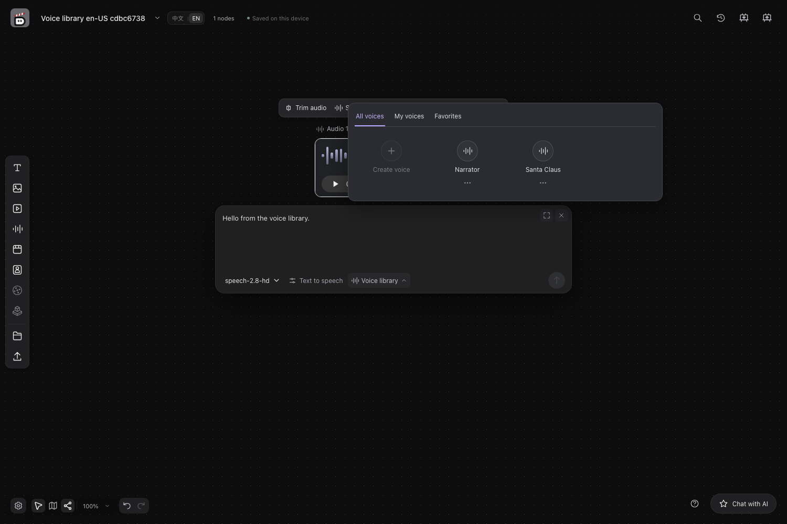

# User guide

[English](user-guide.md) · [简体中文](user-guide.zh-CN.md) · [Back to README](../../README.md)

## Connect models

For external agent harnesses (Codex, OpenCode, Claude Code, DeepSeek Harness and JiuwenSwarm), OpenDirector checks the backend's `PATH` first, then common CLI installation directories. These include user bins, npm/nvm, Bun, Volta, Windows Scoop and Python Scripts, and macOS Homebrew and user Python bins. It also checks Codex desktop installs, OpenCode's `.opencode/bin`, Claude's `.claude/local`, and configured npm, pipx and uv bin directories. It checks known directories without scanning the whole disk. Finding a CLI does not establish authentication or configuration readiness. For other locations, add the CLI directory to the backend's `PATH` and restart the backend. The Default agent continues to use the bundled OpenCode.

Click the gear at the bottom left to open **Settings**, then open **Model connections**. Add models for chat, image, video, or audio generation as needed.

For optional Kling 4.0 and Flash video generation, follow [Generate videos with Kling](kling-video.md). Both support text, first-frame, and image-reference generation. Standard Kling 4.0 also supports first-and-last frames. Adding the service preserves your existing model selection.

1. Choose the connection type and API protocol.
2. Enter the service URL, Model ID, and the credentials or authentication method required by the service.
3. For video models, check the adapter, supported modes, resolutions, and durations.
4. Save the model, then select it in the generation panel or chat.

Use the following guide to check the configuration fields:

| Field | What to enter |
| --- | --- |
| Connection type | Choose **Provider API** or **Self-hosted service** to match your service |
| API protocol | Choose a protocol that matches the service's actual API and the model category; matching names alone do not guarantee media compatibility |
| Service URL (Base URL) | Enter an address reachable from the machine running the application; for an SSH tunnel, use the locally forwarded address |
| API Key | Enter the key required by the service. If the service does not require authentication, select **No key required**; a placeholder key is unnecessary |
| Model ID | Use the model name actually exposed by the service; select it with **Fetch models** or add it manually |

A service can provide multiple models within the same category. After entering its URL and authentication settings, click **Fetch models**, search for and select the models you need, then save. Use **Add manually** for models that are not listed. Chat models can be tested individually in the list. The service URL and credentials are stored once and can be updated together by editing the service. Deselecting a model removes its configuration; wherever that configuration was selected, you will need to select a model again.

The service URL and Model ID must match your model service. Self-hosted service URLs typically include `/v1`; use the model name actually exposed by the service as the Model ID. For third-party services, follow the information provided by the service.

For Qwen assistant chat, choose **Alibaba Cloud Model Studio (Beijing)** and enter a Beijing API key. The preset selects `qwen3.8-max`. You can keep the shared Beijing URL or enter your Beijing workspace's OpenAI-compatible Base URL ending in `/compatible-mode/v1`. [Alibaba Cloud endpoint guide](https://help.aliyun.com/en/model-studio/compatibility-of-openai-with-dashscope)

For a self-hosted chat service, allow at least 8192 tokens of context: the
application sends `max_tokens: 8192`, so a smaller `--max-model-len` (for
example vLLM's 4096 default) rejects every request with HTTP 400.

For detailed video settings, see [Video model capability configuration (Chinese)](video-model-capabilities.md). When no explicit output specification is provided, use **Auto** or **Service default duration**.

Automatic region selection in images and video matting require a model with segmentation capabilities. Image generation and editing still require the corresponding generation or editing model.

To generate music, add an audio model with the **vLLM-Omni music** protocol, for example `m-a-p/YuE2-3B` or `MiniMaxAI/MiniMax-Music3` served by `vllm serve <model> --omni`. An audio node that uses it takes a style description as its prompt, optional lyrics (leave them empty for an instrumental piece) and a maximum length of 8–360 seconds; the model may end the piece earlier. Each generation draws its own seed, so generating again gives another take; the seed is kept with the job, and a job resumed after a restart renders the take it was accepted with. Speech models keep reading the prompt aloud.

To make music from a reference recording, connect an audio node to a YuE2 music node and also add an audio model with the **vLLM-Omni score** protocol: SheetSage2 served by vLLM-Omni's `tools/sheetsage2_serve.py` (see its SheetSage2 recipe). The recording is first transcribed into a score, then YuE2 renders that score in the new style, following its melody only (the default) or its melody and chords. Lyrics work as without a reference: write them to the reference's phrasing, or leave them empty for an instrumental piece. This keeps the tune, not the original voice or sound. Without a connected recording, music is generated from text alone.

To use **Depth motion capture** on a video, add a video model with the **vLLM-Omni depth** protocol, for example `depth-anything/Video-Depth-Anything-Small` served by `vllm serve <model> --omni`. The tool turns a clip of up to 30 seconds into a grayscale depth video at 480P or 720P, frame for frame, with near objects bright and far ones dark, ready to use as a motion and structure reference. The depth model does not generate video.

In **General** settings, you can switch themes and adjust the watermark removal option. Watermark settings affect only content generated afterward, and the actual effect depends on support from the model service.

## Make your first short film

Start by generating and exporting a single shot, then expand to more clips.

1. **Connect models**: In **Settings → Model connections**, configure the image and video models you need. Add an audio model if you want narration.
2. **Prepare an image**: Create an image node and generate an image, or upload one you already have. For example, try “a street on a morning after rain, soft morning light, reflections on the ground.”
3. **Generate a video**: Create a video node, choose a video model, and connect the image node containing your image as a reference. Describe the motion using a mode the model supports, then generate. Check progress and results in **Generation history**.
4. **Refine your assets**: Check the result and edit the image or video as needed. For narration, create an audio node, enter the text to be read aloud, and choose a voice supported by the service.
5. **Arrange the timeline**: Create a timeline node and open its editor. Add your prepared visuals and audio, adjust their order, start and end points, speed, and volume, then preview the result.
6. **Download your film**: Click **Render MP4** and keep the page open until it finishes. Download the result or add it to the canvas.

You can also [chat with AI](#chat-with-ai) first to develop ideas, save text, or generate assets, then continue editing on the canvas and timeline. If something fails, check the [generation task status](#monitor-and-manage-generation-tasks) and identify the cause before deciding whether to submit again.

## Create and manage canvases

The first launch creates an untitled canvas. Later launches can restore the most recently used project.

- Click the project name at the top left to rename it. Press `Enter` or click elsewhere to save, or press `Esc` to cancel.
- Click the arrow next to the name to switch projects. Choose **New canvas project** to create one.
- On an empty canvas, click **Configure models** to open **Settings → Model connections**.
- Use the left toolbar or double-click empty canvas space to create text, image, video, audio, timeline, or subject nodes.
- Right-click empty canvas space to create a node, paste, undo, or redo.
- Click **Upload** on the left or drag files onto the canvas to add assets. Use **Asset library** to choose existing assets.
- Single-image HEIC and HEIF photos are supported; multi-image files and sequences are rejected. OpenDirector retains the original file and creates an oriented, full-resolution PNG for browser display. Downloads, canvas archives and timeline media packages retain the original. Files must decode successfully and contain at most 25 million pixels. If an original is unavailable, exporting reports an error instead of substituting the display preview.
- Double-click a node's name to rename it. Double-click its content to open the appropriate editor or preview.

The canvas saves automatically. Before closing it or switching projects, check that the top-left status reads **Saved locally**. If saving fails, keep the page open and follow the error message.

## Generate content and add references

1. Create a text, image, video, or audio node, then click it to open the generation panel.
2. Choose a model, enter a prompt, and set the available parameters.
3. Connect a source node that has content to the target node, or type `@` in the input field to select reference assets.
4. Check the references and parameters, then generate. When the task finishes, view its result in the node or **Generation history**.

After typing `@`, use the up and down arrow keys to select an asset, the left and right arrow keys to switch categories, `Enter` to insert, and `Esc` to close the picker. References are inserted into the text as single units. Removing the last reference to a source also removes its corresponding reference connection.

An empty node must first receive an upload, saved text, or generated content before it can serve as a valid reference for other nodes. When uploading a node's own content, the file type must match the node. To add references, use connections, `@`, or the reference controls in the generation panel.

**MiniMax-H3-Image / MiniMax-H3-Image-Highspeed** can mix HEIC, HEIF, PNG, JPEG and WebP references in the selected order, through the canvas or Agent commands. Both use the original project assets. Each edge must be 128–8192 pixels, the long-to-short edge ratio at most 4:1, and there can be at most 16 images. The complete Base64-encoded request must fit within 64 MiB; oversized inputs are rejected without automatic compression. Other models retain their own format restrictions.

For video generation, choose a mode supported by the model:

- **Multimodal references**: Add image, video, audio, or text references supported by the model.
- **First and last frames**: Connect up to two image sources and assign them to the first- and last-frame slots. Last-frame support depends on the model's capabilities and the guidance in the interface.
- **Continuation**: Select a model that supports continuation and a source video. If the service restarts or the source is no longer available, you may need to regenerate the source video.

For audio generation, enter the text to be read aloud in the prompt. Supported vLLM-Omni speech models, MOSS Open Platform, and MiniMax Official Speech offer **Voice library** beside the model controls. The library opens above the composer with **All voices**, **My voices**, and **Favorites**. Click a compatible voice’s name to select it. When a preview is available, click the circular play button to listen. When a compatible voice has no preview, its icon and card background also select it. Metadata filters appear only when supplied by the service.

On MOSS Open Platform, select the stable `moss-tts-1.5-flash` or `moss-tts-1.0-pro` model, or choose its dated snapshot to pin a version. All four use the same voice library on a given account connection. The library shows up to 150 MOSS voices per page. Use **Next page** and **Previous page** to browse. Filters and the Favorites tab show matches on the current page.

For MiniMax, choose **Settings → Model connections → Audio → Add service → MiniMax Official Speech**, enter your mainland China API key, and save `speech-2.8-hd` or `speech-2.8-turbo`. The preset uses `https://api.minimax.cn/v1`. Unsupported model IDs are rejected when saving the service; choose a supported model from the preset. In an audio node, select that model, choose a system voice from **Voice library**, and enter up to 3,000 characters. MiniMax recommends streaming for longer text; this integration uses non-streaming synthesis. Reference assets, voice cloning, voice design, and deletion are not supported by this integration. The system voice API does not provide previews; selecting a voice does not start a paid synthesis request. Compatible MiniMax speech models on the same account connection retain the selection.

MiniMax speech uses the [synchronous T2A API](https://platform.minimax.cn/docs/api-reference/speech-t2a-http) and saves an MP3 in the project. A saved result URL permits download recovery without another synthesis request, even after removing the model configuration. The provider's URLs expire after 24 hours; an expired link cannot be recovered locally. An unknown submission is not retried automatically. This integration covers the mainland China endpoint; international endpoints and real-account availability need separate verification.

Choose **Create voice** to upload a local recording, name it, and review its playback, format, size and duration before submitting. vLLM-Omni requires the consent recording ID; adapters such as Drama3 also require the recording transcript. MOSS-TTS-Nano needs a registered voice with reference audio: a listed `default` voice is insufficient. This upload registers the voice with the selected service without adding a canvas reference node.

On Zhipu BigModel Open Platform, select `glm-tts`. The library lists the seven documented system voices and the voices cloned on that account. To clone a voice, upload a 3–30 second MP3 or WAV recording of at most 10 MB; the recording transcript is optional but improves similarity. OpenDirector deletes the uploaded sample from the account after registration. Each request reads at most 1,024 characters, and references are not accepted. Cloned voices can be deleted from the library.

The same provider also offers conversation models: select the Agent category and the preset preselects the supported GLM chat models without contacting the service, as described under model connections.

Selected voices are saved in the project; favorites are saved as browser preferences. Both are scoped to the configured service and account. Compatible models sharing a service can retain the selection; another service or account requires its own registered voice. Use a voice’s secondary menu to copy its provider ID or delete an uploaded voice where supported. Deletion requires confirmation; MOSS deletion is unavailable until its API supports it. Service errors are shown without credentials; an unsupported model keeps its existing voice controls.

Agents use the same validation through `voice_list`, `voice_create`, and `voice_delete`. The [business CLI](cli.md) also exposes `voice list`, `voice create`, and `voice delete`.

## Monitor and manage generation tasks

Open **Generation history** at the top right to view task progress, results, and failure details.

- You can request cancellation of queued or running tasks.
- For recoverable interrupted tasks, choose **Continue checking the original task**.
- If the submission status is unknown, first check whether the server accepted the task before deciding to generate again. This avoids duplicate submissions.
- After changing the service URL, model, or protocol, you may no longer be able to query older tasks.

## Chat with AI

Codex web search citations appear as numbered source links when the search result supplies a matching source. Copying a reply keeps those links in Markdown. Saved replies can recover sources from their corresponding local run traces without changing the original text; if the trace or source is unavailable, the reply shows **Source unavailable**. Incomplete citations remain hidden while a reply is streaming and show that message if the reply ends without a complete citation. Literal examples inside code remain unchanged.

Click a source number to view its full URL in a bordered information card, then choose **Copy link** or **Open link**. Close the card with the button at its top right, by pressing `Esc`, or by clicking outside it.

Click **Chat with AI** at the bottom right, select a chat model, and describe what you want to create. You can upload, drag and drop, or paste assets, or type `@` to reference canvas content. The assistant can save text as requested and call configured generation models to create assets.

Use **New conversation** at the top of the panel to start a separate chat. **Conversation history** lets you search and switch between this canvas's conversations. Switching saves your draft and restores the selected conversation's messages, reference attachments, and model choices; the active conversation also survives a page reload. Wait for uploads or replies to finish, or stop the reply, before switching.

- Press `Enter` to send, or `Shift+Enter` for a new line.
- You can stop the response while it is being generated.
- Click the collapse button at the top right to hide the chat panel. Drag its left edge to resize it.

Asset generation may continue after the reply ends. Check its progress in **Generation history**.

## Edit images, video, and audio

Select a node, then choose an action from its toolbar.

- **Images**: Crop, rotate, flip, adjust colors, work with layers, add text, shapes, or annotations, and edit selections.
- **Video and audio**: Extract frames, trim, extract audio tracks, and process clips.
- **AI tools**: Extend images, erase content, remove backgrounds, edit images with AI, upscale, and more. Availability depends on the connected models.

For a local edit, mark an area or create a selection first, then enter your instructions and confirm the action. If a required model capability is missing, follow the tool's instructions to configure it. Hover over a disabled control for an explanation.

## Arrange and export videos

1. Create a timeline node and open its editor.
2. Add images, videos, and audio. Adjust their order, start and end points, speed, and volume.
3. Preview and check the picture and sound.
4. Click **Render MP4**. When rendering finishes, download the result or add it to the canvas.

Use **Add text** for a timed title, caption, or end card. You can also select a text resource and choose **Create from text resource**; this copies its current wording into an independently editable overlay and retains its source. Set the start/end in seconds, or drag the text bar and its edges. Drag the text in the preview to position it. Text properties include font, size, width, alignment, line height, color, background, and outline. **Bring forward** / **Send backward** control overlapping text. Undo and redo apply to local edits; **Apply edits** saves the document.

The bundled **Noto Sans CJK SC** font works offline. **Import font** accepts static OTF/TTF files (up to 32 MiB each; used fonts together up to 64 MiB). A font must contain every character used. Missing characters show a diagnostic while you edit and prevent unsupported glyphs from being drawn; your wording is preserved so you can correct it or choose a suitable font. Missing files or characters block saving and export with an explanation. Text supports explicit line breaks and automatic wrapping. If the overflow warning appears, adjust the position, width, font size, or wording. Pure text renders over black, and text can extend beyond the last picture. Automatic transcription and SRT/ASS import are not provided.

The AI assistant can edit the same saved timeline through the shared editor commands. Save local edits before handing work over. If another writer changes a document while you have a draft, your draft remains available and saving reports the conflict; reopen the latest version and reconcile the changes. Rendering and adding a result to the canvas are separate actions. Each added result retains the saved document revision and the actual media, font, and text-source references used for it; editing again does not overwrite an earlier result.

Choose **Export editable package** to share a portable `.timeline.zip` containing the saved timeline and its actual resources. Export first saves the draft. In another project, **Import as new timeline** creates a separate timeline and leaves the current draft intact; **Replace current timeline from package** explicitly replaces the open saved document. Imported text, timing, styles, layers, and resources remain editable without the source project. The package limit is 512 MiB. If an import is incomplete, use **Retry the same package import** to continue that operation.

Editable JSON describes the timeline within the same project and does not embed resource bytes. FCPXML and XML + media ZIP support timelines without text; they refuse text overlays rather than discarding them. Use MP4 for a finished video or the editable package for continued editing. If your browser reports that a required encoding capability is unavailable, use a browser that supports it.

Keep the page and editor open while rendering. Closing the editor or canceling stops the current render. MP4 rendering requires the browser; the assistant cannot render a final video after the browser is closed.

## Save, back up, and download

- Use a node's download control to save its asset.
- Use **Export canvas** at the top right to save a JSON copy of the canvas.
- Local projects are stored in the `projects/` folder inside the repository directory. To preserve complete projects, stop the application and back up that folder.
- Model settings are stored in `.opendirector/models.json` and may contain API keys. Keep backups secure and exclude these credentials when sharing projects or logs.

Saving projects locally does not imply offline inference. Generation prompts and selected reference assets are sent to the configured model service. Usage costs and data handling depend on that service; choose one appropriate for your assets.

## Troubleshooting

| Symptom | What to check first |
| --- | --- |
| `node` / `npm` is missing, or npm reports `EBADENGINE` | Check `node --version` against `.nvmrc`. On macOS with Homebrew, run `export PATH="$(brew --prefix node@24)/bin:$PATH"` in the startup terminal |
| Python installation reports an unsupported version | Check `.venv/bin/python --version`. On macOS, create the environment with `python3.12`, not an older system `python3`. If `.venv` was created with the wrong version, rename it and recreate it with the supported interpreter, then reinstall the requirements |
| The page will not open, or the service is unavailable | Check that the startup terminal is still running, use the address it displays, and check for startup errors or port conflicts. Running only `npm run dev` does not start the complete application service |
| A message asks you to build the frontend first | For source installs, run `python -m pip install -v -e .` again; for wheels, reinstall the matching wheel, then restart |
| A model cannot generate content, or a tool is disabled | Check that the model is saved and selected in the panel, and that the service URL, protocol, Model ID, authentication, and required capabilities match |
| An upload is rejected | Check that the file type matches the node or reference slot, then check the size, format, and duration against the error message |
| Media processing fails | Run `ffmpeg -version` and `ffprobe -version` in your terminal to check that the tools are available; restart the application after installing them |
| A video cannot be rendered or exported | Check your browser's encoding support and whether the assets can be read and played correctly. Keep the page and editor open while rendering |
| A task is interrupted, or its submission status is unknown | Check **Generation history**. Use **Continue checking the original task** for recoverable tasks. If the status is unknown, check whether the server accepted the task before submitting again |
| Changes have not been saved | Keep the page open, check the **Saved locally** status and any error messages, and resolve the save failure before closing or switching |
