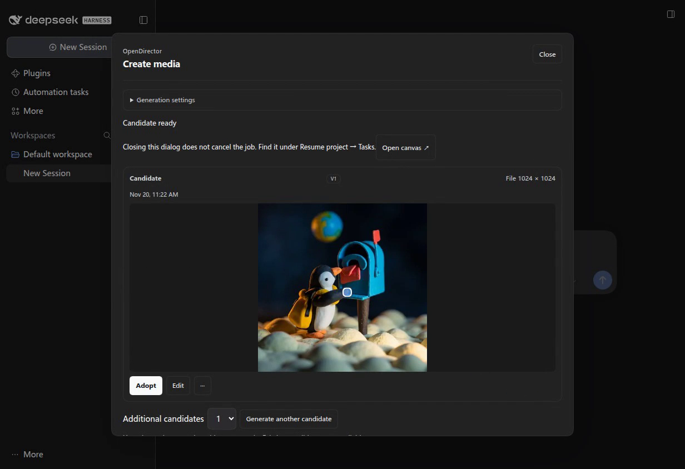

# From an idea to a saved media project

[中文](#中文) · [Open the presentation page](showcase.html) · [Install and connect](../README.md)

[Watch Lunar Post Office (1 min 16 sec)](media/walkthrough.mp4) · [Compare three saved versions (GIF)](media/walkthrough.gif)

The video follows one image from prompt to saved project. The plugin sends a single generation through OpenDirector and a local bridge to MiniMax image-01. The candidate appears around 0:50. After adoption, the same image is marked current when the project reopens. This is a continuous, browser-driven recording on the web host bundled with Windows DSH 0.2.2-rc.5.

The separate GIF shows how to compare V1, V2 and V3. It uses previously generated images replayed in DSH rc.3 Web.

## Try an example

Open **OpenDirector → Create media** and pick an example below the description. The form keeps your model and parameters; choose **Generate** when ready.

| Start with | Next step |
| --- | --- |
| Studio by the window | Generate two candidates, compare them and adopt one. Reopen the same project. |
| A character for an action pack | From the saved image, choose **Make an action pack**. Start with the desktop companion or expression actions, generate and choose one version per action. |
| A short introduction | Select **Voiceover**, use your configured voice model and voice ID, then generate and listen. |

Saved-image forms also have examples for a desk-lamp edit, evening lighting and a gentle camera move. Supported continuation forms have a matching example.

A DSH conversation can start the same workflow:

> Create a project called “Studio by the window”. Use my configured image model to generate two candidates of a wooden desk, a blue mug and a green plant in natural window light. Show them before adopting either one.

## 中文

「月面邮局」的视频在 Windows DSH rc.5 自带的网页宿主中连续录制。浏览器自动操作插件，通过 OpenDirector 和本机转接向 MiniMax image-01 实际生成一张图。约 0:50 可以看到候选，结尾是刷新后重新打开工程的结果。另附的 GIF 用回放图片演示三版候选的比较与采用。

打开「OpenDirector → 创作素材」，在描述下选择示例，选择工作室生图、角色参考图或配音。示例先填入描述；检查模型和参数后再生成。已经选好的模型、尺寸、参考图顺序和候选数量会保留。

- **工作室图片**：先生成两张候选，对比并采用一张，再从「继续工程」找回。
- **角色动作素材包**：用一张已保存的角色图创建动作包。选择基础动作或表情示例，逐动作选版，再导出 ZIP。
- **配音**：选择配音模型和音色，填入开场白示例，生成后试听。

也可以在 DSH 中直接说：

> 新建“窗边工作室”工程，用我已配置的图片模型生成两张候选：木桌、蓝色陶瓷杯、绿植和自然窗光。先给我对比，不要直接采用。
