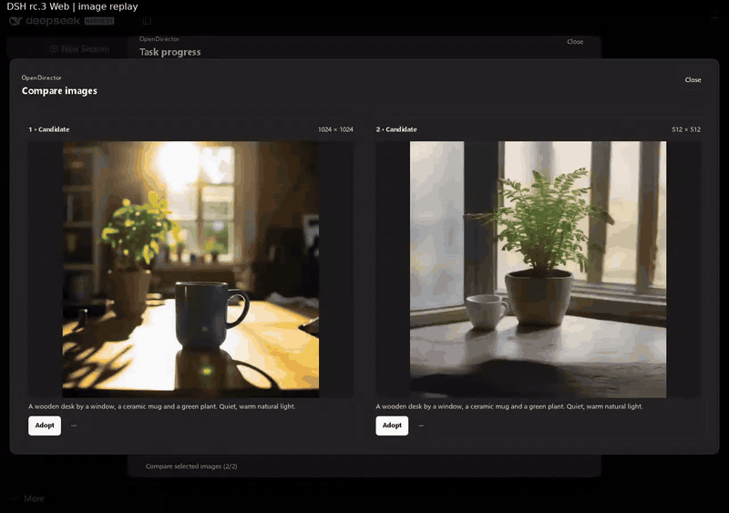

# From an idea to a saved media project

[中文](#中文) · [Open the presentation page](showcase.html) · [Install and connect](../README.md)

[Watch the short recording](media/walkthrough.mp4) · [Animated GIF](media/walkthrough.gif)

The recording uses DSH rc.3 Web and two existing images replayed through a local provider. It shows three labeled versions, a comparison of the original images, adoption of V2, and the same selection after reloading. Capture itself makes no paid model calls.

## Try an example

Choose **Create media → Try an example**. Read the example before filling the description. The form keeps your model and parameters; choose **Generate** when ready.

| Start with | Next step |
| --- | --- |
| Studio by the window | Generate two candidates, compare them and adopt one. Reopen the same project. |
| A character for an action pack | From the saved image, choose **Make an action pack**. Start with the desktop companion or expression actions, generate and choose one version per action. |
| A short introduction | Select **Voiceover**, use your configured voice model and voice ID, then generate and listen. |

Saved-image forms also have examples for a desk-lamp edit, evening lighting and a gentle camera move. Supported continuation forms have a matching example.

A DSH conversation can start the same workflow:

> Create a project called “Studio by the window”. Use my configured image model to generate two candidates of a wooden desk, a blue mug and a green plant in natural window light. Show them before adopting either one.

## 中文

这段演示使用完整的 DSH rc.3 网页宿主。图片来自已有素材回放，展示三个带版本号的候选、原图对比、采用 V2，以及刷新后找回同一个选择的实际界面操作。录制过程没有调用付费模型。

从「创作素材 → 试一个例子」开始，选择工作室生图、角色参考图或配音。示例先填入描述；检查模型和参数后再生成。已经选好的模型、尺寸、参考图顺序和候选数量会保留。

- **工作室图片**：先生成两张候选，对比并采用一张，再从「继续工程」找回。
- **角色动作素材包**：用一张已保存的角色图创建动作包。选择基础动作或表情示例，逐动作选版，再导出 ZIP。
- **配音**：选择配音模型和音色，填入开场白示例，生成后试听。

也可以在 DSH 中直接说：

> 新建“窗边工作室”工程，用我已配置的图片模型生成两张候选：木桌、蓝色陶瓷杯、绿植和自然窗光。先给我对比，不要直接采用。
